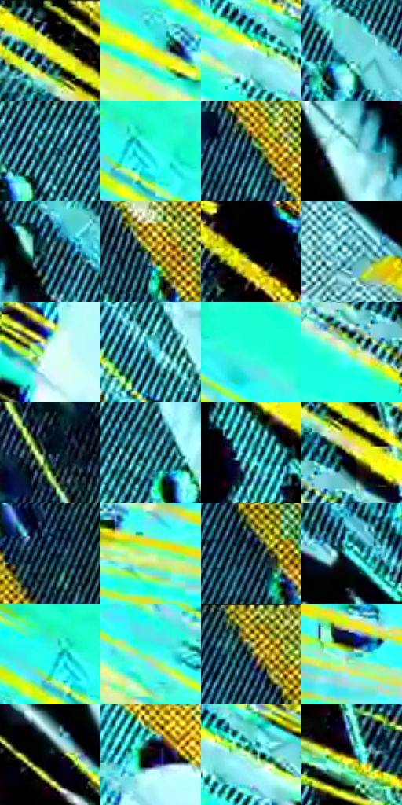

# 电影参考 152

- 状态：条件／活跃；来源世界：miles-home。
- 视角：rolled-or-dutch；景别：medium；场景：industrial。
- 时段：graphic-no-physical-time（外观依据，中置信度；具体时间／晨昏未知）；光照：graphic-field。
- 材质候选：skin, fabric, metal（帧级，不是像素分割）。
- 明暗组：light；L* P5/P50/P95：0.23534 / 64.6045 / 95.28405。
- 资格门禁：energy。
- 原截图 SHA-256：`bda388cf4d823e0881dbf23584cec6d5987227507c35fc03f2491feb53f3d3fb`；尺寸：2880 × 1210。
- sRGB 像素 SHA-256：`ded1e9633967fff02dbd81ef2810793a70dad89e2df9c8a27264155f9695e6f6`。

## 观察与迁移

黄青高反差局部线束，属于异常事件的图形强化。

本公开版保存32个128×128原像素色卡上下文；图集格子并非原场景相邻位置。原rect、图集tile和像素SHA见 `data/palette-crops.json`。上下文不足时不得批准替色，不能以小样推断完整构图。

## 实测色卡

颜色比例分母为保留采样像素，不是材料面积；全部 32 色参与全库匹配。表内四舍五入仅用于阅读，原精度在 JSON。

| ID | HEX | Lab | 原图 xy | 像素数 | 比例 | 明度角色 |
| --- | --- | --- | --- | ---: | ---: | --- |
| 152-S01 | #010101 | [0.274173, -1.7e-05, 3.3e-05] | [652, 40] | 22806 | 11.753004% | deep-shadow |
| 152-S02 | #EDF118 | [92.124363, -22.067977, 87.96495] | [196, 224] | 9334 | 4.810249% | highlight |
| 152-S03 | #B3F8FB | [93.311338, -20.576713, -8.32416] | [700, 500] | 8935 | 4.604626% | highlight |
| 152-S04 | #6BD8DF | [80.494244, -29.332436, -13.032681] | [2256, 428] | 8711 | 4.489188% | highlight |
| 152-S05 | #246976 | [40.87271, -16.84356, -13.573349] | [1712, 68] | 8569 | 4.416009% | midtone |
| 152-S06 | #3AFFFA | [91.376631, -46.803328, -11.097414] | [300, 132] | 7816 | 4.027952% | highlight |
| 152-S07 | #0E2F3B | [17.653977, -7.32912, -11.140116] | [2580, 420] | 7369 | 3.797592% | deep-shadow |
| 152-S08 | #92E5E3 | [85.852302, -25.587584, -7.008383] | [2260, 872] | 6969 | 3.591453% | highlight |
| 152-S09 | #4F878F | [52.918963, -16.214983, -10.059786] | [2056, 244] | 6613 | 3.407990% | midtone |
| 152-S10 | #8C8D2A | [56.873266, -12.999823, 50.03878] | [2700, 568] | 6586 | 3.394076% | midtone |
| 152-S11 | #020308 | [0.863146, 0.433668, -1.984157] | [908, 140] | 6480 | 3.339449% | deep-shadow |
| 152-S12 | #62B1BA | [67.712671, -21.848933, -12.133406] | [1512, 436] | 6317 | 3.255447% | light |
| 152-S13 | #DDFCF8 | [96.725635, -10.738332, -1.465117] | [1124, 508] | 6234 | 3.212673% | highlight |
| 152-S14 | #39AEB4 | [65.305943, -29.85216, -12.552144] | [1968, 464] | 6069 | 3.127641% | light |
| 152-S15 | #23FBD9 | [89.090256, -55.613416, 2.646568] | [412, 172] | 5891 | 3.035909% | highlight |
| 152-S16 | #D7EE6A | [90.154603, -25.801585, 60.230917] | [624, 208] | 5704 | 2.939539% | highlight |
| 152-S17 | #06192C | [8.268686, 0.271154, -15.098342] | [2760, 116] | 5392 | 2.778751% | deep-shadow |
| 152-S18 | #0E4B56 | [28.894072, -14.303309, -11.889057] | [1804, 132] | 4879 | 2.514378% | shadow |
| 152-S19 | #248E96 | [53.943271, -25.962732, -12.710264] | [1764, 796] | 4853 | 2.500979% | midtone |
| 152-S20 | #C3C13D | [76.118675, -14.96175, 63.348911] | [696, 144] | 4801 | 2.474181% | light |
| 152-S21 | #1F465B | [27.916812, -6.522683, -16.567529] | [2600, 140] | 4784 | 2.465420% | shadow |
| 152-S22 | #AAF599 | [89.928469, -39.988383, 37.128111] | [60, 1036] | 4611 | 2.376265% | highlight |
| 152-S23 | #02101A | [4.137266, -1.582953, -7.776405] | [2392, 172] | 4471 | 2.304117% | deep-shadow |
| 152-S24 | #53F8F7 | [89.712038, -41.757968, -11.973658] | [2384, 740] | 4366 | 2.250005% | highlight |
| 152-S25 | #28FDF2 | [90.370358, -49.505176, -8.462486] | [260, 120] | 4256 | 2.193317% | highlight |
| 152-S26 | #5AFCD0 | [90.018545, -52.260295, 8.760731] | [392, 316] | 3786 | 1.951104% | highlight |
| 152-S27 | #4B5931 | [35.717945, -13.056449, 21.35106] | [2336, 56] | 3656 | 1.884109% | shadow |
| 152-S28 | #44D7D6 | [78.856857, -37.906387, -10.783931] | [256, 1068] | 3608 | 1.859372% | light |
| 152-S29 | #060A10 | [2.648413, -0.062989, -3.044066] | [2220, 1020] | 2891 | 1.489868% | deep-shadow |
| 152-S30 | #060F03 | [3.495117, -4.317955, 3.923677] | [1208, 324] | 2459 | 1.267238% | deep-shadow |
| 152-S31 | #94C78F | [75.528955, -27.500651, 22.81672] | [748, 512] | 2436 | 1.255385% | light |
| 152-S32 | #201F18 | [11.641335, -1.106638, 4.963396] | [932, 816] | 2392 | 1.232710% | deep-shadow |

## 色阶与空间分布

- 采样 ROI：`[0.01, 0.02, 0.98, 0.94]`；步长：4；样本数：194044。
- 排除区：`[]`。
- 深暗、暗、中、亮、高光五段计数：`[52732, 17851, 20886, 27050, 75525]`。
- RGB 各 256 箱、L* 100 箱、13×5 色相明度表和 3×3 空间统计全部保存在 [总数据](../film-library.json)。
- [可视化档案](../../references/library.html)按需绘制直方图，不存 2,094 张重复图表图片。

## 纹理特征占比

**这是分块图像特征的面积占比，不是波点／排线／丝网／错版的精确语义覆盖率。** 窗格、发丝、织物也会产生方向或周期特征。
原图 ROI 像素 3109722；已测块覆盖 3109722（100.0000%）；未测 0。

| 特征 | 块覆盖像素 | 占已测面积 | 阈值敏感范围 |
| --- | ---: | ---: | --- |
| low-contrast | 37210 | 1.1966% | 1.1966% ~ 1.1966% |
| directional-structure | 750848 | 24.1452% | 8.9567% ~ 39.4695% |
| periodic-structure | 2256128 | 72.5508% | 58.8071% ~ 84.6687% |
| mixed-detail | 65536 | 2.1075% | 0.5269% ~ 5.1781% |

阈值敏感范围不是统计置信区间。逐块坐标、尺度、对比、方向一致性、频谱集中度、频率与角度见 [全量特征记录](../texture-features.jsonl)，以帧号定位。
四种印刷层的真实像素覆盖仍标为 `null`，不能填 0，也不能拿上表代替。不得据这些代理测量删除唯一证据。

[测量方法与保留策略](../../references/library-retention.md) · [分类索引](../archive/README.md)
