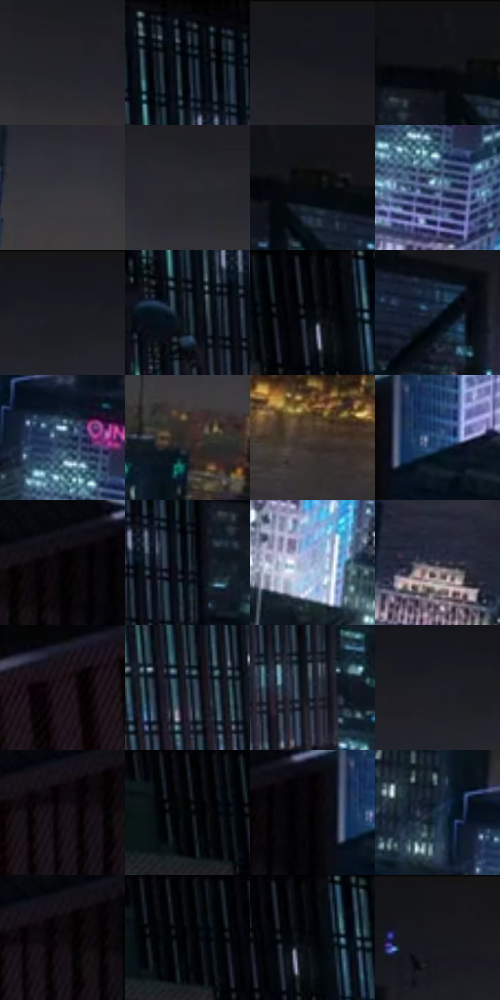

# 电影参考 153

- 状态：常规／活跃；来源世界：miles-home。
- 视角：high-angle；景别：environment-wide；场景：city。
- 时段：night-appearance（外观依据，中置信度；具体时间／晨昏未知）；光照：night-mixed。
- 材质候选：glass, brick, metal, sky（帧级，不是像素分割）。
- 明暗组：very-dark；L* P5/P50/P95：0.96134 / 10.33158 / 45.76158。
- 资格门禁：无附加门禁。
- 原截图 SHA-256：`add6c74564a0209c421ac60bb3f20487d7379dc6e44c9e8d8c2a27d590cfc995`；尺寸：2880 × 1212。
- sRGB 像素 SHA-256：`d98dc66b6ae42aa37c641f6f6fc9b55047143d574bc67b9bfab20fdff23b6b73`。

## 观察与迁移

高空冷夜城市，楼顶暗形与少量窗光构成空间。

本公开版保存32个128×128原像素色卡上下文；图集格子并非原场景相邻位置。原rect、图集tile和像素SHA见 `data/palette-crops.json`。上下文不足时不得批准替色，不能以小样推断完整构图。

## 实测色卡

颜色比例分母为保留采样像素，不是材料面积；全部 32 色参与全库匹配。表内四舍五入仅用于阅读，原精度在 JSON。

| ID | HEX | Lab | 原图 xy | 像素数 | 比例 | 明度角色 |
| --- | --- | --- | --- | ---: | ---: | --- |
| 153-S01 | #232329 | [13.940286, 1.560088, -3.982809] | [1780, 176] | 9136 | 4.708211% | deep-shadow |
| 153-S02 | #060B13 | [2.93623, 0.135765, -4.409347] | [604, 64] | 8711 | 4.489188% | deep-shadow |
| 153-S03 | #15171D | [7.776541, 0.781805, -4.530462] | [1560, 28] | 8445 | 4.352106% | deep-shadow |
| 153-S04 | #101318 | [5.797636, 0.054397, -3.67215] | [756, 32] | 8156 | 4.203170% | deep-shadow |
| 153-S05 | #36373E | [23.218014, 1.275264, -4.496238] | [1492, 232] | 7853 | 4.047020% | shadow |
| 153-S06 | #292A31 | [17.221794, 1.353493, -4.680139] | [1588, 168] | 7134 | 3.676486% | deep-shadow |
| 153-S07 | #07090C | [2.412533, -0.090365, -1.361869] | [808, 80] | 7095 | 3.656387% | deep-shadow |
| 153-S08 | #596E92 | [46.110197, 1.77505, -22.13067] | [1404, 572] | 7069 | 3.642988% | midtone |
| 153-S09 | #191C23 | [10.247629, 0.623614, -5.259285] | [1356, 56] | 6803 | 3.505906% | deep-shadow |
| 153-S10 | #0F1823 | [7.913926, -0.239226, -8.904824] | [580, 184] | 6800 | 3.504360% | deep-shadow |
| 153-S11 | #0D0E12 | [4.00435, 0.443042, -2.177205] | [284, 32] | 6792 | 3.500237% | deep-shadow |
| 153-S12 | #15222F | [12.662765, -1.151853, -10.352262] | [944, 156] | 6640 | 3.421904% | deep-shadow |
| 153-S13 | #263955 | [23.651243, 1.567307, -19.261293] | [1372, 492] | 6592 | 3.397168% | shadow |
| 153-S14 | #362D2A | [19.342684, 3.496504, 3.459861] | [1348, 324] | 6213 | 3.201851% | deep-shadow |
| 153-S15 | #483B34 | [26.021386, 4.407974, 6.469144] | [1776, 448] | 6165 | 3.177114% | shadow |
| 153-S16 | #2B4E75 | [32.360586, 0.43291, -26.096631] | [1028, 696] | 5939 | 3.060646% | shadow |
| 153-S17 | #050304 | [0.958925, 0.66199, -0.194048] | [884, 688] | 5892 | 3.036425% | deep-shadow |
| 153-S18 | #08111A | [4.760941, -0.573339, -6.817056] | [676, 152] | 5850 | 3.014780% | deep-shadow |
| 153-S19 | #92A2C6 | [66.541096, 2.478406, -20.299304] | [1432, 732] | 5692 | 2.933355% | light |
| 153-S20 | #535361 | [35.768684, 3.205471, -8.094576] | [1732, 620] | 5440 | 2.803488% | shadow |
| 153-S21 | #1F161B | [8.51844, 5.667186, -1.779819] | [376, 844] | 5357 | 2.760714% | deep-shadow |
| 153-S22 | #29323D | [20.398545, -0.704084, -8.175751] | [420, 280] | 5251 | 2.706087% | shadow |
| 153-S23 | #212836 | [16.039888, 1.112688, -10.046826] | [680, 400] | 5237 | 2.698872% | deep-shadow |
| 153-S24 | #1C1E24 | [11.294866, 0.731859, -4.389353] | [1312, 76] | 5167 | 2.662798% | deep-shadow |
| 153-S25 | #170F15 | [5.220735, 4.512923, -2.242397] | [788, 736] | 4957 | 2.554575% | deep-shadow |
| 153-S26 | #05060A | [1.66588, 0.294572, -1.605635] | [184, 44] | 4835 | 2.491703% | deep-shadow |
| 153-S27 | #020102 | [0.352269, 0.400526, -0.286252] | [956, 696] | 4725 | 2.435015% | deep-shadow |
| 153-S28 | #152A40 | [16.431225, -0.333922, -16.470304] | [1292, 452] | 4481 | 2.309270% | deep-shadow |
| 153-S29 | #0F090C | [2.922044, 2.194656, -0.556749] | [820, 720] | 4418 | 2.276803% | deep-shadow |
| 153-S30 | #040609 | [1.587784, -0.105972, -1.31935] | [204, 32] | 4308 | 2.220115% | deep-shadow |
| 153-S31 | #020308 | [0.863146, 0.433668, -1.984157] | [308, 40] | 4034 | 2.078910% | deep-shadow |
| 153-S32 | #16151A | [7.059047, 1.747921, -3.300468] | [1048, 28] | 2857 | 1.472346% | deep-shadow |

## 色阶与空间分布

- 采样 ROI：`[0.01, 0.02, 0.98, 0.94]`；步长：4；样本数：194044。
- 排除区：`[]`。
- 深暗、暗、中、亮、高光五段计数：`[144587, 36402, 9000, 3438, 617]`。
- RGB 各 256 箱、L* 100 箱、13×5 色相明度表和 3×3 空间统计全部保存在 [总数据](../film-library.json)。
- [可视化档案](../../references/library.html)按需绘制直方图，不存 2,094 张重复图表图片。

## 纹理特征占比

**这是分块图像特征的面积占比，不是波点／排线／丝网／错版的精确语义覆盖率。** 窗格、发丝、织物也会产生方向或周期特征。
原图 ROI 像素 3115310；已测块覆盖 3115310（100.0000%）；未测 0。

| 特征 | 块覆盖像素 | 占已测面积 | 阈值敏感范围 |
| --- | ---: | ---: | --- |
| low-contrast | 163840 | 5.2592% | 3.6814% ~ 6.8369% |
| directional-structure | 360448 | 11.5702% | 1.0518% ~ 24.5512% |
| periodic-structure | 2075904 | 66.6356% | 65.5467% ~ 66.6356% |
| mixed-detail | 515118 | 16.5350% | 6.2206% ~ 26.0016% |

阈值敏感范围不是统计置信区间。逐块坐标、尺度、对比、方向一致性、频谱集中度、频率与角度见 [全量特征记录](../texture-features.jsonl)，以帧号定位。
四种印刷层的真实像素覆盖仍标为 `null`，不能填 0，也不能拿上表代替。不得据这些代理测量删除唯一证据。

[测量方法与保留策略](../../references/library-retention.md) · [分类索引](../archive/README.md)
