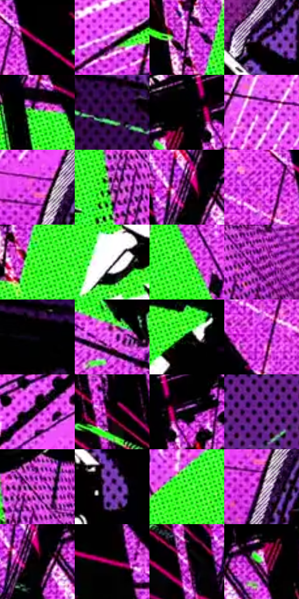

# 电影参考 154

- 状态：条件／活跃；来源世界：miles-home。
- 视角：graphic-nonphysical；景别：detail；场景：graphic。
- 时段：graphic-no-physical-time（外观依据，中置信度；具体时间／晨昏未知）；光照：graphic-field。
- 材质候选：fabric, metal, brick（帧级，不是像素分割）。
- 明暗组：very-dark；L* P5/P50/P95：0.25439 / 14.95624 / 88.25545。
- 资格门禁：impact。
- 原截图 SHA-256：`1082f38797da451406b36c78aa1f9c555bfe005dfd30e8cf22200cedecf0460f`；尺寸：2880 × 1200。
- sRGB 像素 SHA-256：`e6deafb829814bd1d7ba28c3e96f28483d56c2bfc701977a5aed193925bbf307`。

## 观察与迁移

绿紫或黄橙爆点与粗图形，不能转成日常背景。

本公开版保存32个128×128原像素色卡上下文；图集格子并非原场景相邻位置。原rect、图集tile和像素SHA见 `data/palette-crops.json`。上下文不足时不得批准替色，不能以小样推断完整构图。

## 实测色卡

颜色比例分母为保留采样像素，不是材料面积；全部 32 色参与全库匹配。表内四舍五入仅用于阅读，原精度在 JSON。

| ID | HEX | Lab | 原图 xy | 像素数 | 比例 | 明度角色 |
| --- | --- | --- | --- | ---: | ---: | --- |
| 154-S01 | #010101 | [0.274173, -1.7e-05, 3.3e-05] | [684, 24] | 42324 | 21.969603% | deep-shadow |
| 154-S02 | #AC21AA | [42.402841, 67.817221, -41.554579] | [716, 1032] | 7698 | 3.995889% | midtone |
| 154-S03 | #480642 | [14.962137, 36.317313, -19.750926] | [1248, 292] | 6199 | 3.217786% | deep-shadow |
| 154-S04 | #190514 | [3.303903, 9.576926, -4.338998] | [1980, 576] | 6126 | 3.179893% | deep-shadow |
| 154-S05 | #5CF74C | [86.660022, -71.027423, 66.908534] | [1012, 384] | 6116 | 3.174702% | highlight |
| 154-S06 | #2E0A44 | [10.669635, 29.210778, -28.314447] | [2668, 228] | 6052 | 3.141481% | deep-shadow |
| 154-S07 | #010105 | [0.353321, 0.556158, -1.513661] | [1164, 28] | 6010 | 3.119679% | deep-shadow |
| 154-S08 | #D83DE0 | [55.401058, 77.378453, -51.711459] | [1960, 84] | 6000 | 3.114489% | midtone |
| 154-S09 | #C628CC | [49.356371, 76.485563, -50.112577] | [2084, 188] | 5855 | 3.039222% | midtone |
| 154-S10 | #6B1773 | [26.668781, 47.828544, -33.441458] | [1528, 1024] | 5817 | 3.019497% | shadow |
| 154-S11 | #200629 | [5.396696, 19.515621, -17.222384] | [1012, 128] | 5718 | 2.968108% | deep-shadow |
| 154-S12 | #EE52F7 | [62.44848, 78.675187, -53.161547] | [600, 84] | 5656 | 2.935925% | light |
| 154-S13 | #1FD117 | [73.514129, -71.933122, 69.058001] | [1296, 376] | 5456 | 2.832108% | light |
| 154-S14 | #F0EBEF | [93.526069, 2.377531, -1.333345] | [1160, 596] | 5263 | 2.731926% | highlight |
| 154-S15 | #40FB32 | [87.149194, -78.917402, 75.409985] | [1384, 248] | 5193 | 2.695590% | highlight |
| 154-S16 | #BE42C3 | [50.435249, 65.176952, -43.277275] | [1676, 1060] | 5094 | 2.644201% | midtone |
| 154-S17 | #09050F | [1.816576, 2.538984, -3.69485] | [2552, 892] | 5043 | 2.617728% | deep-shadow |
| 154-S18 | #F461F9 | [65.455693, 74.644873, -49.447788] | [784, 724] | 4739 | 2.459927% | light |
| 154-S19 | #030C03 | [2.609304, -3.650209, 2.609207] | [1280, 788] | 4738 | 2.459408% | deep-shadow |
| 154-S20 | #E446F0 | [59.129629, 79.551784, -54.642319] | [596, 168] | 4331 | 2.248142% | midtone |
| 154-S21 | #060203 | [0.801369, 1.185006, -0.009803] | [1732, 48] | 4309 | 2.236722% | deep-shadow |
| 154-S22 | #060307 | [1.076594, 1.340621, -1.23718] | [808, 64] | 4227 | 2.194157% | deep-shadow |
| 154-S23 | #020102 | [0.352269, 0.400526, -0.286252] | [1224, 24] | 4152 | 2.155226% | deep-shadow |
| 154-S24 | #6C2A85 | [30.730593, 44.032108, -38.287831] | [2704, 40] | 4103 | 2.129791% | shadow |
| 154-S25 | #D466D7 | [60.255676, 58.58853, -38.99861] | [1576, 952] | 4099 | 2.127715% | light |
| 154-S26 | #7E40AB | [39.652295, 46.109553, -46.942278] | [2008, 704] | 3677 | 1.908662% | shadow |
| 154-S27 | #31F623 | [85.34327, -80.074393, 77.162399] | [1600, 304] | 3647 | 1.893090% | highlight |
| 154-S28 | #3B2746 | [19.320954, 16.202802, -15.822225] | [2092, 244] | 3622 | 1.880113% | deep-shadow |
| 154-S29 | #050101 | [0.507409, 1.04598, 0.368587] | [1028, 152] | 3357 | 1.742556% | deep-shadow |
| 154-S30 | #B3046A | [39.094357, 65.926703, -7.333689] | [504, 456] | 3090 | 1.603962% | shadow |
| 154-S31 | #F69AF2 | [75.524266, 47.334778, -29.900967] | [912, 188] | 2884 | 1.497031% | light |
| 154-S32 | #818A84 | [56.594698, -4.498716, 2.078841] | [1124, 128] | 2053 | 1.065674% | midtone |

## 色阶与空间分布

- 采样 ROI：`[0.01, 0.02, 0.98, 0.94]`；步长：4；样本数：192648。
- 排除区：`[]`。
- 深暗、暗、中、亮、高光五段计数：`[99792, 17691, 32475, 21788, 20902]`。
- RGB 各 256 箱、L* 100 箱、13×5 色相明度表和 3×3 空间统计全部保存在 [总数据](../film-library.json)。
- [可视化档案](../../references/library.html)按需绘制直方图，不存 2,094 张重复图表图片。

## 纹理特征占比

**这是分块图像特征的面积占比，不是波点／排线／丝网／错版的精确语义覆盖率。** 窗格、发丝、织物也会产生方向或周期特征。
原图 ROI 像素 3084576；已测块覆盖 3084576（100.0000%）；未测 0。

| 特征 | 块覆盖像素 | 占已测面积 | 阈值敏感范围 |
| --- | ---: | ---: | --- |
| low-contrast | 102400 | 3.3197% | 2.4566% ~ 3.9837% |
| directional-structure | 180224 | 5.8427% | 2.1246% ~ 14.8724% |
| periodic-structure | 2353440 | 76.2970% | 67.6740% ~ 76.2970% |
| mixed-detail | 448512 | 14.5405% | 8.7641% ~ 26.2177% |

阈值敏感范围不是统计置信区间。逐块坐标、尺度、对比、方向一致性、频谱集中度、频率与角度见 [全量特征记录](../texture-features.jsonl)，以帧号定位。
四种印刷层的真实像素覆盖仍标为 `null`，不能填 0，也不能拿上表代替。不得据这些代理测量删除唯一证据。

[测量方法与保留策略](../../references/library-retention.md) · [分类索引](../archive/README.md)
