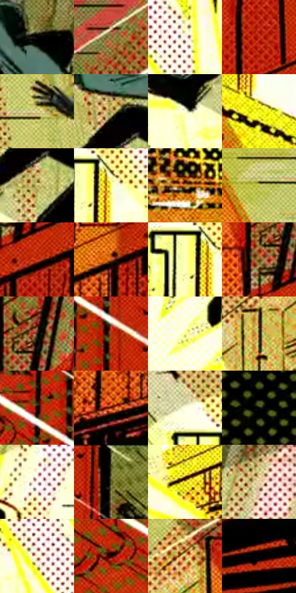

# 电影参考 155

- 状态：条件／活跃；来源世界：miles-home。
- 视角：graphic-nonphysical；景别：environment-wide；场景：graphic。
- 时段：graphic-no-physical-time（外观依据，中置信度；具体时间／晨昏未知）；光照：graphic-field。
- 材质候选：fabric, metal, brick（帧级，不是像素分割）。
- 明暗组：light；L* P5/P50/P95：0.29154 / 60.06901 / 99.06505。
- 资格门禁：impact。
- 原截图 SHA-256：`777c6525d7651faf14120131c3f23c31c2e9496ec86ae46f35021228f6ab8154`；尺寸：2880 × 1208。
- sRGB 像素 SHA-256：`4c8d63ac57f47ed5d7b6d57d6ed3615c22e776960c606e7e41f2ece5ea12de93`。

## 观察与迁移

绿紫或黄橙爆点与粗图形，不能转成日常背景。

本公开版保存32个128×128原像素色卡上下文；图集格子并非原场景相邻位置。原rect、图集tile和像素SHA见 `data/palette-crops.json`。上下文不足时不得批准替色，不能以小样推断完整构图。

## 实测色卡

颜色比例分母为保留采样像素，不是材料面积；全部 32 色参与全库匹配。表内四舍五入仅用于阅读，原精度在 JSON。

| ID | HEX | Lab | 原图 xy | 像素数 | 比例 | 明度角色 |
| --- | --- | --- | --- | ---: | ---: | --- |
| 155-S01 | #010101 | [0.274173, -1.7e-05, 3.3e-05] | [1512, 76] | 13084 | 6.767143% | deep-shadow |
| 155-S02 | #8A783B | [50.865614, -1.147126, 35.60297] | [2456, 208] | 9714 | 5.024154% | midtone |
| 155-S03 | #FEFEE7 | [99.113408, -3.855552, 11.009359] | [1148, 620] | 8212 | 4.247308% | highlight |
| 155-S04 | #B72006 | [39.776417, 57.376979, 50.919743] | [2728, 440] | 8192 | 4.236964% | shadow |
| 155-S05 | #D9C78A | [80.423862, -2.460724, 32.863025] | [1236, 164] | 7988 | 4.131453% | highlight |
| 155-S06 | #A69D4D | [63.964385, -7.591091, 42.494483] | [1360, 224] | 7979 | 4.126799% | light |
| 155-S07 | #FEFFD1 | [98.905232, -7.698522, 21.937942] | [1284, 372] | 7556 | 3.908020% | highlight |
| 155-S08 | #F9F929 | [95.1837, -20.62436, 87.877602] | [632, 736] | 7329 | 3.790614% | highlight |
| 155-S09 | #C9B868 | [74.635165, -4.678955, 42.584639] | [1388, 320] | 6856 | 3.545975% | light |
| 155-S10 | #FBFC75 | [96.581402, -17.533524, 63.429215] | [844, 396] | 6704 | 3.467359% | highlight |
| 155-S11 | #D28326 | [61.72128, 23.53817, 58.779948] | [788, 1068] | 6519 | 3.371676% | light |
| 155-S12 | #C3C558 | [77.42444, -15.216335, 53.417872] | [1008, 180] | 6224 | 3.219099% | light |
| 155-S13 | #C83415 | [45.349955, 56.710999, 50.985852] | [2584, 624] | 6200 | 3.206686% | midtone |
| 155-S14 | #C55C24 | [51.445415, 38.676079, 49.625045] | [2484, 668] | 6171 | 3.191687% | midtone |
| 155-S15 | #FEFEB1 | [98.085705, -11.446283, 36.930619] | [796, 400] | 6056 | 3.132209% | highlight |
| 155-S16 | #7F4714 | [36.119185, 19.98748, 38.666912] | [2520, 540] | 5973 | 3.089280% | shadow |
| 155-S17 | #2C1A06 | [11.188077, 6.562053, 14.356932] | [2564, 484] | 5814 | 3.007044% | deep-shadow |
| 155-S18 | #A83812 | [39.914391, 44.37622, 45.42507] | [232, 192] | 5705 | 2.950669% | shadow |
| 155-S19 | #FCFD9D | [97.382525, -13.978971, 45.822049] | [1336, 784] | 5614 | 2.903603% | highlight |
| 155-S20 | #474016 | [26.917824, -3.084119, 26.101645] | [2292, 512] | 5320 | 2.751544% | shadow |
| 155-S21 | #0A0201 | [0.99503, 1.952916, 1.115598] | [168, 104] | 5250 | 2.715339% | deep-shadow |
| 155-S22 | #721907 | [24.605234, 37.767558, 33.224343] | [2400, 828] | 5120 | 2.648102% | shadow |
| 155-S23 | #FDFDDD | [98.572909, -5.268534, 15.345692] | [756, 308] | 5054 | 2.613967% | highlight |
| 155-S24 | #080B02 | [2.6679, -2.046297, 3.137059] | [228, 1004] | 4885 | 2.526559% | deep-shadow |
| 155-S25 | #FEFAF3 | [98.397878, 0.125839, 3.823793] | [1696, 488] | 4863 | 2.515180% | highlight |
| 155-S26 | #666835 | [42.737213, -8.980883, 28.293301] | [356, 48] | 4820 | 2.492940% | midtone |
| 155-S27 | #E5D323 | [83.637094, -10.519792, 78.990507] | [1912, 912] | 4469 | 2.311400% | highlight |
| 155-S28 | #EED8AA | [87.091551, 0.786669, 25.492349] | [1748, 308] | 3527 | 1.824191% | highlight |
| 155-S29 | #FCF3CA | [95.606489, -3.426826, 20.896929] | [1052, 580] | 3470 | 1.794710% | highlight |
| 155-S30 | #210401 | [3.725715, 11.639479, 5.383539] | [88, 160] | 3306 | 1.709888% | deep-shadow |
| 155-S31 | #DE9A54 | [68.956857, 18.482488, 46.287082] | [2372, 384] | 3297 | 1.705233% | light |
| 155-S32 | #030209 | [0.745164, 1.234771, -2.55676] | [2776, 856] | 2075 | 1.073206% | deep-shadow |

## 色阶与空间分布

- 采样 ROI：`[0.01, 0.02, 0.98, 0.94]`；步长：4；样本数：193346。
- 排除区：`[]`。
- 深暗、暗、中、亮、高光五段计数：`[36241, 21805, 38525, 28233, 68542]`。
- RGB 各 256 箱、L* 100 箱、13×5 色相明度表和 3×3 空间统计全部保存在 [总数据](../film-library.json)。
- [可视化档案](../../references/library.html)按需绘制直方图，不存 2,094 张重复图表图片。

## 纹理特征占比

**这是分块图像特征的面积占比，不是波点／排线／丝网／错版的精确语义覆盖率。** 窗格、发丝、织物也会产生方向或周期特征。
原图 ROI 像素 3104134；已测块覆盖 3104134（100.0000%）；未测 0。

| 特征 | 块覆盖像素 | 占已测面积 | 阈值敏感范围 |
| --- | ---: | ---: | --- |
| low-contrast | 65536 | 2.1112% | 1.5834% ~ 2.1112% |
| directional-structure | 174592 | 5.6245% | 1.4927% ~ 10.8616% |
| periodic-structure | 2481286 | 79.9349% | 72.1868% ~ 82.4459% |
| mixed-detail | 382720 | 12.3294% | 5.1091% ~ 24.2093% |

阈值敏感范围不是统计置信区间。逐块坐标、尺度、对比、方向一致性、频谱集中度、频率与角度见 [全量特征记录](../texture-features.jsonl)，以帧号定位。
四种印刷层的真实像素覆盖仍标为 `null`，不能填 0，也不能拿上表代替。不得据这些代理测量删除唯一证据。

[测量方法与保留策略](../../references/library-retention.md) · [分类索引](../archive/README.md)
