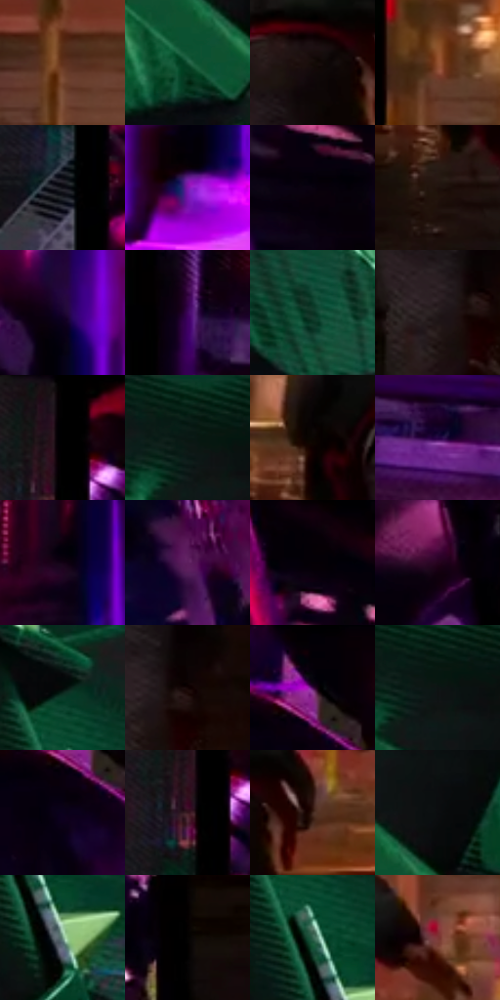

# 电影参考 156

- 状态：条件／活跃；来源世界：miles-home。
- 视角：mixed-panels；景别：graphic-or-multipanel；场景：graphic。
- 时段：event-time-unknown（外观依据，中置信度；具体时间／晨昏未知）；光照：event-light。
- 材质候选：fabric, metal, stone（帧级，不是像素分割）。
- 明暗组：very-dark；L* P5/P50/P95：0.43173 / 6.74934 / 42.36041。
- 资格门禁：panel。
- 原截图 SHA-256：`db4cbc1cb106e1872535c57f669a1da90ce05adacec25f6d1b151877ef55734d`；尺寸：2876 × 1208。
- sRGB 像素 SHA-256：`4d4a4194af9aed5f57bb5a25d183162b6665b18bdff7750a6e922265e9281ebc`。

## 观察与迁移

连续分格与紫色事件烟雾，黑沟槽和特殊色光单列。

本公开版保存32个128×128原像素色卡上下文；图集格子并非原场景相邻位置。原rect、图集tile和像素SHA见 `data/palette-crops.json`。上下文不足时不得批准替色，不能以小样推断完整构图。

## 实测色卡

颜色比例分母为保留采样像素，不是材料面积；全部 32 色参与全库匹配。表内四舍五入仅用于阅读，原精度在 JSON。

| ID | HEX | Lab | 原图 xy | 像素数 | 比例 | 明度角色 |
| --- | --- | --- | --- | ---: | ---: | --- |
| 156-S01 | #60311B | [26.049267, 19.163069, 23.17] | [2716, 284] | 13565 | 7.025986% | shadow |
| 156-S02 | #175538 | [31.725399, -27.341711, 11.354118] | [116, 260] | 10526 | 5.451937% | shadow |
| 156-S03 | #150B08 | [3.760745, 3.156655, 2.405813] | [2432, 556] | 9148 | 4.738202% | deep-shadow |
| 156-S04 | #925130 | [41.549322, 24.117752, 30.877681] | [1992, 396] | 8511 | 4.408269% | midtone |
| 156-S05 | #100F17 | [4.639847, 2.084984, -4.603332] | [920, 256] | 8286 | 4.291730% | deep-shadow |
| 156-S06 | #8118AE | [34.755199, 63.038637, -56.62435] | [1556, 1088] | 8178 | 4.235791% | shadow |
| 156-S07 | #09020F | [1.228343, 3.740665, -4.553804] | [1268, 208] | 7733 | 4.005304% | deep-shadow |
| 156-S08 | #1F100C | [6.219146, 6.651039, 4.46344] | [2264, 688] | 7091 | 3.672780% | deep-shadow |
| 156-S09 | #19032F | [4.308803, 20.02929, -23.52736] | [1212, 648] | 6910 | 3.579031% | deep-shadow |
| 156-S10 | #3E055C | [14.982676, 39.966004, -37.653891] | [996, 916] | 6748 | 3.495124% | deep-shadow |
| 156-S11 | #0C3222 | [17.80384, -18.077516, 6.340787] | [204, 444] | 6370 | 3.299339% | deep-shadow |
| 156-S12 | #241B1C | [10.869569, 4.64206, 0.991586] | [2420, 764] | 6272 | 3.248580% | deep-shadow |
| 156-S13 | #010101 | [0.274173, -1.7e-05, 3.3e-05] | [940, 28] | 6202 | 3.212323% | deep-shadow |
| 156-S14 | #0A1E17 | [9.440512, -10.213598, 2.334473] | [76, 44] | 5895 | 3.053313% | deep-shadow |
| 156-S15 | #0A0502 | [1.603051, 0.890278, 1.596128] | [2276, 568] | 5874 | 3.042436% | deep-shadow |
| 156-S16 | #270344 | [8.251461, 31.458809, -32.310624] | [1100, 1076] | 5784 | 2.995820% | deep-shadow |
| 156-S17 | #140115 | [2.028784, 9.061494, -6.939608] | [1420, 608] | 5685 | 2.944543% | deep-shadow |
| 156-S18 | #5C1F5E | [23.881232, 36.916882, -24.405344] | [1668, 80] | 5678 | 2.940917% | shadow |
| 156-S19 | #060008 | [0.508147, 2.681346, -2.474557] | [1196, 32] | 5594 | 2.897410% | deep-shadow |
| 156-S20 | #26021E | [4.961945, 21.194443, -9.315428] | [1840, 532] | 5592 | 2.896374% | deep-shadow |
| 156-S21 | #040908 | [2.156231, -1.446697, -0.081972] | [544, 140] | 5406 | 2.800035% | deep-shadow |
| 156-S22 | #130404 | [2.114458, 4.564331, 1.608385] | [2468, 744] | 4703 | 2.435917% | deep-shadow |
| 156-S23 | #020006 | [0.235338, 1.357262, -2.086264] | [1440, 28] | 4701 | 2.434881% | deep-shadow |
| 156-S24 | #0D1313 | [5.404485, -2.143335, -0.754358] | [100, 80] | 4430 | 2.294516% | deep-shadow |
| 156-S25 | #0B011D | [1.639913, 8.110963, -13.815363] | [1416, 140] | 4384 | 2.270691% | deep-shadow |
| 156-S26 | #391921 | [13.680693, 16.887827, 1.780158] | [924, 124] | 4270 | 2.211645% | deep-shadow |
| 156-S27 | #43291F | [19.550025, 10.786223, 11.553834] | [2528, 560] | 4192 | 2.171244% | deep-shadow |
| 156-S28 | #0B0D0E | [3.52912, -0.416514, -0.662647] | [180, 172] | 3997 | 2.070244% | deep-shadow |
| 156-S29 | #729784 | [59.320578, -16.87667, 5.879538] | [592, 312] | 3977 | 2.059885% | midtone |
| 156-S30 | #040302 | [0.861042, 0.122403, 0.470661] | [1936, 764] | 3940 | 2.040721% | deep-shadow |
| 156-S31 | #35634F | [38.277875, -21.027001, 6.50776] | [556, 236] | 1742 | 0.902268% | shadow |
| 156-S32 | #7D3636 | [32.404604, 30.838979, 15.129436] | [2624, 464] | 1685 | 0.872745% | shadow |

## 色阶与空间分布

- 采样 ROI：`[0.01, 0.02, 0.98, 0.94]`；步长：4；样本数：193069。
- 排除区：`[]`。
- 深暗、暗、中、亮、高光五段计数：`[137421, 43511, 10161, 1663, 313]`。
- RGB 各 256 箱、L* 100 箱、13×5 色相明度表和 3×3 空间统计全部保存在 [总数据](../film-library.json)。
- [可视化档案](../../references/library.html)按需绘制直方图，不存 2,094 张重复图表图片。

## 纹理特征占比

**这是分块图像特征的面积占比，不是波点／排线／丝网／错版的精确语义覆盖率。** 窗格、发丝、织物也会产生方向或周期特征。
原图 ROI 像素 3099690；已测块覆盖 3099690（100.0000%）；未测 0。

| 特征 | 块覆盖像素 | 占已测面积 | 阈值敏感范围 |
| --- | ---: | ---: | --- |
| low-contrast | 145066 | 4.6800% | 2.0619% ~ 6.6869% |
| directional-structure | 528768 | 17.0587% | 7.1233% ~ 35.0260% |
| periodic-structure | 2245632 | 72.4470% | 61.3264% ~ 74.5613% |
| mixed-detail | 180224 | 5.8143% | 1.5857% ~ 11.6285% |

阈值敏感范围不是统计置信区间。逐块坐标、尺度、对比、方向一致性、频谱集中度、频率与角度见 [全量特征记录](../texture-features.jsonl)，以帧号定位。
四种印刷层的真实像素覆盖仍标为 `null`，不能填 0，也不能拿上表代替。不得据这些代理测量删除唯一证据。

[测量方法与保留策略](../../references/library-retention.md) · [分类索引](../archive/README.md)
