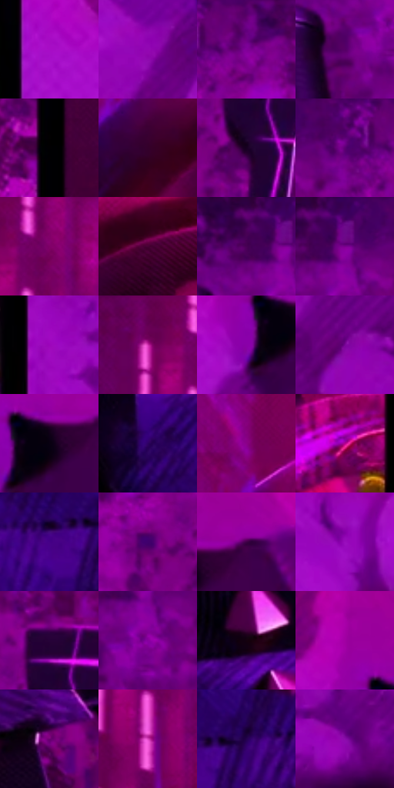

# 电影参考 157

- 状态：条件／活跃；来源世界：miles-home。
- 视角：mixed-panels；景别：graphic-or-multipanel；场景：graphic。
- 时段：event-time-unknown（外观依据，中置信度；具体时间／晨昏未知）；光照：event-light。
- 材质候选：fabric, metal, stone（帧级，不是像素分割）。
- 明暗组：dark；L* P5/P50/P95：0.60603 / 23.99578 / 42.1421。
- 资格门禁：panel。
- 原截图 SHA-256：`fd075f8bb8268380f8e29638927c0791fedf8a3645d32de8eda1c0f04b47e07b`；尺寸：2880 × 1204。
- sRGB 像素 SHA-256：`63da528f92381c17280958be8d49e0c0b5fa539703ed7ea091f14882c8d628ad`。

## 观察与迁移

连续分格与紫色事件烟雾，黑沟槽和特殊色光单列。

本公开版保存32个128×128原像素色卡上下文；图集格子并非原场景相邻位置。原rect、图集tile和像素SHA见 `data/palette-crops.json`。上下文不足时不得批准替色，不能以小样推断完整构图。

## 实测色卡

颜色比例分母为保留采样像素，不是材料面积；全部 32 色参与全库匹配。表内四舍五入仅用于阅读，原精度在 JSON。

| ID | HEX | Lab | 原图 xy | 像素数 | 比例 | 明度角色 |
| --- | --- | --- | --- | ---: | ---: | --- |
| 157-S01 | #A70DC6 | [42.125829, 75.1564, -58.536771] | [1980, 220] | 13102 | 6.801005% | midtone |
| 157-S02 | #9306B3 | [37.09377, 69.690657, -55.670687] | [2780, 396] | 12585 | 6.532640% | shadow |
| 157-S03 | #680180 | [25.331934, 54.819874, -43.891971] | [544, 44] | 10675 | 5.541194% | shadow |
| 157-S04 | #550066 | [19.601301, 47.212814, -36.595909] | [288, 168] | 10152 | 5.269715% | deep-shadow |
| 157-S05 | #010002 | [0.097882, 0.539587, -0.664709] | [952, 80] | 8983 | 4.662909% | deep-shadow |
| 157-S06 | #33002B | [7.934387, 30.140805, -14.49325] | [1580, 228] | 8954 | 4.647855% | deep-shadow |
| 157-S07 | #170021 | [2.63741, 14.348671, -15.39984] | [708, 248] | 8860 | 4.599062% | deep-shadow |
| 157-S08 | #71018C | [27.91612, 58.387907, -47.145693] | [452, 56] | 7615 | 3.952805% | shadow |
| 157-S09 | #810168 | [28.615027, 55.443368, -23.008478] | [1388, 48] | 7447 | 3.865599% | shadow |
| 157-S10 | #470134 | [13.288356, 35.699098, -12.411804] | [1764, 192] | 6830 | 3.545326% | deep-shadow |
| 157-S11 | #470157 | [15.745271, 41.731787, -32.970788] | [300, 40] | 6594 | 3.422823% | deep-shadow |
| 157-S12 | #5E0174 | [22.523086, 51.034302, -40.884214] | [348, 60] | 6372 | 3.307587% | shadow |
| 157-S13 | #9C04BA | [39.071827, 72.449188, -56.536267] | [1972, 752] | 6269 | 3.254122% | shadow |
| 157-S14 | #610050 | [20.522794, 45.75356, -20.283379] | [1300, 32] | 6243 | 3.240625% | shadow |
| 157-S15 | #8901A8 | [34.329908, 66.931169, -53.658638] | [2204, 272] | 6030 | 3.130061% | shadow |
| 157-S16 | #780497 | [30.192783, 60.953475, -50.186307] | [2740, 628] | 6028 | 3.129023% | shadow |
| 157-S17 | #090011 | [0.890192, 4.921289, -6.159299] | [2264, 244] | 5425 | 2.816017% | deep-shadow |
| 157-S18 | #2D0162 | [12.359528, 40.824134, -46.080139] | [124, 436] | 5396 | 2.800963% | deep-shadow |
| 157-S19 | #8B0089 | [32.47185, 62.241822, -37.692029] | [1572, 84] | 4612 | 2.394004% | shadow |
| 157-S20 | #B60291 | [41.272129, 71.018137, -28.160654] | [1856, 336] | 4282 | 2.222707% | midtone |
| 157-S21 | #460187 | [20.332934, 52.056296, -56.716676] | [204, 720] | 4218 | 2.189485% | shadow |
| 157-S22 | #40006C | [16.36814, 45.556773, -45.969376] | [608, 220] | 4142 | 2.150035% | deep-shadow |
| 157-S23 | #400047 | [12.891886, 37.77794, -26.657855] | [2336, 208] | 3820 | 1.982891% | deep-shadow |
| 157-S24 | #9A0DBD | [39.297247, 71.654735, -57.953771] | [1148, 596] | 3813 | 1.979258% | shadow |
| 157-S25 | #260238 | [6.693592, 28.557364, -26.24631] | [708, 148] | 3736 | 1.939288% | deep-shadow |
| 157-S26 | #86019D | [32.973407, 64.563491, -49.227751] | [352, 136] | 3729 | 1.935655% | shadow |
| 157-S27 | #14010F | [1.851332, 7.814527, -3.545845] | [256, 332] | 3518 | 1.826128% | deep-shadow |
| 157-S28 | #A100A3 | [38.239377, 69.950904, -44.125812] | [2180, 156] | 3322 | 1.724389% | shadow |
| 157-S29 | #6E0272 | [25.484601, 53.137901, -34.666168] | [700, 960] | 2852 | 1.480420% | shadow |
| 157-S30 | #D945BE | [54.791841, 69.673428, -33.246661] | [1360, 180] | 2577 | 1.337673% | midtone |
| 157-S31 | #23024E | [8.573641, 34.146647, -38.802853] | [284, 692] | 2423 | 1.257734% | deep-shadow |
| 157-S32 | #890CA9 | [34.895818, 65.651997, -53.341341] | [2200, 968] | 2044 | 1.061002% | shadow |

## 色阶与空间分布

- 采样 ROI：`[0.01, 0.02, 0.98, 0.94]`；步长：4；样本数：192648。
- 排除区：`[]`。
- 深暗、暗、中、亮、高光五段计数：`[78785, 94863, 18184, 762, 54]`。
- RGB 各 256 箱、L* 100 箱、13×5 色相明度表和 3×3 空间统计全部保存在 [总数据](../film-library.json)。
- [可视化档案](../../references/library.html)按需绘制直方图，不存 2,094 张重复图表图片。

## 纹理特征占比

**这是分块图像特征的面积占比，不是波点／排线／丝网／错版的精确语义覆盖率。** 窗格、发丝、织物也会产生方向或周期特征。
原图 ROI 像素 3092958；已测块覆盖 3092958（100.0000%）；未测 0。

| 特征 | 块覆盖像素 | 占已测面积 | 阈值敏感范围 |
| --- | ---: | ---: | --- |
| low-contrast | 227584 | 7.3581% | 4.5523% ~ 8.7611% |
| directional-structure | 392320 | 12.6843% | 5.6407% ~ 22.6290% |
| periodic-structure | 2423902 | 78.3684% | 72.8188% ~ 78.3684% |
| mixed-detail | 49152 | 1.5892% | 0.0000% ~ 8.2893% |

阈值敏感范围不是统计置信区间。逐块坐标、尺度、对比、方向一致性、频谱集中度、频率与角度见 [全量特征记录](../texture-features.jsonl)，以帧号定位。
四种印刷层的真实像素覆盖仍标为 `null`，不能填 0，也不能拿上表代替。不得据这些代理测量删除唯一证据。

[测量方法与保留策略](../../references/library-retention.md) · [分类索引](../archive/README.md)
