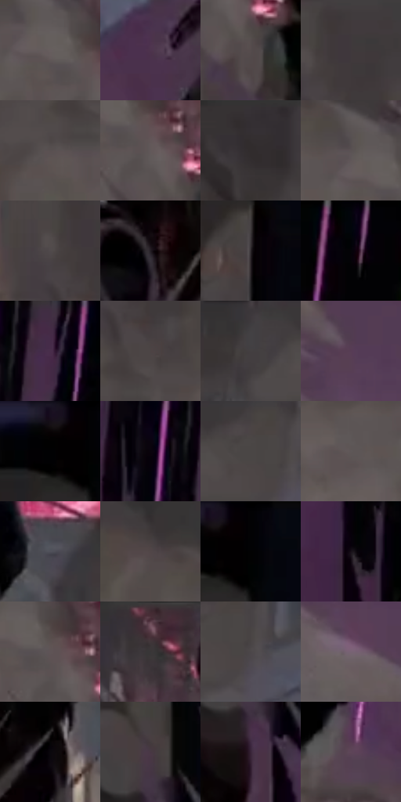

# 电影参考 158

- 状态：条件／活跃；来源世界：miles-home。
- 视角：low-angle；景别：detail；场景：street。
- 时段：night-appearance（外观依据，中置信度；具体时间／晨昏未知）；光照：night-mixed。
- 材质候选：stone, asphalt, metal（帧级，不是像素分割）。
- 明暗组：dark；L* P5/P50/P95：0.58792 / 28.16431 / 40.7601。
- 资格门禁：impact。
- 原截图 SHA-256：`e621c52f40f2e9da05cbeb7dc452840a940652dfc496d01dc9e445db34640dc4`；尺寸：2880 × 1206。
- sRGB 像素 SHA-256：`95b0dca44b8c46154b152946acad6da34c57bf5c04805e24be9546a58b0e32c6`。

## 观察与迁移

落地尘烟与局部放射形，结构破损不可无依据迁移。

本公开版保存32个128×128原像素色卡上下文；图集格子并非原场景相邻位置。原rect、图集tile和像素SHA见 `data/palette-crops.json`。上下文不足时不得批准替色，不能以小样推断完整构图。

## 实测色卡

颜色比例分母为保留采样像素，不是材料面积；全部 32 色参与全库匹配。表内四舍五入仅用于阅读，原精度在 JSON。

| ID | HEX | Lab | 原图 xy | 像素数 | 比例 | 明度角色 |
| --- | --- | --- | --- | ---: | ---: | --- |
| 158-S01 | #675E5F | [40.7601, 3.795367, 0.736094] | [716, 280] | 9944 | 5.143111% | midtone |
| 158-S02 | #4D344E | [25.515035, 16.347701, -11.45752] | [1908, 500] | 9315 | 4.817788% | shadow |
| 158-S03 | #544C4D | [33.113201, 3.523113, 0.615896] | [812, 400] | 8545 | 4.419538% | shadow |
| 158-S04 | #40393C | [24.773019, 3.689873, -0.746443] | [396, 64] | 7883 | 4.077147% | shadow |
| 158-S05 | #585051 | [34.814972, 3.491558, 0.608488] | [332, 260] | 7796 | 4.032150% | shadow |
| 158-S06 | #63595A | [38.787307, 4.240405, 0.898956] | [772, 328] | 7669 | 3.966464% | shadow |
| 158-S07 | #342F32 | [20.017507, 2.912319, -1.102752] | [116, 28] | 7644 | 3.953534% | shadow |
| 158-S08 | #5A5253 | [35.660557, 3.47639, 0.604964] | [684, 248] | 6977 | 3.608557% | shadow |
| 158-S09 | #514A4B | [32.157155, 3.119932, 0.462468] | [340, 84] | 6662 | 3.445636% | shadow |
| 158-S10 | #221C22 | [11.177919, 4.347617, -3.024187] | [1972, 260] | 6658 | 3.443567% | deep-shadow |
| 158-S11 | #2C262A | [15.947013, 3.696484, -1.610247] | [1048, 192] | 6518 | 3.371158% | deep-shadow |
| 158-S12 | #040307 | [0.959977, 0.817622, -1.421457] | [1560, 64] | 6328 | 3.272889% | deep-shadow |
| 158-S13 | #452B47 | [21.75561, 17.540218, -12.627607] | [1404, 44] | 6288 | 3.252201% | shadow |
| 158-S14 | #4C4444 | [29.633909, 3.387736, 1.235703] | [396, 180] | 6180 | 3.196342% | shadow |
| 158-S15 | #443F41 | [27.201606, 2.562984, -0.450471] | [2472, 64] | 6099 | 3.154449% | shadow |
| 158-S16 | #573C56 | [29.235289, 16.832778, -10.917364] | [788, 772] | 6051 | 3.129623% | shadow |
| 158-S17 | #020101 | [0.332482, 0.261482, 0.092172] | [1000, 48] | 5946 | 3.075316% | deep-shadow |
| 158-S18 | #09030C | [1.352683, 2.835997, -2.8955] | [1308, 96] | 5820 | 3.010148% | deep-shadow |
| 158-S19 | #484243 | [28.588932, 2.754779, 0.315532] | [2592, 28] | 5736 | 2.966702% | shadow |
| 158-S20 | #5E5758 | [37.663736, 3.032682, 0.445086] | [596, 304] | 5583 | 2.887569% | shadow |
| 158-S21 | #50505A | [34.356851, 2.266686, -5.833788] | [2216, 144] | 5533 | 2.861709% | shadow |
| 158-S22 | #514648 | [30.872858, 5.0505, 0.516507] | [592, 180] | 5454 | 2.820850% | shadow |
| 158-S23 | #020204 | [0.587921, 0.278053, -0.756781] | [1052, 28] | 5325 | 2.754130% | deep-shadow |
| 158-S24 | #171118 | [5.862491, 4.16864, -3.499405] | [1228, 696] | 5184 | 2.681204% | deep-shadow |
| 158-S25 | #5F5456 | [36.828444, 4.893331, 0.486665] | [756, 300] | 5128 | 2.652240% | shadow |
| 158-S26 | #3B3537 | [22.833661, 3.07438, -0.293742] | [772, 56] | 5104 | 2.639827% | shadow |
| 158-S27 | #4C4749 | [30.697919, 2.512728, -0.443886] | [2636, 92] | 4990 | 2.580865% | shadow |
| 158-S28 | #786374 | [44.487126, 11.62178, -6.376544] | [944, 980] | 4921 | 2.545178% | midtone |
| 158-S29 | #0A080D | [2.414081, 1.254207, -1.805904] | [2120, 268] | 4663 | 2.411739% | deep-shadow |
| 158-S30 | #483744 | [25.344075, 10.157172, -5.134002] | [1020, 336] | 3076 | 1.590930% | shadow |
| 158-S31 | #392539 | [17.866473, 13.55659, -9.118448] | [1020, 444] | 2549 | 1.318362% | deep-shadow |
| 158-S32 | #5E4558 | [32.570403, 14.287797, -7.08717] | [1548, 904] | 1777 | 0.919078% | shadow |

## 色阶与空间分布

- 采样 ROI：`[0.01, 0.02, 0.98, 0.94]`；步长：4；样本数：193346。
- 排除区：`[]`。
- 深暗、暗、中、亮、高光五段计数：`[52948, 126818, 13450, 127, 3]`。
- RGB 各 256 箱、L* 100 箱、13×5 色相明度表和 3×3 空间统计全部保存在 [总数据](../film-library.json)。
- [可视化档案](../../references/library.html)按需绘制直方图，不存 2,094 张重复图表图片。

## 纹理特征占比

**这是分块图像特征的面积占比，不是波点／排线／丝网／错版的精确语义覆盖率。** 窗格、发丝、织物也会产生方向或周期特征。
原图 ROI 像素 3098546；已测块覆盖 3098546（100.0000%）；未测 0。

| 特征 | 块覆盖像素 | 占已测面积 | 阈值敏感范围 |
| --- | ---: | ---: | --- |
| low-contrast | 32768 | 1.0575% | 0.5288% ~ 2.1151% |
| directional-structure | 969778 | 31.2978% | 16.9205% ~ 42.7489% |
| periodic-structure | 2079616 | 67.1159% | 56.7223% ~ 80.4357% |
| mixed-detail | 16384 | 0.5288% | 0.0000% ~ 0.5288% |

阈值敏感范围不是统计置信区间。逐块坐标、尺度、对比、方向一致性、频谱集中度、频率与角度见 [全量特征记录](../texture-features.jsonl)，以帧号定位。
四种印刷层的真实像素覆盖仍标为 `null`，不能填 0，也不能拿上表代替。不得据这些代理测量删除唯一证据。

[测量方法与保留策略](../../references/library-retention.md) · [分类索引](../archive/README.md)
