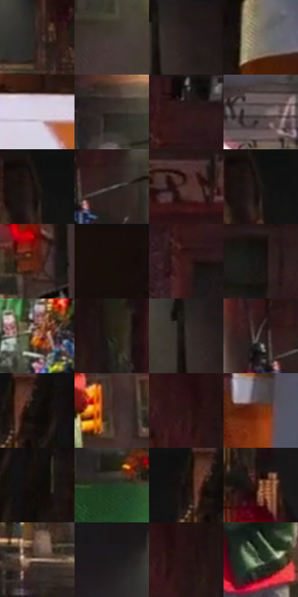

# 电影参考 159

- 状态：条件／活跃；来源世界：miles-home。
- 视角：near-level；景别：environment-wide；场景：street。
- 时段：night-appearance（外观依据，中置信度；具体时间／晨昏未知）；光照：night-mixed。
- 材质候选：fabric, brick, asphalt, painted-metal, glass（帧级，不是像素分割）。
- 明暗组：very-dark；L* P5/P50/P95：5.02275 / 16.58081 / 68.15741。
- 资格门禁：glitch。
- 原截图 SHA-256：`ccddcad6ea54e69cd21306d88236bb8576d85811069b530e143098ba37237d62`；尺寸：2880 × 1208。
- sRGB 像素 SHA-256：`286072323c93bb3b8bf13c2e5c8b238ff50fa7088475eb243115e37ddaa3cee4`。

## 观察与迁移

湿路和车漆可学，远处彩色碎裂须条件启用。

本公开版保存32个128×128原像素色卡上下文；图集格子并非原场景相邻位置。原rect、图集tile和像素SHA见 `data/palette-crops.json`。上下文不足时不得批准替色，不能以小样推断完整构图。

## 实测色卡

颜色比例分母为保留采样像素，不是材料面积；全部 32 色参与全库匹配。表内四舍五入仅用于阅读，原精度在 JSON。

| ID | HEX | Lab | 原图 xy | 像素数 | 比例 | 明度角色 |
| --- | --- | --- | --- | ---: | ---: | --- |
| 159-S01 | #332723 | [16.875139, 4.86519, 4.779416] | [1492, 392] | 9035 | 4.672970% | deep-shadow |
| 159-S02 | #443A35 | [25.2973, 3.403875, 4.721728] | [2196, 132] | 8465 | 4.378161% | shadow |
| 159-S03 | #221917 | [9.776673, 4.076832, 3.111259] | [2440, 32] | 8092 | 4.185243% | deep-shadow |
| 159-S04 | #797168 | [48.10208, 1.425111, 6.109769] | [1796, 96] | 7995 | 4.135074% | midtone |
| 159-S05 | #D9D0DE | [84.554555, 5.624112, -5.790414] | [2768, 836] | 7602 | 3.931811% | highlight |
| 159-S06 | #37302C | [20.471545, 2.324009, 3.712206] | [552, 364] | 7498 | 3.878022% | shadow |
| 159-S07 | #241F1E | [12.278845, 2.168255, 1.557454] | [436, 32] | 7382 | 3.818026% | deep-shadow |
| 159-S08 | #605652 | [37.393176, 3.309781, 3.811473] | [2092, 656] | 7150 | 3.698034% | shadow |
| 159-S09 | #121111 | [5.148492, 0.381719, 0.13522] | [1096, 36] | 7077 | 3.660277% | deep-shadow |
| 159-S10 | #524A49 | [32.19655, 3.137337, 1.810306] | [852, 368] | 6886 | 3.561491% | shadow |
| 159-S11 | #51352C | [25.191845, 11.298275, 10.77036] | [2732, 620] | 6854 | 3.544940% | shadow |
| 159-S12 | #1C1816 | [8.637341, 1.520748, 2.108878] | [1100, 72] | 6557 | 3.391330% | deep-shadow |
| 159-S13 | #542010 | [19.866036, 23.103764, 22.295138] | [2348, 308] | 6536 | 3.380468% | deep-shadow |
| 159-S14 | #180F0C | [5.080264, 3.24942, 2.695146] | [2792, 28] | 6471 | 3.346850% | deep-shadow |
| 159-S15 | #381B19 | [13.797671, 14.021718, 7.739527] | [400, 140] | 6246 | 3.230478% | deep-shadow |
| 159-S16 | #181616 | [7.460688, 0.95659, 0.338086] | [124, 176] | 6150 | 3.180826% | deep-shadow |
| 159-S17 | #B37452 | [54.747346, 21.121391, 28.91231] | [708, 692] | 6077 | 3.143070% | midtone |
| 159-S18 | #231F17 | [11.952308, 0.237429, 6.171216] | [920, 152] | 6073 | 3.141001% | deep-shadow |
| 159-S19 | #2A2622 | [15.455713, 0.98055, 3.324825] | [2396, 28] | 5970 | 3.087729% | deep-shadow |
| 159-S20 | #2B1F1C | [13.092415, 5.254993, 4.290812] | [780, 348] | 5707 | 2.951703% | deep-shadow |
| 159-S21 | #191211 | [6.140434, 2.960405, 1.668307] | [1612, 28] | 5467 | 2.827573% | deep-shadow |
| 159-S22 | #422C27 | [20.464768, 9.387985, 7.31731] | [2212, 336] | 5221 | 2.700340% | shadow |
| 159-S23 | #2D1515 | [10.171848, 12.209046, 5.34119] | [796, 148] | 5212 | 2.695685% | deep-shadow |
| 159-S24 | #7A331A | [30.83342, 29.333018, 30.251314] | [1908, 988] | 4982 | 2.576728% | shadow |
| 159-S25 | #0F0C0A | [3.490558, 0.654116, 1.133916] | [1692, 136] | 4622 | 2.390533% | deep-shadow |
| 159-S26 | #263725 | [21.124322, -11.33435, 9.118123] | [556, 524] | 4451 | 2.302091% | shadow |
| 159-S27 | #1C1610 | [7.751509, 1.78511, 4.633235] | [1560, 40] | 4436 | 2.294332% | deep-shadow |
| 159-S28 | #855A42 | [42.297457, 14.729685, 20.972864] | [1108, 292] | 4282 | 2.214682% | midtone |
| 159-S29 | #B5A195 | [67.638833, 5.309434, 8.918886] | [1596, 808] | 4203 | 2.173823% | light |
| 159-S30 | #1E1A1B | [9.75084, 2.192274, 0.01802] | [1336, 320] | 4196 | 2.170203% | deep-shadow |
| 159-S31 | #241313 | [8.020432, 8.802549, 3.37932] | [840, 160] | 3825 | 1.978319% | deep-shadow |
| 159-S32 | #3D4A3B | [29.924738, -8.597015, 7.26473] | [2092, 500] | 2626 | 1.358187% | shadow |

## 色阶与空间分布

- 采样 ROI：`[0.01, 0.02, 0.98, 0.94]`；步长：4；样本数：193346。
- 排除区：`[]`。
- 深暗、暗、中、亮、高光五段计数：`[112751, 49890, 18056, 5576, 7073]`。
- RGB 各 256 箱、L* 100 箱、13×5 色相明度表和 3×3 空间统计全部保存在 [总数据](../film-library.json)。
- [可视化档案](../../references/library.html)按需绘制直方图，不存 2,094 张重复图表图片。

## 纹理特征占比

**这是分块图像特征的面积占比，不是波点／排线／丝网／错版的精确语义覆盖率。** 窗格、发丝、织物也会产生方向或周期特征。
原图 ROI 像素 3104134；已测块覆盖 3104134（100.0000%）；未测 0。

| 特征 | 块覆盖像素 | 占已测面积 | 阈值敏感范围 |
| --- | ---: | ---: | --- |
| low-contrast | 158848 | 5.1173% | 4.7586% ~ 7.4182% |
| directional-structure | 419718 | 13.5213% | 5.9216% ~ 24.8156% |
| periodic-structure | 2299008 | 74.0628% | 69.3702% ~ 74.0628% |
| mixed-detail | 226560 | 7.2987% | 1.0556% ~ 12.5974% |

阈值敏感范围不是统计置信区间。逐块坐标、尺度、对比、方向一致性、频谱集中度、频率与角度见 [全量特征记录](../texture-features.jsonl)，以帧号定位。
四种印刷层的真实像素覆盖仍标为 `null`，不能填 0，也不能拿上表代替。不得据这些代理测量删除唯一证据。

[测量方法与保留策略](../../references/library-retention.md) · [分类索引](../archive/README.md)
