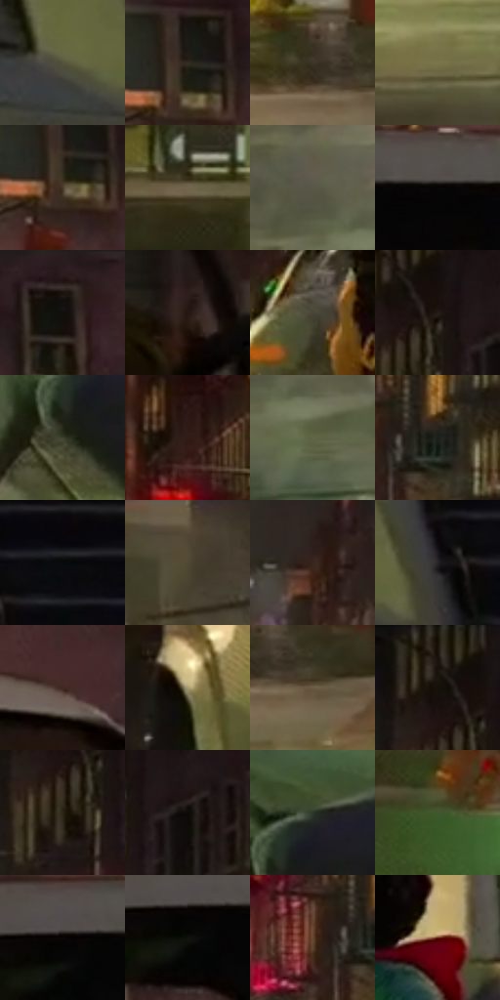

# 电影参考 160

- 状态：条件／活跃；来源世界：miles-home。
- 视角：near-level；景别：full-body；场景：street。
- 时段：night-appearance（外观依据，中置信度；具体时间／晨昏未知）；光照：night-mixed。
- 材质候选：fabric, brick, asphalt, painted-metal, glass（帧级，不是像素分割）。
- 明暗组：dark；L* P5/P50/P95：1.91921 / 20.99708 / 47.9857。
- 资格门禁：glitch。
- 原截图 SHA-256：`ccf78ee6961b6d048bb8760a8f6783af41831ed924ed2b68d36af9ab39c38aa4`；尺寸：2880 × 1200。
- sRGB 像素 SHA-256：`8ec4f07449ff1629fe7e9f189864141301430c6c17fb0cd67f69768eaea3c6c3`。

## 观察与迁移

湿路和车漆可学，远处彩色碎裂须条件启用。

本公开版保存32个128×128原像素色卡上下文；图集格子并非原场景相邻位置。原rect、图集tile和像素SHA见 `data/palette-crops.json`。上下文不足时不得批准替色，不能以小样推断完整构图。

## 实测色卡

颜色比例分母为保留采样像素，不是材料面积；全部 32 色参与全库匹配。表内四舍五入仅用于阅读，原精度在 JSON。

| ID | HEX | Lab | 原图 xy | 像素数 | 比例 | 明度角色 |
| --- | --- | --- | --- | ---: | ---: | --- |
| 160-S01 | #54533D | [34.819333, -3.719767, 13.080417] | [2064, 788] | 9065 | 4.705473% | shadow |
| 160-S02 | #312C22 | [18.231795, 0.269741, 7.331279] | [2004, 84] | 8671 | 4.500955% | deep-shadow |
| 160-S03 | #3D3627 | [22.920202, 0.309405, 10.580816] | [460, 664] | 8601 | 4.464619% | shadow |
| 160-S04 | #7B744B | [48.523836, -3.872815, 23.644025] | [392, 844] | 8090 | 4.199369% | midtone |
| 160-S05 | #4A3B2C | [26.057005, 4.081498, 11.791681] | [1996, 120] | 7789 | 4.043125% | shadow |
| 160-S06 | #70654D | [43.194509, 0.303991, 15.208908] | [124, 600] | 7735 | 4.015095% | midtone |
| 160-S07 | #5A5648 | [36.550451, -1.055697, 8.748981] | [588, 1012] | 7640 | 3.965782% | shadow |
| 160-S08 | #060605 | [1.625254, -0.139148, 0.378622] | [1852, 296] | 7575 | 3.932042% | deep-shadow |
| 160-S09 | #1B1713 | [8.064857, 1.100682, 3.29017] | [2132, 48] | 7468 | 3.876500% | deep-shadow |
| 160-S10 | #261712 | [9.55047, 6.77627, 6.248297] | [2072, 420] | 7067 | 3.668348% | deep-shadow |
| 160-S11 | #484638 | [29.522328, -1.931111, 8.764109] | [1320, 432] | 6888 | 3.575433% | shadow |
| 160-S12 | #241D19 | [11.442522, 2.573237, 4.023] | [1432, 88] | 6874 | 3.568166% | deep-shadow |
| 160-S13 | #3E4230 | [27.113155, -5.377377, 10.433671] | [1076, 980] | 6868 | 3.565051% | shadow |
| 160-S14 | #321C16 | [13.025961, 10.001991, 8.692033] | [1064, 156] | 6299 | 3.269694% | deep-shadow |
| 160-S15 | #5F6644 | [41.771892, -8.997507, 18.366047] | [652, 1096] | 6122 | 3.177817% | midtone |
| 160-S16 | #1C201B | [11.682175, -3.114482, 2.778452] | [1192, 304] | 5866 | 3.044932% | deep-shadow |
| 160-S17 | #08090A | [2.42904, -0.122612, -0.470265] | [2276, 732] | 5852 | 3.037665% | deep-shadow |
| 160-S18 | #524937 | [31.428236, 0.57935, 12.179069] | [364, 60] | 5456 | 2.832108% | shadow |
| 160-S19 | #38251E | [16.785817, 7.910248, 8.258226] | [816, 308] | 5399 | 2.802521% | deep-shadow |
| 160-S20 | #272525 | [14.888456, 0.923101, 0.331005] | [2184, 772] | 5366 | 2.785391% | deep-shadow |
| 160-S21 | #422923 | [19.497902, 10.815859, 8.727746] | [2208, 280] | 5300 | 2.751132% | deep-shadow |
| 160-S22 | #A59970 | [63.303644, -2.026382, 23.191312] | [1160, 700] | 5066 | 2.629667% | light |
| 160-S23 | #6A5B44 | [39.519979, 2.330071, 15.533489] | [520, 696] | 5022 | 2.606827% | shadow |
| 160-S24 | #19120C | [6.014691, 2.076795, 4.073152] | [1388, 44] | 4931 | 2.559591% | deep-shadow |
| 160-S25 | #272415 | [14.100858, -1.522728, 10.550728] | [1396, 152] | 4870 | 2.527927% | deep-shadow |
| 160-S26 | #0F0B08 | [3.237823, 0.811487, 1.5795] | [1500, 120] | 4635 | 2.405942% | deep-shadow |
| 160-S27 | #2F3829 | [22.276643, -7.206355, 8.156309] | [1112, 896] | 4476 | 2.323408% | shadow |
| 160-S28 | #42582D | [34.654979, -16.957847, 22.195802] | [332, 244] | 3840 | 1.993273% | shadow |
| 160-S29 | #0A0503 | [1.622838, 1.029322, 1.217705] | [1732, 296] | 3795 | 1.969914% | deep-shadow |
| 160-S30 | #0F110C | [4.778416, -1.59766, 2.153974] | [1728, 324] | 3618 | 1.878037% | deep-shadow |
| 160-S31 | #654631 | [32.633381, 10.511052, 17.922917] | [1120, 312] | 3513 | 1.823533% | shadow |
| 160-S32 | #642219 | [23.419846, 29.212716, 21.55219] | [1516, 476] | 2891 | 1.500664% | shadow |

## 色阶与空间分布

- 采样 ROI：`[0.01, 0.02, 0.98, 0.94]`；步长：4；样本数：192648。
- 排除区：`[]`。
- 深暗、暗、中、亮、高光五段计数：`[92288, 72829, 24829, 2164, 538]`。
- RGB 各 256 箱、L* 100 箱、13×5 色相明度表和 3×3 空间统计全部保存在 [总数据](../film-library.json)。
- [可视化档案](../../references/library.html)按需绘制直方图，不存 2,094 张重复图表图片。

## 纹理特征占比

**这是分块图像特征的面积占比，不是波点／排线／丝网／错版的精确语义覆盖率。** 窗格、发丝、织物也会产生方向或周期特征。
原图 ROI 像素 3084576；已测块覆盖 3084576（100.0000%）；未测 0。

| 特征 | 块覆盖像素 | 占已测面积 | 阈值敏感范围 |
| --- | ---: | ---: | --- |
| low-contrast | 10240 | 0.3320% | 0.3320% ~ 2.7886% |
| directional-structure | 993312 | 32.2025% | 19.4630% ~ 46.7181% |
| periodic-structure | 1923328 | 62.3531% | 51.3564% ~ 66.6853% |
| mixed-detail | 157696 | 5.1124% | 1.5935% ~ 11.0630% |

阈值敏感范围不是统计置信区间。逐块坐标、尺度、对比、方向一致性、频谱集中度、频率与角度见 [全量特征记录](../texture-features.jsonl)，以帧号定位。
四种印刷层的真实像素覆盖仍标为 `null`，不能填 0，也不能拿上表代替。不得据这些代理测量删除唯一证据。

[测量方法与保留策略](../../references/library-retention.md) · [分类索引](../archive/README.md)
