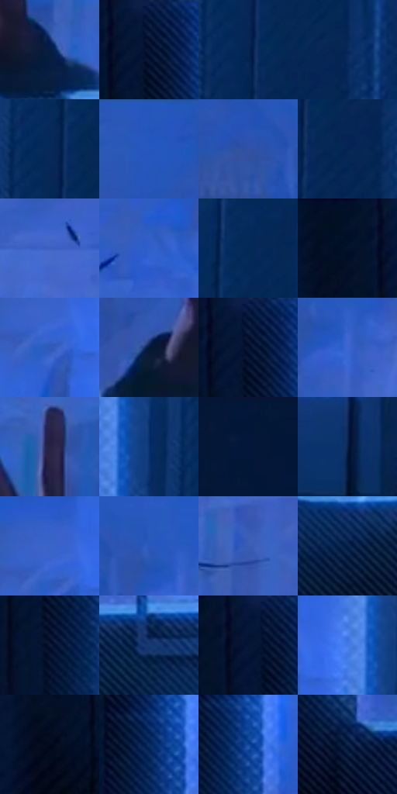

# 电影参考 161

- 状态：常规／活跃；来源世界：miles-home。
- 视角：near-level；景别：detail；场景：interior。
- 时段：interior-time-unknown（外观依据，中置信度；具体时间／晨昏未知）；光照：cool-interior。
- 材质候选：skin, fabric, glass, wood, plastic（帧级，不是像素分割）。
- 明暗组：very-dark；L* P5/P50/P95：5.52168 / 17.39491 / 45.06579。
- 资格门禁：无附加门禁。
- 原截图 SHA-256：`5aa80903d4f5843642d610788b0a589f65226f12269a43bcb156af6eb4b54725`；尺寸：2880 × 1210。
- sRGB 像素 SHA-256：`a19d5066d11a19aaf098753d1cae988ded277111553e2601bce8e5a19c35042a`。

## 观察与迁移

冷蓝卧室与窗口影形，大暗面中保留关键轮廓。

本公开版保存32个128×128原像素色卡上下文；图集格子并非原场景相邻位置。原rect、图集tile和像素SHA见 `data/palette-crops.json`。上下文不足时不得批准替色，不能以小样推断完整构图。

## 实测色卡

颜色比例分母为保留采样像素，不是材料面积；全部 32 色参与全库匹配。表内四舍五入仅用于阅读，原精度在 JSON。

| ID | HEX | Lab | 原图 xy | 像素数 | 比例 | 明度角色 |
| --- | --- | --- | --- | ---: | ---: | --- |
| 161-S01 | #051E42 | [11.647684, 6.517653, -25.514396] | [1900, 620] | 10694 | 5.511121% | deep-shadow |
| 161-S02 | #041635 | [7.737042, 6.485188, -22.549783] | [476, 40] | 9302 | 4.793758% | deep-shadow |
| 161-S03 | #072653 | [15.776364, 8.51657, -30.537911] | [2428, 212] | 9126 | 4.703057% | deep-shadow |
| 161-S04 | #082A5B | [17.748084, 9.242486, -32.71068] | [2536, 212] | 8688 | 4.477335% | deep-shadow |
| 161-S05 | #072958 | [17.156541, 8.530336, -31.667904] | [2420, 148] | 8285 | 4.269650% | deep-shadow |
| 161-S06 | #2456BB | [38.927271, 20.998884, -57.895645] | [984, 28] | 7861 | 4.051143% | shadow |
| 161-S07 | #3052A6 | [36.771017, 17.055888, -48.953743] | [1084, 152] | 7418 | 3.822844% | shadow |
| 161-S08 | #032452 | [14.898962, 9.109093, -31.287146] | [2492, 260] | 7307 | 3.765641% | deep-shadow |
| 161-S09 | #3C61BF | [43.167079, 18.364214, -53.328796] | [1464, 216] | 7237 | 3.729566% | midtone |
| 161-S10 | #2F5FC8 | [42.698142, 21.245931, -59.324664] | [1988, 176] | 7213 | 3.717198% | midtone |
| 161-S11 | #062B5C | [18.093013, 8.743821, -32.820372] | [2476, 28] | 7117 | 3.667725% | deep-shadow |
| 161-S12 | #031029 | [4.967686, 4.104237, -18.077964] | [384, 28] | 6600 | 3.401290% | deep-shadow |
| 161-S13 | #315ABA | [40.424462, 19.470987, -54.86379] | [2172, 140] | 6293 | 3.243079% | midtone |
| 161-S14 | #03183A | [8.806422, 7.110754, -24.435251] | [944, 608] | 6184 | 3.186906% | deep-shadow |
| 161-S15 | #04142F | [6.605343, 4.836039, -19.965842] | [476, 64] | 5883 | 3.031787% | deep-shadow |
| 161-S16 | #3C67D0 | [45.924622, 20.714356, -58.682659] | [1224, 192] | 5841 | 3.010142% | midtone |
| 161-S17 | #282343 | [15.790459, 11.448725, -19.454409] | [1800, 324] | 5825 | 3.001896% | deep-shadow |
| 161-S18 | #0A326E | [21.839039, 11.955943, -38.516925] | [2328, 116] | 5760 | 2.968399% | shadow |
| 161-S19 | #051737 | [8.313009, 6.851822, -23.067067] | [32, 28] | 5584 | 2.877698% | deep-shadow |
| 161-S20 | #08234B | [14.18183, 7.264971, -27.663995] | [2276, 756] | 5503 | 2.835955% | deep-shadow |
| 161-S21 | #3963C8 | [44.17791, 19.930052, -56.913258] | [2164, 92] | 5480 | 2.824102% | midtone |
| 161-S22 | #2B58BB | [39.713436, 20.421188, -56.610174] | [1184, 136] | 5424 | 2.795242% | shadow |
| 161-S23 | #395CB5 | [40.99078, 17.470979, -51.004458] | [1412, 352] | 5360 | 2.762260% | midtone |
| 161-S24 | #042048 | [12.775328, 7.638469, -27.874609] | [1164, 760] | 4472 | 2.304632% | deep-shadow |
| 161-S25 | #0C1A37 | [9.740608, 5.807756, -20.751341] | [480, 356] | 4419 | 2.277319% | deep-shadow |
| 161-S26 | #183874 | [24.585337, 11.681561, -37.897758] | [1348, 740] | 4206 | 2.167550% | shadow |
| 161-S27 | #021331 | [6.325617, 5.998716, -21.895719] | [452, 56] | 3945 | 2.033044% | deep-shadow |
| 161-S28 | #427CE5 | [53.197964, 15.957456, -58.84954] | [2264, 104] | 3901 | 2.010369% | midtone |
| 161-S29 | #020A1C | [2.834395, 1.83689, -11.290245] | [376, 768] | 3644 | 1.877925% | deep-shadow |
| 161-S30 | #0B2E61 | [19.588619, 9.248934, -33.699394] | [528, 224] | 3500 | 1.803715% | deep-shadow |
| 161-S31 | #12479D | [31.961535, 17.614841, -51.379881] | [556, 240] | 3376 | 1.739812% | shadow |
| 161-S32 | #0D2347 | [14.072387, 6.167609, -25.07626] | [564, 732] | 2596 | 1.337841% | deep-shadow |

## 色阶与空间分布

- 采样 ROI：`[0.01, 0.02, 0.98, 0.94]`；步长：4；样本数：194044。
- 排除区：`[]`。
- 深暗、暗、中、亮、高光五段计数：`[118418, 33832, 41701, 93, 0]`。
- RGB 各 256 箱、L* 100 箱、13×5 色相明度表和 3×3 空间统计全部保存在 [总数据](../film-library.json)。
- [可视化档案](../../references/library.html)按需绘制直方图，不存 2,094 张重复图表图片。

## 纹理特征占比

**这是分块图像特征的面积占比，不是波点／排线／丝网／错版的精确语义覆盖率。** 窗格、发丝、织物也会产生方向或周期特征。
原图 ROI 像素 3109722；已测块覆盖 3109722（100.0000%）；未测 0。

| 特征 | 块覆盖像素 | 占已测面积 | 阈值敏感范围 |
| --- | ---: | ---: | --- |
| low-contrast | 821594 | 26.4202% | 22.7321% ~ 34.7594% |
| directional-structure | 999424 | 32.1387% | 17.9134% ~ 46.8909% |
| periodic-structure | 1272320 | 40.9143% | 30.3770% ~ 46.2735% |
| mixed-detail | 16384 | 0.5269% | 0.0000% ~ 1.0537% |

阈值敏感范围不是统计置信区间。逐块坐标、尺度、对比、方向一致性、频谱集中度、频率与角度见 [全量特征记录](../texture-features.jsonl)，以帧号定位。
四种印刷层的真实像素覆盖仍标为 `null`，不能填 0，也不能拿上表代替。不得据这些代理测量删除唯一证据。

[测量方法与保留策略](../../references/library-retention.md) · [分类索引](../archive/README.md)
