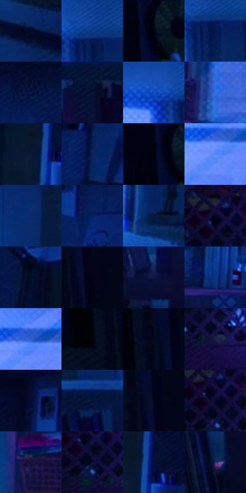

# 电影参考 162

- 状态：常规／活跃；来源世界：miles-home。
- 视角：near-level；景别：environment-wide；场景：interior。
- 时段：interior-time-unknown（外观依据，中置信度；具体时间／晨昏未知）；光照：cool-interior。
- 材质候选：skin, fabric, glass, wood, plastic（帧级，不是像素分割）。
- 明暗组：very-dark；L* P5/P50/P95：1.11126 / 7.38591 / 51.26647。
- 资格门禁：无附加门禁。
- 原截图 SHA-256：`9725c842ccd265495a69b3d20aebeef64dfb197e5e0257dd31d6a69ca98e1ef5`；尺寸：2876 × 1192。
- sRGB 像素 SHA-256：`b2b5f560f2aa6b91a787963d27d7cf37a1d448fdd3aef3421942a88dd73de363`。

## 观察与迁移

冷蓝卧室与窗口影形，大暗面中保留关键轮廓。

本公开版保存32个128×128原像素色卡上下文；图集格子并非原场景相邻位置。原rect、图集tile和像素SHA见 `data/palette-crops.json`。上下文不足时不得批准替色，不能以小样推断完整构图。

## 实测色卡

颜色比例分母为保留采样像素，不是材料面积；全部 32 色参与全库匹配。表内四舍五入仅用于阅读，原精度在 JSON。

| ID | HEX | Lab | 原图 xy | 像素数 | 比例 | 明度角色 |
| --- | --- | --- | --- | ---: | ---: | --- |
| 162-S01 | #040B27 | [3.717696, 5.923683, -18.509711] | [2480, 536] | 9350 | 4.878049% | deep-shadow |
| 162-S02 | #0D3E92 | [28.393424, 18.974385, -50.484055] | [824, 32] | 8510 | 4.439807% | shadow |
| 162-S03 | #020717 | [2.047716, 1.64408, -8.493844] | [468, 56] | 8348 | 4.355289% | deep-shadow |
| 162-S04 | #06194D | [11.060806, 15.681574, -34.11229] | [836, 100] | 8347 | 4.354767% | deep-shadow |
| 162-S05 | #030D2C | [4.41681, 7.011076, -21.208386] | [2748, 32] | 7802 | 4.070432% | deep-shadow |
| 162-S06 | #081033 | [5.97181, 10.392798, -23.915744] | [868, 452] | 7124 | 3.716708% | deep-shadow |
| 162-S07 | #154DB2 | [35.360563, 22.247063, -58.412868] | [736, 32] | 6831 | 3.563845% | shadow |
| 162-S08 | #3373EA | [50.573277, 21.618194, -65.907555] | [1936, 436] | 6696 | 3.493413% | midtone |
| 162-S09 | #0B1832 | [8.607305, 4.941448, -18.945794] | [2416, 276] | 6692 | 3.491326% | deep-shadow |
| 162-S10 | #0A2058 | [14.410705, 15.655619, -36.120735] | [2580, 344] | 6665 | 3.477240% | deep-shadow |
| 162-S11 | #000313 | [1.012755, 1.781467, -7.260023] | [432, 24] | 6610 | 3.448546% | deep-shadow |
| 162-S12 | #5989F9 | [58.836615, 18.454052, -60.860651] | [1320, 140] | 6568 | 3.426634% | midtone |
| 162-S13 | #0A2A6E | [19.415008, 17.812813, -42.458677] | [1656, 108] | 6557 | 3.420895% | deep-shadow |
| 162-S14 | #072163 | [15.661057, 19.456511, -41.411834] | [2676, 176] | 6430 | 3.354637% | deep-shadow |
| 162-S15 | #051840 | [9.445594, 10.329852, -27.669576] | [2244, 384] | 6288 | 3.280553% | deep-shadow |
| 162-S16 | #090722 | [2.940117, 6.877372, -15.822642] | [520, 312] | 6181 | 3.224729% | deep-shadow |
| 162-S17 | #050A1B | [2.966808, 2.322642, -10.278068] | [2332, 32] | 6026 | 3.143863% | deep-shadow |
| 162-S18 | #040318 | [1.416915, 4.028571, -10.160418] | [156, 132] | 5772 | 3.011347% | deep-shadow |
| 162-S19 | #0D1843 | [10.136889, 12.905016, -28.644012] | [1312, 656] | 5681 | 2.963871% | deep-shadow |
| 162-S20 | #0A337F | [23.551138, 18.577136, -46.562511] | [1784, 380] | 5534 | 2.887179% | shadow |
| 162-S21 | #2A5CC9 | [41.784998, 23.036181, -61.390716] | [1348, 108] | 5468 | 2.852746% | midtone |
| 162-S22 | #00010A | [0.393946, 0.989878, -3.497917] | [64, 224] | 5250 | 2.739011% | deep-shadow |
| 162-S23 | #020A20 | [3.018986, 3.134028, -14.172862] | [100, 28] | 5147 | 2.685275% | deep-shadow |
| 162-S24 | #1D1F48 | [13.878797, 12.966936, -26.0233] | [600, 412] | 5105 | 2.663362% | deep-shadow |
| 162-S25 | #030B33 | [4.494872, 11.533206, -26.302699] | [2588, 88] | 5088 | 2.654493% | deep-shadow |
| 162-S26 | #041338 | [7.018041, 10.215467, -25.888344] | [1048, 408] | 4995 | 2.605974% | deep-shadow |
| 162-S27 | #02031E | [1.551211, 5.268763, -14.805285] | [136, 72] | 4881 | 2.546498% | deep-shadow |
| 162-S28 | #0A092A | [3.857149, 9.616361, -20.553023] | [532, 340] | 4481 | 2.337811% | deep-shadow |
| 162-S29 | #160F36 | [7.032003, 16.08322, -24.348832] | [1716, 552] | 4117 | 2.147907% | deep-shadow |
| 162-S30 | #0E0D2D | [5.154231, 10.492958, -20.748159] | [536, 372] | 3808 | 1.986696% | deep-shadow |
| 162-S31 | #040E3C | [6.015773, 15.476621, -30.404592] | [2464, 248] | 3048 | 1.590192% | deep-shadow |
| 162-S32 | #263174 | [23.233959, 18.841886, -40.047539] | [1324, 784] | 2275 | 1.186905% | shadow |

## 色阶与空间分布

- 采样 ROI：`[0.01, 0.02, 0.98, 0.94]`；步长：4；样本数：191675。
- 排除区：`[]`。
- 深暗、暗、中、亮、高光五段计数：`[148154, 25880, 15427, 2213, 1]`。
- RGB 各 256 箱、L* 100 箱、13×5 色相明度表和 3×3 空间统计全部保存在 [总数据](../film-library.json)。
- [可视化档案](../../references/library.html)按需绘制直方图，不存 2,094 张重复图表图片。

## 纹理特征占比

**这是分块图像特征的面积占比，不是波点／排线／丝网／错版的精确语义覆盖率。** 窗格、发丝、织物也会产生方向或周期特征。
原图 ROI 像素 3060630；已测块覆盖 3060630（100.0000%）；未测 0。

| 特征 | 块覆盖像素 | 占已测面积 | 阈值敏感范围 |
| --- | ---: | ---: | --- |
| low-contrast | 294784 | 9.6315% | 7.4149% ~ 13.9893% |
| directional-structure | 684800 | 22.3745% | 10.5976% ~ 35.7239% |
| periodic-structure | 1980438 | 64.7069% | 56.5559% ~ 69.7547% |
| mixed-detail | 100608 | 3.2872% | 0.3053% ~ 5.6584% |

阈值敏感范围不是统计置信区间。逐块坐标、尺度、对比、方向一致性、频谱集中度、频率与角度见 [全量特征记录](../texture-features.jsonl)，以帧号定位。
四种印刷层的真实像素覆盖仍标为 `null`，不能填 0，也不能拿上表代替。不得据这些代理测量删除唯一证据。

[测量方法与保留策略](../../references/library-retention.md) · [分类索引](../archive/README.md)
