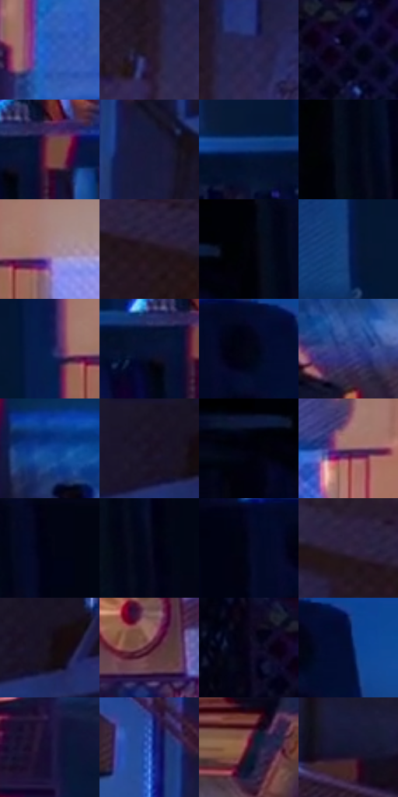

# 电影参考 163

- 状态：常规／活跃；来源世界：miles-home。
- 视角：near-level；景别：environment-wide；场景：interior。
- 时段：interior-time-unknown（外观依据，中置信度；具体时间／晨昏未知）；光照：interior-mixed。
- 材质候选：skin, hair, fabric, wood, plastic, paint（帧级，不是像素分割）。
- 明暗组：very-dark；L* P5/P50/P95：0.77114 / 10.50495 / 49.36447。
- 资格门禁：无附加门禁。
- 原截图 SHA-256：`18fa3cc16f6be5ebd653193094ca1d5ef515bcaa7ecfa78a220f1aeb054fb7b9`；尺寸：2880 × 1206。
- sRGB 像素 SHA-256：`64ee72300ed495a51f74fcbc78198155beec5ce8b6ed49fd387731e7aec0a7ce`。

## 观察与迁移

暖门口与冷蓝房间对照，墙影随人物与光源方向。

本公开版保存32个128×128原像素色卡上下文；图集格子并非原场景相邻位置。原rect、图集tile和像素SHA见 `data/palette-crops.json`。上下文不足时不得批准替色，不能以小样推断完整构图。

## 实测色卡

颜色比例分母为保留采样像素，不是材料面积；全部 32 色参与全库匹配。表内四舍五入仅用于阅读，原精度在 JSON。

| ID | HEX | Lab | 原图 xy | 像素数 | 比例 | 明度角色 |
| --- | --- | --- | --- | ---: | ---: | --- |
| 163-S01 | #275BBF | [40.691944, 19.555866, -57.36656] | [2036, 548] | 10816 | 5.594116% | midtone |
| 163-S02 | #281B29 | [11.925099, 9.545389, -6.96847] | [2664, 384] | 9016 | 4.663143% | deep-shadow |
| 163-S03 | #2A2754 | [18.290691, 14.98053, -27.05631] | [2724, 320] | 8927 | 4.617111% | deep-shadow |
| 163-S04 | #0A0927 | [3.670394, 8.304013, -18.557426] | [620, 480] | 8277 | 4.280926% | deep-shadow |
| 163-S05 | #7A4545 | [35.644078, 22.736142, 9.923651] | [1216, 540] | 7662 | 3.962844% | shadow |
| 163-S06 | #19193B | [10.686548, 11.428722, -22.046649] | [2364, 172] | 7234 | 3.741479% | deep-shadow |
| 163-S07 | #0F3677 | [23.905167, 13.37917, -40.919655] | [1048, 520] | 7017 | 3.629245% | shadow |
| 163-S08 | #020817 | [2.243794, 1.243519, -8.207526] | [196, 280] | 6959 | 3.599247% | deep-shadow |
| 163-S09 | #A6848B | [58.484808, 14.141163, 1.207604] | [1224, 148] | 6949 | 3.594075% | midtone |
| 163-S10 | #21131B | [7.842901, 8.864617, -2.753166] | [2772, 716] | 6823 | 3.528907% | deep-shadow |
| 163-S11 | #000108 | [0.354373, 0.71179, -2.74107] | [156, 28] | 6705 | 3.467876% | deep-shadow |
| 163-S12 | #0E2C65 | [19.365763, 12.786737, -36.678152] | [1000, 156] | 6548 | 3.386675% | deep-shadow |
| 163-S13 | #0B1D4F | [12.697561, 14.066737, -32.80519] | [1132, 152] | 6266 | 3.240822% | deep-shadow |
| 163-S14 | #071335 | [6.935799, 9.325177, -23.832303] | [1156, 552] | 6178 | 3.195308% | deep-shadow |
| 163-S15 | #030315 | [1.25202, 3.018076, -8.21408] | [620, 52] | 5970 | 3.087729% | deep-shadow |
| 163-S16 | #334285 | [30.139918, 16.01147, -39.561341] | [1752, 1072] | 5896 | 3.049455% | shadow |
| 163-S17 | #114599 | [31.053256, 17.275066, -50.430739] | [1536, 976] | 5837 | 3.018940% | shadow |
| 163-S18 | #191226 | [7.038551, 9.036701, -12.44925] | [2500, 44] | 5793 | 2.996183% | deep-shadow |
| 163-S19 | #02020F | [0.820181, 1.91017, -5.198774] | [48, 100] | 5752 | 2.974978% | deep-shadow |
| 163-S20 | #865F6C | [44.711315, 17.969579, -1.028741] | [1656, 144] | 5739 | 2.968254% | midtone |
| 163-S21 | #010412 | [1.236942, 1.43019, -6.303997] | [256, 28] | 5560 | 2.875674% | deep-shadow |
| 163-S22 | #09091E | [3.13584, 4.695895, -12.382341] | [248, 332] | 5519 | 2.854468% | deep-shadow |
| 163-S23 | #04071F | [2.499015, 4.518912, -14.16181] | [536, 60] | 5496 | 2.842572% | deep-shadow |
| 163-S24 | #302240 | [16.218406, 13.991663, -16.637281] | [2712, 684] | 5385 | 2.785162% | deep-shadow |
| 163-S25 | #170D19 | [4.879655, 6.523609, -5.719771] | [2548, 72] | 5276 | 2.728787% | deep-shadow |
| 163-S26 | #572738 | [22.872861, 24.303094, -0.467367] | [1904, 284] | 4721 | 2.441737% | shadow |
| 163-S27 | #09031B | [1.827498, 6.172563, -11.93557] | [536, 464] | 4426 | 2.289160% | deep-shadow |
| 163-S28 | #030C2E | [4.330984, 8.44819, -22.845493] | [680, 64] | 4264 | 2.205373% | deep-shadow |
| 163-S29 | #150F34 | [6.765099, 14.961673, -23.322801] | [1976, 716] | 3747 | 1.937976% | deep-shadow |
| 163-S30 | #4D75D8 | [50.985279, 17.385081, -55.054432] | [2280, 100] | 3227 | 1.669029% | midtone |
| 163-S31 | #401026 | [13.235006, 25.593499, -2.388046] | [1928, 944] | 2781 | 1.438354% | deep-shadow |
| 163-S32 | #111631 | [8.259216, 7.572529, -18.747221] | [2324, 860] | 2580 | 1.334395% | deep-shadow |

## 色阶与空间分布

- 采样 ROI：`[0.01, 0.02, 0.98, 0.94]`；步长：4；样本数：193346。
- 排除区：`[]`。
- 深暗、暗、中、亮、高光五段计数：`[131213, 40097, 18924, 3103, 9]`。
- RGB 各 256 箱、L* 100 箱、13×5 色相明度表和 3×3 空间统计全部保存在 [总数据](../film-library.json)。
- [可视化档案](../../references/library.html)按需绘制直方图，不存 2,094 张重复图表图片。

## 纹理特征占比

**这是分块图像特征的面积占比，不是波点／排线／丝网／错版的精确语义覆盖率。** 窗格、发丝、织物也会产生方向或周期特征。
原图 ROI 像素 3098546；已测块覆盖 3098546（100.0000%）；未测 0。

| 特征 | 块覆盖像素 | 占已测面积 | 阈值敏感范围 |
| --- | ---: | ---: | --- |
| low-contrast | 363698 | 11.7377% | 9.4227% ~ 17.9052% |
| directional-structure | 668800 | 21.5843% | 11.0999% ~ 35.3239% |
| periodic-structure | 1935232 | 62.4561% | 54.1958% ~ 64.2201% |
| mixed-detail | 130816 | 4.2219% | 1.0575% ~ 6.7748% |

阈值敏感范围不是统计置信区间。逐块坐标、尺度、对比、方向一致性、频谱集中度、频率与角度见 [全量特征记录](../texture-features.jsonl)，以帧号定位。
四种印刷层的真实像素覆盖仍标为 `null`，不能填 0，也不能拿上表代替。不得据这些代理测量删除唯一证据。

[测量方法与保留策略](../../references/library-retention.md) · [分类索引](../archive/README.md)
