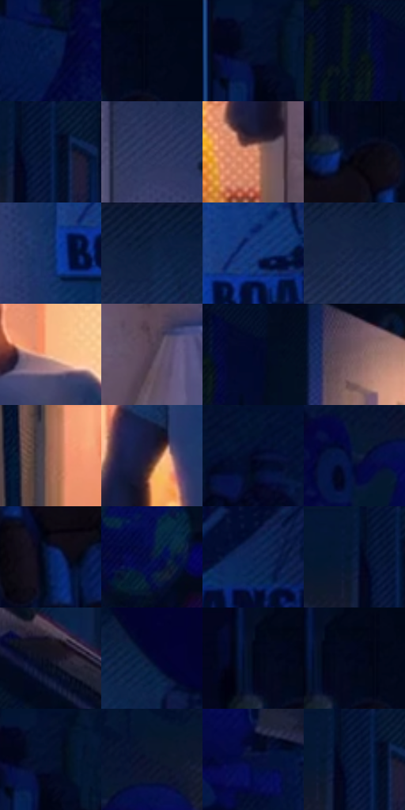

# 电影参考 164

- 状态：常规／活跃；来源世界：miles-home。
- 视角：near-level；景别：full-body；场景：interior。
- 时段：interior-time-unknown（外观依据，中置信度；具体时间／晨昏未知）；光照：interior-mixed。
- 材质候选：skin, hair, fabric, wood, plastic, paint（帧级，不是像素分割）。
- 明暗组：very-dark；L* P5/P50/P95：2.33552 / 9.20463 / 66.0076。
- 资格门禁：无附加门禁。
- 原截图 SHA-256：`da07610e9c1c28ba9312c6a68949dcc3eb9ea870cadaf2e11454c7c29041e83f`；尺寸：2880 × 1208。
- sRGB 像素 SHA-256：`a6335d7c0ad26b35f72b6ffdc578c79b77e6743bc6efb8e7df031f40767f812d`。

## 观察与迁移

暖门口与冷蓝房间对照，墙影随人物与光源方向。

本公开版保存32个128×128原像素色卡上下文；图集格子并非原场景相邻位置。原rect、图集tile和像素SHA见 `data/palette-crops.json`。上下文不足时不得批准替色，不能以小样推断完整构图。

## 实测色卡

颜色比例分母为保留采样像素，不是材料面积；全部 32 色参与全库匹配。表内四舍五入仅用于阅读，原精度在 JSON。

| ID | HEX | Lab | 原图 xy | 像素数 | 比例 | 明度角色 |
| --- | --- | --- | --- | ---: | ---: | --- |
| 164-S01 | #05184A | [10.406817, 14.977622, -33.109662] | [348, 256] | 11867 | 6.137701% | deep-shadow |
| 164-S02 | #02081A | [2.358639, 2.050542, -10.393198] | [2812, 28] | 8997 | 4.653316% | deep-shadow |
| 164-S03 | #051230 | [6.12588, 6.864733, -21.466868] | [204, 28] | 8776 | 4.539013% | deep-shadow |
| 164-S04 | #020B22 | [3.321267, 3.434422, -15.274205] | [936, 28] | 8269 | 4.276789% | deep-shadow |
| 164-S05 | #051840 | [9.445594, 10.329852, -27.669576] | [716, 28] | 8129 | 4.204380% | deep-shadow |
| 164-S06 | #303761 | [24.397001, 9.941982, -25.895524] | [1772, 276] | 8078 | 4.178002% | shadow |
| 164-S07 | #D98A6A | [64.94093, 26.768249, 29.65277] | [1680, 836] | 8014 | 4.144901% | light |
| 164-S08 | #07091A | [2.84626, 2.957478, -9.643044] | [2768, 132] | 7952 | 4.112834% | deep-shadow |
| 164-S09 | #152F62 | [20.337313, 10.184805, -33.13021] | [2040, 684] | 7855 | 4.062665% | shadow |
| 164-S10 | #061633 | [7.690911, 5.938064, -21.160755] | [1844, 28] | 7647 | 3.955086% | deep-shadow |
| 164-S11 | #153576 | [23.714342, 14.28429, -40.584122] | [2112, 624] | 6657 | 3.443050% | shadow |
| 164-S12 | #132246 | [13.969417, 7.597198, -24.533233] | [1800, 104] | 6326 | 3.271855% | deep-shadow |
| 164-S13 | #F5B98D | [79.634989, 16.256198, 30.738203] | [1572, 368] | 6268 | 3.241857% | light |
| 164-S14 | #4C3D4F | [27.949432, 10.312575, -8.428032] | [1816, 816] | 6150 | 3.180826% | shadow |
| 164-S15 | #031029 | [4.967686, 4.104237, -18.077964] | [1008, 28] | 6050 | 3.129105% | deep-shadow |
| 164-S16 | #6B5360 | [38.123057, 12.333826, -3.706074] | [1140, 44] | 6004 | 3.105314% | shadow |
| 164-S17 | #A06753 | [49.252989, 20.57463, 20.744264] | [1236, 1052] | 5866 | 3.033939% | midtone |
| 164-S18 | #2E2234 | [15.344136, 9.902671, -9.589554] | [1312, 584] | 5734 | 2.965668% | deep-shadow |
| 164-S19 | #020827 | [3.007846, 6.612579, -19.625704] | [348, 60] | 5309 | 2.745855% | deep-shadow |
| 164-S20 | #0D1A39 | [9.950668, 6.902473, -21.847311] | [460, 176] | 5270 | 2.725683% | deep-shadow |
| 164-S21 | #062257 | [14.792679, 13.278741, -34.831525] | [2704, 284] | 5121 | 2.648620% | deep-shadow |
| 164-S22 | #05103C | [6.584469, 14.473426, -29.476467] | [980, 236] | 5114 | 2.644999% | deep-shadow |
| 164-S23 | #0D2454 | [15.419372, 11.186032, -31.780274] | [2376, 616] | 5075 | 2.624828% | deep-shadow |
| 164-S24 | #041737 | [8.256058, 6.65529, -23.161854] | [664, 28] | 4420 | 2.286057% | deep-shadow |
| 164-S25 | #131324 | [6.607872, 5.098148, -11.652598] | [916, 720] | 4347 | 2.248301% | deep-shadow |
| 164-S26 | #02082F | [3.538325, 10.340306, -24.859113] | [2136, 116] | 4296 | 2.221923% | deep-shadow |
| 164-S27 | #040E24 | [4.220173, 3.332339, -15.427682] | [2736, 28] | 4039 | 2.089001% | deep-shadow |
| 164-S28 | #01061D | [2.035729, 3.4865, -13.285211] | [2776, 44] | 3966 | 2.051245% | deep-shadow |
| 164-S29 | #040E2C | [4.712022, 6.788613, -20.737533] | [220, 52] | 3215 | 1.662822% | deep-shadow |
| 164-S30 | #09142C | [6.685725, 4.659687, -17.594512] | [528, 124] | 3073 | 1.589379% | deep-shadow |
| 164-S31 | #020C35 | [4.812473, 11.979901, -27.268439] | [592, 284] | 2791 | 1.443526% | deep-shadow |
| 164-S32 | #021233 | [6.182243, 7.705521, -23.596614] | [696, 28] | 2671 | 1.381461% | deep-shadow |

## 色阶与空间分布

- 采样 ROI：`[0.01, 0.02, 0.98, 0.94]`；步长：4；样本数：193346。
- 排除区：`[]`。
- 深暗、暗、中、亮、高光五段计数：`[142013, 29841, 8491, 10442, 2559]`。
- RGB 各 256 箱、L* 100 箱、13×5 色相明度表和 3×3 空间统计全部保存在 [总数据](../film-library.json)。
- [可视化档案](../../references/library.html)按需绘制直方图，不存 2,094 张重复图表图片。

## 纹理特征占比

**这是分块图像特征的面积占比，不是波点／排线／丝网／错版的精确语义覆盖率。** 窗格、发丝、织物也会产生方向或周期特征。
原图 ROI 像素 3104134；已测块覆盖 3104134（100.0000%）；未测 0。

| 特征 | 块覆盖像素 | 占已测面积 | 阈值敏感范围 |
| --- | ---: | ---: | --- |
| low-contrast | 177408 | 5.7152% | 2.1112% ~ 8.0821% |
| directional-structure | 637440 | 20.5352% | 8.9934% ~ 31.3885% |
| periodic-structure | 2177414 | 70.1456% | 64.9168% ~ 70.9538% |
| mixed-detail | 111872 | 3.6040% | 1.5834% ~ 11.9706% |

阈值敏感范围不是统计置信区间。逐块坐标、尺度、对比、方向一致性、频谱集中度、频率与角度见 [全量特征记录](../texture-features.jsonl)，以帧号定位。
四种印刷层的真实像素覆盖仍标为 `null`，不能填 0，也不能拿上表代替。不得据这些代理测量删除唯一证据。

[测量方法与保留策略](../../references/library-retention.md) · [分类索引](../archive/README.md)
