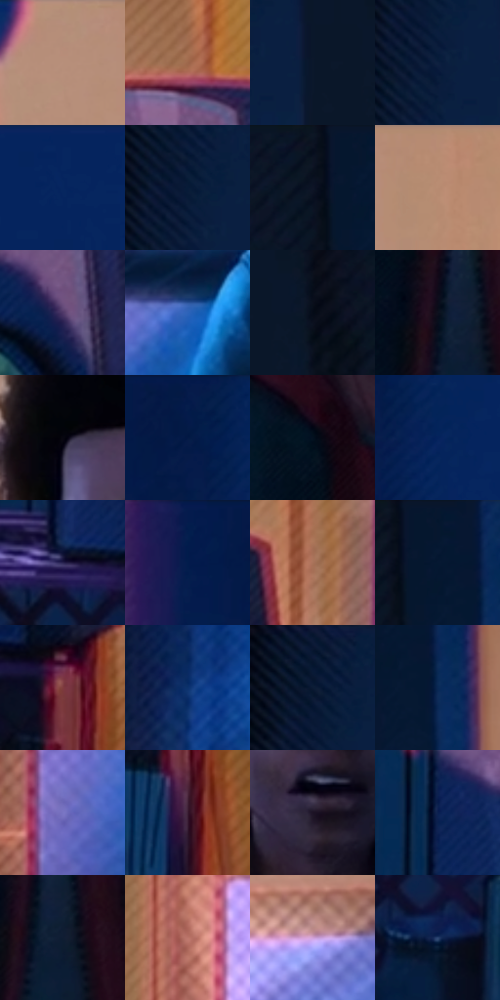

# 电影参考 165

- 状态：常规／活跃；来源世界：miles-home。
- 视角：near-level；景别：medium；场景：interior。
- 时段：interior-time-unknown（外观依据，中置信度；具体时间／晨昏未知）；光照：interior-mixed。
- 材质候选：skin, hair, fabric, wood, plastic, paint（帧级，不是像素分割）。
- 明暗组：very-dark；L* P5/P50/P95：3.12536 / 15.16466 / 62.27925。
- 资格门禁：无附加门禁。
- 原截图 SHA-256：`5e2d779ba31c0d33c73415398c24eb1c5c44ffe6eadd61d24e245b15d57db1b3`；尺寸：2880 × 1204。
- sRGB 像素 SHA-256：`52c09628da71c7b75747de1d81c213526a9dcb837644697ee54ea31043bce7d5`。

## 观察与迁移

暖门口与冷蓝房间对照，墙影随人物与光源方向。

本公开版保存32个128×128原像素色卡上下文；图集格子并非原场景相邻位置。原rect、图集tile和像素SHA见 `data/palette-crops.json`。上下文不足时不得批准替色，不能以小样推断完整构图。

## 实测色卡

颜色比例分母为保留采样像素，不是材料面积；全部 32 色参与全库匹配。表内四舍五入仅用于阅读，原精度在 JSON。

| ID | HEX | Lab | 原图 xy | 像素数 | 比例 | 明度角色 |
| --- | --- | --- | --- | ---: | ---: | --- |
| 165-S01 | #B68E7A | [62.251745, 12.265747, 16.462315] | [1632, 36] | 11990 | 6.223786% | light |
| 165-S02 | #9D674C | [48.750238, 18.598074, 24.080464] | [1988, 328] | 10811 | 5.611789% | midtone |
| 165-S03 | #0B182B | [8.117758, 1.84416, -14.578588] | [164, 156] | 10149 | 5.268157% | deep-shadow |
| 165-S04 | #0D203F | [12.462933, 4.903725, -22.080581] | [84, 152] | 10148 | 5.267638% | deep-shadow |
| 165-S05 | #06265F | [16.751684, 13.853047, -36.984989] | [2800, 28] | 9415 | 4.887152% | deep-shadow |
| 165-S06 | #071B37 | [9.835056, 4.05165, -20.614539] | [76, 100] | 8848 | 4.592833% | deep-shadow |
| 165-S07 | #0E1424 | [6.51271, 2.633303, -11.832531] | [432, 40] | 8173 | 4.242453% | deep-shadow |
| 165-S08 | #B88B72 | [61.543916, 13.731259, 20.019347] | [1752, 28] | 7970 | 4.137079% | light |
| 165-S09 | #4F3768 | [27.829253, 21.544584, -24.799096] | [2028, 552] | 7490 | 3.887920% | shadow |
| 165-S10 | #2C64BA | [43.052819, 12.349904, -50.637952] | [1024, 612] | 7387 | 3.834455% | midtone |
| 165-S11 | #040B18 | [2.990538, 0.813874, -7.862574] | [256, 152] | 6908 | 3.585815% | deep-shadow |
| 165-S12 | #0D101E | [4.966775, 2.576904, -9.599537] | [1340, 968] | 6656 | 3.455006% | deep-shadow |
| 165-S13 | #07060F | [1.896037, 1.615425, -3.592809] | [1264, 188] | 6299 | 3.269694% | deep-shadow |
| 165-S14 | #041A47 | [10.699029, 11.884117, -30.548827] | [2504, 52] | 6055 | 3.143038% | deep-shadow |
| 165-S15 | #03101F | [4.415412, 0.223358, -11.267911] | [1284, 576] | 5768 | 2.994062% | deep-shadow |
| 165-S16 | #04235C | [15.488251, 14.580987, -37.051462] | [2580, 136] | 5597 | 2.905299% | deep-shadow |
| 165-S17 | #2A2552 | [17.573207, 15.703609, -26.858315] | [1800, 872] | 5439 | 2.823284% | deep-shadow |
| 165-S18 | #051E4E | [12.675242, 12.131694, -32.167219] | [2392, 36] | 5382 | 2.793696% | deep-shadow |
| 165-S19 | #A9735A | [53.423926, 18.270999, 22.426448] | [2180, 384] | 5282 | 2.741788% | midtone |
| 165-S20 | #051731 | [7.828738, 3.968172, -19.480025] | [484, 44] | 5206 | 2.702338% | deep-shadow |
| 165-S21 | #7F3D3E | [34.39288, 28.583648, 12.756101] | [2112, 920] | 5082 | 2.637972% | shadow |
| 165-S22 | #0C326D | [21.809888, 11.684655, -37.917353] | [2572, 1096] | 4340 | 2.252813% | shadow |
| 165-S23 | #021329 | [5.768926, 2.086797, -16.82341] | [52, 28] | 4336 | 2.250737% | deep-shadow |
| 165-S24 | #092955 | [16.986368, 7.39319, -29.929549] | [532, 116] | 4162 | 2.160417% | deep-shadow |
| 165-S25 | #7975C3 | [52.648981, 20.537394, -40.287101] | [796, 976] | 4044 | 2.099165% | midtone |
| 165-S26 | #391D32 | [15.376749, 17.361721, -7.982747] | [2128, 1056] | 3884 | 2.016112% | deep-shadow |
| 165-S27 | #1D1326 | [7.830613, 10.012635, -11.177768] | [1352, 428] | 3331 | 1.729060% | deep-shadow |
| 165-S28 | #0A2151 | [14.093672, 11.771179, -31.9019] | [1800, 472] | 3247 | 1.685457% | deep-shadow |
| 165-S29 | #0F1D33 | [10.698161, 2.426331, -16.333856] | [1372, 996] | 2940 | 1.526099% | deep-shadow |
| 165-S30 | #BC766B | [56.793884, 26.182686, 17.596204] | [732, 660] | 2351 | 1.220360% | midtone |
| 165-S31 | #CFA1D6 | [71.967785, 26.095971, -20.410912] | [1008, 460] | 2327 | 1.207902% | light |
| 165-S32 | #2E4674 | [29.964605, 6.009332, -29.238023] | [1812, 1120] | 1631 | 0.846622% | shadow |

## 色阶与空间分布

- 采样 ROI：`[0.01, 0.02, 0.98, 0.94]`；步长：4；样本数：192648。
- 排除区：`[]`。
- 深暗、暗、中、亮、高光五段计数：`[122071, 19464, 28785, 22100, 228]`。
- RGB 各 256 箱、L* 100 箱、13×5 色相明度表和 3×3 空间统计全部保存在 [总数据](../film-library.json)。
- [可视化档案](../../references/library.html)按需绘制直方图，不存 2,094 张重复图表图片。

## 纹理特征占比

**这是分块图像特征的面积占比，不是波点／排线／丝网／错版的精确语义覆盖率。** 窗格、发丝、织物也会产生方向或周期特征。
原图 ROI 像素 3092958；已测块覆盖 3092958（100.0000%）；未测 0。

| 特征 | 块覆盖像素 | 占已测面积 | 阈值敏感范围 |
| --- | ---: | ---: | --- |
| low-contrast | 749312 | 24.2264% | 16.9965% ~ 27.9344% |
| directional-structure | 649856 | 21.0108% | 12.7505% ~ 35.6567% |
| periodic-structure | 1628254 | 52.6439% | 46.8170% ~ 55.2635% |
| mixed-detail | 65536 | 2.1189% | 0.5297% ~ 4.0515% |

阈值敏感范围不是统计置信区间。逐块坐标、尺度、对比、方向一致性、频谱集中度、频率与角度见 [全量特征记录](../texture-features.jsonl)，以帧号定位。
四种印刷层的真实像素覆盖仍标为 `null`，不能填 0，也不能拿上表代替。不得据这些代理测量删除唯一证据。

[测量方法与保留策略](../../references/library-retention.md) · [分类索引](../archive/README.md)
