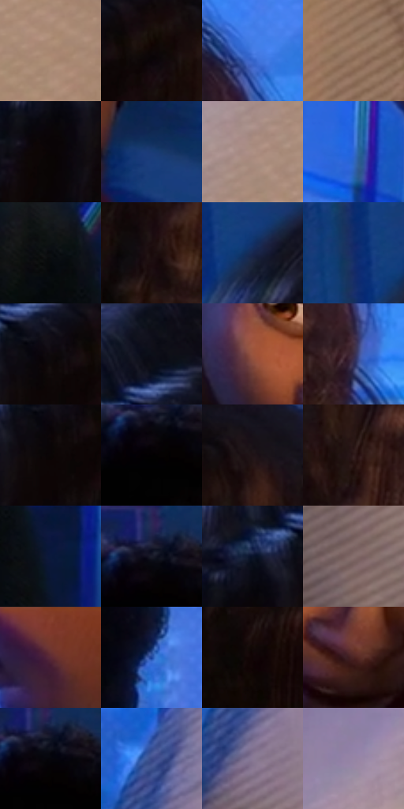

# 电影参考 166

- 状态：常规／活跃；来源世界：miles-home。
- 视角：high-angle；景别：medium；场景：interior。
- 时段：interior-time-unknown（外观依据，中置信度；具体时间／晨昏未知）；光照：interior-mixed。
- 材质候选：skin, hair, fabric, wood, plastic, paint（帧级，不是像素分割）。
- 明暗组：very-dark；L* P5/P50/P95：1.36845 / 17.36482 / 60.29008。
- 资格门禁：无附加门禁。
- 原截图 SHA-256：`40b6801459dfc68219769391a18fa0ebef1b40afb5fb16227abf278b73dba439`；尺寸：2880 × 1206。
- sRGB 像素 SHA-256：`fc6e08f9978ee1d64dfb2c271b3c8e8e0f30146906318c102b2cc2d37df4c253`。

## 观察与迁移

暖门口与冷蓝房间对照，墙影随人物与光源方向。

本公开版保存32个128×128原像素色卡上下文；图集格子并非原场景相邻位置。原rect、图集tile和像素SHA见 `data/palette-crops.json`。上下文不足时不得批准替色，不能以小样推断完整构图。

## 实测色卡

颜色比例分母为保留采样像素，不是材料面积；全部 32 色参与全库匹配。表内四舍五入仅用于阅读，原精度在 JSON。

| ID | HEX | Lab | 原图 xy | 像素数 | 比例 | 明度角色 |
| --- | --- | --- | --- | ---: | ---: | --- |
| 166-S01 | #A88771 | [58.831818, 9.321335, 16.60295] | [2808, 464] | 9739 | 5.037084% | midtone |
| 166-S02 | #0E0705 | [2.315093, 1.674679, 1.445173] | [696, 216] | 8922 | 4.614525% | deep-shadow |
| 166-S03 | #467CE4 | [53.293675, 16.164599, -58.127153] | [1052, 200] | 8865 | 4.585044% | midtone |
| 166-S04 | #9C7B65 | [54.211757, 9.583442, 16.919729] | [2808, 1096] | 8647 | 4.472293% | midtone |
| 166-S05 | #090405 | [1.408025, 1.446471, 0.082401] | [492, 292] | 8495 | 4.393678% | deep-shadow |
| 166-S06 | #1A3B76 | [25.728004, 10.66028, -37.322791] | [1716, 692] | 8223 | 4.252997% | shadow |
| 166-S07 | #AE9084 | [62.178981, 9.37826, 10.603289] | [2596, 392] | 8203 | 4.242653% | light |
| 166-S08 | #2F68D4 | [45.982905, 19.969866, -60.898417] | [2128, 252] | 7940 | 4.106627% | midtone |
| 166-S09 | #080B0E | [2.914603, -0.312692, -1.581142] | [1800, 952] | 7476 | 3.866643% | deep-shadow |
| 166-S10 | #190A0B | [4.046424, 5.902597, 1.641841] | [888, 480] | 7331 | 3.791648% | deep-shadow |
| 166-S11 | #17274F | [16.491078, 8.442431, -26.644418] | [172, 252] | 7055 | 3.648899% | deep-shadow |
| 166-S12 | #132D6B | [20.346685, 15.192414, -38.985742] | [100, 220] | 7003 | 3.622004% | shadow |
| 166-S13 | #0F0A0D | [3.140821, 1.953608, -0.704563] | [608, 212] | 6850 | 3.542871% | deep-shadow |
| 166-S14 | #0B0F18 | [4.324233, 0.763333, -5.865937] | [572, 108] | 6130 | 3.170482% | deep-shadow |
| 166-S15 | #99533E | [43.224277, 26.991455, 25.066506] | [1380, 756] | 6126 | 3.168413% | midtone |
| 166-S16 | #3B2C46 | [20.725328, 12.813169, -13.643056] | [1060, 356] | 6108 | 3.159103% | shadow |
| 166-S17 | #0A0605 | [1.858489, 0.906849, 0.747176] | [596, 252] | 5937 | 3.070661% | deep-shadow |
| 166-S18 | #020102 | [0.352269, 0.400526, -0.286252] | [1504, 280] | 5598 | 2.895328% | deep-shadow |
| 166-S19 | #1F1316 | [7.362054, 6.731266, 0.299326] | [804, 172] | 5370 | 2.777404% | deep-shadow |
| 166-S20 | #311D1D | [13.354698, 9.828308, 4.056419] | [928, 364] | 5328 | 2.755682% | deep-shadow |
| 166-S21 | #0A193B | [9.604446, 8.030138, -23.843924] | [1896, 1056] | 5231 | 2.705512% | deep-shadow |
| 166-S22 | #191C2A | [10.589046, 2.905284, -9.898695] | [1512, 236] | 5202 | 2.690513% | deep-shadow |
| 166-S23 | #0A142A | [6.611471, 3.989656, -16.215711] | [496, 204] | 5069 | 2.621725% | deep-shadow |
| 166-S24 | #856E6E | [48.591908, 9.053047, 3.400194] | [2140, 928] | 4836 | 2.501215% | midtone |
| 166-S25 | #713630 | [30.311326, 25.400702, 15.849177] | [2172, 52] | 4759 | 2.461390% | shadow |
| 166-S26 | #19429B | [30.564943, 20.786408, -52.430133] | [1792, 424] | 4374 | 2.262266% | shadow |
| 166-S27 | #100405 | [1.878636, 3.557038, 0.826053] | [732, 600] | 4345 | 2.247267% | deep-shadow |
| 166-S28 | #4B2322 | [19.282186, 18.765418, 9.356074] | [1496, 844] | 3198 | 1.654030% | deep-shadow |
| 166-S29 | #05050A | [1.469802, 0.695132, -1.891953] | [1524, 252] | 2978 | 1.540244% | deep-shadow |
| 166-S30 | #3B4A88 | [33.14463, 13.458439, -36.574682] | [2112, 604] | 2868 | 1.483351% | shadow |
| 166-S31 | #8A7A96 | [53.518737, 11.676764, -12.82303] | [2124, 720] | 2631 | 1.360773% | midtone |
| 166-S32 | #9685A4 | [57.979579, 12.480362, -14.072602] | [2364, 464] | 2509 | 1.297674% | midtone |

## 色阶与空间分布

- 采样 ROI：`[0.01, 0.02, 0.98, 0.94]`；步长：4；样本数：193346。
- 排除区：`[]`。
- 深暗、暗、中、亮、高光五段计数：`[103849, 31487, 47321, 10686, 3]`。
- RGB 各 256 箱、L* 100 箱、13×5 色相明度表和 3×3 空间统计全部保存在 [总数据](../film-library.json)。
- [可视化档案](../../references/library.html)按需绘制直方图，不存 2,094 张重复图表图片。

## 纹理特征占比

**这是分块图像特征的面积占比，不是波点／排线／丝网／错版的精确语义覆盖率。** 窗格、发丝、织物也会产生方向或周期特征。
原图 ROI 像素 3098546；已测块覆盖 3098546（100.0000%）；未测 0。

| 特征 | 块覆盖像素 | 占已测面积 | 阈值敏感范围 |
| --- | ---: | ---: | --- |
| low-contrast | 510336 | 16.4702% | 12.3351% ~ 22.7245% |
| directional-structure | 491392 | 15.8588% | 6.5187% ~ 28.6276% |
| periodic-structure | 2080434 | 67.1423% | 59.0373% ~ 67.1423% |
| mixed-detail | 16384 | 0.5288% | 0.0000% ~ 5.4611% |

阈值敏感范围不是统计置信区间。逐块坐标、尺度、对比、方向一致性、频谱集中度、频率与角度见 [全量特征记录](../texture-features.jsonl)，以帧号定位。
四种印刷层的真实像素覆盖仍标为 `null`，不能填 0，也不能拿上表代替。不得据这些代理测量删除唯一证据。

[测量方法与保留策略](../../references/library-retention.md) · [分类索引](../archive/README.md)
