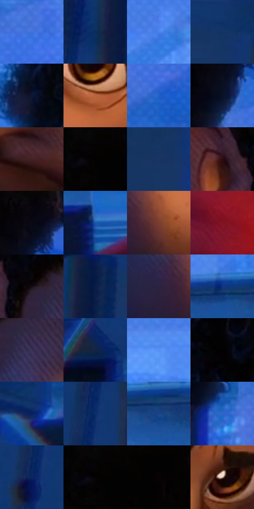

# 电影参考 167

- 状态：常规／活跃；来源世界：miles-home。
- 视角：high-angle；景别：close-up；场景：interior。
- 时段：interior-time-unknown（外观依据，中置信度；具体时间／晨昏未知）；光照：interior-mixed。
- 材质候选：skin, hair, fabric, wood, plastic, paint（帧级，不是像素分割）。
- 明暗组：dark；L* P5/P50/P95：0.82252 / 21.1364 / 56.3633。
- 资格门禁：无附加门禁。
- 原截图 SHA-256：`38a26a590b2a506df92bad93df76d56a6e38cda468eb5b6234c73c97a5a5e057`；尺寸：2880 × 1204。
- sRGB 像素 SHA-256：`c3f8c2869aac3c5d5116983cc165c355f78aa782451f3b13635ee92ff16fd297`。

## 观察与迁移

暖门口与冷蓝房间对照，墙影随人物与光源方向。

本公开版保存32个128×128原像素色卡上下文；图集格子并非原场景相邻位置。原rect、图集tile和像素SHA见 `data/palette-crops.json`。上下文不足时不得批准替色，不能以小样推断完整构图。

## 实测色卡

颜色比例分母为保留采样像素，不是材料面积；全部 32 色参与全库匹配。表内四舍五入仅用于阅读，原精度在 JSON。

| ID | HEX | Lab | 原图 xy | 像素数 | 比例 | 明度角色 |
| --- | --- | --- | --- | ---: | ---: | --- |
| 167-S01 | #3F72DB | [49.741821, 18.169722, -58.782609] | [2108, 304] | 10757 | 5.583759% | midtone |
| 167-S02 | #0B2E5A | [19.068251, 6.146775, -29.915185] | [2524, 272] | 10596 | 5.500187% | deep-shadow |
| 167-S03 | #4882EA | [55.360107, 14.894025, -58.161982] | [300, 88] | 10315 | 5.354325% | midtone |
| 167-S04 | #11356C | [22.818546, 9.586074, -35.63642] | [2724, 36] | 9022 | 4.683153% | shadow |
| 167-S05 | #0F1734 | [8.6723, 7.533818, -20.283269] | [792, 140] | 8564 | 4.445413% | deep-shadow |
| 167-S06 | #B8653E | [51.665195, 29.942402, 36.333497] | [1280, 780] | 8128 | 4.219094% | midtone |
| 167-S07 | #2261CA | [42.9907, 19.430383, -60.023667] | [1996, 548] | 7849 | 4.074270% | midtone |
| 167-S08 | #0A1227 | [5.813228, 3.926493, -15.212245] | [1796, 180] | 7605 | 3.947614% | deep-shadow |
| 167-S09 | #441F22 | [17.106602, 18.121503, 6.177883] | [1372, 972] | 7424 | 3.853661% | deep-shadow |
| 167-S10 | #050303 | [0.939138, 0.522946, 0.184376] | [1136, 28] | 7180 | 3.727005% | deep-shadow |
| 167-S11 | #1A3462 | [22.149224, 7.39326, -30.208585] | [2680, 552] | 6991 | 3.628898% | shadow |
| 167-S12 | #2B0C12 | [7.410117, 16.704721, 3.259934] | [896, 520] | 6787 | 3.523006% | deep-shadow |
| 167-S13 | #06050A | [1.52811, 0.956631, -1.799814] | [1832, 28] | 6643 | 3.448258% | deep-shadow |
| 167-S14 | #1D54AA | [36.934544, 14.974433, -51.105521] | [636, 632] | 6600 | 3.425937% | shadow |
| 167-S15 | #7B3F2F | [33.925177, 24.410914, 21.434695] | [1148, 900] | 6142 | 3.188198% | shadow |
| 167-S16 | #801422 | [27.315035, 44.865114, 21.729405] | [556, 948] | 6095 | 3.163801% | shadow |
| 167-S17 | #150E14 | [4.733487, 3.869909, -2.302692] | [1004, 568] | 6031 | 3.130580% | deep-shadow |
| 167-S18 | #0A1B47 | [11.297219, 11.907574, -29.563513] | [2592, 80] | 5695 | 2.956169% | deep-shadow |
| 167-S19 | #2A2440 | [16.125449, 10.440168, -16.83154] | [1056, 892] | 5654 | 2.934886% | deep-shadow |
| 167-S20 | #113580 | [24.395754, 18.08222, -45.808029] | [420, 468] | 5484 | 2.846643% | shadow |
| 167-S21 | #393256 | [23.07683, 12.542139, -20.711172] | [1064, 632] | 5402 | 2.804078% | shadow |
| 167-S22 | #122445 | [14.511718, 5.457144, -22.976899] | [1984, 1004] | 5329 | 2.766185% | deep-shadow |
| 167-S23 | #5992F4 | [60.96654, 11.385175, -54.705505] | [568, 108] | 5308 | 2.755284% | light |
| 167-S24 | #020203 | [0.568134, 0.139009, -0.378358] | [924, 28] | 5203 | 2.700781% | deep-shadow |
| 167-S25 | #07215F | [15.269034, 17.708446, -39.403215] | [2000, 828] | 5127 | 2.661331% | deep-shadow |
| 167-S26 | #0E2F6C | [20.860493, 13.621951, -38.807387] | [2476, 380] | 4916 | 2.551804% | shadow |
| 167-S27 | #1B4489 | [29.843488, 12.305751, -42.574128] | [512, 500] | 4459 | 2.314584% | shadow |
| 167-S28 | #3066CC | [44.925589, 18.352867, -58.025038] | [1768, 392] | 3073 | 1.595137% | midtone |
| 167-S29 | #0D2763 | [17.631339, 15.517927, -38.185168] | [2436, 580] | 1770 | 0.918774% | deep-shadow |
| 167-S30 | #030201 | [0.586869, 0.122421, 0.470628] | [1124, 56] | 1746 | 0.906316% | deep-shadow |
| 167-S31 | #090103 | [0.780217, 2.370065, -0.019706] | [1616, 160] | 735 | 0.381525% | deep-shadow |
| 167-S32 | #B8A195 | [67.910697, 6.452644, 9.34302] | [1532, 724] | 18 | 0.009343% | light |

## 色阶与空间分布

- 采样 ROI：`[0.01, 0.02, 0.98, 0.94]`；步长：4；样本数：192648。
- 排除区：`[]`。
- 深暗、暗、中、亮、高光五段计数：`[88058, 57464, 44017, 3085, 24]`。
- RGB 各 256 箱、L* 100 箱、13×5 色相明度表和 3×3 空间统计全部保存在 [总数据](../film-library.json)。
- [可视化档案](../../references/library.html)按需绘制直方图，不存 2,094 张重复图表图片。

## 纹理特征占比

**这是分块图像特征的面积占比，不是波点／排线／丝网／错版的精确语义覆盖率。** 窗格、发丝、织物也会产生方向或周期特征。
原图 ROI 像素 3092958；已测块覆盖 3092958（100.0000%）；未测 0。

| 特征 | 块覆盖像素 | 占已测面积 | 阈值敏感范围 |
| --- | ---: | ---: | --- |
| low-contrast | 283392 | 9.1625% | 7.2298% ~ 12.3118% |
| directional-structure | 687582 | 22.2306% | 11.1313% ~ 38.1884% |
| periodic-structure | 2029440 | 65.6149% | 54.5818% ~ 71.1024% |
| mixed-detail | 92544 | 2.9921% | 0.0000% ~ 5.4545% |

阈值敏感范围不是统计置信区间。逐块坐标、尺度、对比、方向一致性、频谱集中度、频率与角度见 [全量特征记录](../texture-features.jsonl)，以帧号定位。
四种印刷层的真实像素覆盖仍标为 `null`，不能填 0，也不能拿上表代替。不得据这些代理测量删除唯一证据。

[测量方法与保留策略](../../references/library-retention.md) · [分类索引](../archive/README.md)
