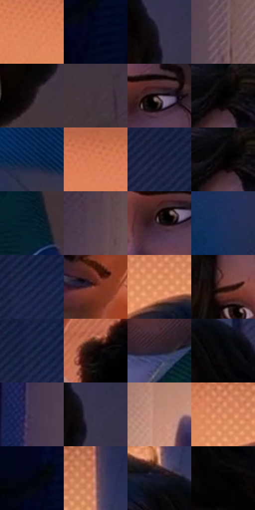

# 电影参考 168

- 状态：常规／活跃；来源世界：miles-home。
- 视角：near-level；景别：medium；场景：interior。
- 时段：interior-time-unknown（外观依据，中置信度；具体时间／晨昏未知）；光照：interior-mixed。
- 材质候选：skin, hair, fabric, wood, plastic, paint（帧级，不是像素分割）。
- 明暗组：very-dark；L* P5/P50/P95：0.27523 / 18.94857 / 67.03567。
- 资格门禁：无附加门禁。
- 原截图 SHA-256：`11087302192fa0808fe23cf0af758f754e57de9a838cb53d4cf94604e28475ec`；尺寸：2880 × 1204。
- sRGB 像素 SHA-256：`f40b336fc9e63f3150dba7f4559db5173f5410a2458e02c5d2944cf18711c4c7`。

## 观察与迁移

暖门口与冷蓝房间对照，墙影随人物与光源方向。

本公开版保存32个128×128原像素色卡上下文；图集格子并非原场景相邻位置。原rect、图集tile和像素SHA见 `data/palette-crops.json`。上下文不足时不得批准替色，不能以小样推断完整构图。

## 实测色卡

颜色比例分母为保留采样像素，不是材料面积；全部 32 色参与全库匹配。表内四舍五入仅用于阅读，原精度在 JSON。

| ID | HEX | Lab | 原图 xy | 像素数 | 比例 | 明度角色 |
| --- | --- | --- | --- | ---: | ---: | --- |
| 168-S01 | #E1865C | [64.831003, 30.944403, 37.308612] | [1692, 132] | 12210 | 6.337984% | light |
| 168-S02 | #040921 | [2.989374, 4.407878, -14.990999] | [100, 180] | 8826 | 4.581413% | deep-shadow |
| 168-S03 | #332F45 | [20.69853, 7.456508, -13.077466] | [2520, 496] | 8574 | 4.450604% | shadow |
| 168-S04 | #765F68 | [42.817206, 10.923732, -1.581729] | [456, 476] | 7833 | 4.065965% | midtone |
| 168-S05 | #120B10 | [3.661643, 3.168527, -1.467098] | [2468, 724] | 7743 | 4.019248% | deep-shadow |
| 168-S06 | #42313B | [22.551721, 9.672799, -3.325368] | [2552, 772] | 7725 | 4.009904% | shadow |
| 168-S07 | #5E4E5A | [35.136524, 9.036573, -4.527236] | [2192, 588] | 7525 | 3.906088% | shadow |
| 168-S08 | #000000 | [0.0, 0.0, 0.0] | [2068, 372] | 7383 | 3.832378% | deep-shadow |
| 168-S09 | #07264D | [15.312715, 5.770493, -27.213613] | [612, 724] | 7330 | 3.804867% | deep-shadow |
| 168-S10 | #CA6E4D | [56.334827, 33.399901, 34.322517] | [1416, 28] | 7305 | 3.791890% | midtone |
| 168-S11 | #202444 | [15.413795, 8.575707, -20.791042] | [2612, 52] | 7160 | 3.716623% | deep-shadow |
| 168-S12 | #020203 | [0.568134, 0.139009, -0.378358] | [2056, 376] | 7131 | 3.701570% | deep-shadow |
| 168-S13 | #061D2E | [9.911677, -1.857866, -13.976397] | [2636, 1068] | 7008 | 3.637723% | deep-shadow |
| 168-S14 | #55424D | [30.312213, 10.299241, -3.486804] | [448, 160] | 6273 | 3.256198% | shadow |
| 168-S15 | #231119 | [7.483561, 10.805092, -1.713916] | [2160, 616] | 6188 | 3.212076% | deep-shadow |
| 168-S16 | #1E305D | [20.750327, 8.999547, -29.156745] | [496, 820] | 6089 | 3.160687% | shadow |
| 168-S17 | #1F294F | [17.651775, 8.794326, -24.75917] | [2784, 108] | 5714 | 2.966031% | deep-shadow |
| 168-S18 | #813C2F | [34.201374, 28.621185, 21.983624] | [1100, 524] | 5661 | 2.938520% | shadow |
| 168-S19 | #F1A075 | [72.978086, 25.569549, 34.65576] | [2080, 176] | 5361 | 2.782796% | light |
| 168-S20 | #46221F | [18.122711, 16.778215, 9.732097] | [2008, 560] | 5325 | 2.764109% | deep-shadow |
| 168-S21 | #151E40 | [12.338415, 8.574462, -22.955771] | [2756, 28] | 5178 | 2.687804% | deep-shadow |
| 168-S22 | #0F0707 | [2.428725, 2.284899, 0.805351] | [1272, 492] | 5160 | 2.678460% | deep-shadow |
| 168-S23 | #28212D | [13.991462, 6.245283, -6.726049] | [2260, 972] | 4998 | 2.594369% | deep-shadow |
| 168-S24 | #050509 | [1.450015, 0.556088, -1.513529] | [2352, 336] | 4629 | 2.402828% | deep-shadow |
| 168-S25 | #473D50 | [27.452769, 8.584702, -9.885292] | [316, 460] | 4451 | 2.310431% | shadow |
| 168-S26 | #39344C | [23.160982, 8.244223, -13.936766] | [2544, 512] | 4410 | 2.289149% | shadow |
| 168-S27 | #BF8977 | [61.913688, 18.271575, 17.837483] | [836, 120] | 4088 | 2.122005% | light |
| 168-S28 | #E09168 | [67.35296, 25.645415, 34.006608] | [2044, 140] | 4027 | 2.090341% | light |
| 168-S29 | #030515 | [1.644175, 2.216955, -7.641444] | [48, 124] | 3493 | 1.813151% | deep-shadow |
| 168-S30 | #9B6962 | [49.441407, 19.109324, 12.069082] | [2280, 116] | 3291 | 1.708297% | midtone |
| 168-S31 | #131525 | [7.301384, 4.17587, -11.333154] | [2280, 268] | 3061 | 1.588908% | deep-shadow |
| 168-S32 | #050202 | [0.723273, 0.784463, 0.276482] | [2364, 444] | 1498 | 0.777584% | deep-shadow |

## 色阶与空间分布

- 采样 ROI：`[0.01, 0.02, 0.98, 0.94]`；步长：4；样本数：192648。
- 排除区：`[]`。
- 深暗、暗、中、亮、高光五段计数：`[101255, 47771, 17618, 25900, 104]`。
- RGB 各 256 箱、L* 100 箱、13×5 色相明度表和 3×3 空间统计全部保存在 [总数据](../film-library.json)。
- [可视化档案](../../references/library.html)按需绘制直方图，不存 2,094 张重复图表图片。

## 纹理特征占比

**这是分块图像特征的面积占比，不是波点／排线／丝网／错版的精确语义覆盖率。** 窗格、发丝、织物也会产生方向或周期特征。
原图 ROI 像素 3092958；已测块覆盖 3092958（100.0000%）；未测 0。

| 特征 | 块覆盖像素 | 占已测面积 | 阈值敏感范围 |
| --- | ---: | ---: | --- |
| low-contrast | 492894 | 15.9360% | 10.2953% ~ 19.5530% |
| directional-structure | 641024 | 20.7253% | 9.0052% ~ 39.3358% |
| periodic-structure | 1800960 | 58.2278% | 48.4362% ~ 63.4298% |
| mixed-detail | 158080 | 5.1110% | 1.9326% ~ 8.0120% |

阈值敏感范围不是统计置信区间。逐块坐标、尺度、对比、方向一致性、频谱集中度、频率与角度见 [全量特征记录](../texture-features.jsonl)，以帧号定位。
四种印刷层的真实像素覆盖仍标为 `null`，不能填 0，也不能拿上表代替。不得据这些代理测量删除唯一证据。

[测量方法与保留策略](../../references/library-retention.md) · [分类索引](../archive/README.md)
