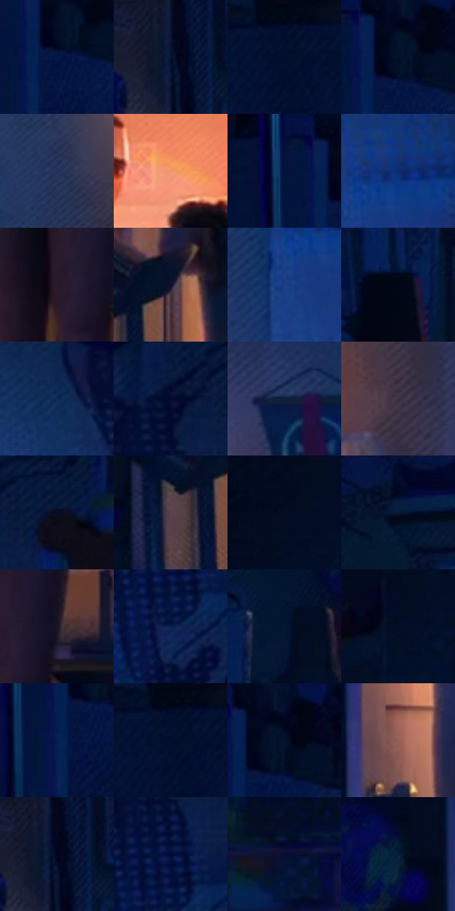

# 电影参考 169

- 状态：常规／活跃；来源世界：miles-home。
- 视角：near-level；景别：environment-wide；场景：interior。
- 时段：interior-time-unknown（外观依据，中置信度；具体时间／晨昏未知）；光照：interior-mixed。
- 材质候选：skin, hair, fabric, wood, plastic, paint（帧级，不是像素分割）。
- 明暗组：very-dark；L* P5/P50/P95：2.43987 / 7.79434 / 47.80879。
- 资格门禁：无附加门禁。
- 原截图 SHA-256：`4081e3a2692e1372f82b8804bad5bd17afdf0612d9da4717ca6363332bee366d`；尺寸：2880 × 1204。
- sRGB 像素 SHA-256：`84255ad2265f537eadcf3670221474f02b3e5c44f45b419774c700984770343f`。

## 观察与迁移

暖门口与冷蓝房间对照，墙影随人物与光源方向。

本公开版保存32个128×128原像素色卡上下文；图集格子并非原场景相邻位置。原rect、图集tile和像素SHA见 `data/palette-crops.json`。上下文不足时不得批准替色，不能以小样推断完整构图。

## 实测色卡

颜色比例分母为保留采样像素，不是材料面积；全部 32 色参与全库匹配。表内四舍五入仅用于阅读，原精度在 JSON。

| ID | HEX | Lab | 原图 xy | 像素数 | 比例 | 明度角色 |
| --- | --- | --- | --- | ---: | ---: | --- |
| 169-S01 | #041646 | [9.333405, 14.582595, -32.079747] | [284, 108] | 10953 | 5.685499% | deep-shadow |
| 169-S02 | #02122F | [5.877238, 5.562225, -21.133249] | [640, 60] | 10556 | 5.479424% | deep-shadow |
| 169-S03 | #020925 | [3.087342, 5.392789, -17.960943] | [72, 28] | 8227 | 4.270483% | deep-shadow |
| 169-S04 | #021229 | [5.469662, 2.698152, -17.293573] | [292, 76] | 8177 | 4.244529% | deep-shadow |
| 169-S05 | #243259 | [21.495415, 7.38796, -25.307268] | [1280, 472] | 7965 | 4.134484% | shadow |
| 169-S06 | #EF976C | [70.574184, 28.767874, 36.325908] | [1408, 168] | 7533 | 3.910240% | light |
| 169-S07 | #02123C | [6.969828, 12.582504, -28.856906] | [216, 60] | 7014 | 3.640837% | deep-shadow |
| 169-S08 | #0C2D6C | [20.191872, 14.903817, -39.896038] | [1980, 240] | 6890 | 3.576471% | shadow |
| 169-S09 | #291C2A | [12.410454, 9.508399, -6.947466] | [1616, 804] | 6734 | 3.495494% | deep-shadow |
| 169-S10 | #0C0F27 | [5.114781, 6.157424, -16.293992] | [1144, 716] | 6658 | 3.456044% | deep-shadow |
| 169-S11 | #1B3F82 | [27.842324, 12.913491, -41.457764] | [1928, 312] | 6584 | 3.417632% | shadow |
| 169-S12 | #020615 | [1.781945, 1.554895, -7.447265] | [704, 332] | 6458 | 3.352228% | deep-shadow |
| 169-S13 | #0B2754 | [16.315159, 8.672027, -30.335928] | [2000, 96] | 6417 | 3.330946% | deep-shadow |
| 169-S14 | #020A2D | [3.788054, 8.538333, -22.960335] | [2180, 80] | 5847 | 3.035069% | deep-shadow |
| 169-S15 | #121E3B | [11.775183, 5.77414, -20.337306] | [1748, 148] | 5752 | 2.985756% | deep-shadow |
| 169-S16 | #3C3041 | [21.785627, 9.208025, -8.616233] | [1792, 564] | 5698 | 2.957726% | shadow |
| 169-S17 | #0B0C1E | [3.86426, 3.978768, -11.274053] | [2288, 80] | 5668 | 2.942154% | deep-shadow |
| 169-S18 | #5C4249 | [31.003804, 12.468398, 0.212552] | [1064, 776] | 5536 | 2.873635% | shadow |
| 169-S19 | #020A1C | [2.834395, 1.83689, -11.290245] | [2744, 28] | 5373 | 2.789025% | deep-shadow |
| 169-S20 | #091936 | [9.153223, 5.55809, -20.98091] | [488, 276] | 5343 | 2.773452% | deep-shadow |
| 169-S21 | #191320 | [7.015874, 6.354623, -7.928549] | [1684, 780] | 5316 | 2.759437% | deep-shadow |
| 169-S22 | #0A1D4E | [12.563835, 13.502834, -32.339556] | [2180, 272] | 5207 | 2.702857% | deep-shadow |
| 169-S23 | #041633 | [7.574293, 5.492335, -21.354342] | [792, 168] | 4946 | 2.567377% | deep-shadow |
| 169-S24 | #040E22 | [4.112892, 2.578472, -14.050312] | [2652, 228] | 4900 | 2.543499% | deep-shadow |
| 169-S25 | #041F51 | [13.227518, 12.621674, -33.320279] | [252, 144] | 4900 | 2.543499% | deep-shadow |
| 169-S26 | #021234 | [6.262754, 8.265595, -24.200388] | [36, 40] | 4881 | 2.533636% | deep-shadow |
| 169-S27 | #020D26 | [3.980108, 4.090572, -17.344042] | [308, 56] | 4874 | 2.530003% | deep-shadow |
| 169-S28 | #976156 | [46.713658, 20.580363, 15.35905] | [1076, 472] | 4803 | 2.493148% | midtone |
| 169-S29 | #04071D | [2.406733, 3.870437, -12.712322] | [648, 32] | 3923 | 2.036356% | deep-shadow |
| 169-S30 | #030B39 | [5.004031, 15.06619, -29.879314] | [2188, 200] | 3805 | 1.975105% | deep-shadow |
| 169-S31 | #0A0E33 | [5.578041, 11.962394, -24.541746] | [2740, 620] | 3360 | 1.744114% | deep-shadow |
| 169-S32 | #031A34 | [9.040828, 2.586073, -19.731684] | [960, 68] | 2350 | 1.219841% | deep-shadow |

## 色阶与空间分布

- 采样 ROI：`[0.01, 0.02, 0.98, 0.94]`；步长：4；样本数：192648。
- 排除区：`[]`。
- 深暗、暗、中、亮、高光五段计数：`[154392, 26410, 5370, 5289, 1187]`。
- RGB 各 256 箱、L* 100 箱、13×5 色相明度表和 3×3 空间统计全部保存在 [总数据](../film-library.json)。
- [可视化档案](../../references/library.html)按需绘制直方图，不存 2,094 张重复图表图片。

## 纹理特征占比

**这是分块图像特征的面积占比，不是波点／排线／丝网／错版的精确语义覆盖率。** 窗格、发丝、织物也会产生方向或周期特征。
原图 ROI 像素 3092958；已测块覆盖 3092958（100.0000%）；未测 0。

| 特征 | 块覆盖像素 | 占已测面积 | 阈值敏感范围 |
| --- | ---: | ---: | --- |
| low-contrast | 299230 | 9.6746% | 4.8089% ~ 12.8280% |
| directional-structure | 441472 | 14.2735% | 8.1031% ~ 26.8957% |
| periodic-structure | 2303104 | 74.4628% | 67.7657% ~ 74.4628% |
| mixed-detail | 49152 | 1.5892% | 0.5297% ~ 6.8864% |

阈值敏感范围不是统计置信区间。逐块坐标、尺度、对比、方向一致性、频谱集中度、频率与角度见 [全量特征记录](../texture-features.jsonl)，以帧号定位。
四种印刷层的真实像素覆盖仍标为 `null`，不能填 0，也不能拿上表代替。不得据这些代理测量删除唯一证据。

[测量方法与保留策略](../../references/library-retention.md) · [分类索引](../archive/README.md)
