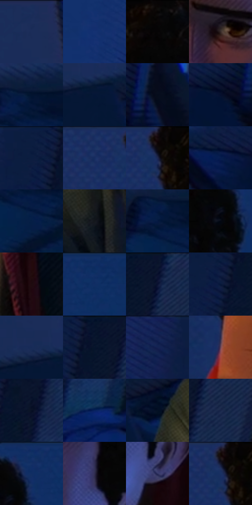

# 电影参考 170

- 状态：常规／活跃；来源世界：miles-home。
- 视角：high-angle；景别：medium；场景：interior。
- 时段：interior-time-unknown（外观依据，中置信度；具体时间／晨昏未知）；光照：interior-mixed。
- 材质候选：skin, hair, fabric, wood, plastic, paint（帧级，不是像素分割）。
- 明暗组：very-dark；L* P5/P50/P95：1.70923 / 10.65958 / 21.98149。
- 资格门禁：无附加门禁。
- 原截图 SHA-256：`321b56f0774c4adc1615a7d597b211ee01a4e845c3afb96b9808db5fa87d419d`；尺寸：2880 × 1208。
- sRGB 像素 SHA-256：`3444014405fb3f3d9bd9b05e527cb3867303728f8f61c77146999ed0ab728f7d`。

## 观察与迁移

暖门口与冷蓝房间对照，墙影随人物与光源方向。

本公开版保存32个128×128原像素色卡上下文；图集格子并非原场景相邻位置。原rect、图集tile和像素SHA见 `data/palette-crops.json`。上下文不足时不得批准替色，不能以小样推断完整构图。

## 实测色卡

颜色比例分母为保留采样像素，不是材料面积；全部 32 色参与全库匹配。表内四舍五入仅用于阅读，原精度在 JSON。

| ID | HEX | Lab | 原图 xy | 像素数 | 比例 | 明度角色 |
| --- | --- | --- | --- | ---: | ---: | --- |
| 170-S01 | #1B2D5A | [19.42302, 9.353013, -29.309064] | [308, 28] | 19122 | 9.890042% | deep-shadow |
| 170-S02 | #143172 | [22.158745, 15.363302, -40.554172] | [2188, 268] | 11785 | 6.095290% | shadow |
| 170-S03 | #060506 | [1.448963, 0.400456, -0.28612] | [1540, 52] | 10237 | 5.294653% | deep-shadow |
| 170-S04 | #362A27 | [18.306648, 4.979213, 4.062561] | [1388, 448] | 9864 | 5.101735% | deep-shadow |
| 170-S05 | #021430 | [6.562441, 4.83105, -20.779723] | [380, 540] | 9823 | 5.080529% | deep-shadow |
| 170-S06 | #041636 | [7.821016, 6.977202, -23.140463] | [892, 480] | 8899 | 4.602629% | deep-shadow |
| 170-S07 | #040C1B | [3.322738, 1.21491, -9.757747] | [2304, 468] | 8169 | 4.225068% | deep-shadow |
| 170-S08 | #03102D | [5.232834, 5.967459, -20.665383] | [2208, 508] | 7953 | 4.113351% | deep-shadow |
| 170-S09 | #0D1D40 | [11.513158, 7.665684, -24.307234] | [2628, 28] | 7703 | 3.984049% | deep-shadow |
| 170-S10 | #1B3162 | [21.248902, 9.720632, -31.649069] | [1108, 32] | 7307 | 3.779235% | shadow |
| 170-S11 | #0D0A0C | [2.973614, 1.146017, -0.498779] | [1184, 44] | 6845 | 3.540285% | deep-shadow |
| 170-S12 | #061D4D | [12.30611, 12.571745, -32.079842] | [2092, 496] | 6797 | 3.515459% | deep-shadow |
| 170-S13 | #051E46 | [11.976123, 8.401975, -27.777263] | [392, 644] | 6583 | 3.404777% | deep-shadow |
| 170-S14 | #13161B | [7.148453, 0.043048, -3.965731] | [1184, 644] | 6370 | 3.294612% | deep-shadow |
| 170-S15 | #051942 | [9.958812, 10.473546, -28.248024] | [352, 576] | 5550 | 2.870502% | deep-shadow |
| 170-S16 | #030812 | [2.137871, 0.350946, -4.974448] | [1696, 136] | 5417 | 2.801713% | deep-shadow |
| 170-S17 | #1F0C0F | [5.318651, 9.141287, 1.671773] | [1548, 832] | 5194 | 2.686376% | deep-shadow |
| 170-S18 | #102C63 | [19.274367, 12.143181, -35.51262] | [1824, 60] | 5121 | 2.648620% | deep-shadow |
| 170-S19 | #0C162D | [7.599898, 4.524019, -16.875566] | [2764, 28] | 4985 | 2.578279% | deep-shadow |
| 170-S20 | #07183A | [9.022847, 7.841628, -24.074831] | [2652, 112] | 4975 | 2.573107% | deep-shadow |
| 170-S21 | #172B57 | [18.354822, 8.81593, -29.038038] | [824, 444] | 4814 | 2.489837% | deep-shadow |
| 170-S22 | #06132B | [6.13148, 4.041537, -17.736367] | [2708, 40] | 4639 | 2.399326% | deep-shadow |
| 170-S23 | #132253 | [14.990068, 13.1356, -31.786224] | [2524, 48] | 4203 | 2.173823% | deep-shadow |
| 170-S24 | #6D4556 | [34.354772, 19.893615, -2.956365] | [1220, 296] | 3941 | 2.038315% | shadow |
| 170-S25 | #070F24 | [4.644138, 3.608082, -14.758176] | [2684, 348] | 3856 | 1.994352% | deep-shadow |
| 170-S26 | #07215E | [15.172614, 17.26788, -38.895671] | [2704, 632] | 3685 | 1.905910% | deep-shadow |
| 170-S27 | #031024 | [4.672251, 2.028188, -14.733602] | [1012, 512] | 3314 | 1.714026% | deep-shadow |
| 170-S28 | #172548 | [15.344695, 7.044498, -23.699039] | [2800, 136] | 2068 | 1.069585% | deep-shadow |
| 170-S29 | #102D66 | [19.825352, 12.704055, -36.583633] | [1740, 52] | 1717 | 0.888045% | deep-shadow |
| 170-S30 | #302C4D | [19.904968, 10.92658, -19.747402] | [1532, 336] | 1140 | 0.589617% | deep-shadow |
| 170-S31 | #303260 | [22.840327, 13.064195, -27.715342] | [1580, 464] | 1058 | 0.547206% | shadow |
| 170-S32 | #1E2C56 | [19.009139, 9.109126, -27.299502] | [1176, 52] | 212 | 0.109648% | deep-shadow |

## 色阶与空间分布

- 采样 ROI：`[0.01, 0.02, 0.98, 0.94]`；步长：4；样本数：193346。
- 排除区：`[]`。
- 深暗、暗、中、亮、高光五段计数：`[165501, 27157, 670, 18, 0]`。
- RGB 各 256 箱、L* 100 箱、13×5 色相明度表和 3×3 空间统计全部保存在 [总数据](../film-library.json)。
- [可视化档案](../../references/library.html)按需绘制直方图，不存 2,094 张重复图表图片。

## 纹理特征占比

**这是分块图像特征的面积占比，不是波点／排线／丝网／错版的精确语义覆盖率。** 窗格、发丝、织物也会产生方向或周期特征。
原图 ROI 像素 3104134；已测块覆盖 3104134（100.0000%）；未测 0。

| 特征 | 块覆盖像素 | 占已测面积 | 阈值敏感范围 |
| --- | ---: | ---: | --- |
| low-contrast | 971910 | 31.3102% | 23.6237% ~ 34.7451% |
| directional-structure | 338816 | 10.9150% | 2.6391% ~ 30.2832% |
| periodic-structure | 1749504 | 56.3605% | 46.0930% ~ 59.7871% |
| mixed-detail | 43904 | 1.4144% | 0.0000% ~ 2.8287% |

阈值敏感范围不是统计置信区间。逐块坐标、尺度、对比、方向一致性、频谱集中度、频率与角度见 [全量特征记录](../texture-features.jsonl)，以帧号定位。
四种印刷层的真实像素覆盖仍标为 `null`，不能填 0，也不能拿上表代替。不得据这些代理测量删除唯一证据。

[测量方法与保留策略](../../references/library-retention.md) · [分类索引](../archive/README.md)
