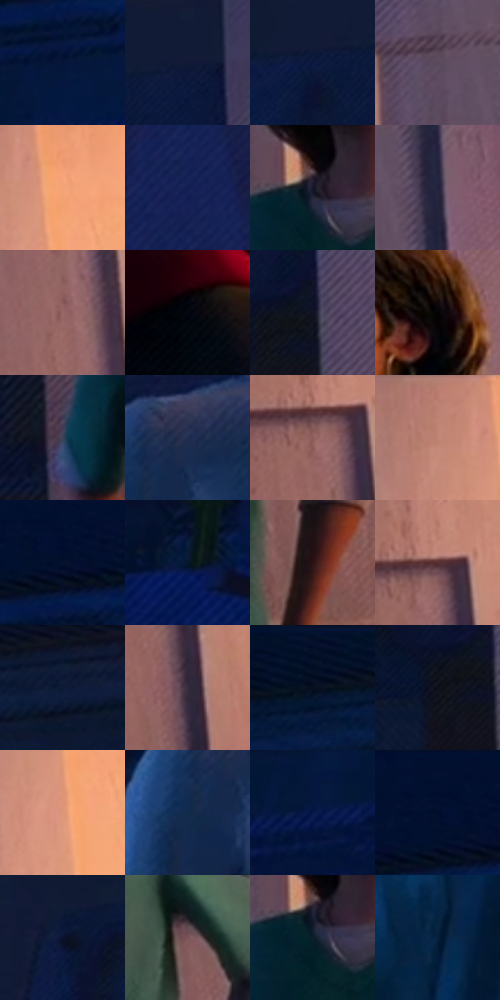

# 电影参考 171

- 状态：常规／活跃；来源世界：miles-home。
- 视角：low-angle；景别：medium；场景：interior。
- 时段：interior-time-unknown（外观依据，中置信度；具体时间／晨昏未知）；光照：interior-mixed。
- 材质候选：skin, hair, fabric, wood, plastic, paint（帧级，不是像素分割）。
- 明暗组：very-dark；L* P5/P50/P95：2.08133 / 10.61065 / 69.267。
- 资格门禁：无附加门禁。
- 原截图 SHA-256：`d5c3e41146f3b7664530ec5c52260b2df62ba7c016c7db922a72debf8a6692cf`；尺寸：2880 × 1210。
- sRGB 像素 SHA-256：`6e1a94311a60ebcc124ed4bc77e79daf1e23a733983c573612add3c4598cc616`。

## 观察与迁移

暖门口与冷蓝房间对照，墙影随人物与光源方向。

本公开版保存32个128×128原像素色卡上下文；图集格子并非原场景相邻位置。原rect、图集tile和像素SHA见 `data/palette-crops.json`。上下文不足时不得批准替色，不能以小样推断完整构图。

## 实测色卡

颜色比例分母为保留采样像素，不是材料面积；全部 32 色参与全库匹配。表内四舍五入仅用于阅读，原精度在 JSON。

| ID | HEX | Lab | 原图 xy | 像素数 | 比例 | 明度角色 |
| --- | --- | --- | --- | ---: | ---: | --- |
| 171-S01 | #051539 | [7.803154, 9.423831, -25.336103] | [96, 188] | 11282 | 5.814145% | deep-shadow |
| 171-S02 | #101936 | [9.574575, 7.054408, -20.282444] | [1720, 80] | 10653 | 5.489992% | deep-shadow |
| 171-S03 | #0B183E | [9.577819, 10.351918, -26.022057] | [1616, 108] | 7857 | 4.049082% | deep-shadow |
| 171-S04 | #58495B | [33.125266, 10.036284, -8.233682] | [1956, 104] | 7832 | 4.036198% | shadow |
| 171-S05 | #F4A375 | [74.007899, 25.174459, 36.043802] | [2524, 88] | 7792 | 4.015584% | light |
| 171-S06 | #121E52 | [13.627097, 15.566117, -33.323555] | [2668, 1024] | 7585 | 3.908907% | deep-shadow |
| 171-S07 | #161728 | [8.451053, 4.899395, -11.765477] | [1928, 588] | 7452 | 3.840366% | deep-shadow |
| 171-S08 | #22223C | [14.45842, 7.825932, -16.711986] | [2060, 152] | 7083 | 3.650203% | deep-shadow |
| 171-S09 | #976867 | [48.835023, 18.731257, 8.178287] | [2336, 440] | 6992 | 3.603306% | midtone |
| 171-S10 | #03070F | [1.85888, 0.168867, -3.675045] | [1392, 740] | 6477 | 3.337903% | deep-shadow |
| 171-S11 | #0F1324 | [6.274545, 3.603265, -12.19523] | [1760, 348] | 6251 | 3.221434% | deep-shadow |
| 171-S12 | #060204 | [0.821156, 1.32405, -0.388227] | [2072, 404] | 6205 | 3.197728% | deep-shadow |
| 171-S13 | #3B4458 | [28.820496, 1.732989, -13.098479] | [1796, 784] | 6157 | 3.172992% | shadow |
| 171-S14 | #212C50 | [18.815644, 7.511778, -23.573336] | [888, 412] | 6096 | 3.141556% | deep-shadow |
| 171-S15 | #8D5D5B | [44.586345, 19.386593, 9.211763] | [2368, 764] | 6079 | 3.132795% | midtone |
| 171-S16 | #BF8474 | [60.642006, 20.678916, 17.786977] | [2440, 48] | 5997 | 3.090536% | light |
| 171-S17 | #06122E | [6.038429, 6.101961, -20.12024] | [112, 88] | 5909 | 3.045186% | deep-shadow |
| 171-S18 | #04182B | [7.70865, 0.058362, -15.251914] | [148, 640] | 5814 | 2.996228% | deep-shadow |
| 171-S19 | #2A1215 | [8.816218, 12.808809, 3.33653] | [2204, 936] | 5758 | 2.967368% | deep-shadow |
| 171-S20 | #553031 | [24.536399, 16.987977, 6.625071] | [2392, 736] | 5697 | 2.935932% | shadow |
| 171-S21 | #0A1734 | [8.351548, 6.434384, -20.815386] | [928, 52] | 5240 | 2.700418% | deep-shadow |
| 171-S22 | #352E3E | [20.277343, 6.985486, -8.938242] | [2424, 916] | 5146 | 2.651976% | shadow |
| 171-S23 | #051025 | [4.844818, 2.944353, -15.222152] | [512, 48] | 4915 | 2.532931% | deep-shadow |
| 171-S24 | #0D0E18 | [4.205475, 1.856365, -6.023723] | [1708, 376] | 4875 | 2.512317% | deep-shadow |
| 171-S25 | #DD967A | [68.455631, 23.457828, 25.600277] | [2504, 160] | 4677 | 2.410278% | light |
| 171-S26 | #102A4D | [16.996619, 4.065081, -24.498797] | [836, 476] | 4586 | 2.363382% | deep-shadow |
| 171-S27 | #051749 | [9.998819, 15.302487, -33.082585] | [292, 232] | 4558 | 2.348952% | deep-shadow |
| 171-S28 | #031030 | [5.448978, 7.486321, -22.554506] | [80, 28] | 4408 | 2.271650% | deep-shadow |
| 171-S29 | #0A122F | [6.343708, 7.651842, -20.362168] | [1384, 148] | 4302 | 2.217023% | deep-shadow |
| 171-S30 | #7A5358 | [39.629947, 17.041611, 3.676818] | [2160, 768] | 4263 | 2.196924% | shadow |
| 171-S31 | #0A202A | [11.025714, -4.800641, -9.309477] | [1924, 612] | 4178 | 2.153120% | deep-shadow |
| 171-S32 | #06203D | [12.013945, 2.786396, -21.406801] | [1060, 1052] | 1928 | 0.993589% | deep-shadow |

## 色阶与空间分布

- 采样 ROI：`[0.01, 0.02, 0.98, 0.94]`；步长：4；样本数：194044。
- 排除区：`[]`。
- 深暗、暗、中、亮、高光五段计数：`[133342, 26663, 17458, 16465, 116]`。
- RGB 各 256 箱、L* 100 箱、13×5 色相明度表和 3×3 空间统计全部保存在 [总数据](../film-library.json)。
- [可视化档案](../../references/library.html)按需绘制直方图，不存 2,094 张重复图表图片。

## 纹理特征占比

**这是分块图像特征的面积占比，不是波点／排线／丝网／错版的精确语义覆盖率。** 窗格、发丝、织物也会产生方向或周期特征。
原图 ROI 像素 3109722；已测块覆盖 3109722（100.0000%）；未测 0。

| 特征 | 块覆盖像素 | 占已测面积 | 阈值敏感范围 |
| --- | ---: | ---: | --- |
| low-contrast | 399834 | 12.8575% | 4.1244% ~ 22.7527% |
| directional-structure | 740224 | 23.8035% | 9.8293% ~ 48.9325% |
| periodic-structure | 1892736 | 60.8651% | 46.4163% ~ 62.8367% |
| mixed-detail | 76928 | 2.4738% | 0.5269% ~ 4.5812% |

阈值敏感范围不是统计置信区间。逐块坐标、尺度、对比、方向一致性、频谱集中度、频率与角度见 [全量特征记录](../texture-features.jsonl)，以帧号定位。
四种印刷层的真实像素覆盖仍标为 `null`，不能填 0，也不能拿上表代替。不得据这些代理测量删除唯一证据。

[测量方法与保留策略](../../references/library-retention.md) · [分类索引](../archive/README.md)
