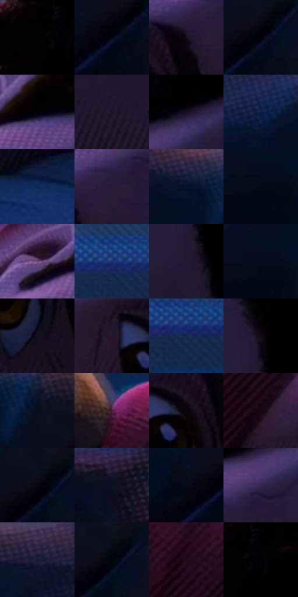

# 电影参考 172

- 状态：常规／活跃；来源世界：miles-home。
- 视角：near-level；景别：close-up；场景：interior。
- 时段：interior-time-unknown（外观依据，中置信度；具体时间／晨昏未知）；光照：cool-interior。
- 材质候选：skin, hair, fabric, wood, paint, screen（帧级，不是像素分割）。
- 明暗组：very-dark；L* P5/P50/P95：0.0 / 4.63854 / 23.93317。
- 资格门禁：无附加门禁。
- 原截图 SHA-256：`83f47d7fed13d95105ce46e63778017f6e488bb987555ac335aeb93c24281661`；尺寸：2880 × 1208。
- sRGB 像素 SHA-256：`1dfe1a4f4f0cb1335d48608dc8f029f35a2be1a6ca431553117f86c89d888ead`。

## 观察与迁移

蓝暗卧室和客厅，屏光面部与黑暗锚点并存。

本公开版保存32个128×128原像素色卡上下文；图集格子并非原场景相邻位置。原rect、图集tile和像素SHA见 `data/palette-crops.json`。上下文不足时不得批准替色，不能以小样推断完整构图。

## 实测色卡

颜色比例分母为保留采样像素，不是材料面积；全部 32 色参与全库匹配。表内四舍五入仅用于阅读，原精度在 JSON。

| ID | HEX | Lab | 原图 xy | 像素数 | 比例 | 明度角色 |
| --- | --- | --- | --- | ---: | ---: | --- |
| 172-S01 | #000000 | [0.0, 0.0, 0.0] | [2112, 28] | 29072 | 15.036256% | deep-shadow |
| 172-S02 | #010510 | [1.37648, 0.632317, -4.936349] | [748, 252] | 8640 | 4.468673% | deep-shadow |
| 172-S03 | #160F1F | [5.520426, 6.885023, -9.463779] | [1904, 420] | 8425 | 4.357473% | deep-shadow |
| 172-S04 | #02020A | [0.706642, 1.112316, -3.027322] | [780, 220] | 7805 | 4.036804% | deep-shadow |
| 172-S05 | #010106 | [0.373108, 0.695202, -1.892085] | [1880, 276] | 7749 | 4.007841% | deep-shadow |
| 172-S06 | #1B1327 | [7.634883, 9.517288, -12.253795] | [2044, 532] | 7565 | 3.912675% | deep-shadow |
| 172-S07 | #171124 | [6.417118, 8.05157, -11.916129] | [2092, 232] | 7367 | 3.810268% | deep-shadow |
| 172-S08 | #0B1E44 | [12.069312, 8.351266, -26.220259] | [460, 104] | 7187 | 3.717170% | deep-shadow |
| 172-S09 | #0D2759 | [16.784449, 11.133961, -32.928405] | [2408, 980] | 7021 | 3.631314% | deep-shadow |
| 172-S10 | #281C37 | [12.968694, 12.705142, -15.468504] | [1968, 384] | 6836 | 3.535630% | deep-shadow |
| 172-S11 | #061227 | [5.579993, 2.880495, -15.593762] | [628, 96] | 6409 | 3.314783% | deep-shadow |
| 172-S12 | #020A17 | [2.63595, 0.442398, -7.634889] | [548, 208] | 6254 | 3.234616% | deep-shadow |
| 172-S13 | #6C4C7A | [37.412468, 22.547958, -20.921245] | [1760, 280] | 6118 | 3.164275% | shadow |
| 172-S14 | #193573 | [23.638616, 13.53685, -38.787118] | [1424, 68] | 6075 | 3.142036% | shadow |
| 172-S15 | #221931 | [10.971898, 10.849985, -14.338187] | [2272, 380] | 5923 | 3.063420% | deep-shadow |
| 172-S16 | #040C1D | [3.409205, 1.822523, -11.212044] | [552, 188] | 5818 | 3.009113% | deep-shadow |
| 172-S17 | #120F1D | [5.048861, 4.535567, -8.659008] | [1860, 628] | 5805 | 3.002389% | deep-shadow |
| 172-S18 | #26152A | [9.919575, 13.283651, -10.812717] | [1752, 476] | 5766 | 2.982218% | deep-shadow |
| 172-S19 | #13294F | [16.934031, 6.186667, -25.946946] | [1456, 88] | 4645 | 2.402429% | deep-shadow |
| 172-S20 | #0D0A15 | [3.222803, 2.897092, -5.264528] | [2288, 284] | 4534 | 2.345019% | deep-shadow |
| 172-S21 | #080F1F | [4.445608, 2.064751, -11.194423] | [728, 128] | 4503 | 2.328985% | deep-shadow |
| 172-S22 | #49213B | [19.309036, 22.888484, -8.095486] | [1240, 352] | 4252 | 2.199166% | deep-shadow |
| 172-S23 | #090208 | [1.075229, 2.664723, -1.625506] | [1840, 480] | 3975 | 2.055900% | deep-shadow |
| 172-S24 | #150813 | [3.433739, 6.239347, -3.55203] | [1344, 608] | 3759 | 1.944183% | deep-shadow |
| 172-S25 | #060610 | [1.864101, 1.539253, -4.189339] | [780, 196] | 3549 | 1.835569% | deep-shadow |
| 172-S26 | #0C1022 | [5.096316, 3.657265, -12.500559] | [276, 804] | 3199 | 1.654547% | deep-shadow |
| 172-S27 | #050916 | [2.579274, 1.377826, -6.965395] | [692, 244] | 3021 | 1.562484% | deep-shadow |
| 172-S28 | #362A4F | [20.062464, 14.927481, -20.804272] | [2020, 320] | 2708 | 1.400598% | shadow |
| 172-S29 | #181832 | [9.62246, 8.480174, -17.268199] | [184, 64] | 2639 | 1.364911% | deep-shadow |
| 172-S30 | #00030C | [0.827904, 0.482503, -3.724747] | [800, 192] | 2612 | 1.350946% | deep-shadow |
| 172-S31 | #220A1A | [5.707129, 14.315368, -5.126247] | [1300, 468] | 2474 | 1.279571% | deep-shadow |
| 172-S32 | #010103 | [0.313747, 0.27807, -0.756814] | [2156, 36] | 1641 | 0.848737% | deep-shadow |

## 色阶与空间分布

- 采样 ROI：`[0.01, 0.02, 0.98, 0.94]`；步长：4；样本数：193346。
- 排除区：`[]`。
- 深暗、暗、中、亮、高光五段计数：`[178252, 12998, 2053, 43, 0]`。
- RGB 各 256 箱、L* 100 箱、13×5 色相明度表和 3×3 空间统计全部保存在 [总数据](../film-library.json)。
- [可视化档案](../../references/library.html)按需绘制直方图，不存 2,094 张重复图表图片。

## 纹理特征占比

**这是分块图像特征的面积占比，不是波点／排线／丝网／错版的精确语义覆盖率。** 窗格、发丝、织物也会产生方向或周期特征。
原图 ROI 像素 3104134；已测块覆盖 3104134（100.0000%）；未测 0。

| 特征 | 块覆盖像素 | 占已测面积 | 阈值敏感范围 |
| --- | ---: | ---: | --- |
| low-contrast | 1089280 | 35.0913% | 27.4710% ~ 41.6930% |
| directional-structure | 439552 | 14.1602% | 3.6040% ~ 27.0547% |
| periodic-structure | 1542534 | 49.6929% | 44.3981% ~ 52.0639% |
| mixed-detail | 32768 | 1.0556% | 1.0556% ~ 2.6391% |

阈值敏感范围不是统计置信区间。逐块坐标、尺度、对比、方向一致性、频谱集中度、频率与角度见 [全量特征记录](../texture-features.jsonl)，以帧号定位。
四种印刷层的真实像素覆盖仍标为 `null`，不能填 0，也不能拿上表代替。不得据这些代理测量删除唯一证据。

[测量方法与保留策略](../../references/library-retention.md) · [分类索引](../archive/README.md)
