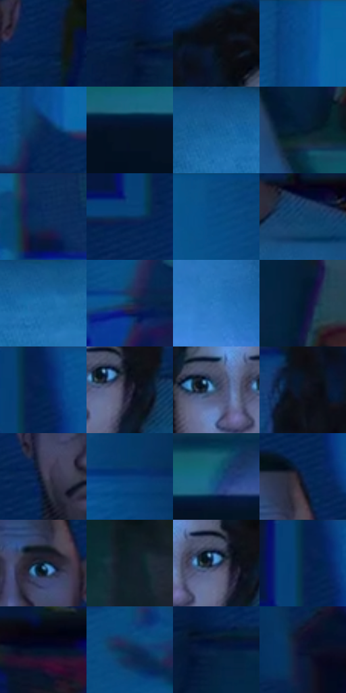

# 电影参考 173

- 状态：常规／活跃；来源世界：miles-home。
- 视角：near-level；景别：medium；场景：interior。
- 时段：interior-time-unknown（外观依据，中置信度；具体时间／晨昏未知）；光照：cool-interior。
- 材质候选：skin, hair, fabric, wood, paint, screen（帧级，不是像素分割）。
- 明暗组：very-dark；L* P5/P50/P95：4.26482 / 15.98561 / 43.46674。
- 资格门禁：无附加门禁。
- 原截图 SHA-256：`f90f31f1e07953a19ad5657904d0218aa9ad67773d79c66b0eb757ccfe6aa9ef`；尺寸：2880 × 1208。
- sRGB 像素 SHA-256：`b57e7ec358a7dd0b6317ebd47cdcc43064896e36c810d463adf12797c5bb3e54`。

## 观察与迁移

蓝暗卧室和客厅，屏光面部与黑暗锚点并存。

本公开版保存32个128×128原像素色卡上下文；图集格子并非原场景相邻位置。原rect、图集tile和像素SHA见 `data/palette-crops.json`。上下文不足时不得批准替色，不能以小样推断完整构图。

## 实测色卡

颜色比例分母为保留采样像素，不是材料面积；全部 32 色参与全库匹配。表内四舍五入仅用于阅读，原精度在 JSON。

| ID | HEX | Lab | 原图 xy | 像素数 | 比例 | 明度角色 |
| --- | --- | --- | --- | ---: | ---: | --- |
| 173-S01 | #03224C | [13.738499, 7.836026, -29.074894] | [1792, 316] | 11852 | 6.129943% | deep-shadow |
| 173-S02 | #071D37 | [10.554298, 2.491849, -19.46554] | [1996, 340] | 10946 | 5.661353% | deep-shadow |
| 173-S03 | #070D18 | [3.603568, 0.703385, -6.946427] | [1176, 316] | 8868 | 4.586596% | deep-shadow |
| 173-S04 | #094F8F | [33.204562, 5.788026, -40.873756] | [2060, 60] | 8645 | 4.471259% | shadow |
| 173-S05 | #082653 | [15.809591, 8.632183, -30.482597] | [2052, 208] | 8070 | 4.173864% | deep-shadow |
| 173-S06 | #051222 | [5.241873, 0.652734, -12.312716] | [612, 948] | 7964 | 4.119040% | deep-shadow |
| 173-S07 | #13609B | [39.359476, 0.262626, -38.286375] | [1520, 632] | 7778 | 4.022840% | shadow |
| 173-S08 | #041B30 | [9.181194, 0.110627, -16.595801] | [2156, 684] | 7261 | 3.755444% | deep-shadow |
| 173-S09 | #082A5B | [17.748084, 9.242486, -32.71068] | [836, 60] | 6958 | 3.598730% | deep-shadow |
| 173-S10 | #083461 | [21.469323, 4.599843, -30.67822] | [1316, 156] | 6837 | 3.536148% | shadow |
| 173-S11 | #064882 | [30.118482, 4.839418, -37.822724] | [2428, 64] | 6782 | 3.507701% | shadow |
| 173-S12 | #12416B | [26.649423, 0.883691, -28.863373] | [1832, 508] | 6661 | 3.445119% | shadow |
| 173-S13 | #1A6BA8 | [43.595817, -0.936505, -39.261082] | [1616, 640] | 6616 | 3.421845% | midtone |
| 173-S14 | #1B3B59 | [23.940056, -0.911513, -21.478707] | [388, 352] | 5984 | 3.094970% | shadow |
| 173-S15 | #2C7CC4 | [50.609852, 1.109738, -44.344479] | [1864, 844] | 5721 | 2.958944% | midtone |
| 173-S16 | #03182D | [7.78617, 0.751342, -16.612685] | [2200, 568] | 5705 | 2.950669% | deep-shadow |
| 173-S17 | #032256 | [14.596119, 12.501389, -34.482565] | [1376, 32] | 5347 | 2.765508% | deep-shadow |
| 173-S18 | #242335 | [14.591489, 5.50772, -11.550645] | [1364, 492] | 5345 | 2.764474% | deep-shadow |
| 173-S19 | #354C6B | [31.776867, 0.666013, -20.692454] | [1248, 480] | 5259 | 2.719994% | shadow |
| 173-S20 | #0F1420 | [6.378285, 1.5004, -8.986767] | [1096, 404] | 5164 | 2.670859% | deep-shadow |
| 173-S21 | #34384D | [23.980087, 4.011515, -13.378715] | [1544, 344] | 4949 | 2.559660% | shadow |
| 173-S22 | #093C77 | [25.626419, 8.629643, -38.144774] | [2572, 428] | 4922 | 2.545695% | shadow |
| 173-S23 | #105276 | [32.814269, -5.942621, -26.069804] | [732, 896] | 4848 | 2.507422% | shadow |
| 173-S24 | #0D2041 | [12.608378, 5.791223, -23.25102] | [1700, 160] | 4773 | 2.468631% | deep-shadow |
| 173-S25 | #0A2438 | [13.300848, -1.735206, -15.82255] | [1672, 256] | 4753 | 2.458287% | deep-shadow |
| 173-S26 | #121E2A | [10.734935, -1.070307, -9.719888] | [672, 456] | 4688 | 2.424669% | deep-shadow |
| 173-S27 | #2F5B8E | [37.911346, 2.031862, -32.708292] | [1336, 476] | 4524 | 2.339847% | shadow |
| 173-S28 | #06284A | [15.749699, 2.764237, -24.466468] | [1348, 64] | 4255 | 2.200718% | deep-shadow |
| 173-S29 | #04142A | [6.261619, 2.42066, -16.790591] | [952, 548] | 4065 | 2.102448% | deep-shadow |
| 173-S30 | #0D2C50 | [17.763208, 3.443207, -25.312041] | [400, 68] | 3596 | 1.859878% | deep-shadow |
| 173-S31 | #041F3F | [11.719086, 4.152442, -23.293954] | [2044, 364] | 2939 | 1.520073% | deep-shadow |
| 173-S32 | #0A1431 | [7.10431, 7.335068, -20.623281] | [256, 592] | 1271 | 0.657371% | deep-shadow |

## 色阶与空间分布

- 采样 ROI：`[0.01, 0.02, 0.98, 0.94]`；步长：4；样本数：193346。
- 排除区：`[]`。
- 深暗、暗、中、亮、高光五段计数：`[117108, 60873, 15281, 84, 0]`。
- RGB 各 256 箱、L* 100 箱、13×5 色相明度表和 3×3 空间统计全部保存在 [总数据](../film-library.json)。
- [可视化档案](../../references/library.html)按需绘制直方图，不存 2,094 张重复图表图片。

## 纹理特征占比

**这是分块图像特征的面积占比，不是波点／排线／丝网／错版的精确语义覆盖率。** 窗格、发丝、织物也会产生方向或周期特征。
原图 ROI 像素 3104134；已测块覆盖 3104134（100.0000%）；未测 0。

| 特征 | 块覆盖像素 | 占已测面积 | 阈值敏感范围 |
| --- | ---: | ---: | --- |
| low-contrast | 436358 | 14.0573% | 10.6348% ~ 17.1335% |
| directional-structure | 671744 | 21.6403% | 15.3066% ~ 31.8337% |
| periodic-structure | 1881344 | 60.6077% | 56.4759% ~ 60.6077% |
| mixed-detail | 114688 | 3.6947% | 1.0556% ~ 7.3894% |

阈值敏感范围不是统计置信区间。逐块坐标、尺度、对比、方向一致性、频谱集中度、频率与角度见 [全量特征记录](../texture-features.jsonl)，以帧号定位。
四种印刷层的真实像素覆盖仍标为 `null`，不能填 0，也不能拿上表代替。不得据这些代理测量删除唯一证据。

[测量方法与保留策略](../../references/library-retention.md) · [分类索引](../archive/README.md)
