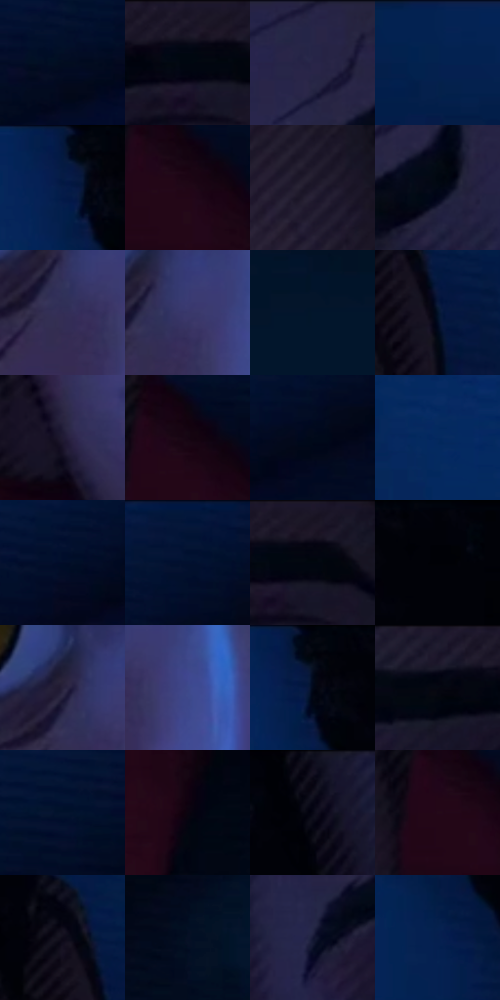

# 电影参考 174

- 状态：常规／活跃；来源世界：miles-home。
- 视角：high-angle；景别：close-up；场景：interior。
- 时段：interior-time-unknown（外观依据，中置信度；具体时间／晨昏未知）；光照：cool-interior。
- 材质候选：skin, hair, fabric, wood, paint, screen（帧级，不是像素分割）。
- 明暗组：very-dark；L* P5/P50/P95：1.28065 / 6.67164 / 25.28283。
- 资格门禁：无附加门禁。
- 原截图 SHA-256：`af1abf831463fe56761aac35b253468efe5bae8c27015306ce363072a1e2a849`；尺寸：2878 × 1208。
- sRGB 像素 SHA-256：`1e544a0cf0cfb44a573c34713127584b29a3fc817a71d73ddc30672c0fab8d2e`。

## 观察与迁移

蓝暗卧室和客厅，屏光面部与黑暗锚点并存。

本公开版保存32个128×128原像素色卡上下文；图集格子并非原场景相邻位置。原rect、图集tile和像素SHA见 `data/palette-crops.json`。上下文不足时不得批准替色，不能以小样推断完整构图。

## 实测色卡

颜色比例分母为保留采样像素，不是材料面积；全部 32 色参与全库匹配。表内四舍五入仅用于阅读，原精度在 JSON。

| ID | HEX | Lab | 原图 xy | 像素数 | 比例 | 明度角色 |
| --- | --- | --- | --- | ---: | ---: | --- |
| 174-S01 | #020D20 | [3.658167, 1.828268, -13.201416] | [2304, 312] | 13249 | 6.852482% | deep-shadow |
| 174-S02 | #181324 | [7.111562, 7.243347, -10.832549] | [1752, 32] | 9661 | 4.996742% | deep-shadow |
| 174-S03 | #272548 | [16.612716, 11.375643, -21.604516] | [1188, 28] | 9166 | 4.740724% | deep-shadow |
| 174-S04 | #042352 | [14.606109, 9.995319, -31.759991] | [2224, 28] | 9164 | 4.739689% | deep-shadow |
| 174-S05 | #041A42 | [10.241935, 9.523215, -27.790504] | [408, 40] | 8951 | 4.629524% | deep-shadow |
| 174-S06 | #200616 | [4.474217, 13.715897, -3.900475] | [2080, 420] | 8690 | 4.494533% | deep-shadow |
| 174-S07 | #1D172A | [9.329657, 8.236902, -11.822053] | [1908, 388] | 8667 | 4.482637% | deep-shadow |
| 174-S08 | #020815 | [2.1741, 0.753774, -6.874629] | [1264, 148] | 8394 | 4.341440% | deep-shadow |
| 174-S09 | #322D56 | [20.929469, 13.760903, -24.144908] | [1296, 548] | 8039 | 4.157831% | shadow |
| 174-S10 | #39386A | [25.976368, 14.8021, -29.159915] | [1328, 520] | 7826 | 4.047666% | shadow |
| 174-S11 | #02162C | [6.94151, 1.472841, -17.21545] | [2632, 680] | 7596 | 3.928708% | deep-shadow |
| 174-S12 | #021227 | [5.346758, 1.834498, -15.975262] | [2024, 160] | 7093 | 3.668553% | deep-shadow |
| 174-S13 | #201B34 | [11.544373, 9.610418, -15.622976] | [952, 732] | 7079 | 3.661312% | deep-shadow |
| 174-S14 | #150512 | [2.815305, 7.228813, -3.833415] | [2072, 388] | 6903 | 3.570283% | deep-shadow |
| 174-S15 | #020A1B | [2.791882, 1.538144, -10.556311] | [2788, 132] | 6263 | 3.239271% | deep-shadow |
| 174-S16 | #05285F | [17.346612, 12.252323, -36.018957] | [32, 104] | 5955 | 3.079971% | deep-shadow |
| 174-S17 | #020C28 | [3.874896, 5.391457, -19.036451] | [2672, 136] | 5859 | 3.030319% | deep-shadow |
| 174-S18 | #041535 | [7.398435, 7.246112, -23.095589] | [2756, 32] | 5857 | 3.029284% | deep-shadow |
| 174-S19 | #130F1E | [5.183262, 5.253762, -9.22613] | [1788, 40] | 5841 | 3.021009% | deep-shadow |
| 174-S20 | #010208 | [0.608759, 0.572729, -2.362614] | [544, 28] | 5587 | 2.889638% | deep-shadow |
| 174-S21 | #27213C | [14.653159, 10.280171, -16.370652] | [1280, 492] | 5533 | 2.861709% | deep-shadow |
| 174-S22 | #3E498B | [33.248597, 15.850012, -38.239645] | [1388, 556] | 4770 | 2.467080% | shadow |
| 174-S23 | #020819 | [2.318964, 1.771743, -9.645147] | [432, 64] | 4460 | 2.306745% | deep-shadow |
| 174-S24 | #01040F | [1.154028, 0.84755, -4.718276] | [1628, 56] | 4235 | 2.190374% | deep-shadow |
| 174-S25 | #04132E | [6.221075, 4.967608, -19.836843] | [452, 656] | 4197 | 2.170720% | deep-shadow |
| 174-S26 | #0B040F | [1.738603, 3.46921, -3.794542] | [2176, 688] | 3346 | 1.730576% | deep-shadow |
| 174-S27 | #0A0816 | [2.67474, 3.085884, -6.79102] | [768, 28] | 3073 | 1.589379% | deep-shadow |
| 174-S28 | #240A18 | [5.945316, 15.00529, -3.169362] | [2044, 424] | 2452 | 1.268193% | deep-shadow |
| 174-S29 | #0D0B1A | [3.608419, 3.783086, -8.480188] | [1980, 96] | 2392 | 1.237160% | deep-shadow |
| 174-S30 | #061025 | [4.903127, 3.205852, -15.12711] | [2284, 844] | 1970 | 1.018899% | deep-shadow |
| 174-S31 | #151734 | [9.15751, 9.117676, -19.479344] | [936, 312] | 905 | 0.468073% | deep-shadow |
| 174-S32 | #06204E | [13.360628, 10.701121, -31.051656] | [500, 308] | 173 | 0.089477% | deep-shadow |

## 色阶与空间分布

- 采样 ROI：`[0.01, 0.02, 0.98, 0.94]`；步长：4；样本数：193346。
- 排除区：`[]`。
- 深暗、暗、中、亮、高光五段计数：`[174201, 18385, 760, 0, 0]`。
- RGB 各 256 箱、L* 100 箱、13×5 色相明度表和 3×3 空间统计全部保存在 [总数据](../film-library.json)。
- [可视化档案](../../references/library.html)按需绘制直方图，不存 2,094 张重复图表图片。

## 纹理特征占比

**这是分块图像特征的面积占比，不是波点／排线／丝网／错版的精确语义覆盖率。** 窗格、发丝、织物也会产生方向或周期特征。
原图 ROI 像素 3101912；已测块覆盖 3101912（100.0000%）；未测 0。

| 特征 | 块覆盖像素 | 占已测面积 | 阈值敏感范围 |
| --- | ---: | ---: | --- |
| low-contrast | 1415512 | 45.6335% | 35.0491% ~ 52.8796% |
| directional-structure | 360448 | 11.6202% | 1.5846% ~ 25.5430% |
| periodic-structure | 1260416 | 40.6335% | 38.8798% ~ 43.4230% |
| mixed-detail | 65536 | 2.1128% | 0.5282% ~ 2.1128% |

阈值敏感范围不是统计置信区间。逐块坐标、尺度、对比、方向一致性、频谱集中度、频率与角度见 [全量特征记录](../texture-features.jsonl)，以帧号定位。
四种印刷层的真实像素覆盖仍标为 `null`，不能填 0，也不能拿上表代替。不得据这些代理测量删除唯一证据。

[测量方法与保留策略](../../references/library-retention.md) · [分类索引](../archive/README.md)
