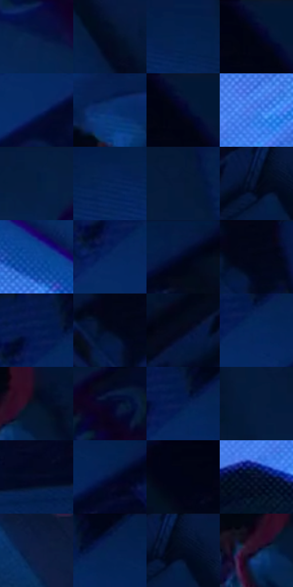

# 电影参考 175

- 状态：常规／活跃；来源世界：miles-home。
- 视角：overhead；景别：environment-wide；场景：interior。
- 时段：interior-time-unknown（外观依据，中置信度；具体时间／晨昏未知）；光照：cool-interior。
- 材质候选：skin, hair, fabric, wood, paint, screen（帧级，不是像素分割）。
- 明暗组：very-dark；L* P5/P50/P95：2.17637 / 10.08599 / 32.78675。
- 资格门禁：无附加门禁。
- 原截图 SHA-256：`fc8f6707a649303c0988165d2e331316fe272aa4ad28eaf87ee31535c286f6a6`；尺寸：2880 × 1206。
- sRGB 像素 SHA-256：`85760846de9d7f7b2853de825f6b6ceec4668d180b2d17db9d6463d68fda1092`。

## 观察与迁移

蓝暗卧室和客厅，屏光面部与黑暗锚点并存。

本公开版保存32个128×128原像素色卡上下文；图集格子并非原场景相邻位置。原rect、图集tile和像素SHA见 `data/palette-crops.json`。上下文不足时不得批准替色，不能以小样推断完整构图。

## 实测色卡

颜色比例分母为保留采样像素，不是材料面积；全部 32 色参与全库匹配。表内四舍五入仅用于阅读，原精度在 JSON。

| ID | HEX | Lab | 原图 xy | 像素数 | 比例 | 明度角色 |
| --- | --- | --- | --- | ---: | ---: | --- |
| 175-S01 | #071D47 | [11.814491, 9.93523, -28.730218] | [680, 200] | 13260 | 6.858171% | deep-shadow |
| 175-S02 | #030C21 | [3.541382, 2.899586, -14.153732] | [1644, 188] | 10962 | 5.669629% | deep-shadow |
| 175-S03 | #052250 | [14.146295, 9.957661, -31.144566] | [1528, 220] | 10686 | 5.526879% | deep-shadow |
| 175-S04 | #021230 | [5.950954, 6.080236, -21.75633] | [2728, 28] | 9649 | 4.990535% | deep-shadow |
| 175-S05 | #062A66 | [18.598909, 13.986906, -38.58843] | [2136, 220] | 9435 | 4.879853% | deep-shadow |
| 175-S06 | #0A3174 | [22.021787, 15.297073, -42.070707] | [1592, 420] | 7812 | 4.040425% | shadow |
| 175-S07 | #031634 | [7.596496, 5.76846, -22.051288] | [2740, 28] | 7436 | 3.845955% | deep-shadow |
| 175-S08 | #3878E3 | [51.629553, 16.445486, -60.267651] | [188, 456] | 7343 | 3.797855% | midtone |
| 175-S09 | #051E40 | [11.48905, 5.572856, -24.365235] | [468, 40] | 7169 | 3.707861% | deep-shadow |
| 175-S10 | #072658 | [16.183419, 10.792416, -33.242319] | [1456, 256] | 6884 | 3.560456% | deep-shadow |
| 175-S11 | #071838 | [8.855909, 6.90372, -22.907094] | [916, 72] | 6728 | 3.479772% | deep-shadow |
| 175-S12 | #081A3C | [9.926466, 7.354228, -24.043116] | [1512, 44] | 6497 | 3.360297% | deep-shadow |
| 175-S13 | #0A479B | [31.661493, 16.320886, -50.662811] | [416, 420] | 6401 | 3.310645% | shadow |
| 175-S14 | #082860 | [17.52191, 12.983285, -36.391483] | [2108, 140] | 6380 | 3.299784% | deep-shadow |
| 175-S15 | #05153D | [8.176722, 11.326281, -27.59996] | [2432, 48] | 5913 | 3.058248% | deep-shadow |
| 175-S16 | #020718 | [2.084609, 1.90333, -9.199423] | [1880, 52] | 5869 | 3.035491% | deep-shadow |
| 175-S17 | #071D4E | [12.439803, 13.14964, -32.546926] | [2120, 48] | 5781 | 2.989977% | deep-shadow |
| 175-S18 | #02081F | [2.578475, 3.595353, -14.053011] | [1844, 80] | 5630 | 2.911878% | deep-shadow |
| 175-S19 | #04091B | [2.712421, 2.461703, -10.660847] | [1344, 92] | 5307 | 2.744820% | deep-shadow |
| 175-S20 | #05245C | [15.831571, 13.918705, -36.490444] | [2172, 112] | 4941 | 2.555522% | deep-shadow |
| 175-S21 | #061329 | [6.002161, 3.132794, -16.440732] | [1636, 584] | 4797 | 2.481044% | deep-shadow |
| 175-S22 | #020A2C | [3.71932, 8.055337, -22.315507] | [696, 56] | 4591 | 2.374500% | deep-shadow |
| 175-S23 | #021B4D | [11.499701, 13.645002, -33.402172] | [2156, 80] | 4162 | 2.152618% | deep-shadow |
| 175-S24 | #051D3B | [10.752077, 3.987668, -22.011387] | [864, 116] | 4140 | 2.141239% | deep-shadow |
| 175-S25 | #040927 | [3.320541, 6.735017, -19.129281] | [2688, 672] | 4029 | 2.083829% | deep-shadow |
| 175-S26 | #02123D | [7.066235, 13.098494, -29.417283] | [2312, 128] | 3492 | 1.806089% | deep-shadow |
| 175-S27 | #000313 | [1.012755, 1.781467, -7.260023] | [2576, 28] | 3489 | 1.804537% | deep-shadow |
| 175-S28 | #070F2C | [5.135988, 7.064356, -20.055365] | [96, 548] | 3472 | 1.795744% | deep-shadow |
| 175-S29 | #101E44 | [12.32469, 9.20416, -25.795555] | [1184, 964] | 3215 | 1.662822% | deep-shadow |
| 175-S30 | #061234 | [6.495989, 9.24315, -23.812933] | [2220, 28] | 3107 | 1.606964% | deep-shadow |
| 175-S31 | #020F26 | [4.466051, 3.097855, -16.587941] | [1544, 48] | 2716 | 1.404736% | deep-shadow |
| 175-S32 | #161130 | [7.089162, 12.35027, -19.856249] | [1572, 624] | 2053 | 1.061827% | deep-shadow |

## 色阶与空间分布

- 采样 ROI：`[0.01, 0.02, 0.98, 0.94]`；步长：4；样本数：193346。
- 排除区：`[]`。
- 深暗、暗、中、亮、高光五段计数：`[171960, 13733, 7429, 224, 0]`。
- RGB 各 256 箱、L* 100 箱、13×5 色相明度表和 3×3 空间统计全部保存在 [总数据](../film-library.json)。
- [可视化档案](../../references/library.html)按需绘制直方图，不存 2,094 张重复图表图片。

## 纹理特征占比

**这是分块图像特征的面积占比，不是波点／排线／丝网／错版的精确语义覆盖率。** 窗格、发丝、织物也会产生方向或周期特征。
原图 ROI 像素 3098546；已测块覆盖 3098546（100.0000%）；未测 0。

| 特征 | 块覆盖像素 | 占已测面积 | 阈值敏感范围 |
| --- | ---: | ---: | --- |
| low-contrast | 460928 | 14.8756% | 8.7990% ~ 19.8080% |
| directional-structure | 221874 | 7.1606% | 1.5863% ~ 24.3413% |
| periodic-structure | 2322944 | 74.9688% | 64.8356% ~ 74.9688% |
| mixed-detail | 92800 | 2.9950% | 2.0242% ~ 4.0525% |

阈值敏感范围不是统计置信区间。逐块坐标、尺度、对比、方向一致性、频谱集中度、频率与角度见 [全量特征记录](../texture-features.jsonl)，以帧号定位。
四种印刷层的真实像素覆盖仍标为 `null`，不能填 0，也不能拿上表代替。不得据这些代理测量删除唯一证据。

[测量方法与保留策略](../../references/library-retention.md) · [分类索引](../archive/README.md)
