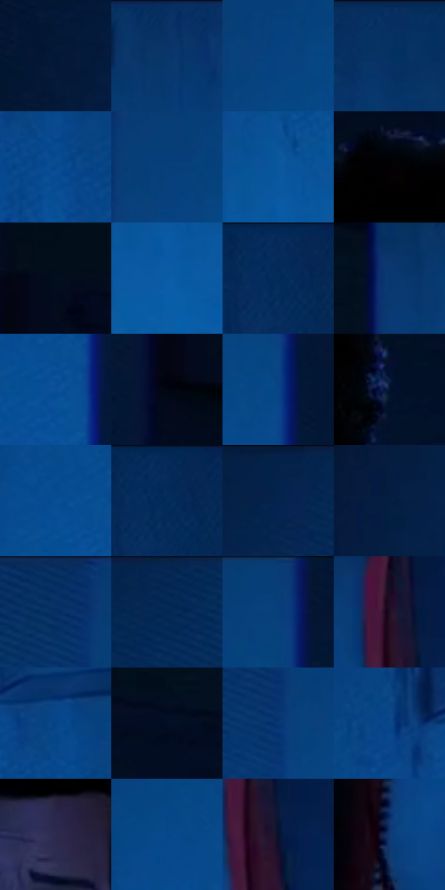

# 电影参考 176

- 状态：常规／活跃；来源世界：miles-home。
- 视角：near-level；景别：medium；场景：interior。
- 时段：interior-time-unknown（外观依据，中置信度；具体时间／晨昏未知）；光照：cool-interior。
- 材质候选：skin, hair, fabric, wood, paint, screen（帧级，不是像素分割）。
- 明暗组：dark；L* P5/P50/P95：1.29196 / 21.28055 / 36.82958。
- 资格门禁：无附加门禁。
- 原截图 SHA-256：`043c883dd4f97068aedbf66ec4f1cc3ea368b6a7a836dd8f92380ed3b370fee6`；尺寸：2880 × 1208。
- sRGB 像素 SHA-256：`f102deec1b65bba29fe3b49686a7e6c597ae6ccca8f408b09ef7c5f23ce47027`。

## 观察与迁移

蓝暗卧室和客厅，屏光面部与黑暗锚点并存。

本公开版保存32个128×128原像素色卡上下文；图集格子并非原场景相邻位置。原rect、图集tile和像素SHA见 `data/palette-crops.json`。上下文不足时不得批准替色，不能以小样推断完整构图。

## 实测色卡

颜色比例分母为保留采样像素，不是材料面积；全部 32 色参与全库匹配。表内四舍五入仅用于阅读，原精度在 JSON。

| ID | HEX | Lab | 原图 xy | 像素数 | 比例 | 明度角色 |
| --- | --- | --- | --- | ---: | ---: | --- |
| 176-S01 | #041735 | [8.088778, 5.685973, -21.982799] | [36, 84] | 13160 | 6.806451% | deep-shadow |
| 176-S02 | #073368 | [21.62275, 8.336468, -34.992079] | [1944, 44] | 12961 | 6.703526% | shadow |
| 176-S03 | #0A4180 | [27.852767, 9.065124, -40.215324] | [832, 168] | 12818 | 6.629566% | shadow |
| 176-S04 | #062F61 | [19.779012, 8.039634, -33.39883] | [2244, 28] | 10167 | 5.258449% | deep-shadow |
| 176-S05 | #04498F | [31.284357, 9.577093, -43.965958] | [2196, 408] | 8643 | 4.470224% | shadow |
| 176-S06 | #063E7A | [26.414205, 8.30977, -38.77281] | [820, 120] | 8389 | 4.338854% | shadow |
| 176-S07 | #0A569F | [36.408036, 7.826813, -45.407235] | [1860, 516] | 8250 | 4.266962% | shadow |
| 176-S08 | #040104 | [0.50846, 1.201612, -0.858822] | [1384, 232] | 7794 | 4.031115% | deep-shadow |
| 176-S09 | #020D1D | [3.51753, 0.839997, -11.061772] | [1208, 84] | 7727 | 3.996462% | deep-shadow |
| 176-S10 | #0C5CA6 | [38.697517, 6.848213, -45.90667] | [1864, 604] | 7672 | 3.968016% | shadow |
| 176-S11 | #042A59 | [17.472342, 7.914112, -31.830175] | [2652, 32] | 7251 | 3.750272% | deep-shadow |
| 176-S12 | #073770 | [23.494645, 8.984657, -37.127979] | [1792, 76] | 6886 | 3.561491% | shadow |
| 176-S13 | #0B5199 | [34.507636, 8.726907, -44.851731] | [916, 436] | 6824 | 3.529424% | shadow |
| 176-S14 | #020612 | [1.687406, 0.890568, -5.639223] | [1156, 172] | 5733 | 2.965151% | deep-shadow |
| 176-S15 | #084487 | [29.245777, 9.847061, -42.324453] | [948, 204] | 5620 | 2.906706% | shadow |
| 176-S16 | #02142E | [6.416681, 3.806779, -19.532798] | [1628, 360] | 5489 | 2.838952% | deep-shadow |
| 176-S17 | #064E95 | [33.256369, 8.817773, -44.446268] | [880, 376] | 5282 | 2.731890% | shadow |
| 176-S18 | #072B5C | [18.121884, 8.845443, -32.772307] | [2660, 40] | 5265 | 2.723097% | deep-shadow |
| 176-S19 | #05224C | [13.81426, 8.100171, -28.948724] | [292, 32] | 5084 | 2.629483% | deep-shadow |
| 176-S20 | #061B40 | [10.502367, 8.098075, -25.954351] | [36, 300] | 4888 | 2.528110% | deep-shadow |
| 176-S21 | #042D61 | [19.077829, 9.325742, -34.533991] | [720, 32] | 4608 | 2.383292% | deep-shadow |
| 176-S22 | #032452 | [14.898962, 9.109093, -31.287146] | [392, 32] | 4489 | 2.321744% | deep-shadow |
| 176-S23 | #093C75 | [25.483194, 7.762183, -37.108001] | [936, 28] | 4421 | 2.286574% | shadow |
| 176-S24 | #1E0F21 | [6.571435, 11.561209, -9.316405] | [1528, 952] | 4156 | 2.149514% | deep-shadow |
| 176-S25 | #044588 | [29.559921, 9.342254, -42.439689] | [2180, 332] | 3970 | 2.053314% | shadow |
| 176-S26 | #020D24 | [3.866651, 3.293302, -15.983449] | [1692, 184] | 3237 | 1.674201% | deep-shadow |
| 176-S27 | #073774 | [23.79609, 10.740095, -39.196308] | [752, 172] | 2863 | 1.480765% | shadow |
| 176-S28 | #0A478B | [30.482156, 9.592916, -42.798488] | [2048, 312] | 2627 | 1.358704% | shadow |
| 176-S29 | #2C2B4F | [19.339706, 11.00881, -22.012491] | [1484, 448] | 2363 | 1.222161% | deep-shadow |
| 176-S30 | #06478A | [30.349547, 8.936008, -42.399488] | [884, 240] | 2229 | 1.152856% | shadow |
| 176-S31 | #08112E | [5.868584, 7.210164, -20.383246] | [1560, 1016] | 1577 | 0.815636% | deep-shadow |
| 176-S32 | #103972 | [24.483415, 9.190723, -36.801243] | [1416, 1128] | 903 | 0.467038% | shadow |

## 色阶与空间分布

- 采样 ROI：`[0.01, 0.02, 0.98, 0.94]`；步长：4；样本数：193346。
- 排除区：`[]`。
- 深暗、暗、中、亮、高光五段计数：`[86466, 106539, 338, 3, 0]`。
- RGB 各 256 箱、L* 100 箱、13×5 色相明度表和 3×3 空间统计全部保存在 [总数据](../film-library.json)。
- [可视化档案](../../references/library.html)按需绘制直方图，不存 2,094 张重复图表图片。

## 纹理特征占比

**这是分块图像特征的面积占比，不是波点／排线／丝网／错版的精确语义覆盖率。** 窗格、发丝、织物也会产生方向或周期特征。
原图 ROI 像素 3104134；已测块覆盖 3104134（100.0000%）；未测 0。

| 特征 | 块覆盖像素 | 占已测面积 | 阈值敏感范围 |
| --- | ---: | ---: | --- |
| low-contrast | 1614086 | 51.9979% | 33.5946% ~ 58.1626% |
| directional-structure | 615168 | 19.8177% | 13.0469% ~ 30.2049% |
| periodic-structure | 776576 | 25.0175% | 24.7371% ~ 33.2934% |
| mixed-detail | 98304 | 3.1669% | 2.9071% ~ 4.0534% |

阈值敏感范围不是统计置信区间。逐块坐标、尺度、对比、方向一致性、频谱集中度、频率与角度见 [全量特征记录](../texture-features.jsonl)，以帧号定位。
四种印刷层的真实像素覆盖仍标为 `null`，不能填 0，也不能拿上表代替。不得据这些代理测量删除唯一证据。

[测量方法与保留策略](../../references/library-retention.md) · [分类索引](../archive/README.md)
