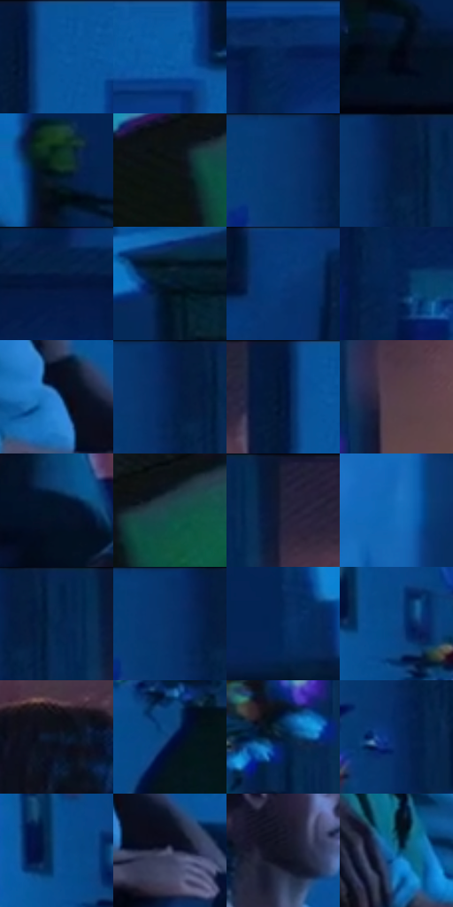

# 电影参考 177

- 状态：常规／活跃；来源世界：miles-home。
- 视角：near-level；景别：environment-wide；场景：interior。
- 时段：interior-time-unknown（外观依据，中置信度；具体时间／晨昏未知）；光照：cool-interior。
- 材质候选：skin, hair, fabric, wood, paint, screen（帧级，不是像素分割）。
- 明暗组：very-dark；L* P5/P50/P95：3.56294 / 15.77149 / 44.99205。
- 资格门禁：无附加门禁。
- 原截图 SHA-256：`ad3b498c819018050ef772881e2aaff47283317968e99862399bec1cfe57cc27`；尺寸：2880 × 1200。
- sRGB 像素 SHA-256：`4c35e8fc8d11ca00c5394f8c9f75249544acbfa4a18f55998ae093923112665e`。

## 观察与迁移

蓝暗卧室和客厅，屏光面部与黑暗锚点并存。

本公开版保存32个128×128原像素色卡上下文；图集格子并非原场景相邻位置。原rect、图集tile和像素SHA见 `data/palette-crops.json`。上下文不足时不得批准替色，不能以小样推断完整构图。

## 实测色卡

颜色比例分母为保留采样像素，不是材料面积；全部 32 色参与全库匹配。表内四舍五入仅用于阅读，原精度在 JSON。

| ID | HEX | Lab | 原图 xy | 像素数 | 比例 | 明度角色 |
| --- | --- | --- | --- | ---: | ---: | --- |
| 177-S01 | #07549C | [35.566513, 7.767629, -44.960175] | [1512, 24] | 10948 | 5.682904% | shadow |
| 177-S02 | #0A5BA5 | [38.308165, 6.998505, -45.938333] | [1680, 28] | 9741 | 5.056372% | shadow |
| 177-S03 | #032456 | [15.236742, 10.967121, -33.441126] | [2404, 56] | 8902 | 4.620863% | deep-shadow |
| 177-S04 | #030814 | [2.199578, 0.784567, -6.154597] | [84, 560] | 8805 | 4.570512% | deep-shadow |
| 177-S05 | #05121E | [5.045439, -0.727622, -9.528067] | [44, 392] | 8794 | 4.564802% | deep-shadow |
| 177-S06 | #0B1314 | [5.305711, -2.506206, -1.562807] | [992, 768] | 8382 | 4.350941% | deep-shadow |
| 177-S07 | #08366F | [23.125189, 9.342174, -37.082191] | [856, 24] | 8014 | 4.159919% | shadow |
| 177-S08 | #061D40 | [11.187201, 6.520073, -24.84895] | [920, 24] | 7575 | 3.932042% | deep-shadow |
| 177-S09 | #061F46 | [12.355715, 7.76534, -27.16159] | [2108, 28] | 7418 | 3.850546% | deep-shadow |
| 177-S10 | #031931 | [8.448618, 1.916479, -18.495082] | [572, 668] | 6863 | 3.562456% | deep-shadow |
| 177-S11 | #083B7B | [25.589969, 11.002542, -40.73165] | [1944, 36] | 6703 | 3.479403% | shadow |
| 177-S12 | #052251 | [14.231289, 10.420054, -31.687145] | [2228, 136] | 6446 | 3.345999% | deep-shadow |
| 177-S13 | #3481CE | [52.822593, 2.725372, -46.513003] | [1580, 736] | 6310 | 3.275404% | midtone |
| 177-S14 | #041F4C | [12.780683, 10.296998, -30.62466] | [904, 32] | 6191 | 3.213633% | deep-shadow |
| 177-S15 | #051739 | [8.484001, 7.808963, -24.232989] | [1472, 52] | 6188 | 3.212076% | deep-shadow |
| 177-S16 | #56404C | [29.830585, 11.7927, -3.539443] | [1060, 216] | 6156 | 3.195465% | shadow |
| 177-S17 | #021427 | [5.958246, 0.585313, -15.01998] | [1128, 452] | 6021 | 3.125389% | deep-shadow |
| 177-S18 | #184947 | [27.882604, -16.752071, -3.687013] | [1072, 740] | 5927 | 3.076596% | shadow |
| 177-S19 | #202138 | [13.710804, 6.50816, -15.077045] | [1044, 36] | 5761 | 2.990428% | deep-shadow |
| 177-S20 | #146CB9 | [44.765395, 4.654534, -47.342425] | [2688, 176] | 5642 | 2.928657% | midtone |
| 177-S21 | #07294E | [16.408803, 3.980917, -26.13521] | [968, 48] | 5496 | 2.852872% | deep-shadow |
| 177-S22 | #063166 | [20.805175, 8.81462, -35.012655] | [872, 24] | 5448 | 2.827956% | shadow |
| 177-S23 | #062C5C | [18.419364, 7.999852, -32.293489] | [384, 488] | 5321 | 2.762032% | deep-shadow |
| 177-S24 | #0A4787 | [30.204136, 7.898162, -40.778923] | [696, 168] | 5054 | 2.623438% | shadow |
| 177-S25 | #081627 | [6.972044, 0.797957, -13.40983] | [1328, 324] | 4555 | 2.364416% | deep-shadow |
| 177-S26 | #0D3368 | [21.7707, 8.872388, -34.746015] | [724, 400] | 4129 | 2.143287% | shadow |
| 177-S27 | #051E39 | [10.964586, 2.266346, -20.246745] | [952, 340] | 3678 | 1.909182% | deep-shadow |
| 177-S28 | #052963 | [18.002196, 13.304434, -37.592407] | [892, 168] | 3341 | 1.734251% | deep-shadow |
| 177-S29 | #0B4F8F | [33.232645, 5.900901, -40.82718] | [656, 148] | 2778 | 1.442008% | shadow |
| 177-S30 | #535873 | [37.942649, 4.709185, -15.985906] | [1656, 800] | 2438 | 1.265521% | shadow |
| 177-S31 | #131422 | [6.812815, 3.70645, -9.817402] | [1472, 340] | 2433 | 1.262925% | deep-shadow |
| 177-S32 | #10638E | [39.556093, -6.972072, -30.174705] | [1408, 740] | 1190 | 0.617707% | shadow |

## 色阶与空间分布

- 采样 ROI：`[0.01, 0.02, 0.98, 0.94]`；步长：4；样本数：192648。
- 排除区：`[]`。
- 深暗、暗、中、亮、高光五段计数：`[114576, 63835, 13878, 166, 193]`。
- RGB 各 256 箱、L* 100 箱、13×5 色相明度表和 3×3 空间统计全部保存在 [总数据](../film-library.json)。
- [可视化档案](../../references/library.html)按需绘制直方图，不存 2,094 张重复图表图片。

## 纹理特征占比

**这是分块图像特征的面积占比，不是波点／排线／丝网／错版的精确语义覆盖率。** 窗格、发丝、织物也会产生方向或周期特征。
原图 ROI 像素 3084576；已测块覆盖 3084576（100.0000%）；未测 0。

| 特征 | 块覆盖像素 | 占已测面积 | 阈值敏感范围 |
| --- | ---: | ---: | --- |
| low-contrast | 300832 | 9.7528% | 7.6945% ~ 11.4790% |
| directional-structure | 736512 | 23.8773% | 8.0089% ~ 32.8157% |
| periodic-structure | 1998080 | 64.7765% | 58.4275% ~ 77.8563% |
| mixed-detail | 49152 | 1.5935% | 1.0623% ~ 2.6558% |

阈值敏感范围不是统计置信区间。逐块坐标、尺度、对比、方向一致性、频谱集中度、频率与角度见 [全量特征记录](../texture-features.jsonl)，以帧号定位。
四种印刷层的真实像素覆盖仍标为 `null`，不能填 0，也不能拿上表代替。不得据这些代理测量删除唯一证据。

[测量方法与保留策略](../../references/library-retention.md) · [分类索引](../archive/README.md)
