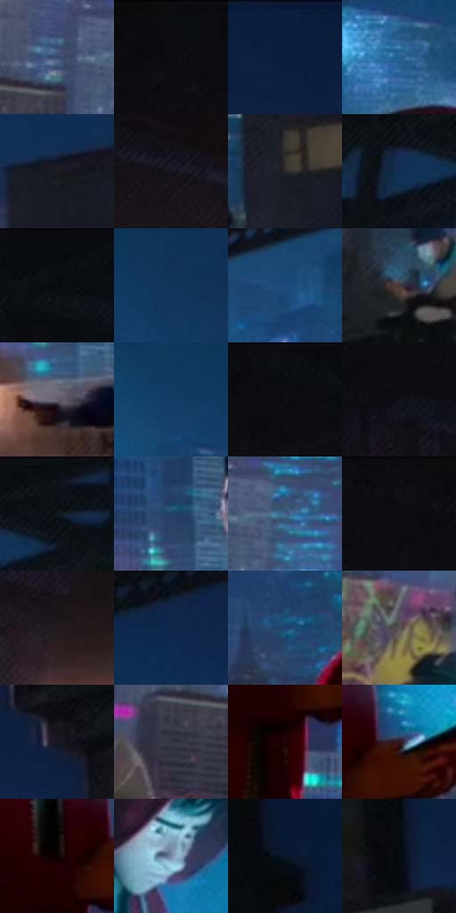

# 电影参考 178

- 状态：常规／活跃；来源世界：miles-home。
- 视角：low-angle；景别：environment-wide；场景：street。
- 时段：night-appearance（外观依据，中置信度；具体时间／晨昏未知）；光照：night-mixed。
- 材质候选：skin, fabric, stone, metal, screen, sky（帧级，不是像素分割）。
- 明暗组：very-dark；L* P5/P50/P95：2.78354 / 16.19436 / 42.86731。
- 资格门禁：无附加门禁。
- 原截图 SHA-256：`761311c9bd23e5f1a5301cc25dca6e424753841393bf7a601a8dc652b67956f2`；尺寸：2876 × 1208。
- sRGB 像素 SHA-256：`7c8f9ae65becdb2bcc8ed5ca4cbd8377d841bf8695fef07377ed814b9d3b16af`。

## 观察与迁移

手机光与城市环境，石构件与近景人脸不同明度层。

本公开版保存32个128×128原像素色卡上下文；图集格子并非原场景相邻位置。原rect、图集tile和像素SHA见 `data/palette-crops.json`。上下文不足时不得批准替色，不能以小样推断完整构图。

## 实测色卡

颜色比例分母为保留采样像素，不是材料面积；全部 32 色参与全库匹配。表内四舍五入仅用于阅读，原精度在 JSON。

| ID | HEX | Lab | 原图 xy | 像素数 | 比例 | 明度角色 |
| --- | --- | --- | --- | ---: | ---: | --- |
| 178-S01 | #384A6F | [31.544867, 4.125781, -23.560611] | [432, 588] | 9500 | 4.920521% | shadow |
| 178-S02 | #0D0C0F | [3.45959, 0.803892, -1.265884] | [136, 28] | 9288 | 4.810715% | deep-shadow |
| 178-S03 | #0D1E3D | [11.626682, 5.556044, -22.008144] | [2244, 40] | 9197 | 4.763582% | deep-shadow |
| 178-S04 | #256293 | [39.971828, -2.149659, -32.495627] | [1384, 296] | 8600 | 4.454366% | shadow |
| 178-S05 | #1D1D24 | [11.044834, 1.900301, -4.755607] | [2476, 480] | 8355 | 4.327468% | deep-shadow |
| 178-S06 | #17161B | [7.543425, 1.814395, -3.335255] | [556, 216] | 8215 | 4.254955% | deep-shadow |
| 178-S07 | #2A2B2E | [17.540091, 0.297631, -2.097129] | [2164, 868] | 8085 | 4.187622% | deep-shadow |
| 178-S08 | #122F53 | [19.164882, 3.337159, -25.082032] | [1324, 104] | 7845 | 4.063314% | deep-shadow |
| 178-S09 | #080A0D | [2.689619, -0.069913, -1.417545] | [1012, 28] | 7152 | 3.704375% | deep-shadow |
| 178-S10 | #12345B | [21.355239, 3.164396, -26.905539] | [1824, 292] | 7048 | 3.650508% | shadow |
| 178-S11 | #1C4B7B | [31.133353, 2.024284, -31.819557] | [1228, 292] | 6981 | 3.615806% | shadow |
| 178-S12 | #493A3A | [26.00512, 6.594573, 2.496056] | [224, 720] | 6576 | 3.406036% | shadow |
| 178-S13 | #645F6F | [41.281834, 5.42578, -8.327923] | [1944, 1108] | 6341 | 3.284318% | midtone |
| 178-S14 | #143C65 | [24.700727, 2.065297, -28.101115] | [1720, 300] | 6340 | 3.283800% | shadow |
| 178-S15 | #0E0F11 | [4.294931, 0.047097, -1.149365] | [808, 32] | 6204 | 3.213359% | deep-shadow |
| 178-S16 | #131219 | [5.792258, 2.081063, -4.427964] | [256, 116] | 5956 | 3.084907% | deep-shadow |
| 178-S17 | #0B1117 | [4.82251, -0.589196, -4.378889] | [1408, 28] | 5770 | 2.988569% | deep-shadow |
| 178-S18 | #253C5F | [25.109199, 2.926595, -23.518844] | [1940, 976] | 5650 | 2.926415% | shadow |
| 178-S19 | #43638C | [41.231228, 0.672115, -26.219913] | [528, 584] | 5600 | 2.900517% | midtone |
| 178-S20 | #111015 | [4.912929, 1.426526, -2.760137] | [440, 44] | 5381 | 2.787086% | deep-shadow |
| 178-S21 | #21191D | [9.855376, 4.86956, -1.282337] | [280, 316] | 5075 | 2.628594% | deep-shadow |
| 178-S22 | #10274A | [15.77509, 4.984467, -24.404756] | [1836, 92] | 4965 | 2.571619% | deep-shadow |
| 178-S23 | #20456D | [28.555867, 1.142801, -27.086376] | [1184, 508] | 4791 | 2.481496% | shadow |
| 178-S24 | #5C5054 | [35.307209, 5.746698, -0.516048] | [664, 852] | 4744 | 2.457153% | shadow |
| 178-S25 | #161822 | [8.475235, 2.061376, -7.237546] | [2560, 220] | 4615 | 2.390337% | deep-shadow |
| 178-S26 | #333544 | [22.539501, 3.053208, -9.580336] | [356, 668] | 4359 | 2.257742% | shadow |
| 178-S27 | #210A0B | [5.100555, 10.630099, 3.307563] | [1424, 856] | 4173 | 2.161403% | deep-shadow |
| 178-S28 | #34161E | [11.942945, 16.141551, 1.370797] | [1496, 752] | 3919 | 2.029844% | deep-shadow |
| 178-S29 | #0B0101 | [0.858748, 2.621643, 0.923767] | [1412, 772] | 3766 | 1.950598% | deep-shadow |
| 178-S30 | #798DA8 | [57.980941, -0.780903, -16.579232] | [1464, 532] | 3735 | 1.934542% | midtone |
| 178-S31 | #0A1728 | [7.501343, 1.028048, -13.321557] | [2748, 132] | 2846 | 1.474084% | deep-shadow |
| 178-S32 | #080C14 | [3.297516, 0.44471, -4.516387] | [2692, 332] | 1997 | 1.034345% | deep-shadow |

## 色阶与空间分布

- 采样 ROI：`[0.01, 0.02, 0.98, 0.94]`；步长：4；样本数：193069。
- 排除区：`[]`。
- 深暗、暗、中、亮、高光五段计数：`[111502, 67089, 13354, 901, 223]`。
- RGB 各 256 箱、L* 100 箱、13×5 色相明度表和 3×3 空间统计全部保存在 [总数据](../film-library.json)。
- [可视化档案](../../references/library.html)按需绘制直方图，不存 2,094 张重复图表图片。

## 纹理特征占比

**这是分块图像特征的面积占比，不是波点／排线／丝网／错版的精确语义覆盖率。** 窗格、发丝、织物也会产生方向或周期特征。
原图 ROI 像素 3099690；已测块覆盖 3099690（100.0000%）；未测 0。

| 特征 | 块覆盖像素 | 占已测面积 | 阈值敏感范围 |
| --- | ---: | ---: | --- |
| low-contrast | 502656 | 16.2163% | 10.5714% ~ 17.2735% |
| directional-structure | 98944 | 3.1921% | 0.8878% ~ 14.7132% |
| periodic-structure | 2386730 | 76.9990% | 68.0587% ~ 76.9990% |
| mixed-detail | 111360 | 3.5926% | 1.5857% ~ 13.7800% |

阈值敏感范围不是统计置信区间。逐块坐标、尺度、对比、方向一致性、频谱集中度、频率与角度见 [全量特征记录](../texture-features.jsonl)，以帧号定位。
四种印刷层的真实像素覆盖仍标为 `null`，不能填 0，也不能拿上表代替。不得据这些代理测量删除唯一证据。

[测量方法与保留策略](../../references/library-retention.md) · [分类索引](../archive/README.md)
