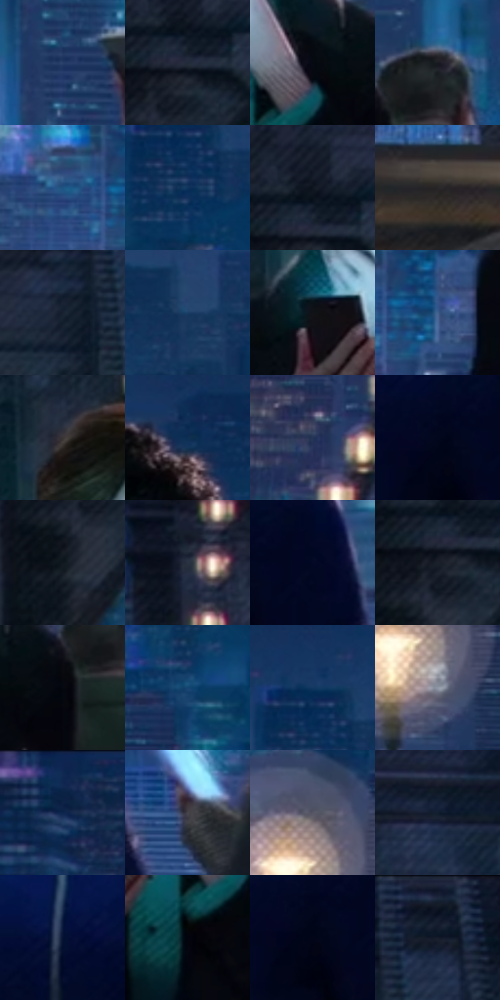

# 电影参考 179

- 状态：常规／活跃；来源世界：miles-home。
- 视角：near-level；景别：medium；场景：street。
- 时段：night-appearance（外观依据，中置信度；具体时间／晨昏未知）；光照：night-mixed。
- 材质候选：skin, fabric, stone, metal, screen, sky（帧级，不是像素分割）。
- 明暗组：very-dark；L* P5/P50/P95：1.86815 / 16.85804 / 40.45004。
- 资格门禁：无附加门禁。
- 原截图 SHA-256：`dce8ca165088726930c94ed451319ed1dce61e958fcb635bb199bbde1e818313`；尺寸：2880 × 1212。
- sRGB 像素 SHA-256：`0bfcf7f05abed176c807bd3cf517994ae47765eb12fade615725df4fa21a96b0`。

## 观察与迁移

手机光与城市环境，石构件与近景人脸不同明度层。

本公开版保存32个128×128原像素色卡上下文；图集格子并非原场景相邻位置。原rect、图集tile和像素SHA见 `data/palette-crops.json`。上下文不足时不得批准替色，不能以小样推断完整构图。

## 实测色卡

颜色比例分母为保留采样像素，不是材料面积；全部 32 色参与全库匹配。表内四舍五入仅用于阅读，原精度在 JSON。

| ID | HEX | Lab | 原图 xy | 像素数 | 比例 | 明度角色 |
| --- | --- | --- | --- | ---: | ---: | --- |
| 179-S01 | #29416B | [27.608613, 4.92684, -27.282365] | [2012, 476] | 9860 | 5.081322% | shadow |
| 179-S02 | #222B39 | [17.287975, 0.333914, -10.21917] | [472, 220] | 9660 | 4.978252% | deep-shadow |
| 179-S03 | #050912 | [2.450567, 0.473384, -4.503853] | [1392, 556] | 9254 | 4.769021% | deep-shadow |
| 179-S04 | #191B22 | [9.845051, 1.058405, -5.125541] | [1540, 500] | 7986 | 4.115561% | deep-shadow |
| 179-S05 | #1D5482 | [34.421794, -0.945021, -30.942458] | [980, 600] | 7936 | 4.089794% | shadow |
| 179-S06 | #0E345C | [21.288454, 3.045666, -27.67826] | [2724, 156] | 7869 | 4.055266% | shadow |
| 179-S07 | #0F151F | [6.655268, 0.495981, -7.800841] | [468, 176] | 7676 | 3.955804% | deep-shadow |
| 179-S08 | #292628 | [15.544126, 1.853228, -0.821322] | [160, 936] | 6692 | 3.448702% | deep-shadow |
| 179-S09 | #172231 | [12.90918, 0.234776, -11.395284] | [696, 156] | 6666 | 3.435303% | deep-shadow |
| 179-S10 | #183E65 | [25.498479, 1.299101, -26.826306] | [1908, 152] | 6536 | 3.368308% | shadow |
| 179-S11 | #111217 | [5.542907, 0.771685, -3.274892] | [1236, 516] | 6470 | 3.334295% | deep-shadow |
| 179-S12 | #426390 | [41.366032, 1.7444, -28.418] | [1076, 612] | 6384 | 3.289975% | midtone |
| 179-S13 | #393435 | [22.241701, 2.422298, 0.168598] | [1232, 272] | 6320 | 3.256993% | shadow |
| 179-S14 | #0D2E53 | [18.643514, 3.304001, -25.923942] | [2356, 80] | 6228 | 3.209581% | deep-shadow |
| 179-S15 | #233457 | [21.948395, 4.975694, -23.271678] | [96, 648] | 6224 | 3.207520% | shadow |
| 179-S16 | #02071D | [2.290115, 3.347439, -12.898832] | [2516, 628] | 5796 | 2.986951% | deep-shadow |
| 179-S17 | #101920 | [8.214977, -1.740109, -6.17746] | [424, 324] | 5620 | 2.896250% | deep-shadow |
| 179-S18 | #2A3341 | [20.985903, 0.199615, -9.993675] | [260, 88] | 5481 | 2.824617% | shadow |
| 179-S19 | #030924 | [3.089701, 5.261123, -17.17874] | [2604, 620] | 5457 | 2.812249% | deep-shadow |
| 179-S20 | #1C212B | [12.664872, 0.697312, -7.416817] | [448, 240] | 5313 | 2.738039% | deep-shadow |
| 179-S21 | #06070F | [2.033806, 0.953365, -3.39863] | [1480, 576] | 5139 | 2.648368% | deep-shadow |
| 179-S22 | #164471 | [28.104583, 1.839724, -30.36073] | [2552, 348] | 5043 | 2.598895% | shadow |
| 179-S23 | #133862 | [23.162927, 3.449044, -28.605953] | [2716, 84] | 4971 | 2.561790% | shadow |
| 179-S24 | #919AA9 | [63.338756, -0.069009, -8.91258] | [1780, 420] | 4961 | 2.556637% | light |
| 179-S25 | #13264A | [15.585818, 6.287634, -24.698937] | [36, 48] | 4948 | 2.549937% | deep-shadow |
| 179-S26 | #48464B | [30.073959, 1.94438, -2.695894] | [2748, 732] | 4916 | 2.533446% | shadow |
| 179-S27 | #555566 | [36.719857, 3.920719, -9.769174] | [1760, 320] | 4831 | 2.489642% | shadow |
| 179-S28 | #121E2F | [11.009112, 0.861796, -12.936764] | [1072, 84] | 4537 | 2.338129% | deep-shadow |
| 179-S29 | #061333 | [6.714741, 8.077579, -22.728864] | [2308, 592] | 4228 | 2.178887% | deep-shadow |
| 179-S30 | #01040D | [1.10499, 0.502955, -3.780422] | [1340, 660] | 4132 | 2.129414% | deep-shadow |
| 179-S31 | #010517 | [1.597252, 2.183702, -9.158618] | [2524, 648] | 3776 | 1.945950% | deep-shadow |
| 179-S32 | #070F20 | [4.435655, 2.143048, -11.991963] | [784, 40] | 3134 | 1.615098% | deep-shadow |

## 色阶与空间分布

- 采样 ROI：`[0.01, 0.02, 0.98, 0.94]`；步长：4；样本数：194044。
- 排除区：`[]`。
- 深暗、暗、中、亮、高光五段计数：`[117184, 66755, 7580, 2008, 517]`。
- RGB 各 256 箱、L* 100 箱、13×5 色相明度表和 3×3 空间统计全部保存在 [总数据](../film-library.json)。
- [可视化档案](../../references/library.html)按需绘制直方图，不存 2,094 张重复图表图片。

## 纹理特征占比

**这是分块图像特征的面积占比，不是波点／排线／丝网／错版的精确语义覆盖率。** 窗格、发丝、织物也会产生方向或周期特征。
原图 ROI 像素 3115310；已测块覆盖 3115310（100.0000%）；未测 0。

| 特征 | 块覆盖像素 | 占已测面积 | 阈值敏感范围 |
| --- | ---: | ---: | --- |
| low-contrast | 137984 | 4.4292% | 3.3774% ~ 5.4811% |
| directional-structure | 324480 | 10.4157% | 3.2254% ~ 20.4081% |
| periodic-structure | 2399150 | 77.0116% | 73.6753% ~ 77.3649% |
| mixed-detail | 253696 | 8.1435% | 2.5392% ~ 13.9286% |

阈值敏感范围不是统计置信区间。逐块坐标、尺度、对比、方向一致性、频谱集中度、频率与角度见 [全量特征记录](../texture-features.jsonl)，以帧号定位。
四种印刷层的真实像素覆盖仍标为 `null`，不能填 0，也不能拿上表代替。不得据这些代理测量删除唯一证据。

[测量方法与保留策略](../../references/library-retention.md) · [分类索引](../archive/README.md)
