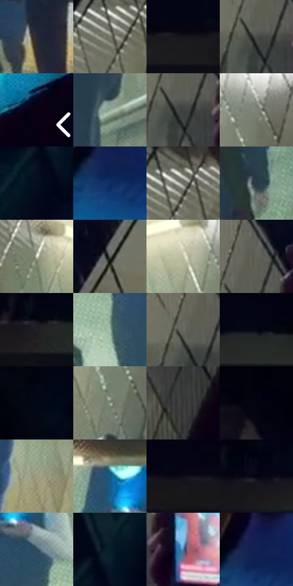

# 电影参考 180

- 状态：常规／活跃；来源世界：miles-home。
- 视角：high-angle；景别：environment-wide；场景：interior。
- 时段：interior-time-unknown（外观依据，中置信度；具体时间／晨昏未知）；光照：cool-interior。
- 材质候选：skin, fabric, stone, metal（帧级，不是像素分割）。
- 明暗组：dark；L* P5/P50/P95：0.90309 / 30.23412 / 78.04057。
- 资格门禁：无附加门禁。
- 原截图 SHA-256：`0a4c693e5359e14e9d91caf9095033d72242a0df3d1d6d75debc6ad457556c58`；尺寸：2880 × 1202。
- sRGB 像素 SHA-256：`db4bec9d7c23b02ecc15818047644c3151d9e188f2a201d2110c194532b56f04`。

## 观察与迁移

地铁入口顶灯集中，人形与瓷砖结构分离。

本公开版保存32个128×128原像素色卡上下文；图集格子并非原场景相邻位置。原rect、图集tile和像素SHA见 `data/palette-crops.json`。上下文不足时不得批准替色，不能以小样推断完整构图。

## 实测色卡

颜色比例分母为保留采样像素，不是材料面积；全部 32 色参与全库匹配。表内四舍五入仅用于阅读，原精度在 JSON。

| ID | HEX | Lab | 原图 xy | 像素数 | 比例 | 明度角色 |
| --- | --- | --- | --- | ---: | ---: | --- |
| 180-S01 | #272833 | [16.443914, 2.495359, -7.275077] | [1152, 804] | 10685 | 5.546385% | deep-shadow |
| 180-S02 | #757769 | [49.490731, -3.464237, 7.45006] | [492, 296] | 9054 | 4.699763% | midtone |
| 180-S03 | #16151B | [7.100135, 2.036644, -4.006685] | [1600, 76] | 8913 | 4.626573% | deep-shadow |
| 180-S04 | #4A4F4C | [33.069871, -2.684281, 1.074873] | [2512, 512] | 8575 | 4.451123% | shadow |
| 180-S05 | #090112 | [1.115178, 4.723866, -6.425843] | [2800, 572] | 8336 | 4.327063% | deep-shadow |
| 180-S06 | #94AA95 | [67.437902, -11.771773, 8.275465] | [2008, 596] | 8203 | 4.258025% | light |
| 180-S07 | #404442 | [28.426302, -2.112057, 0.637971] | [2524, 520] | 8092 | 4.200407% | shadow |
| 180-S08 | #7D8374 | [53.871256, -5.141321, 7.354878] | [2236, 332] | 7423 | 3.853141% | midtone |
| 180-S09 | #040E1E | [3.916459, 1.198116, -11.235981] | [116, 388] | 7065 | 3.667310% | deep-shadow |
| 180-S10 | #13366A | [23.056439, 8.255457, -33.960485] | [36, 952] | 6677 | 3.465907% | shadow |
| 180-S11 | #6C6F63 | [46.255109, -3.527665, 6.293182] | [524, 268] | 6591 | 3.421266% | midtone |
| 180-S12 | #283A44 | [23.319167, -4.231652, -8.476833] | [1364, 700] | 6553 | 3.401541% | shadow |
| 180-S13 | #DBDFCD | [88.085608, -4.503403, 8.356543] | [724, 304] | 6389 | 3.316411% | highlight |
| 180-S14 | #545A55 | [37.577231, -3.449075, 2.072833] | [224, 616] | 6307 | 3.273847% | shadow |
| 180-S15 | #BEBFA3 | [76.590202, -5.183637, 14.041045] | [2128, 320] | 6155 | 3.194946% | light |
| 180-S16 | #616357 | [41.458643, -3.183483, 6.558877] | [2540, 432] | 6142 | 3.188198% | midtone |
| 180-S17 | #201F26 | [12.136086, 2.313309, -4.548184] | [1288, 84] | 5933 | 3.079710% | deep-shadow |
| 180-S18 | #9EBDAC | [73.960169, -13.871788, 5.111944] | [1352, 432] | 5905 | 3.065176% | light |
| 180-S19 | #656A60 | [44.11695, -3.965753, 4.955084] | [2496, 480] | 5805 | 3.013268% | midtone |
| 180-S20 | #030413 | [1.383759, 2.165404, -6.697289] | [1044, 28] | 5724 | 2.971222% | deep-shadow |
| 180-S21 | #020717 | [2.047716, 1.64408, -8.493844] | [2616, 56] | 5552 | 2.881940% | deep-shadow |
| 180-S22 | #879381 | [59.528534, -7.835576, 8.070861] | [2188, 460] | 5524 | 2.867406% | midtone |
| 180-S23 | #373736 | [23.03633, -0.228828, 0.627074] | [2564, 752] | 5317 | 2.759956% | shadow |
| 180-S24 | #02000C | [0.356288, 2.207184, -4.399424] | [2384, 36] | 5258 | 2.729330% | deep-shadow |
| 180-S25 | #9D9D83 | [64.096953, -4.59493, 13.641674] | [2016, 796] | 5044 | 2.618247% | light |
| 180-S26 | #165B86 | [36.692513, -4.646042, -29.822148] | [1412, 256] | 4235 | 2.198310% | shadow |
| 180-S27 | #0F0C18 | [3.888136, 3.447933, -6.469775] | [1736, 68] | 4064 | 2.109547% | deep-shadow |
| 180-S28 | #080A19 | [3.060972, 2.539618, -8.519746] | [784, 40] | 3432 | 1.781487% | deep-shadow |
| 180-S29 | #2F4A5D | [30.137025, -4.352702, -14.364509] | [1480, 364] | 3345 | 1.736327% | shadow |
| 180-S30 | #0D1E2D | [10.582936, -1.357, -12.170951] | [148, 304] | 2274 | 1.180391% | deep-shadow |
| 180-S31 | #557AA0 | [49.962416, -2.340722, -24.438515] | [2636, 536] | 2040 | 1.058926% | midtone |
| 180-S32 | #18254E | [15.835711, 9.725878, -27.013057] | [36, 908] | 2036 | 1.056850% | deep-shadow |

## 色阶与空间分布

- 采样 ROI：`[0.01, 0.02, 0.98, 0.94]`；步长：4；样本数：192648。
- 排除区：`[]`。
- 深暗、暗、中、亮、高光五段计数：`[71616, 46134, 41127, 25780, 7991]`。
- RGB 各 256 箱、L* 100 箱、13×5 色相明度表和 3×3 空间统计全部保存在 [总数据](../film-library.json)。
- [可视化档案](../../references/library.html)按需绘制直方图，不存 2,094 张重复图表图片。

## 纹理特征占比

**这是分块图像特征的面积占比，不是波点／排线／丝网／错版的精确语义覆盖率。** 窗格、发丝、织物也会产生方向或周期特征。
原图 ROI 像素 3087370；已测块覆盖 3087370（100.0000%）；未测 0。

| 特征 | 块覆盖像素 | 占已测面积 | 阈值敏感范围 |
| --- | ---: | ---: | --- |
| low-contrast | 172682 | 5.5932% | 5.2574% ~ 6.1239% |
| directional-structure | 457088 | 14.8051% | 6.7040% ~ 32.8979% |
| periodic-structure | 2344576 | 75.9409% | 59.0504% ~ 79.2659% |
| mixed-detail | 113024 | 3.6609% | 2.7944% ~ 7.9063% |

阈值敏感范围不是统计置信区间。逐块坐标、尺度、对比、方向一致性、频谱集中度、频率与角度见 [全量特征记录](../texture-features.jsonl)，以帧号定位。
四种印刷层的真实像素覆盖仍标为 `null`，不能填 0，也不能拿上表代替。不得据这些代理测量删除唯一证据。

[测量方法与保留策略](../../references/library-retention.md) · [分类索引](../archive/README.md)
