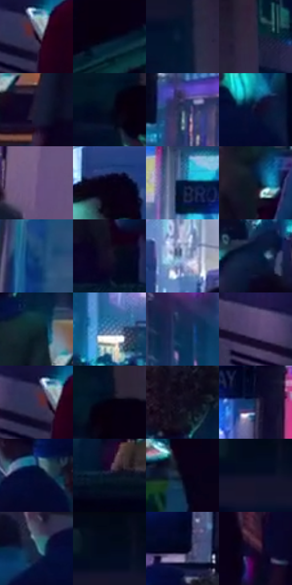

# 电影参考 181

- 状态：常规／活跃；来源世界：miles-home。
- 视角：high-angle；景别：environment-wide；场景：street。
- 时段：night-appearance（外观依据，中置信度；具体时间／晨昏未知）；光照：night-mixed。
- 材质候选：skin, fabric, screen, metal, asphalt（帧级，不是像素分割）。
- 明暗组：very-dark；L* P5/P50/P95：0.84818 / 8.94804 / 51.78981。
- 资格门禁：无附加门禁。
- 原截图 SHA-256：`84da822ad4a5c6c4ef4148a542e61024592d553f84412b4cba36e441530b74d5`；尺寸：2880 × 1206。
- sRGB 像素 SHA-256：`fc02098a74f1be2cb3be58182f6034ad5b91bbda791906e675512aa742d60199`。

## 观察与迁移

广告街多人场景，屏幕高彩不均匀覆盖全部肤色。

本公开版保存32个128×128原像素色卡上下文；图集格子并非原场景相邻位置。原rect、图集tile和像素SHA见 `data/palette-crops.json`。上下文不足时不得批准替色，不能以小样推断完整构图。

## 实测色卡

颜色比例分母为保留采样像素，不是材料面积；全部 32 色参与全库匹配。表内四舍五入仅用于阅读，原精度在 JSON。

| ID | HEX | Lab | 原图 xy | 像素数 | 比例 | 明度角色 |
| --- | --- | --- | --- | ---: | ---: | --- |
| 181-S01 | #0E0118 | [1.635138, 7.567079, -9.768544] | [2620, 720] | 9762 | 5.048980% | deep-shadow |
| 181-S02 | #020315 | [1.193711, 2.756577, -8.306219] | [216, 860] | 9619 | 4.975019% | deep-shadow |
| 181-S03 | #031630 | [7.284696, 3.732284, -19.622597] | [640, 188] | 8853 | 4.578838% | deep-shadow |
| 181-S04 | #2C2941 | [17.931847, 7.896546, -14.686075] | [824, 120] | 8732 | 4.516256% | deep-shadow |
| 181-S05 | #1D1C33 | [11.488336, 7.467143, -15.012277] | [2240, 708] | 8665 | 4.481603% | deep-shadow |
| 181-S06 | #051020 | [4.580384, 1.086152, -11.78246] | [56, 408] | 7948 | 4.110765% | deep-shadow |
| 181-S07 | #314060 | [27.196809, 3.747086, -20.836902] | [2208, 316] | 7847 | 4.058527% | shadow |
| 181-S08 | #070624 | [2.734702, 7.508801, -17.707645] | [948, 516] | 7488 | 3.872850% | deep-shadow |
| 181-S09 | #6E5685 | [40.677099, 19.701809, -22.585493] | [2436, 460] | 7207 | 3.727514% | midtone |
| 181-S10 | #090114 | [1.176885, 5.157487, -7.605992] | [1664, 332] | 6975 | 3.607522% | deep-shadow |
| 181-S11 | #2D5F89 | [38.807479, -2.679387, -28.2746] | [1884, 28] | 6953 | 3.596144% | shadow |
| 181-S12 | #0D192C | [8.67581, 2.020232, -14.428566] | [592, 592] | 6872 | 3.554250% | deep-shadow |
| 181-S13 | #144170 | [27.013579, 3.210487, -31.466545] | [2812, 384] | 6808 | 3.521149% | shadow |
| 181-S14 | #181327 | [7.284094, 8.302193, -12.827808] | [604, 764] | 6796 | 3.514942% | deep-shadow |
| 181-S15 | #98B1D6 | [71.536714, -0.124467, -21.478625] | [1836, 288] | 6525 | 3.374779% | light |
| 181-S16 | #0A1B3D | [10.447372, 7.360791, -23.909764] | [1200, 448] | 6268 | 3.241857% | deep-shadow |
| 181-S17 | #11262E | [13.841664, -5.562886, -7.84763] | [2140, 604] | 5909 | 3.056179% | deep-shadow |
| 181-S18 | #577FAD | [52.085763, -0.814484, -28.685557] | [1428, 308] | 5654 | 2.924291% | midtone |
| 181-S19 | #0D2C4F | [17.696128, 3.004475, -24.744135] | [1312, 152] | 5556 | 2.873605% | deep-shadow |
| 181-S20 | #53446F | [32.080417, 16.37678, -22.557078] | [2484, 692] | 5495 | 2.842055% | shadow |
| 181-S21 | #3B3152 | [22.777191, 12.720768, -18.513433] | [2596, 712] | 5185 | 2.681721% | shadow |
| 181-S22 | #020010 | [0.454399, 2.896619, -6.275801] | [108, 372] | 5157 | 2.667239% | deep-shadow |
| 181-S23 | #100E21 | [4.823692, 5.635659, -12.121692] | [2088, 484] | 4884 | 2.526041% | deep-shadow |
| 181-S24 | #1D2744 | [16.152334, 5.511873, -19.636849] | [2084, 124] | 4724 | 2.443288% | deep-shadow |
| 181-S25 | #030C2D | [4.260601, 7.9536, -22.2074] | [1948, 456] | 4351 | 2.250370% | deep-shadow |
| 181-S26 | #071329 | [6.060469, 3.394294, -16.34506] | [1276, 820] | 4335 | 2.242094% | deep-shadow |
| 181-S27 | #07061A | [2.258027, 4.15916, -10.506992] | [144, 700] | 4283 | 2.215200% | deep-shadow |
| 181-S28 | #0B0F27 | [5.051392, 5.873142, -16.397656] | [540, 104] | 3961 | 2.048659% | deep-shadow |
| 181-S29 | #1A3B52 | [23.52669, -3.833103, -17.524642] | [808, 512] | 3621 | 1.872808% | shadow |
| 181-S30 | #03091A | [2.613025, 1.911481, -10.012769] | [540, 36] | 3398 | 1.757471% | deep-shadow |
| 181-S31 | #03041A | [1.632636, 3.914283, -11.451692] | [2024, 332] | 2499 | 1.292502% | deep-shadow |
| 181-S32 | #27102C | [8.855848, 17.621198, -13.946624] | [1840, 712] | 1016 | 0.525483% | deep-shadow |

## 色阶与空间分布

- 采样 ROI：`[0.01, 0.02, 0.98, 0.94]`；步长：4；样本数：193346。
- 排除区：`[]`。
- 深暗、暗、中、亮、高光五段计数：`[135636, 40096, 10940, 5677, 997]`。
- RGB 各 256 箱、L* 100 箱、13×5 色相明度表和 3×3 空间统计全部保存在 [总数据](../film-library.json)。
- [可视化档案](../../references/library.html)按需绘制直方图，不存 2,094 张重复图表图片。

## 纹理特征占比

**这是分块图像特征的面积占比，不是波点／排线／丝网／错版的精确语义覆盖率。** 窗格、发丝、织物也会产生方向或周期特征。
原图 ROI 像素 3098546；已测块覆盖 3098546（100.0000%）；未测 0。

| 特征 | 块覆盖像素 | 占已测面积 | 阈值敏感范围 |
| --- | ---: | ---: | --- |
| low-contrast | 62720 | 2.0242% | 1.4954% ~ 2.5529% |
| directional-structure | 491954 | 15.8769% | 6.4542% ~ 25.8243% |
| periodic-structure | 2445568 | 78.9263% | 72.1515% ~ 82.0039% |
| mixed-detail | 98304 | 3.1726% | 0.5288% ~ 8.9890% |

阈值敏感范围不是统计置信区间。逐块坐标、尺度、对比、方向一致性、频谱集中度、频率与角度见 [全量特征记录](../texture-features.jsonl)，以帧号定位。
四种印刷层的真实像素覆盖仍标为 `null`，不能填 0，也不能拿上表代替。不得据这些代理测量删除唯一证据。

[测量方法与保留策略](../../references/library-retention.md) · [分类索引](../archive/README.md)
