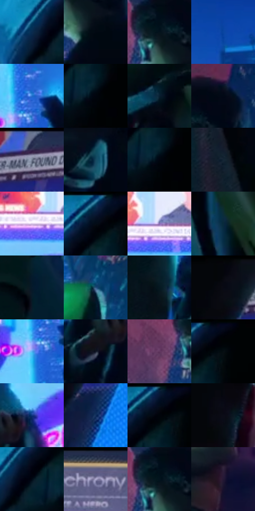

# 电影参考 182

- 状态：常规／活跃；来源世界：miles-home。
- 视角：low-angle；景别：environment-wide；场景：street。
- 时段：night-appearance（外观依据，中置信度；具体时间／晨昏未知）；光照：night-mixed。
- 材质候选：skin, fabric, screen, metal, asphalt（帧级，不是像素分割）。
- 明暗组：very-dark；L* P5/P50/P95：1.0207 / 11.31903 / 64.37199。
- 资格门禁：无附加门禁。
- 原截图 SHA-256：`ed0cb5107694fa8ccad5f1b5aa35060d1cf093473884519955d26a5290480128`；尺寸：2880 × 1216。
- sRGB 像素 SHA-256：`733c45066cdc0bf70ca7f21e4108b8801c8cc74558630e4ba29fcecb698d837c`。

## 观察与迁移

广告街多人场景，屏幕高彩不均匀覆盖全部肤色。

本公开版保存32个128×128原像素色卡上下文；图集格子并非原场景相邻位置。原rect、图集tile和像素SHA见 `data/palette-crops.json`。上下文不足时不得批准替色，不能以小样推断完整构图。

## 实测色卡

颜色比例分母为保留采样像素，不是材料面积；全部 32 色参与全库匹配。表内四舍五入仅用于阅读，原精度在 JSON。

| ID | HEX | Lab | 原图 xy | 像素数 | 比例 | 明度角色 |
| --- | --- | --- | --- | ---: | ---: | --- |
| 182-S01 | #0A2B4F | [17.256704, 3.333925, -25.451125] | [2656, 144] | 10193 | 5.234105% | deep-shadow |
| 182-S02 | #020812 | [2.079562, 0.089447, -5.066587] | [828, 360] | 9883 | 5.074920% | deep-shadow |
| 182-S03 | #05121C | [4.956078, -1.355571, -8.108797] | [776, 272] | 8689 | 4.461801% | deep-shadow |
| 182-S04 | #0A45A0 | [31.480354, 19.774609, -53.981527] | [1724, 132] | 8671 | 4.452558% | shadow |
| 182-S05 | #246FCD | [47.169788, 11.765936, -55.000155] | [1660, 512] | 8623 | 4.427910% | midtone |
| 182-S06 | #01050D | [1.301068, 0.102394, -3.494104] | [2788, 172] | 8595 | 4.413532% | deep-shadow |
| 182-S07 | #061F30 | [10.791062, -2.437446, -14.049527] | [2632, 672] | 7924 | 4.068973% | deep-shadow |
| 182-S08 | #020816 | [2.20827, 0.993889, -7.528128] | [856, 220] | 7304 | 3.750603% | deep-shadow |
| 182-S09 | #293052 | [20.805808, 7.602366, -21.725553] | [412, 32] | 7066 | 3.628390% | shadow |
| 182-S10 | #144960 | [28.792895, -8.497225, -18.453424] | [348, 696] | 6854 | 3.519528% | shadow |
| 182-S11 | #01040F | [1.154028, 0.84755, -4.718276] | [2784, 172] | 6832 | 3.508231% | deep-shadow |
| 182-S12 | #152635 | [14.415021, -1.77305, -11.920489] | [1076, 1052] | 6754 | 3.468178% | deep-shadow |
| 182-S13 | #D6C4E3 | [81.468396, 11.949121, -13.074671] | [1388, 356] | 6540 | 3.358289% | highlight |
| 182-S14 | #020C1A | [3.165033, 0.403188, -9.207984] | [2756, 60] | 6463 | 3.318750% | deep-shadow |
| 182-S15 | #896CB5 | [51.128197, 26.758625, -34.526702] | [1448, 332] | 6434 | 3.303858% | midtone |
| 182-S16 | #082A3B | [15.608051, -5.043755, -14.324688] | [2716, 868] | 6196 | 3.181645% | deep-shadow |
| 182-S17 | #06192B | [8.20289, -0.190623, -14.463234] | [2520, 868] | 5976 | 3.068675% | deep-shadow |
| 182-S18 | #26517E | [33.568025, 0.860757, -29.803547] | [2264, 348] | 5738 | 2.946462% | shadow |
| 182-S19 | #051821 | [7.183568, -3.779674, -8.572355] | [1136, 472] | 5384 | 2.764684% | deep-shadow |
| 182-S20 | #05060C | [1.707682, 0.588318, -2.4051] | [216, 40] | 5270 | 2.706145% | deep-shadow |
| 182-S21 | #57ADF0 | [68.16846, -5.799848, -41.153422] | [1624, 568] | 5119 | 2.628606% | light |
| 182-S22 | #111625 | [7.465811, 2.714502, -11.091117] | [1236, 552] | 4990 | 2.562365% | deep-shadow |
| 182-S23 | #623860 | [30.083416, 25.504079, -15.959712] | [692, 316] | 4667 | 2.396504% | shadow |
| 182-S24 | #010206 | [0.569186, 0.294641, -1.605767] | [2820, 36] | 4582 | 2.352857% | deep-shadow |
| 182-S25 | #0F357E | [24.172121, 17.07389, -44.915434] | [1320, 480] | 4508 | 2.314858% | shadow |
| 182-S26 | #11305D | [20.13566, 6.746913, -30.175687] | [260, 204] | 4463 | 2.291750% | shadow |
| 182-S27 | #00040A | [0.98218, -0.211804, -2.638963] | [2776, 64] | 4205 | 2.159267% | deep-shadow |
| 182-S28 | #0B0C17 | [3.576454, 1.956327, -6.198412] | [68, 356] | 3976 | 2.041676% | deep-shadow |
| 182-S29 | #000915 | [2.253561, -0.169785, -6.772588] | [2712, 140] | 3874 | 1.989299% | deep-shadow |
| 182-S30 | #5B5C82 | [40.393416, 8.932615, -21.342962] | [1496, 44] | 3254 | 1.670929% | midtone |
| 182-S31 | #02141D | [5.436593, -3.080388, -8.182668] | [772, 268] | 3248 | 1.667848% | deep-shadow |
| 182-S32 | #251935 | [11.590736, 13.178681, -16.229993] | [1564, 888] | 2467 | 1.266804% | deep-shadow |

## 色阶与空间分布

- 采样 ROI：`[0.01, 0.02, 0.98, 0.94]`；步长：4；样本数：194742。
- 排除区：`[]`。
- 深暗、暗、中、亮、高光五段计数：`[125500, 40441, 17208, 7979, 3614]`。
- RGB 各 256 箱、L* 100 箱、13×5 色相明度表和 3×3 空间统计全部保存在 [总数据](../film-library.json)。
- [可视化档案](../../references/library.html)按需绘制直方图，不存 2,094 张重复图表图片。

## 纹理特征占比

**这是分块图像特征的面积占比，不是波点／排线／丝网／错版的精确语义覆盖率。** 窗格、发丝、织物也会产生方向或周期特征。
原图 ROI 像素 3126486；已测块覆盖 3126486（100.0000%）；未测 0。

| 特征 | 块覆盖像素 | 占已测面积 | 阈值敏感范围 |
| --- | ---: | ---: | --- |
| low-contrast | 228864 | 7.3202% | 6.4072% ~ 9.9404% |
| directional-structure | 441174 | 14.1109% | 7.1114% ~ 31.7603% |
| periodic-structure | 2345984 | 75.0358% | 60.3955% ~ 75.0358% |
| mixed-detail | 110464 | 3.5332% | 1.4370% ~ 8.7736% |

阈值敏感范围不是统计置信区间。逐块坐标、尺度、对比、方向一致性、频谱集中度、频率与角度见 [全量特征记录](../texture-features.jsonl)，以帧号定位。
四种印刷层的真实像素覆盖仍标为 `null`，不能填 0，也不能拿上表代替。不得据这些代理测量删除唯一证据。

[测量方法与保留策略](../../references/library-retention.md) · [分类索引](../archive/README.md)
