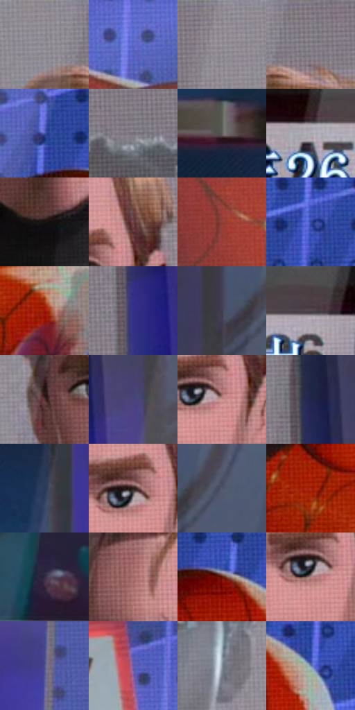

# 电影参考 183

- 状态：条件／活跃；来源世界：miles-home。
- 视角：near-level；景别：detail；场景：reflection。
- 时段：interior-time-unknown（外观依据，中置信度；具体时间／晨昏未知）；光照：cool-interior。
- 材质候选：screen, glass, skin（帧级，不是像素分割）。
- 明暗组：dark；L* P5/P50/P95：11.38091 / 37.52769 / 65.98671。
- 资格门禁：secondary-image, reflection。
- 原截图 SHA-256：`d1cb621022e806905a1aaf7970298a5a2fda4748558aacc6f26bd3b9be109111`；尺寸：2880 × 1202。
- sRGB 像素 SHA-256：`3fa850f09df931d192a32f0888dbef5d5e7424748703e94794e33165e86cae00`。

## 观察与迁移

电视显示与表面人脸映像叠加，分别属于显示和反射。

本公开版保存32个128×128原像素色卡上下文；图集格子并非原场景相邻位置。原rect、图集tile和像素SHA见 `data/palette-crops.json`。上下文不足时不得批准替色，不能以小样推断完整构图。

## 实测色卡

颜色比例分母为保留采样像素，不是材料面积；全部 32 色参与全库匹配。表内四舍五入仅用于阅读，原精度在 JSON。

| ID | HEX | Lab | 原图 xy | 像素数 | 比例 | 明度角色 |
| --- | --- | --- | --- | ---: | ---: | --- |
| 183-S01 | #96919A | [60.841554, 3.582185, -4.087136] | [1884, 32] | 12416 | 6.444915% | light |
| 183-S02 | #5D6BCF | [48.692816, 23.566201, -53.56404] | [596, 160] | 11031 | 5.725987% | midtone |
| 183-S03 | #8B858F | [56.334489, 4.206464, -4.547076] | [1744, 32] | 10777 | 5.594141% | midtone |
| 183-S04 | #817B85 | [52.427378, 4.266501, -4.608892] | [1984, 28] | 10497 | 5.448798% | midtone |
| 183-S05 | #4958AF | [40.393492, 20.807398, -48.389673] | [1016, 200] | 8856 | 4.596985% | midtone |
| 183-S06 | #746F7A | [47.607074, 4.18405, -5.380386] | [1556, 264] | 8495 | 4.409597% | midtone |
| 183-S07 | #63575C | [38.273158, 5.864104, -1.092431] | [36, 508] | 8249 | 4.281903% | shadow |
| 183-S08 | #AAAAB4 | [69.888142, 1.935116, -5.116857] | [2124, 1116] | 7885 | 4.092957% | light |
| 183-S09 | #170F10 | [5.069657, 3.451284, 0.646975] | [2004, 892] | 7688 | 3.990698% | deep-shadow |
| 183-S10 | #6E413E | [32.797335, 19.160542, 10.16154] | [2140, 424] | 7450 | 3.867157% | shadow |
| 183-S11 | #953E39 | [38.078359, 36.242153, 21.413431] | [728, 440] | 7339 | 3.809539% | shadow |
| 183-S12 | #3346A0 | [33.180964, 23.249755, -51.153961] | [1336, 84] | 7152 | 3.712470% | shadow |
| 183-S13 | #A01406 | [33.96102, 53.537231, 45.164256] | [1208, 896] | 6562 | 3.406212% | shadow |
| 183-S14 | #333187 | [25.710605, 28.13607, -47.972068] | [2568, 620] | 6499 | 3.373510% | shadow |
| 183-S15 | #3E3C50 | [26.259269, 5.817343, -11.78503] | [2716, 188] | 6464 | 3.355342% | shadow |
| 183-S16 | #4F464B | [30.761309, 4.827146, -1.604646] | [2280, 1096] | 6297 | 3.268656% | shadow |
| 183-S17 | #553333 | [25.376913, 15.371785, 6.466271] | [1840, 516] | 5678 | 2.947344% | shadow |
| 183-S18 | #48437C | [31.455742, 17.423597, -31.768112] | [2672, 524] | 5537 | 2.874154% | shadow |
| 183-S19 | #C89190 | [65.393565, 20.645176, 8.771638] | [2104, 504] | 5230 | 2.714796% | light |
| 183-S20 | #1F274C | [16.815541, 9.103194, -24.05653] | [2568, 184] | 5155 | 2.675865% | deep-shadow |
| 183-S21 | #283A5C | [24.479967, 3.942057, -22.543503] | [156, 644] | 4787 | 2.484843% | shadow |
| 183-S22 | #2C1C1E | [12.350242, 8.25995, 1.794303] | [2080, 484] | 4702 | 2.440721% | deep-shadow |
| 183-S23 | #4F546A | [36.067478, 3.429244, -13.299845] | [2808, 172] | 4627 | 2.401790% | shadow |
| 183-S24 | #AC2713 | [38.325429, 52.215694, 44.090028] | [1020, 812] | 4607 | 2.391408% | shadow |
| 183-S25 | #342A43 | [19.187567, 10.7327, -14.043171] | [1736, 1036] | 4511 | 2.341576% | deep-shadow |
| 183-S26 | #9E6563 | [48.85779, 22.745257, 10.714498] | [1924, 380] | 3967 | 2.059196% | midtone |
| 183-S27 | #68120C | [21.591137, 36.969924, 27.369704] | [1100, 264] | 3693 | 1.916968% | shadow |
| 183-S28 | #AC7F7E | [57.518192, 17.257737, 7.381651] | [2072, 512] | 2030 | 1.053735% | midtone |
| 183-S29 | #52528F | [37.501073, 16.354426, -33.823919] | [360, 464] | 1872 | 0.971720% | shadow |
| 183-S30 | #665CAC | [43.443719, 24.104186, -41.62068] | [436, 68] | 1157 | 0.600577% | midtone |
| 183-S31 | #85909C | [59.281188, -1.396948, -7.687343] | [1648, 688] | 1060 | 0.550226% | midtone |
| 183-S32 | #6F85B3 | [55.490163, 3.776307, -26.744234] | [1208, 316] | 378 | 0.196213% | midtone |

## 色阶与空间分布

- 采样 ROI：`[0.01, 0.02, 0.98, 0.94]`；步长：4；样本数：192648。
- 排除区：`[]`。
- 深暗、暗、中、亮、高光五段计数：`[22594, 83937, 64487, 21439, 191]`。
- RGB 各 256 箱、L* 100 箱、13×5 色相明度表和 3×3 空间统计全部保存在 [总数据](../film-library.json)。
- [可视化档案](../../references/library.html)按需绘制直方图，不存 2,094 张重复图表图片。

## 纹理特征占比

**这是分块图像特征的面积占比，不是波点／排线／丝网／错版的精确语义覆盖率。** 窗格、发丝、织物也会产生方向或周期特征。
原图 ROI 像素 3087370；已测块覆盖 3087370（100.0000%）；未测 0。

| 特征 | 块覆盖像素 | 占已测面积 | 阈值敏感范围 |
| --- | ---: | ---: | --- |
| low-contrast | 0 | 0.0000% | 0.0000% ~ 0.0000% |
| directional-structure | 490890 | 15.8999% | 11.6960% ~ 22.2266% |
| periodic-structure | 2498176 | 80.9160% | 77.2427% ~ 80.9160% |
| mixed-detail | 98304 | 3.1841% | 0.5307% ~ 8.6318% |

阈值敏感范围不是统计置信区间。逐块坐标、尺度、对比、方向一致性、频谱集中度、频率与角度见 [全量特征记录](../texture-features.jsonl)，以帧号定位。
四种印刷层的真实像素覆盖仍标为 `null`，不能填 0，也不能拿上表代替。不得据这些代理测量删除唯一证据。

[测量方法与保留策略](../../references/library-retention.md) · [分类索引](../archive/README.md)
