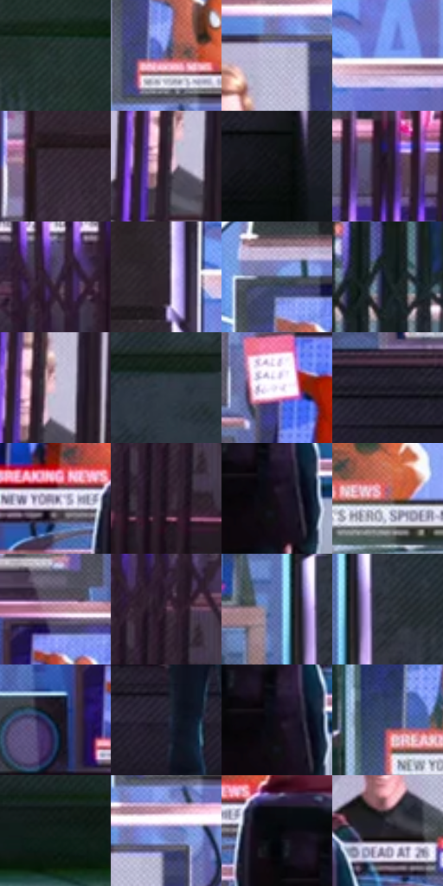

# 电影参考 184

- 状态：条件／活跃；来源世界：miles-home。
- 视角：near-level；景别：environment-wide；场景：street。
- 时段：night-appearance（外观依据，中置信度；具体时间／晨昏未知）；光照：night-mixed。
- 材质候选：screen, glass, metal, fabric（帧级，不是像素分割）。
- 明暗组：very-dark；L* P5/P50/P95：4.01987 / 19.5594 / 79.25769。
- 资格门禁：secondary-image。
- 原截图 SHA-256：`0415b619d6a3f1ac1e3026a005e1a99aac638ded6f0fca68c82b16fc7ada36fe`；尺寸：2880 × 1206。
- sRGB 像素 SHA-256：`c1b3d483583ad1b5af6edd9d842aac7d74afc300e30ab7ae16fc3a5e0d395c5d`。

## 观察与迁移

整面电视橱窗，屏内人物不算现场群像。

本公开版保存32个128×128原像素色卡上下文；图集格子并非原场景相邻位置。原rect、图集tile和像素SHA见 `data/palette-crops.json`。上下文不足时不得批准替色，不能以小样推断完整构图。

## 实测色卡

颜色比例分母为保留采样像素，不是材料面积；全部 32 色参与全库匹配。表内四舍五入仅用于阅读，原精度在 JSON。

| ID | HEX | Lab | 原图 xy | 像素数 | 比例 | 明度角色 |
| --- | --- | --- | --- | ---: | ---: | --- |
| 184-S01 | #21302E | [18.515848, -6.776744, -0.747092] | [2132, 308] | 8648 | 4.472810% | deep-shadow |
| 184-S02 | #625C79 | [40.624001, 8.93487, -15.452747] | [1644, 308] | 8577 | 4.436089% | midtone |
| 184-S03 | #B4B3CD | [73.772599, 5.495174, -12.985931] | [1600, 456] | 8276 | 4.280409% | light |
| 184-S04 | #80A2EC | [66.887691, 7.665586, -40.831524] | [1028, 72] | 7970 | 4.122144% | light |
| 184-S05 | #332735 | [17.515542, 8.721236, -6.929376] | [528, 308] | 7951 | 4.112317% | deep-shadow |
| 184-S06 | #2D202F | [14.379127, 9.617072, -7.51433] | [340, 544] | 7705 | 3.985084% | deep-shadow |
| 184-S07 | #0C0D10 | [3.644014, 0.229697, -1.54751] | [1908, 996] | 7650 | 3.956637% | deep-shadow |
| 184-S08 | #261B28 | [11.615077, 8.420186, -6.732087] | [232, 332] | 7465 | 3.860954% | deep-shadow |
| 184-S09 | #4C3F5C | [29.067241, 12.179233, -15.168049] | [164, 684] | 7359 | 3.806130% | shadow |
| 184-S10 | #302631 | [16.681905, 7.15604, -5.414674] | [916, 84] | 7071 | 3.657174% | deep-shadow |
| 184-S11 | #4A5672 | [36.604378, 2.729373, -17.482765] | [1628, 180] | 7058 | 3.650450% | shadow |
| 184-S12 | #1C2628 | [14.322955, -3.775179, -2.762218] | [2792, 200] | 6925 | 3.581662% | deep-shadow |
| 184-S13 | #D5BFD6 | [79.763455, 11.826966, -8.642665] | [360, 508] | 6470 | 3.346332% | light |
| 184-S14 | #313A46 | [24.067934, -0.47513, -8.6128] | [2180, 712] | 6340 | 3.279096% | shadow |
| 184-S15 | #EFE8F6 | [92.890753, 4.850639, -5.920799] | [1244, 500] | 6093 | 3.151345% | highlight |
| 184-S16 | #1B1A26 | [9.88945, 3.892495, -8.01024] | [1692, 912] | 5779 | 2.988942% | deep-shadow |
| 184-S17 | #8A849F | [56.494802, 7.83342, -13.543609] | [1300, 648] | 5759 | 2.978598% | midtone |
| 184-S18 | #231623 | [9.42158, 9.486349, -6.402849] | [308, 780] | 5678 | 2.936704% | deep-shadow |
| 184-S19 | #180F1A | [5.513991, 6.297262, -5.560341] | [1464, 752] | 5472 | 2.830159% | deep-shadow |
| 184-S20 | #9F6164 | [48.060342, 25.541666, 9.014212] | [2456, 136] | 5431 | 2.808954% | midtone |
| 184-S21 | #BA8696 | [61.388334, 22.335967, -0.604037] | [1140, 716] | 5045 | 2.609312% | light |
| 184-S22 | #442B3E | [21.224913, 15.147246, -7.329538] | [312, 708] | 5043 | 2.608277% | shadow |
| 184-S23 | #586DA5 | [46.614945, 7.797628, -32.563599] | [1896, 564] | 5022 | 2.597416% | midtone |
| 184-S24 | #2B3239 | [20.401263, -1.110733, -5.425234] | [1960, 584] | 4998 | 2.585003% | shadow |
| 184-S25 | #16151B | [7.100135, 2.036644, -4.006685] | [1056, 808] | 4618 | 2.388464% | deep-shadow |
| 184-S26 | #262536 | [15.495092, 5.135633, -10.845999] | [1372, 952] | 4552 | 2.354329% | deep-shadow |
| 184-S27 | #120C16 | [4.060052, 4.034822, -4.698707] | [1456, 736] | 4522 | 2.338812% | deep-shadow |
| 184-S28 | #344762 | [29.708228, 0.654674, -18.196777] | [2308, 104] | 4425 | 2.288643% | shadow |
| 184-S29 | #121E1B | [10.078375, -6.178707, 0.35735] | [2664, 1064] | 4391 | 2.271058% | deep-shadow |
| 184-S30 | #727DC2 | [54.173524, 13.588033, -37.352776] | [1640, 416] | 4157 | 2.150032% | midtone |
| 184-S31 | #06070C | [1.962068, 0.449257, -2.026644] | [1392, 668] | 3524 | 1.822639% | deep-shadow |
| 184-S32 | #26222B | [14.004422, 4.124974, -5.291715] | [1544, 624] | 3372 | 1.744024% | deep-shadow |

## 色阶与空间分布

- 采样 ROI：`[0.01, 0.02, 0.98, 0.94]`；步长：4；样本数：193346。
- 排除区：`[]`。
- 深暗、暗、中、亮、高光五段计数：`[98849, 35452, 26157, 24088, 8800]`。
- RGB 各 256 箱、L* 100 箱、13×5 色相明度表和 3×3 空间统计全部保存在 [总数据](../film-library.json)。
- [可视化档案](../../references/library.html)按需绘制直方图，不存 2,094 张重复图表图片。

## 纹理特征占比

**这是分块图像特征的面积占比，不是波点／排线／丝网／错版的精确语义覆盖率。** 窗格、发丝、织物也会产生方向或周期特征。
原图 ROI 像素 3098546；已测块覆盖 3098546（100.0000%）；未测 0。

| 特征 | 块覆盖像素 | 占已测面积 | 阈值敏感范围 |
| --- | ---: | ---: | --- |
| low-contrast | 87168 | 2.8132% | 1.0534% ~ 3.6931% |
| directional-structure | 861952 | 27.8180% | 12.8473% ~ 50.3953% |
| periodic-structure | 2083890 | 67.2538% | 48.5513% ~ 78.1720% |
| mixed-detail | 65536 | 2.1151% | 0.0000% ~ 5.2876% |

阈值敏感范围不是统计置信区间。逐块坐标、尺度、对比、方向一致性、频谱集中度、频率与角度见 [全量特征记录](../texture-features.jsonl)，以帧号定位。
四种印刷层的真实像素覆盖仍标为 `null`，不能填 0，也不能拿上表代替。不得据这些代理测量删除唯一证据。

[测量方法与保留策略](../../references/library-retention.md) · [分类索引](../archive/README.md)
