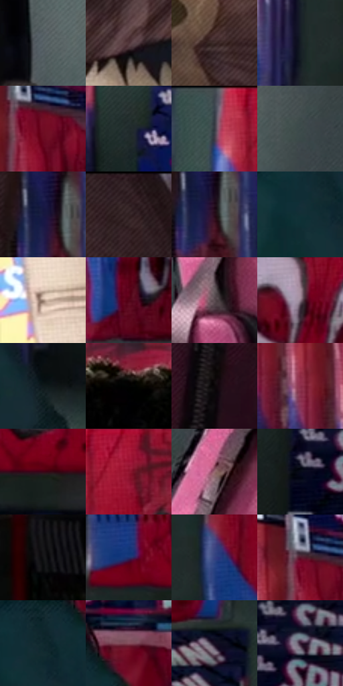

# 电影参考 185

- 状态：常规／活跃；来源世界：miles-home。
- 视角：near-level；景别：medium；场景：interior。
- 时段：daylight-time-unspecified（外观依据，中置信度；具体时间／晨昏未知）；光照：neutral-day。
- 材质候选：skin, hair, fabric, plastic, glass, paper（帧级，不是像素分割）。
- 明暗组：very-dark；L* P5/P50/P95：1.95038 / 18.50608 / 54.92763。
- 资格门禁：无附加门禁。
- 原截图 SHA-256：`f135e145f8be9e11a608ec547338e03f695e024cce0076daf393dc8c48d91e8f`；尺寸：2880 × 1206。
- sRGB 像素 SHA-256：`e86bf847dadf052e3d9f71faafe84d3d07fcdb202b801d969fc9197c9bbb05f5`。

## 观察与迁移

服装店日光与商品陈列，服装图案和皮肤分开。

本公开版保存32个128×128原像素色卡上下文；图集格子并非原场景相邻位置。原rect、图集tile和像素SHA见 `data/palette-crops.json`。上下文不足时不得批准替色，不能以小样推断完整构图。

## 实测色卡

颜色比例分母为保留采样像素，不是材料面积；全部 32 色参与全库匹配。表内四舍五入仅用于阅读，原精度在 JSON。

| ID | HEX | Lab | 原图 xy | 像素数 | 比例 | 明度角色 |
| --- | --- | --- | --- | ---: | ---: | --- |
| 185-S01 | #596268 | [40.990307, -2.093443, -4.580561] | [472, 744] | 8770 | 4.535910% | midtone |
| 185-S02 | #503539 | [25.404287, 12.793949, 2.40635] | [132, 560] | 8552 | 4.423158% | shadow |
| 185-S03 | #3C2929 | [18.829164, 8.877984, 3.520481] | [188, 124] | 8302 | 4.293857% | deep-shadow |
| 185-S04 | #151D23 | [10.254875, -1.743296, -5.282665] | [2468, 112] | 8199 | 4.240584% | deep-shadow |
| 185-S05 | #710C24 | [23.34522, 42.56188, 14.721728] | [892, 100] | 7912 | 4.092146% | shadow |
| 185-S06 | #222C2D | [17.135642, -4.012902, -2.075456] | [1940, 628] | 7722 | 3.993876% | deep-shadow |
| 185-S07 | #363841 | [23.652292, 1.383824, -5.858691] | [1992, 64] | 7701 | 3.983015% | shadow |
| 185-S08 | #3D494A | [30.038195, -4.547337, -2.210179] | [640, 928] | 7556 | 3.908020% | shadow |
| 185-S09 | #16183F | [10.4283, 12.998264, -25.318794] | [516, 188] | 7466 | 3.861471% | deep-shadow |
| 185-S10 | #2C1A1E | [11.743647, 9.682577, 0.917915] | [384, 36] | 7304 | 3.777684% | deep-shadow |
| 185-S11 | #270D19 | [7.131198, 15.285952, -2.154256] | [536, 212] | 6657 | 3.443050% | deep-shadow |
| 185-S12 | #123036 | [17.957704, -8.979193, -7.206174] | [1604, 820] | 6640 | 3.434258% | deep-shadow |
| 185-S13 | #BFA6A9 | [70.325817, 9.595788, 1.8155] | [44, 1024] | 6561 | 3.393398% | light |
| 185-S14 | #560318 | [16.054923, 36.264464, 12.579363] | [916, 484] | 6466 | 3.344264% | deep-shadow |
| 185-S15 | #5B4D51 | [34.244285, 6.614736, -0.187391] | [824, 1008] | 6372 | 3.295646% | shadow |
| 185-S16 | #907C8B | [54.24811, 10.439572, -5.265505] | [2768, 176] | 6345 | 3.281682% | midtone |
| 185-S17 | #0D191A | [7.726452, -4.629497, -2.396134] | [1864, 1016] | 6071 | 3.139967% | deep-shadow |
| 185-S18 | #010101 | [0.274173, -1.7e-05, 3.3e-05] | [1648, 96] | 5885 | 3.043766% | deep-shadow |
| 185-S19 | #0A0608 | [1.91785, 1.32398, -0.388095] | [1176, 692] | 5743 | 2.970323% | deep-shadow |
| 185-S20 | #8B2E4A | [33.855273, 41.802241, 4.590651] | [732, 120] | 5444 | 2.815678% | shadow |
| 185-S21 | #3D0617 | [10.442594, 27.307689, 4.758131] | [2728, 324] | 5199 | 2.688962% | deep-shadow |
| 185-S22 | #911530 | [31.280639, 50.337581, 18.259258] | [2100, 68] | 5018 | 2.595347% | shadow |
| 185-S23 | #986A72 | [49.737196, 19.592875, 2.938712] | [840, 884] | 4872 | 2.519835% | midtone |
| 185-S24 | #060A18 | [2.906078, 1.747646, -7.971915] | [2556, 600] | 4775 | 2.469666% | deep-shadow |
| 185-S25 | #111214 | [5.440383, 0.051234, -1.314102] | [1176, 1028] | 4757 | 2.460356% | deep-shadow |
| 185-S26 | #1B2F6D | [21.467378, 15.659097, -38.445009] | [2608, 280] | 4407 | 2.279333% | shadow |
| 185-S27 | #364181 | [29.785836, 15.883705, -37.632982] | [2560, 80] | 4131 | 2.136584% | shadow |
| 185-S28 | #56152B | [18.755857, 31.636394, 2.592036] | [860, 68] | 4050 | 2.094690% | deep-shadow |
| 185-S29 | #10292D | [14.873772, -8.218462, -5.575534] | [1644, 780] | 3755 | 1.942114% | deep-shadow |
| 185-S30 | #874F5F | [40.524599, 25.678129, 0.841664] | [1736, 708] | 3751 | 1.940045% | midtone |
| 185-S31 | #130C1F | [4.519251, 7.035399, -11.008105] | [2384, 404] | 3690 | 1.908496% | deep-shadow |
| 185-S32 | #331A31 | [13.617465, 16.727733, -10.042547] | [2628, 552] | 3273 | 1.692820% | deep-shadow |

## 色阶与空间分布

- 采样 ROI：`[0.01, 0.02, 0.98, 0.94]`；步长：4；样本数：193346。
- 排除区：`[]`。
- 深暗、暗、中、亮、高光五段计数：`[103899, 63486, 18937, 5445, 1579]`。
- RGB 各 256 箱、L* 100 箱、13×5 色相明度表和 3×3 空间统计全部保存在 [总数据](../film-library.json)。
- [可视化档案](../../references/library.html)按需绘制直方图，不存 2,094 张重复图表图片。

## 纹理特征占比

**这是分块图像特征的面积占比，不是波点／排线／丝网／错版的精确语义覆盖率。** 窗格、发丝、织物也会产生方向或周期特征。
原图 ROI 像素 3098546；已测块覆盖 3098546（100.0000%）；未测 0。

| 特征 | 块覆盖像素 | 占已测面积 | 阈值敏感范围 |
| --- | ---: | ---: | --- |
| low-contrast | 103680 | 3.3461% | 2.2886% ~ 4.2260% |
| directional-structure | 685184 | 22.1131% | 6.4278% ~ 39.5540% |
| periodic-structure | 2233266 | 72.0746% | 57.6286% ~ 80.0061% |
| mixed-detail | 76416 | 2.4662% | 0.5288% ~ 9.3401% |

阈值敏感范围不是统计置信区间。逐块坐标、尺度、对比、方向一致性、频谱集中度、频率与角度见 [全量特征记录](../texture-features.jsonl)，以帧号定位。
四种印刷层的真实像素覆盖仍标为 `null`，不能填 0，也不能拿上表代替。不得据这些代理测量删除唯一证据。

[测量方法与保留策略](../../references/library-retention.md) · [分类索引](../archive/README.md)
