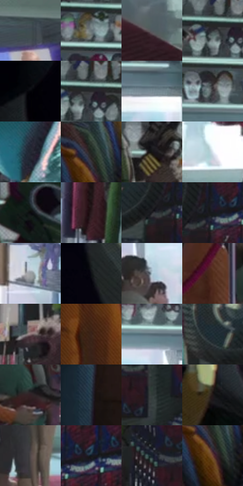

# 电影参考 186

- 状态：常规／活跃；来源世界：miles-home。
- 视角：near-level；景别：environment-wide；场景：interior。
- 时段：daylight-time-unspecified（外观依据，中置信度；具体时间／晨昏未知）；光照：neutral-day。
- 材质候选：skin, hair, fabric, plastic, glass, paper（帧级，不是像素分割）。
- 明暗组：dark；L* P5/P50/P95：2.64541 / 20.14386 / 78.13001。
- 资格门禁：无附加门禁。
- 原截图 SHA-256：`dcc6de37a645a0f2e682378f885d37ba382502e68afcef4770198aca3d3f1a9c`；尺寸：2880 × 1202。
- sRGB 像素 SHA-256：`62e0790d5fe5899654ae8a1e44bc40295b1a387eaa5a8a56519a30cb178f3d63`。

## 观察与迁移

服装店日光与商品陈列，服装图案和皮肤分开。

本公开版保存32个128×128原像素色卡上下文；图集格子并非原场景相邻位置。原rect、图集tile和像素SHA见 `data/palette-crops.json`。上下文不足时不得批准替色，不能以小样推断完整构图。

## 实测色卡

颜色比例分母为保留采样像素，不是材料面积；全部 32 色参与全库匹配。表内四舍五入仅用于阅读，原精度在 JSON。

| ID | HEX | Lab | 原图 xy | 像素数 | 比例 | 明度角色 |
| --- | --- | --- | --- | ---: | ---: | --- |
| 186-S01 | #404C52 | [31.504226, -3.255737, -5.147053] | [1936, 112] | 8759 | 4.546634% | shadow |
| 186-S02 | #687378 | [47.701173, -3.005927, -4.159025] | [1252, 168] | 8174 | 4.242972% | midtone |
| 186-S03 | #525A60 | [37.753484, -1.737436, -4.515967] | [1696, 1008] | 8017 | 4.161476% | shadow |
| 186-S04 | #303135 | [20.369436, 0.538506, -2.688245] | [980, 128] | 7434 | 3.858851% | shadow |
| 186-S05 | #040408 | [1.175841, 0.556106, -1.513562] | [64, 544] | 7418 | 3.850546% | deep-shadow |
| 186-S06 | #2A2A2D | [17.167753, 0.736142, -1.947338] | [1012, 120] | 7079 | 3.674577% | deep-shadow |
| 186-S07 | #778B94 | [56.609305, -5.123285, -7.190602] | [1732, 356] | 7073 | 3.671463% | midtone |
| 186-S08 | #3F3B3F | [25.392777, 2.609983, -1.843843] | [1092, 256] | 6955 | 3.610211% | shadow |
| 186-S09 | #212630 | [15.077312, 0.631489, -7.284535] | [2224, 144] | 6870 | 3.566089% | deep-shadow |
| 186-S10 | #212623 | [14.573501, -3.01174, 1.22718] | [672, 892] | 6633 | 3.443067% | deep-shadow |
| 186-S11 | #151414 | [6.415646, 0.433487, 0.15364] | [816, 280] | 6548 | 3.398945% | deep-shadow |
| 186-S12 | #DCE7F0 | [91.079291, -1.957541, -5.620772] | [1384, 688] | 6531 | 3.390121% | highlight |
| 186-S13 | #0A0A0D | [2.806237, 0.453086, -1.233267] | [676, 112] | 6490 | 3.368839% | deep-shadow |
| 186-S14 | #2C1B1E | [12.045049, 8.971999, 1.354135] | [2024, 824] | 6417 | 3.330946% | deep-shadow |
| 186-S15 | #1E1E22 | [11.414989, 1.047995, -2.718707] | [2640, 156] | 6312 | 3.276442% | deep-shadow |
| 186-S16 | #171A1F | [9.155748, 0.024074, -3.943308] | [2696, 132] | 6309 | 3.274885% | deep-shadow |
| 186-S17 | #989DA1 | [64.45322, -0.99716, -2.703972] | [1744, 676] | 6267 | 3.253083% | light |
| 186-S18 | #0E0F14 | [4.385546, 0.683855, -2.882377] | [216, 480] | 6257 | 3.247893% | deep-shadow |
| 186-S19 | #A9C2CD | [76.935819, -6.126012, -8.347673] | [1208, 428] | 6164 | 3.199618% | light |
| 186-S20 | #512C1B | [22.40943, 15.218626, 18.27046] | [876, 784] | 5747 | 2.983161% | shadow |
| 186-S21 | #8B7376 | [50.756193, 9.889861, 1.869148] | [2340, 408] | 5595 | 2.904261% | midtone |
| 186-S22 | #3D241A | [17.125326, 10.565674, 11.612375] | [352, 100] | 5570 | 2.891284% | deep-shadow |
| 186-S23 | #556972 | [43.13592, -5.22505, -7.499227] | [1568, 312] | 5352 | 2.778124% | midtone |
| 186-S24 | #213039 | [18.939109, -3.457222, -7.707341] | [2500, 132] | 4826 | 2.505087% | deep-shadow |
| 186-S25 | #332026 | [14.827443, 10.296621, -0.295855] | [1028, 848] | 4575 | 2.374798% | deep-shadow |
| 186-S26 | #2E3E4C | [25.405148, -2.358205, -10.575877] | [136, 44] | 4573 | 2.373759% | shadow |
| 186-S27 | #313B39 | [23.921842, -4.646635, -0.155934] | [2680, 436] | 4565 | 2.369607% | shadow |
| 186-S28 | #201717 | [8.838663, 4.53116, 1.733518] | [376, 660] | 4332 | 2.248661% | deep-shadow |
| 186-S29 | #4F4848 | [31.265754, 2.929714, 1.063155] | [1192, 820] | 4308 | 2.236203% | shadow |
| 186-S30 | #11161D | [7.06074, -0.130493, -5.644264] | [2812, 108] | 3973 | 2.062311% | deep-shadow |
| 186-S31 | #161F2A | [11.398324, -0.434193, -8.673334] | [2508, 372] | 3951 | 2.050891% | deep-shadow |
| 186-S32 | #6E4435 | [33.365175, 16.296148, 16.618807] | [676, 948] | 3574 | 1.855197% | shadow |

## 色阶与空间分布

- 采样 ROI：`[0.01, 0.02, 0.98, 0.94]`；步长：4；样本数：192648。
- 排除区：`[]`。
- 深暗、暗、中、亮、高光五段计数：`[95750, 50933, 26490, 10438, 9037]`。
- RGB 各 256 箱、L* 100 箱、13×5 色相明度表和 3×3 空间统计全部保存在 [总数据](../film-library.json)。
- [可视化档案](../../references/library.html)按需绘制直方图，不存 2,094 张重复图表图片。

## 纹理特征占比

**这是分块图像特征的面积占比，不是波点／排线／丝网／错版的精确语义覆盖率。** 窗格、发丝、织物也会产生方向或周期特征。
原图 ROI 像素 3087370；已测块覆盖 3087370（100.0000%）；未测 0。

| 特征 | 块覆盖像素 | 占已测面积 | 阈值敏感范围 |
| --- | ---: | ---: | --- |
| low-contrast | 10368 | 0.3358% | 0.0000% ~ 1.0075% |
| directional-structure | 691082 | 22.3842% | 6.4638% ~ 38.0019% |
| periodic-structure | 2293248 | 74.2784% | 61.4675% ~ 84.9458% |
| mixed-detail | 92672 | 3.0016% | 0.5307% ~ 7.5829% |

阈值敏感范围不是统计置信区间。逐块坐标、尺度、对比、方向一致性、频谱集中度、频率与角度见 [全量特征记录](../texture-features.jsonl)，以帧号定位。
四种印刷层的真实像素覆盖仍标为 `null`，不能填 0，也不能拿上表代替。不得据这些代理测量删除唯一证据。

[测量方法与保留策略](../../references/library-retention.md) · [分类索引](../archive/README.md)
