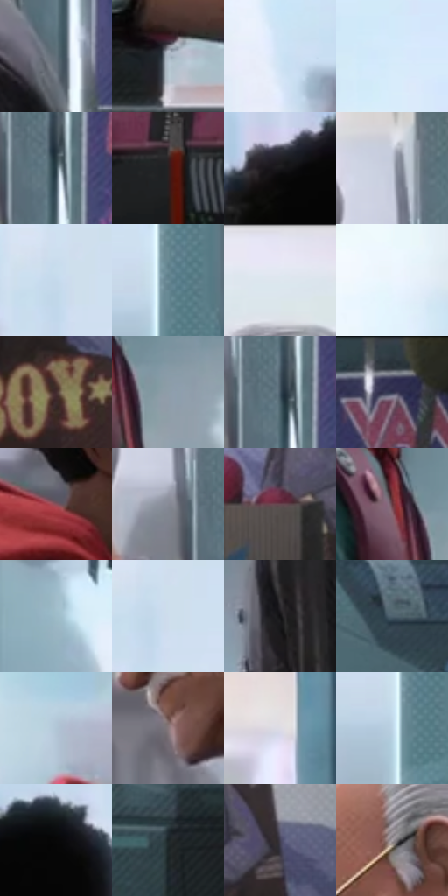

# 电影参考 187

- 状态：常规／活跃；来源世界：miles-home。
- 视角：near-level；景别：medium；场景：interior。
- 时段：daylight-time-unspecified（外观依据，中置信度；具体时间／晨昏未知）；光照：neutral-day。
- 材质候选：skin, hair, fabric, plastic, glass, paper（帧级，不是像素分割）。
- 明暗组：middle；L* P5/P50/P95：6.63284 / 53.58728 / 92.86282。
- 资格门禁：无附加门禁。
- 原截图 SHA-256：`8b9d78bbf7eebfde74bd0e16ca2db07a3789c7728a899a7d6e6e57489032fe8b`；尺寸：2880 × 1200。
- sRGB 像素 SHA-256：`ff1c2618fab8facbf8f04ed40203f656e1a2783f5c92e06bafdb96df37181a47`。

## 观察与迁移

服装店日光与商品陈列，服装图案和皮肤分开。

本公开版保存32个128×128原像素色卡上下文；图集格子并非原场景相邻位置。原rect、图集tile和像素SHA见 `data/palette-crops.json`。上下文不足时不得批准替色，不能以小样推断完整构图。

## 实测色卡

颜色比例分母为保留采样像素，不是材料面积；全部 32 色参与全库匹配。表内四舍五入仅用于阅读，原精度在 JSON。

| ID | HEX | Lab | 原图 xy | 像素数 | 比例 | 明度角色 |
| --- | --- | --- | --- | ---: | ---: | --- |
| 187-S01 | #62707B | [46.464843, -2.663813, -7.83439] | [2376, 512] | 8710 | 4.521199% | midtone |
| 187-S02 | #ACB8C5 | [74.242275, -1.516708, -7.981854] | [2004, 1112] | 8539 | 4.432436% | light |
| 187-S03 | #CEE3F4 | [89.20066, -3.543526, -10.60611] | [1684, 420] | 7843 | 4.071156% | highlight |
| 187-S04 | #D5EBFA | [91.892365, -4.253407, -9.690106] | [400, 128] | 7720 | 4.007309% | highlight |
| 187-S05 | #2D414A | [26.252587, -5.241404, -7.981132] | [2388, 348] | 7422 | 3.852622% | shadow |
| 187-S06 | #2A2021 | [13.442545, 5.017123, 1.150192] | [340, 880] | 7266 | 3.771646% | deep-shadow |
| 187-S07 | #19191B | [8.832678, 0.526983, -1.395752] | [724, 236] | 7146 | 3.709356% | deep-shadow |
| 187-S08 | #C5CCDA | [81.901949, 0.320523, -7.752567] | [2304, 204] | 6680 | 3.467464% | highlight |
| 187-S09 | #C5D9EB | [85.752198, -3.03026, -11.067259] | [996, 124] | 6625 | 3.438914% | highlight |
| 187-S10 | #698894 | [54.81264, -7.965005, -9.971194] | [1256, 320] | 6390 | 3.316930% | midtone |
| 187-S11 | #E5E9F5 | [92.366085, 0.880662, -6.258284] | [2088, 48] | 6330 | 3.285785% | highlight |
| 187-S12 | #EBF5FE | [96.047316, -1.622647, -5.448795] | [1728, 152] | 6321 | 3.281114% | highlight |
| 187-S13 | #422C2E | [20.662285, 10.517802, 2.793279] | [2748, 1016] | 6297 | 3.268656% | shadow |
| 187-S14 | #8E9DA9 | [63.940582, -2.739796, -8.039333] | [936, 748] | 6101 | 3.166916% | light |
| 187-S15 | #3F515F | [33.493936, -3.184321, -10.423787] | [2380, 324] | 6097 | 3.164840% | shadow |
| 187-S16 | #293037 | [19.478715, -1.106688, -5.456474] | [2500, 36] | 6047 | 3.138885% | deep-shadow |
| 187-S17 | #89505B | [40.915989, 25.316734, 3.920279] | [716, 512] | 5961 | 3.094244% | midtone |
| 187-S18 | #888A96 | [57.667867, 1.733597, -6.628207] | [2304, 312] | 5929 | 3.077634% | midtone |
| 187-S19 | #66474F | [33.765807, 14.597825, 0.536058] | [2596, 888] | 5865 | 3.044413% | shadow |
| 187-S20 | #64373D | [28.848509, 20.805295, 5.06163] | [860, 708] | 5774 | 2.997176% | shadow |
| 187-S21 | #91B1BC | [70.24142, -8.389149, -9.199817] | [32, 1080] | 5745 | 2.982123% | light |
| 187-S22 | #CEDCED | [87.203194, -1.345168, -9.896712] | [1016, 136] | 5590 | 2.901665% | highlight |
| 187-S23 | #121113 | [5.2076, 0.797072, -0.995211] | [2184, 700] | 5223 | 2.711162% | deep-shadow |
| 187-S24 | #4F616E | [40.142424, -3.516228, -9.598729] | [1412, 872] | 5143 | 2.669636% | midtone |
| 187-S25 | #B0C5D5 | [78.441608, -3.779708, -10.374504] | [568, 400] | 5033 | 2.612537% | light |
| 187-S26 | #87777B | [51.581836, 6.90006, 0.078101] | [2008, 484] | 5023 | 2.607346% | midtone |
| 187-S27 | #DEDCE5 | [88.147835, 2.311914, -4.152814] | [1436, 320] | 5007 | 2.599041% | highlight |
| 187-S28 | #BED5E6 | [84.094394, -4.179425, -10.938867] | [1236, 360] | 4755 | 2.468232% | highlight |
| 187-S29 | #080808 | [2.193388, -0.000139, 0.000264] | [892, 212] | 4670 | 2.424110% | deep-shadow |
| 187-S30 | #1C2527 | [13.922712, -3.378986, -2.640694] | [1536, 1056] | 4292 | 2.227898% | deep-shadow |
| 187-S31 | #434156 | [28.50032, 5.985544, -12.233246] | [2736, 856] | 4001 | 2.076845% | shadow |
| 187-S32 | #AAA4A9 | [67.992361, 3.088592, -1.809659] | [2048, 240] | 3103 | 1.610710% | light |

## 色阶与空间分布

- 采样 ROI：`[0.01, 0.02, 0.98, 0.94]`；步长：4；样本数：192648。
- 排除区：`[]`。
- 深暗、暗、中、亮、高光五段计数：`[35354, 39697, 30967, 29667, 56963]`。
- RGB 各 256 箱、L* 100 箱、13×5 色相明度表和 3×3 空间统计全部保存在 [总数据](../film-library.json)。
- [可视化档案](../../references/library.html)按需绘制直方图，不存 2,094 张重复图表图片。

## 纹理特征占比

**这是分块图像特征的面积占比，不是波点／排线／丝网／错版的精确语义覆盖率。** 窗格、发丝、织物也会产生方向或周期特征。
原图 ROI 像素 3084576；已测块覆盖 3084576（100.0000%）；未测 0。

| 特征 | 块覆盖像素 | 占已测面积 | 阈值敏感范围 |
| --- | ---: | ---: | --- |
| low-contrast | 131072 | 4.2493% | 1.5935% ~ 4.7804% |
| directional-structure | 1047040 | 33.9444% | 19.7857% ~ 48.9341% |
| periodic-structure | 1814304 | 58.8186% | 49.4725% ~ 69.8816% |
| mixed-detail | 92160 | 2.9878% | 0.0000% ~ 5.5523% |

阈值敏感范围不是统计置信区间。逐块坐标、尺度、对比、方向一致性、频谱集中度、频率与角度见 [全量特征记录](../texture-features.jsonl)，以帧号定位。
四种印刷层的真实像素覆盖仍标为 `null`，不能填 0，也不能拿上表代替。不得据这些代理测量删除唯一证据。

[测量方法与保留策略](../../references/library-retention.md) · [分类索引](../archive/README.md)
