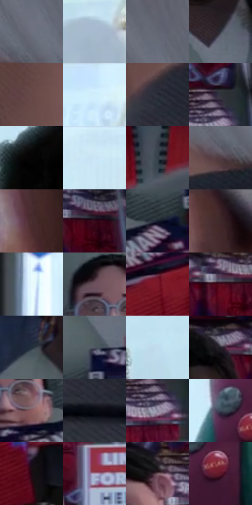

# 电影参考 188

- 状态：常规／活跃；来源世界：miles-home。
- 视角：near-level；景别：medium；场景：interior。
- 时段：daylight-time-unspecified（外观依据，中置信度；具体时间／晨昏未知）；光照：neutral-day。
- 材质候选：skin, hair, fabric, plastic, glass, paper（帧级，不是像素分割）。
- 明暗组：dark；L* P5/P50/P95：2.97184 / 27.1669 / 92.17224。
- 资格门禁：无附加门禁。
- 原截图 SHA-256：`922feffbb92024a47e51e57340a4feae287a75b7392b6a4cfbe557071e83b336`；尺寸：2880 × 1204。
- sRGB 像素 SHA-256：`b9776ad79ad3d2ed1a0e5d04f30219a2850e981a38e24a698505916f96dbe09f`。

## 观察与迁移

服装店日光与商品陈列，服装图案和皮肤分开。

本公开版保存32个128×128原像素色卡上下文；图集格子并非原场景相邻位置。原rect、图集tile和像素SHA见 `data/palette-crops.json`。上下文不足时不得批准替色，不能以小样推断完整构图。

## 实测色卡

颜色比例分母为保留采样像素，不是材料面积；全部 32 色参与全库匹配。表内四舍五入仅用于阅读，原精度在 JSON。

| ID | HEX | Lab | 原图 xy | 像素数 | 比例 | 明度角色 |
| --- | --- | --- | --- | ---: | ---: | --- |
| 188-S01 | #6F707E | [47.590372, 2.637886, -7.834161] | [2624, 424] | 10040 | 5.211578% | midtone |
| 188-S02 | #A7B9CD | [74.394057, -1.9596, -12.152792] | [1836, 256] | 9522 | 4.942693% | light |
| 188-S03 | #616673 | [43.184697, 1.011912, -7.93758] | [2628, 328] | 9406 | 4.882480% | midtone |
| 188-S04 | #343540 | [22.466136, 2.337103, -6.98949] | [364, 620] | 8053 | 4.180163% | shadow |
| 188-S05 | #664548 | [33.026282, 14.681901, 3.937428] | [2356, 492] | 7923 | 4.112682% | shadow |
| 188-S06 | #D0EEFB | [92.363508, -7.12181, -9.546677] | [1876, 64] | 7815 | 4.056621% | highlight |
| 188-S07 | #2B2D38 | [18.695852, 2.029048, -7.309033] | [2376, 624] | 7280 | 3.778913% | deep-shadow |
| 188-S08 | #30323B | [20.924492, 1.426214, -5.95911] | [732, 468] | 7200 | 3.737386% | shadow |
| 188-S09 | #050303 | [0.939138, 0.522946, 0.184376] | [1220, 212] | 7049 | 3.659005% | deep-shadow |
| 188-S10 | #C9E5F3 | [89.358053, -6.327322, -9.883136] | [1096, 32] | 6979 | 3.622669% | highlight |
| 188-S11 | #353F48 | [26.097479, -1.719129, -6.842168] | [1424, 996] | 6821 | 3.540654% | shadow |
| 188-S12 | #513D43 | [28.093622, 9.854714, -0.289643] | [2576, 492] | 6378 | 3.310701% | shadow |
| 188-S13 | #4B2E31 | [22.555643, 13.792831, 3.617981] | [2064, 212] | 6238 | 3.238030% | shadow |
| 188-S14 | #350B1A | [9.56957, 22.426944, 0.977553] | [676, 64] | 6207 | 3.221938% | deep-shadow |
| 188-S15 | #161E2C | [11.141212, 1.020613, -10.5274] | [276, 836] | 6058 | 3.144595% | deep-shadow |
| 188-S16 | #392126 | [15.991732, 12.392776, 1.504728] | [2080, 40] | 5975 | 3.101512% | deep-shadow |
| 188-S17 | #E8FAFE | [97.09824, -5.11266, -3.925071] | [872, 168] | 5743 | 2.981085% | highlight |
| 188-S18 | #1D141A | [7.552705, 5.928972, -2.478904] | [32, 744] | 5639 | 2.927100% | deep-shadow |
| 188-S19 | #7B1A29 | [27.049068, 41.823226, 16.533271] | [240, 960] | 5617 | 2.915680% | shadow |
| 188-S20 | #4C0A1C | [14.612417, 31.147625, 7.312141] | [640, 296] | 5573 | 2.892841% | deep-shadow |
| 188-S21 | #1E2C37 | [17.240761, -2.413478, -8.927357] | [152, 488] | 5487 | 2.848200% | deep-shadow |
| 188-S22 | #505964 | [37.426625, -0.880032, -7.503863] | [340, 736] | 5318 | 2.760475% | shadow |
| 188-S23 | #C0DCEC | [86.229611, -5.927889, -10.919516] | [1676, 156] | 5167 | 2.682094% | highlight |
| 188-S24 | #252029 | [13.147351, 4.599248, -5.152005] | [376, 276] | 5064 | 2.628628% | deep-shadow |
| 188-S25 | #8A5A5F | [43.570081, 20.473511, 5.286755] | [156, 832] | 4954 | 2.571529% | midtone |
| 188-S26 | #0A0B14 | [3.200973, 1.403168, -4.643374] | [2400, 728] | 4411 | 2.289668% | deep-shadow |
| 188-S27 | #8A8499 | [56.293063, 6.517458, -10.389281] | [720, 532] | 4375 | 2.270981% | midtone |
| 188-S28 | #404B5D | [31.606188, 0.370626, -12.016045] | [1004, 888] | 3956 | 2.053486% | shadow |
| 188-S29 | #1D0911 | [4.490399, 9.547998, -0.682002] | [368, 1116] | 3567 | 1.851563% | deep-shadow |
| 188-S30 | #AD99B0 | [65.593936, 11.598196, -9.238277] | [764, 656] | 3226 | 1.674557% | light |
| 188-S31 | #6F575E | [39.587964, 11.117324, -0.259204] | [592, 500] | 3071 | 1.594099% | shadow |
| 188-S32 | #5F1728 | [20.826178, 33.590383, 7.890898] | [1076, 940] | 2536 | 1.316391% | shadow |

## 色阶与空间分布

- 采样 ROI：`[0.01, 0.02, 0.98, 0.94]`；步长：4；样本数：192648。
- 排除区：`[]`。
- 深暗、暗、中、亮、高光五段计数：`[63736, 60628, 29308, 12886, 26090]`。
- RGB 各 256 箱、L* 100 箱、13×5 色相明度表和 3×3 空间统计全部保存在 [总数据](../film-library.json)。
- [可视化档案](../../references/library.html)按需绘制直方图，不存 2,094 张重复图表图片。

## 纹理特征占比

**这是分块图像特征的面积占比，不是波点／排线／丝网／错版的精确语义覆盖率。** 窗格、发丝、织物也会产生方向或周期特征。
原图 ROI 像素 3092958；已测块覆盖 3092958（100.0000%）；未测 0。

| 特征 | 块覆盖像素 | 占已测面积 | 阈值敏感范围 |
| --- | ---: | ---: | --- |
| low-contrast | 125440 | 4.0557% | 2.1189% ~ 9.4263% |
| directional-structure | 657408 | 21.2550% | 8.2893% ~ 43.7308% |
| periodic-structure | 2250334 | 72.7567% | 53.6206% ~ 78.2329% |
| mixed-detail | 59776 | 1.9326% | 0.5297% ~ 4.0515% |

阈值敏感范围不是统计置信区间。逐块坐标、尺度、对比、方向一致性、频谱集中度、频率与角度见 [全量特征记录](../texture-features.jsonl)，以帧号定位。
四种印刷层的真实像素覆盖仍标为 `null`，不能填 0，也不能拿上表代替。不得据这些代理测量删除唯一证据。

[测量方法与保留策略](../../references/library-retention.md) · [分类索引](../archive/README.md)
