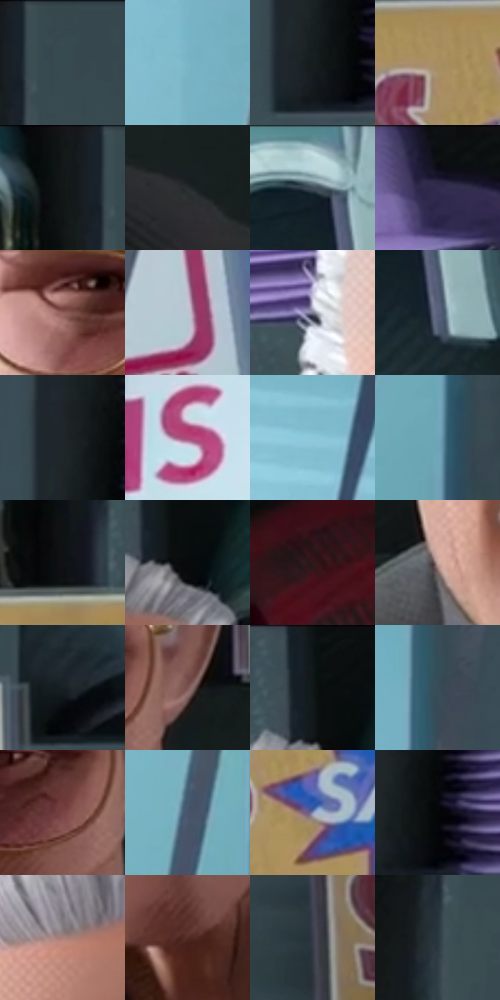

# 电影参考 189

- 状态：常规／活跃；来源世界：miles-home。
- 视角：high-angle；景别：close-up；场景：interior。
- 时段：daylight-time-unspecified（外观依据，中置信度；具体时间／晨昏未知）；光照：neutral-day。
- 材质候选：skin, hair, fabric, plastic, glass, paper（帧级，不是像素分割）。
- 明暗组：dark；L* P5/P50/P95：3.43264 / 31.52961 / 80.32424。
- 资格门禁：无附加门禁。
- 原截图 SHA-256：`a280cd43b22897a0db3216002f5668772b5594563c30c55a94688f9af3593998`；尺寸：2880 × 1204。
- sRGB 像素 SHA-256：`d45199a08a34b42555e223aec06630a9657692cb2e67cd36176a212dae224498`。

## 观察与迁移

服装店日光与商品陈列，服装图案和皮肤分开。

本公开版保存32个128×128原像素色卡上下文；图集格子并非原场景相邻位置。原rect、图集tile和像素SHA见 `data/palette-crops.json`。上下文不足时不得批准替色，不能以小样推断完整构图。

## 实测色卡

颜色比例分母为保留采样像素，不是材料面积；全部 32 色参与全库匹配。表内四舍五入仅用于阅读，原精度在 JSON。

| ID | HEX | Lab | 原图 xy | 像素数 | 比例 | 明度角色 |
| --- | --- | --- | --- | ---: | ---: | --- |
| 189-S01 | #384A51 | [30.235433, -5.145044, -6.463615] | [2504, 44] | 13137 | 6.819173% | shadow |
| 189-S02 | #7BB6C7 | [70.724604, -14.746435, -14.651125] | [520, 496] | 9656 | 5.012250% | light |
| 189-S03 | #171D1E | [10.218114, -2.471256, -1.614097] | [808, 304] | 9070 | 4.708069% | deep-shadow |
| 189-S04 | #A88D61 | [60.104044, 3.989733, 27.257177] | [2260, 332] | 8416 | 4.368589% | light |
| 189-S05 | #141718 | [7.474287, -1.096191, -1.180311] | [2424, 28] | 7810 | 4.054026% | deep-shadow |
| 189-S06 | #282D30 | [18.104109, -1.404722, -2.677042] | [2080, 852] | 7799 | 4.048316% | deep-shadow |
| 189-S07 | #404F57 | [32.634425, -3.80744, -6.64511] | [2232, 64] | 7362 | 3.821478% | shadow |
| 189-S08 | #0B0F10 | [4.066568, -1.047302, -0.938089] | [1248, 28] | 7209 | 3.742058% | deep-shadow |
| 189-S09 | #92605A | [45.928871, 19.573039, 11.784671] | [1332, 596] | 7040 | 3.654333% | midtone |
| 189-S10 | #BBC5D0 | [79.070466, -1.263357, -6.663318] | [288, 1084] | 6744 | 3.500685% | light |
| 189-S11 | #7A7A91 | [51.950876, 4.972918, -12.406439] | [1188, 340] | 6399 | 3.321602% | midtone |
| 189-S12 | #57607B | [40.931221, 3.241251, -16.284226] | [2268, 152] | 6365 | 3.303953% | midtone |
| 189-S13 | #20262A | [14.73703, -1.559769, -3.537702] | [796, 228] | 6160 | 3.197542% | deep-shadow |
| 189-S14 | #BFDDE8 | [86.312434, -7.596592, -8.691228] | [32, 432] | 5883 | 3.053756% | highlight |
| 189-S15 | #8CC9DA | [77.524195, -15.304496, -14.663362] | [380, 180] | 5878 | 3.051161% | light |
| 189-S16 | #70A6B9 | [65.135308, -12.837212, -15.391702] | [588, 1044] | 5763 | 2.991466% | light |
| 189-S17 | #101113 | [5.040985, 0.049848, -1.258493] | [2416, 232] | 5679 | 2.947863% | deep-shadow |
| 189-S18 | #080B0C | [2.867997, -0.640199, -0.689794] | [1652, 120] | 5596 | 2.904780% | deep-shadow |
| 189-S19 | #2E1819 | [11.306391, 11.209785, 4.036186] | [2816, 960] | 5473 | 2.840933% | deep-shadow |
| 189-S20 | #C6A69E | [70.697002, 10.428546, 8.510001] | [1304, 812] | 5433 | 2.820169% | light |
| 189-S21 | #182124 | [12.018938, -3.101452, -3.341268] | [2640, 268] | 5160 | 2.678460% | deep-shadow |
| 189-S22 | #7C5755 | [40.829081, 15.020326, 7.273939] | [1724, 584] | 5009 | 2.600079% | midtone |
| 189-S23 | #101617 | [6.736913, -2.199035, -1.541143] | [1628, 40] | 4945 | 2.566858% | deep-shadow |
| 189-S24 | #394C58 | [31.214579, -4.065575, -9.46869] | [632, 236] | 4937 | 2.562705% | shadow |
| 189-S25 | #794344 | [34.998356, 23.369343, 9.636722] | [1636, 608] | 4890 | 2.538308% | shadow |
| 189-S26 | #49546C | [35.67338, 1.945719, -15.190896] | [532, 840] | 4774 | 2.478095% | shadow |
| 189-S27 | #8F92B8 | [61.531001, 7.210808, -20.113631] | [2316, 436] | 4060 | 2.107471% | light |
| 189-S28 | #050607 | [1.606519, -0.12256, -0.470364] | [852, 288] | 3765 | 1.954342% | deep-shadow |
| 189-S29 | #A8807B | [57.264476, 14.676194, 8.69077] | [1388, 208] | 3280 | 1.702587% | midtone |
| 189-S30 | #532D25 | [23.168524, 16.495462, 12.747072] | [1532, 960] | 3117 | 1.617977% | shadow |
| 189-S31 | #373B49 | [25.017346, 1.936632, -9.117931] | [2816, 404] | 3067 | 1.592023% | shadow |
| 189-S32 | #2A373E | [22.203793, -3.385418, -6.119604] | [2456, 708] | 2772 | 1.438894% | shadow |

## 色阶与空间分布

- 采样 ROI：`[0.01, 0.02, 0.98, 0.94]`；步长：4；样本数：192648。
- 排除区：`[]`。
- 深暗、暗、中、亮、高光五段计数：`[69430, 47135, 30191, 35429, 10463]`。
- RGB 各 256 箱、L* 100 箱、13×5 色相明度表和 3×3 空间统计全部保存在 [总数据](../film-library.json)。
- [可视化档案](../../references/library.html)按需绘制直方图，不存 2,094 张重复图表图片。

## 纹理特征占比

**这是分块图像特征的面积占比，不是波点／排线／丝网／错版的精确语义覆盖率。** 窗格、发丝、织物也会产生方向或周期特征。
原图 ROI 像素 3092958；已测块覆盖 3092958（100.0000%）；未测 0。

| 特征 | 块覆盖像素 | 占已测面积 | 阈值敏感范围 |
| --- | ---: | ---: | --- |
| low-contrast | 138880 | 4.4902% | 3.6170% ~ 5.4586% |
| directional-structure | 1562496 | 50.5179% | 33.8441% ~ 55.4136% |
| periodic-structure | 1358814 | 43.9325% | 40.4397% ~ 55.9298% |
| mixed-detail | 32768 | 1.0594% | 0.5297% ~ 4.7675% |

阈值敏感范围不是统计置信区间。逐块坐标、尺度、对比、方向一致性、频谱集中度、频率与角度见 [全量特征记录](../texture-features.jsonl)，以帧号定位。
四种印刷层的真实像素覆盖仍标为 `null`，不能填 0，也不能拿上表代替。不得据这些代理测量删除唯一证据。

[测量方法与保留策略](../../references/library-retention.md) · [分类索引](../archive/README.md)
