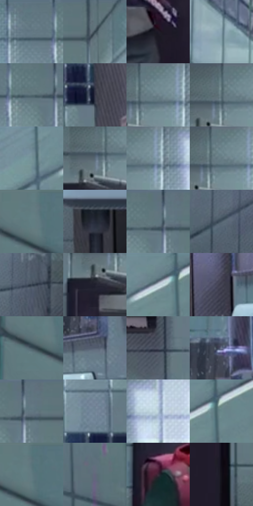

# 电影参考 190

- 状态：常规／活跃；来源世界：miles-home。
- 视角：near-level；景别：full-body；场景：interior。
- 时段：interior-time-unknown（外观依据，中置信度；具体时间／晨昏未知）；光照：cool-interior。
- 材质候选：skin, fabric, ceramic, metal, plastic（帧级，不是像素分割）。
- 明暗组：middle；L* P5/P50/P95：10.92859 / 45.72927 / 62.44459。
- 资格门禁：无附加门禁。
- 原截图 SHA-256：`60555c8c65779b09bbb04c4e3c1d3b3df00210f3406d1128166f2e1c86c56806`；尺寸：2880 × 1204。
- sRGB 像素 SHA-256：`c5d3c90d858639936fdba976ba2a3dc97575ac1d736de335de2712ef842d9451`。

## 观察与迁移

瓷砖墙、洁具与人物，缝线为材质结构不是印刷排线。

本公开版保存32个128×128原像素色卡上下文；图集格子并非原场景相邻位置。原rect、图集tile和像素SHA见 `data/palette-crops.json`。上下文不足时不得批准替色，不能以小样推断完整构图。

## 实测色卡

颜色比例分母为保留采样像素，不是材料面积；全部 32 色参与全库匹配。表内四舍五入仅用于阅读，原精度在 JSON。

| ID | HEX | Lab | 原图 xy | 像素数 | 比例 | 明度角色 |
| --- | --- | --- | --- | ---: | ---: | --- |
| 190-S01 | #647985 | [49.589292, -4.778363, -9.0771] | [1728, 64] | 9060 | 4.702878% | midtone |
| 190-S02 | #5D7379 | [46.933264, -6.610493, -5.980801] | [1972, 28] | 8958 | 4.649931% | midtone |
| 190-S03 | #1E1A27 | [10.2686, 5.44923, -8.140237] | [1376, 740] | 8691 | 4.511337% | deep-shadow |
| 190-S04 | #849DAC | [63.34044, -5.313954, -10.694259] | [740, 140] | 8319 | 4.318238% | light |
| 190-S05 | #546970 | [42.999431, -6.070821, -6.499965] | [1820, 76] | 7774 | 4.035339% | midtone |
| 190-S06 | #343545 | [22.674164, 3.715328, -10.038772] | [1932, 320] | 7612 | 3.951248% | shadow |
| 190-S07 | #6E878F | [54.684372, -7.028621, -7.237192] | [1248, 32] | 7233 | 3.754516% | midtone |
| 190-S08 | #596F75 | [45.326689, -6.631494, -6.009324] | [1208, 40] | 7085 | 3.677692% | midtone |
| 190-S09 | #758F97 | [57.71329, -7.31904, -7.284178] | [2556, 56] | 6883 | 3.572838% | midtone |
| 190-S10 | #586977 | [43.520858, -2.934224, -9.922151] | [1188, 88] | 6819 | 3.539616% | midtone |
| 190-S11 | #7B91A0 | [58.973402, -4.361338, -10.50345] | [1292, 56] | 6636 | 3.444624% | midtone |
| 190-S12 | #688087 | [51.983917, -6.971285, -6.647443] | [1232, 60] | 6608 | 3.430090% | midtone |
| 190-S13 | #627B81 | [49.914259, -7.571066, -6.249586] | [132, 36] | 6400 | 3.322121% | midtone |
| 190-S14 | #242937 | [16.68339, 1.829864, -9.737819] | [1988, 904] | 6322 | 3.281633% | deep-shadow |
| 190-S15 | #5E717F | [46.607257, -3.614334, -10.037328] | [1856, 28] | 5636 | 2.925543% | midtone |
| 190-S16 | #4B5C68 | [38.109004, -3.435119, -8.995891] | [744, 1096] | 5593 | 2.903222% | shadow |
| 190-S17 | #36414E | [27.059177, -0.961157, -9.319702] | [980, 772] | 5582 | 2.897513% | shadow |
| 190-S18 | #20202D | [12.794542, 3.645718, -8.629947] | [1164, 152] | 5525 | 2.867925% | deep-shadow |
| 190-S19 | #69828C | [52.797326, -6.564036, -8.344952] | [2668, 40] | 5462 | 2.835223% | midtone |
| 190-S20 | #454454 | [29.511809, 4.245185, -9.383304] | [2080, 624] | 5431 | 2.819131% | shadow |
| 190-S21 | #40505B | [33.097509, -3.342957, -8.48662] | [104, 104] | 5331 | 2.767223% | shadow |
| 190-S22 | #555E70 | [39.758848, 0.88091, -11.360096] | [2280, 604] | 5307 | 2.754765% | shadow |
| 190-S23 | #4D5262 | [34.99126, 1.875482, -9.944012] | [1860, 676] | 5252 | 2.726216% | shadow |
| 190-S24 | #6C758E | [49.329803, 2.455306, -14.717353] | [2264, 460] | 5179 | 2.688323% | midtone |
| 190-S25 | #617580 | [48.034901, -4.699128, -8.469344] | [1884, 36] | 5055 | 2.623957% | midtone |
| 190-S26 | #728697 | [54.929132, -3.225285, -11.469904] | [1744, 212] | 4965 | 2.577239% | midtone |
| 190-S27 | #B8CDDC | [81.30206, -3.983522, -9.812745] | [1392, 68] | 4814 | 2.498858% | highlight |
| 190-S28 | #4E646E | [40.99175, -5.646184, -8.329343] | [2716, 28] | 4487 | 2.329118% | midtone |
| 190-S29 | #5F7980 | [49.087895, -7.665408, -6.911203] | [148, 64] | 4312 | 2.238279% | midtone |
| 190-S30 | #62677C | [43.875298, 2.948985, -12.329787] | [2528, 960] | 3590 | 1.863502% | midtone |
| 190-S31 | #392937 | [18.93546, 10.356661, -6.106294] | [1156, 484] | 3525 | 1.829762% | deep-shadow |
| 190-S32 | #121118 | [5.378525, 1.998179, -4.26416] | [1560, 1048] | 3202 | 1.662099% | deep-shadow |

## 色阶与空间分布

- 采样 ROI：`[0.01, 0.02, 0.98, 0.94]`；步长：4；样本数：192648。
- 排除区：`[]`。
- 深暗、暗、中、亮、高光五段计数：`[26727, 38977, 112337, 11883, 2724]`。
- RGB 各 256 箱、L* 100 箱、13×5 色相明度表和 3×3 空间统计全部保存在 [总数据](../film-library.json)。
- [可视化档案](../../references/library.html)按需绘制直方图，不存 2,094 张重复图表图片。

## 纹理特征占比

**这是分块图像特征的面积占比，不是波点／排线／丝网／错版的精确语义覆盖率。** 窗格、发丝、织物也会产生方向或周期特征。
原图 ROI 像素 3092958；已测块覆盖 3092958（100.0000%）；未测 0。

| 特征 | 块覆盖像素 | 占已测面积 | 阈值敏感范围 |
| --- | ---: | ---: | --- |
| low-contrast | 27008 | 0.8732% | 0.8732% ~ 1.4029% |
| directional-structure | 624000 | 20.1749% | 10.8220% ~ 36.0375% |
| periodic-structure | 2371550 | 76.6758% | 62.5596% ~ 82.5068% |
| mixed-detail | 70400 | 2.2761% | 0.5297% ~ 5.2682% |

阈值敏感范围不是统计置信区间。逐块坐标、尺度、对比、方向一致性、频谱集中度、频率与角度见 [全量特征记录](../texture-features.jsonl)，以帧号定位。
四种印刷层的真实像素覆盖仍标为 `null`，不能填 0，也不能拿上表代替。不得据这些代理测量删除唯一证据。

[测量方法与保留策略](../../references/library-retention.md) · [分类索引](../archive/README.md)
