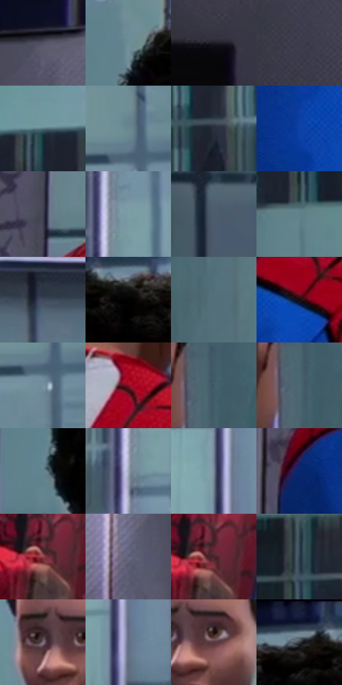

# 电影参考 191

- 状态：条件／活跃；来源世界：miles-home。
- 视角：near-level；景别：medium；场景：reflection。
- 时段：interior-time-unknown（外观依据，中置信度；具体时间／晨昏未知）；光照：cool-interior。
- 材质候选：skin, fabric, glass, ceramic, metal（帧级，不是像素分割）。
- 明暗组：dark；L* P5/P50/P95：2.23296 / 37.09331 / 62.08606。
- 资格门禁：reflection。
- 原截图 SHA-256：`8ed1474209adea4d18df1e03e5bc3bdf2f317a142cf1f38c3fae5090f384c128`；尺寸：2880 × 1210。
- sRGB 像素 SHA-256：`2a8d8401d7e48a5d716d1fa20f0a62dde0bfb054784a1afbd94a378eab3c4e1e`。

## 观察与迁移

平面镜内外同一人物，映像按源图透视裁切。

本公开版保存32个128×128原像素色卡上下文；图集格子并非原场景相邻位置。原rect、图集tile和像素SHA见 `data/palette-crops.json`。上下文不足时不得批准替色，不能以小样推断完整构图。

## 实测色卡

颜色比例分母为保留采样像素，不是材料面积；全部 32 色参与全库匹配。表内四舍五入仅用于阅读，原精度在 JSON。

| ID | HEX | Lab | 原图 xy | 像素数 | 比例 | 明度角色 |
| --- | --- | --- | --- | ---: | ---: | --- |
| 191-S01 | #515063 | [34.77697, 4.84732, -10.863441] | [164, 68] | 9643 | 4.969491% | shadow |
| 191-S02 | #6D8E98 | [56.941927, -9.069885, -9.06211] | [660, 136] | 9043 | 4.660283% | midtone |
| 191-S03 | #1E1E27 | [11.627777, 2.47317, -6.066759] | [324, 1008] | 8923 | 4.598442% | deep-shadow |
| 191-S04 | #393948 | [24.525426, 3.755841, -9.183954] | [48, 520] | 8834 | 4.552576% | shadow |
| 191-S05 | #5A7982 | [48.833716, -8.765619, -8.505592] | [1756, 148] | 8760 | 4.514440% | midtone |
| 191-S06 | #698691 | [54.129727, -7.590586, -9.257766] | [2572, 240] | 8640 | 4.452598% | midtone |
| 191-S07 | #292F3C | [19.352265, 1.048031, -9.083019] | [1980, 248] | 8533 | 4.397456% | deep-shadow |
| 191-S08 | #0E41A5 | [30.852851, 24.756475, -58.015747] | [892, 1096] | 8039 | 4.142875% | shadow |
| 191-S09 | #404251 | [28.32814, 2.878024, -9.273959] | [556, 632] | 7597 | 3.915091% | shadow |
| 191-S10 | #7C9EA6 | [62.919835, -9.794577, -8.001365] | [2200, 204] | 7293 | 3.758426% | light |
| 191-S11 | #4D5C6E | [38.476515, -1.144966, -12.130536] | [2620, 1040] | 7163 | 3.691431% | shadow |
| 191-S12 | #608189 | [51.828878, -9.619648, -8.101763] | [1456, 368] | 6792 | 3.500237% | midtone |
| 191-S13 | #3E495D | [30.829252, 0.972421, -13.215701] | [1608, 1136] | 6726 | 3.466224% | shadow |
| 191-S14 | #010101 | [0.274173, -1.7e-05, 3.3e-05] | [960, 92] | 6681 | 3.443034% | deep-shadow |
| 191-S15 | #536F7A | [45.098674, -7.314754, -9.389003] | [1252, 640] | 6628 | 3.415720% | midtone |
| 191-S16 | #0F090C | [2.922044, 2.194656, -0.556749] | [1092, 816] | 6589 | 3.395622% | deep-shadow |
| 191-S17 | #7791A1 | [58.737566, -5.397689, -11.454856] | [2572, 308] | 6126 | 3.157016% | midtone |
| 191-S18 | #880D22 | [28.483483, 48.835874, 23.541641] | [940, 664] | 5919 | 3.050339% | shadow |
| 191-S19 | #415A67 | [36.771271, -5.782699, -10.460394] | [1116, 444] | 5575 | 2.873060% | shadow |
| 191-S20 | #4B6772 | [41.86154, -7.316784, -9.477877] | [1104, 464] | 5492 | 2.830286% | midtone |
| 191-S21 | #64838E | [52.833373, -8.227592, -9.489073] | [636, 276] | 5403 | 2.784420% | midtone |
| 191-S22 | #9DA6B9 | [67.978349, 0.773585, -10.833078] | [2168, 268] | 5226 | 2.693204% | light |
| 191-S23 | #75869A | [55.24138, -1.519545, -12.711803] | [2144, 400] | 5131 | 2.644246% | midtone |
| 191-S24 | #082870 | [18.964583, 19.993894, -44.489983] | [500, 836] | 5022 | 2.588073% | deep-shadow |
| 191-S25 | #8F434A | [38.463184, 32.849689, 11.170184] | [1872, 968] | 4459 | 2.297932% | shadow |
| 191-S26 | #5F6077 | [41.422498, 4.920692, -13.040918] | [484, 180] | 3973 | 2.047474% | midtone |
| 191-S27 | #47242A | [19.093185, 17.386489, 3.417789] | [1884, 960] | 3647 | 1.879471% | deep-shadow |
| 191-S28 | #2C3D4F | [25.067197, -1.399977, -13.081765] | [1376, 232] | 3541 | 1.824844% | shadow |
| 191-S29 | #84707F | [49.528249, 10.620117, -5.339252] | [1780, 612] | 3445 | 1.775371% | midtone |
| 191-S30 | #626D83 | [45.869146, 1.106531, -13.510932] | [2172, 572] | 2407 | 1.240440% | midtone |
| 191-S31 | #58383E | [27.438878, 15.202074, 2.158505] | [1840, 620] | 1959 | 1.009565% | shadow |
| 191-S32 | #161E37 | [11.789169, 5.200907, -17.449619] | [868, 36] | 835 | 0.430315% | deep-shadow |

## 色阶与空间分布

- 采样 ROI：`[0.01, 0.02, 0.98, 0.94]`；步长：4；样本数：194044。
- 排除区：`[]`。
- 深暗、暗、中、亮、高光五段计数：`[33407, 73541, 73677, 13212, 207]`。
- RGB 各 256 箱、L* 100 箱、13×5 色相明度表和 3×3 空间统计全部保存在 [总数据](../film-library.json)。
- [可视化档案](../../references/library.html)按需绘制直方图，不存 2,094 张重复图表图片。

## 纹理特征占比

**这是分块图像特征的面积占比，不是波点／排线／丝网／错版的精确语义覆盖率。** 窗格、发丝、织物也会产生方向或周期特征。
原图 ROI 像素 3109722；已测块覆盖 3109722（100.0000%）；未测 0。

| 特征 | 块覆盖像素 | 占已测面积 | 阈值敏感范围 |
| --- | ---: | ---: | --- |
| low-contrast | 163290 | 5.2510% | 2.6166% ~ 8.6879% |
| directional-structure | 1203968 | 38.7163% | 27.1006% ~ 48.1093% |
| periodic-structure | 1593600 | 51.2457% | 47.6935% ~ 59.7908% |
| mixed-detail | 148864 | 4.7871% | 1.5806% ~ 4.7871% |

阈值敏感范围不是统计置信区间。逐块坐标、尺度、对比、方向一致性、频谱集中度、频率与角度见 [全量特征记录](../texture-features.jsonl)，以帧号定位。
四种印刷层的真实像素覆盖仍标为 `null`，不能填 0，也不能拿上表代替。不得据这些代理测量删除唯一证据。

[测量方法与保留策略](../../references/library-retention.md) · [分类索引](../archive/README.md)
