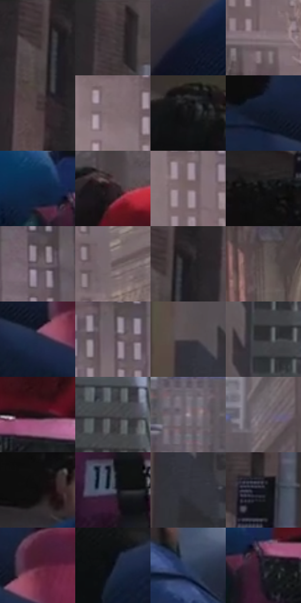

# 电影参考 192

- 状态：常规／活跃；来源世界：miles-home。
- 视角：near-level；景别：environment-wide；场景：street。
- 时段：daylight-time-unspecified（外观依据，中置信度；具体时间／晨昏未知）；光照：neutral-day。
- 材质候选：skin, hair, fabric, stone, glass（帧级，不是像素分割）。
- 明暗组：dark；L* P5/P50/P95：4.29493 / 22.62166 / 52.24543。
- 资格门禁：无附加门禁。
- 原截图 SHA-256：`d9d0b73ffa20ac14524c4e8c31ca7f4879cd4ea1842a5068fe615e7d0416f614`；尺寸：2880 × 1206。
- sRGB 像素 SHA-256：`630362f5c57d161dccf951ab17a8653bc4e97f3f967075b5d2a0ac70f6b40370`。

## 观察与迁移

典礼人群、近景面部和石建筑，情绪不由配色强行改写。

本公开版保存32个128×128原像素色卡上下文；图集格子并非原场景相邻位置。原rect、图集tile和像素SHA见 `data/palette-crops.json`。上下文不足时不得批准替色，不能以小样推断完整构图。

## 实测色卡

颜色比例分母为保留采样像素，不是材料面积；全部 32 色参与全库匹配。表内四舍五入仅用于阅读，原精度在 JSON。

| ID | HEX | Lab | 原图 xy | 像素数 | 比例 | 明度角色 |
| --- | --- | --- | --- | ---: | ---: | --- |
| 192-S01 | #383030 | [20.705032, 3.596381, 1.325391] | [56, 52] | 9936 | 5.138974% | shadow |
| 192-S02 | #433B3E | [25.770427, 4.100981, -0.577928] | [296, 52] | 9467 | 4.896403% | shadow |
| 192-S03 | #101A2E | [9.369849, 2.917226, -14.790552] | [136, 908] | 8597 | 4.446433% | deep-shadow |
| 192-S04 | #8A7A80 | [52.819241, 7.241899, -1.011864] | [2060, 508] | 8372 | 4.330061% | midtone |
| 192-S05 | #534445 | [30.407524, 6.599877, 1.802892] | [60, 184] | 7851 | 4.060596% | shadow |
| 192-S06 | #816D71 | [48.003351, 8.583199, 0.709828] | [1528, 72] | 7634 | 3.948362% | midtone |
| 192-S07 | #121214 | [5.52557, 0.433274, -1.179492] | [456, 544] | 7607 | 3.934397% | deep-shadow |
| 192-S08 | #0E1525 | [6.893999, 2.361846, -11.997665] | [2620, 932] | 7522 | 3.890435% | deep-shadow |
| 192-S09 | #112645 | [15.141543, 3.761552, -21.976154] | [1276, 852] | 7430 | 3.842852% | deep-shadow |
| 192-S10 | #2E2227 | [14.797624, 6.767607, -1.136605] | [1408, 672] | 7413 | 3.834059% | deep-shadow |
| 192-S11 | #766367 | [43.879317, 8.331202, 0.580036] | [1608, 172] | 7241 | 3.745099% | midtone |
| 192-S12 | #0D0E10 | [3.94781, 0.04573, -1.095874] | [224, 560] | 6908 | 3.572869% | deep-shadow |
| 192-S13 | #665A60 | [39.549816, 6.030491, -1.661302] | [1852, 84] | 6780 | 3.506667% | shadow |
| 192-S14 | #635256 | [36.667217, 7.782019, 0.30135] | [2156, 320] | 6653 | 3.440981% | shadow |
| 192-S15 | #201B1F | [10.482558, 3.394232, -1.86127] | [108, 52] | 6618 | 3.422879% | deep-shadow |
| 192-S16 | #5B4F4F | [34.763709, 4.974521, 1.833293] | [2480, 376] | 6532 | 3.378399% | shadow |
| 192-S17 | #202C47 | [18.201958, 3.870988, -18.449879] | [2708, 1004] | 6415 | 3.317886% | deep-shadow |
| 192-S18 | #6C5F65 | [41.708307, 6.371846, -1.495856] | [1732, 84] | 5778 | 2.988425% | midtone |
| 192-S19 | #524C51 | [33.042401, 3.535265, -2.056765] | [732, 356] | 5694 | 2.944979% | shadow |
| 192-S20 | #302E33 | [19.313871, 2.08415, -2.877663] | [840, 84] | 5195 | 2.686893% | deep-shadow |
| 192-S21 | #1F1216 | [7.06279, 7.388262, -0.137667] | [1480, 856] | 5165 | 2.671377% | deep-shadow |
| 192-S22 | #464449 | [29.203037, 1.954041, -2.708596] | [972, 112] | 5093 | 2.634138% | shadow |
| 192-S23 | #A599A3 | [64.504695, 6.246741, -3.630138] | [1220, 460] | 5068 | 2.621208% | light |
| 192-S24 | #726A74 | [45.83421, 5.138452, -4.438448] | [1348, 388] | 4919 | 2.544144% | midtone |
| 192-S25 | #0D0C0D | [3.410552, 0.459297, -0.32803] | [252, 684] | 4487 | 2.320710% | deep-shadow |
| 192-S26 | #555968 | [37.977316, 1.929888, -9.116748] | [1392, 1056] | 4417 | 2.284505% | shadow |
| 192-S27 | #35353E | [22.481859, 2.209497, -5.607274] | [768, 444] | 3601 | 1.862464% | shadow |
| 192-S28 | #13151D | [6.896313, 1.342389, -5.874299] | [324, 420] | 3313 | 1.713508% | deep-shadow |
| 192-S29 | #501E31 | [19.458513, 25.696076, -0.766273] | [2764, 952] | 3115 | 1.611101% | deep-shadow |
| 192-S30 | #0C101C | [4.810521, 1.64896, -8.282491] | [2172, 1004] | 3080 | 1.592999% | deep-shadow |
| 192-S31 | #30405E | [27.026162, 2.783254, -19.816416] | [596, 780] | 2830 | 1.463697% | shadow |
| 192-S32 | #21222B | [13.48238, 1.995642, -6.130942] | [1344, 900] | 2615 | 1.352498% | deep-shadow |

## 色阶与空间分布

- 采样 ROI：`[0.01, 0.02, 0.98, 0.94]`；步长：4；样本数：193346。
- 排除区：`[]`。
- 深暗、暗、中、亮、高光五段计数：`[83272, 68348, 38439, 3150, 137]`。
- RGB 各 256 箱、L* 100 箱、13×5 色相明度表和 3×3 空间统计全部保存在 [总数据](../film-library.json)。
- [可视化档案](../../references/library.html)按需绘制直方图，不存 2,094 张重复图表图片。

## 纹理特征占比

**这是分块图像特征的面积占比，不是波点／排线／丝网／错版的精确语义覆盖率。** 窗格、发丝、织物也会产生方向或周期特征。
原图 ROI 像素 3098546；已测块覆盖 3098546（100.0000%）；未测 0。

| 特征 | 块覆盖像素 | 占已测面积 | 阈值敏感范围 |
| --- | ---: | ---: | --- |
| low-contrast | 239872 | 7.7414% | 6.8615% ~ 10.2076% |
| directional-structure | 472064 | 15.2350% | 6.0767% ~ 27.6568% |
| periodic-structure | 2228274 | 71.9135% | 62.8378% ~ 72.2605% |
| mixed-detail | 158336 | 5.1100% | 2.6438% ~ 11.4552% |

阈值敏感范围不是统计置信区间。逐块坐标、尺度、对比、方向一致性、频谱集中度、频率与角度见 [全量特征记录](../texture-features.jsonl)，以帧号定位。
四种印刷层的真实像素覆盖仍标为 `null`，不能填 0，也不能拿上表代替。不得据这些代理测量删除唯一证据。

[测量方法与保留策略](../../references/library-retention.md) · [分类索引](../archive/README.md)
