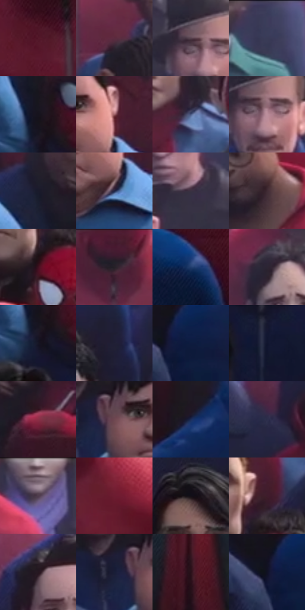

# 电影参考 193

- 状态：常规／活跃；来源世界：miles-home。
- 视角：high-angle；景别：environment-wide；场景：street。
- 时段：daylight-time-unspecified（外观依据，中置信度；具体时间／晨昏未知）；光照：neutral-day。
- 材质候选：skin, hair, fabric, stone, glass（帧级，不是像素分割）。
- 明暗组：very-dark；L* P5/P50/P95：6.04855 / 18.18279 / 51.98597。
- 资格门禁：无附加门禁。
- 原截图 SHA-256：`1583204d6c7edb91c40964b3742b44e34098073806d42c491d0c36abef385e29`；尺寸：2880 × 1208。
- sRGB 像素 SHA-256：`b875ce5764f9d146a034e25e9be118619e36638bfc69accedac22062aa73dbde`。

## 观察与迁移

典礼人群、近景面部和石建筑，情绪不由配色强行改写。

本公开版保存32个128×128原像素色卡上下文；图集格子并非原场景相邻位置。原rect、图集tile和像素SHA见 `data/palette-crops.json`。上下文不足时不得批准替色，不能以小样推断完整构图。

## 实测色卡

颜色比例分母为保留采样像素，不是材料面积；全部 32 色参与全库匹配。表内四舍五入仅用于阅读，原精度在 JSON。

| ID | HEX | Lab | 原图 xy | 像素数 | 比例 | 明度角色 |
| --- | --- | --- | --- | ---: | ---: | --- |
| 193-S01 | #54182A | [18.82479, 29.438319, 3.347186] | [140, 816] | 8375 | 4.331613% | deep-shadow |
| 193-S02 | #5B2C40 | [24.940122, 24.163036, -2.777458] | [684, 240] | 8079 | 4.178519% | shadow |
| 193-S03 | #55414C | [29.995069, 10.737486, -3.308561] | [1620, 172] | 7851 | 4.060596% | shadow |
| 193-S04 | #3C3D5A | [26.837504, 7.298353, -17.444316] | [1096, 28] | 7414 | 3.834576% | shadow |
| 193-S05 | #16131D | [6.549039, 3.94671, -6.367509] | [688, 620] | 7201 | 3.724411% | deep-shadow |
| 193-S06 | #9A5C62 | [46.187547, 26.132295, 7.475301] | [388, 324] | 7180 | 3.713550% | midtone |
| 193-S07 | #4B5A83 | [38.631736, 5.590744, -24.783044] | [2760, 344] | 7171 | 3.708895% | shadow |
| 193-S08 | #BD909D | [64.323418, 19.008469, -0.249746] | [1648, 200] | 6976 | 3.608039% | light |
| 193-S09 | #1A1A2B | [10.051898, 5.136857, -11.458552] | [640, 440] | 6918 | 3.578041% | deep-shadow |
| 193-S10 | #1F2443 | [15.26612, 7.913777, -20.338074] | [372, 416] | 6765 | 3.498909% | deep-shadow |
| 193-S11 | #3C3142 | [22.126569, 8.77709, -8.775591] | [1780, 136] | 6757 | 3.494771% | shadow |
| 193-S12 | #402A33 | [19.984136, 11.870896, -1.675649] | [920, 364] | 6686 | 3.458049% | deep-shadow |
| 193-S13 | #3F111F | [12.965166, 23.804421, 2.37193] | [2672, 580] | 6667 | 3.448222% | deep-shadow |
| 193-S14 | #271E27 | [12.648651, 6.425178, -4.42632] | [620, 52] | 6571 | 3.398570% | deep-shadow |
| 193-S15 | #223D6D | [26.101934, 6.960649, -30.97565] | [96, 1036] | 6109 | 3.159621% | shadow |
| 193-S16 | #2C2533 | [15.991461, 6.678231, -7.914279] | [1260, 156] | 6049 | 3.128588% | deep-shadow |
| 193-S17 | #161524 | [7.535723, 5.009416, -10.192763] | [688, 680] | 6015 | 3.111003% | deep-shadow |
| 193-S18 | #202035 | [13.21235, 6.228274, -13.724285] | [1792, 460] | 5942 | 3.073247% | deep-shadow |
| 193-S19 | #0E1B3F | [10.819917, 8.967544, -24.715382] | [2232, 900] | 5492 | 2.840504% | deep-shadow |
| 193-S20 | #10152E | [7.620792, 6.819216, -17.563961] | [788, 784] | 5467 | 2.827573% | deep-shadow |
| 193-S21 | #8C2E46 | [33.927005, 41.740924, 7.309303] | [756, 480] | 5402 | 2.793955% | shadow |
| 193-S22 | #6F4751 | [34.964565, 18.65927, 1.14708] | [224, 320] | 5367 | 2.775853% | shadow |
| 193-S23 | #1A2C55 | [18.698934, 7.84553, -27.141018] | [2328, 752] | 5364 | 2.774301% | deep-shadow |
| 193-S24 | #2C2D4A | [19.665559, 7.93298, -18.122913] | [2204, 488] | 5262 | 2.721546% | deep-shadow |
| 193-S25 | #866F7B | [49.335265, 11.199626, -3.229679] | [1496, 28] | 5067 | 2.620690% | midtone |
| 193-S26 | #6D1C31 | [24.653315, 37.080859, 7.406225] | [296, 804] | 4946 | 2.558108% | shadow |
| 193-S27 | #130F17 | [4.895456, 3.231321, -4.199423] | [1108, 684] | 4700 | 2.430875% | deep-shadow |
| 193-S28 | #3E1C2B | [15.640156, 18.73682, -2.497132] | [2712, 480] | 4683 | 2.422083% | deep-shadow |
| 193-S29 | #261720 | [10.024487, 9.402347, -3.203368] | [2312, 332] | 4656 | 2.408118% | deep-shadow |
| 193-S30 | #181D37 | [11.611586, 6.550471, -17.720496] | [176, 320] | 4346 | 2.247784% | deep-shadow |
| 193-S31 | #291019 | [8.238331, 14.334922, -0.485661] | [1440, 864] | 4205 | 2.174858% | deep-shadow |
| 193-S32 | #101122 | [5.659257, 4.394503, -11.611472] | [2188, 896] | 3663 | 1.894531% | deep-shadow |

## 色阶与空间分布

- 采样 ROI：`[0.01, 0.02, 0.98, 0.94]`；步长：4；样本数：193346。
- 排除区：`[]`。
- 深暗、暗、中、亮、高光五段计数：`[106964, 64971, 16585, 4577, 249]`。
- RGB 各 256 箱、L* 100 箱、13×5 色相明度表和 3×3 空间统计全部保存在 [总数据](../film-library.json)。
- [可视化档案](../../references/library.html)按需绘制直方图，不存 2,094 张重复图表图片。

## 纹理特征占比

**这是分块图像特征的面积占比，不是波点／排线／丝网／错版的精确语义覆盖率。** 窗格、发丝、织物也会产生方向或周期特征。
原图 ROI 像素 3104134；已测块覆盖 3104134（100.0000%）；未测 0。

| 特征 | 块覆盖像素 | 占已测面积 | 阈值敏感范围 |
| --- | ---: | ---: | --- |
| low-contrast | 43904 | 1.4144% | 0.8866% ~ 4.0741% |
| directional-structure | 377472 | 12.1603% | 5.6369% ~ 21.3228% |
| periodic-structure | 2655238 | 85.5388% | 77.7906% ~ 87.1222% |
| mixed-detail | 27520 | 0.8866% | 0.0000% ~ 3.1669% |

阈值敏感范围不是统计置信区间。逐块坐标、尺度、对比、方向一致性、频谱集中度、频率与角度见 [全量特征记录](../texture-features.jsonl)，以帧号定位。
四种印刷层的真实像素覆盖仍标为 `null`，不能填 0，也不能拿上表代替。不得据这些代理测量删除唯一证据。

[测量方法与保留策略](../../references/library-retention.md) · [分类索引](../archive/README.md)
