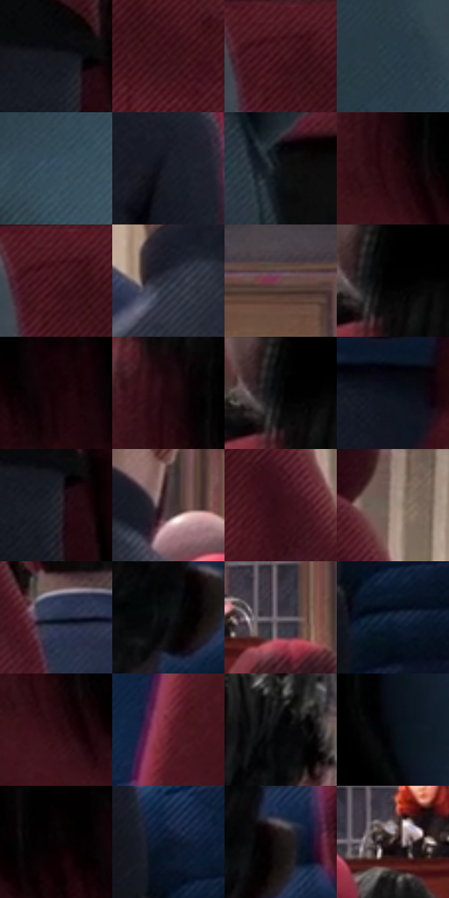

# 电影参考 194

- 状态：常规／活跃；来源世界：miles-home。
- 视角：near-level；景别：environment-wide；场景：street。
- 时段：daylight-time-unspecified（外观依据，中置信度；具体时间／晨昏未知）；光照：neutral-day。
- 材质候选：skin, hair, fabric, stone, glass（帧级，不是像素分割）。
- 明暗组：very-dark；L* P5/P50/P95：0.86209 / 10.80351 / 38.1424。
- 资格门禁：无附加门禁。
- 原截图 SHA-256：`6cdf30e486104dfb7b55dc91401f3920a6e6a8f5fe2044883e1c7819598d0971`；尺寸：2880 × 1198。
- sRGB 像素 SHA-256：`e4449e274e69f9299945c2f51166e354df68892938dc3a51d5bf31e9658c074d`。

## 观察与迁移

典礼人群、近景面部和石建筑，情绪不由配色强行改写。

本公开版保存32个128×128原像素色卡上下文；图集格子并非原场景相邻位置。原rect、图集tile和像素SHA见 `data/palette-crops.json`。上下文不足时不得批准替色，不能以小样推断完整构图。

## 实测色卡

颜色比例分母为保留采样像素，不是材料面积；全部 32 色参与全库匹配。表内四舍五入仅用于阅读，原精度在 JSON。

| ID | HEX | Lab | 原图 xy | 像素数 | 比例 | 明度角色 |
| --- | --- | --- | --- | ---: | ---: | --- |
| 194-S01 | #15171D | [7.776541, 0.781805, -4.530462] | [708, 832] | 10837 | 5.625285% | deep-shadow |
| 194-S02 | #3C121B | [12.433221, 21.596915, 4.503545] | [612, 112] | 9038 | 4.691458% | deep-shadow |
| 194-S03 | #491822 | [16.432661, 24.354783, 5.371853] | [548, 40] | 8068 | 4.187949% | deep-shadow |
| 194-S04 | #273947 | [23.040971, -2.942675, -10.910589] | [348, 140] | 7808 | 4.052988% | shadow |
| 194-S05 | #34485A | [29.669971, -2.545496, -13.130748] | [320, 384] | 7599 | 3.944500% | shadow |
| 194-S06 | #181D26 | [10.65158, 0.431361, -6.870524] | [1300, 552] | 7567 | 3.927889% | deep-shadow |
| 194-S07 | #0F1116 | [5.061775, 0.393529, -3.265275] | [360, 752] | 7441 | 3.862485% | deep-shadow |
| 194-S08 | #270A10 | [6.196075, 15.288672, 2.56189] | [2452, 252] | 7374 | 3.827706% | deep-shadow |
| 194-S09 | #43141E | [14.331033, 23.674413, 5.156572] | [544, 52] | 7148 | 3.710394% | deep-shadow |
| 194-S10 | #303742 | [22.840879, 0.001351, -7.803685] | [1092, 340] | 6677 | 3.465907% | shadow |
| 194-S11 | #684746 | [33.75751, 13.995396, 6.289673] | [1560, 148] | 6576 | 3.413480% | shadow |
| 194-S12 | #010101 | [0.274173, -1.7e-05, 3.3e-05] | [2424, 24] | 6553 | 3.401541% | deep-shadow |
| 194-S13 | #160307 | [2.268029, 6.683892, 0.645506] | [2664, 288] | 6449 | 3.347556% | deep-shadow |
| 194-S14 | #20070D | [4.409636, 11.48366, 1.37096] | [2444, 188] | 6348 | 3.295129% | deep-shadow |
| 194-S15 | #080809 | [2.213175, 0.138905, -0.37816] | [2408, 52] | 6291 | 3.265541% | deep-shadow |
| 194-S16 | #0D121C | [5.437699, 0.804369, -7.338989] | [2228, 888] | 6162 | 3.198580% | deep-shadow |
| 194-S17 | #26272F | [15.841728, 1.653554, -5.37526] | [728, 868] | 6157 | 3.195984% | deep-shadow |
| 194-S18 | #4A3A3D | [26.212901, 7.608453, 0.823809] | [1248, 312] | 6041 | 3.135771% | shadow |
| 194-S19 | #340F17 | [10.059529, 19.496026, 3.934597] | [756, 176] | 6031 | 3.130580% | deep-shadow |
| 194-S20 | #A38A82 | [59.503809, 8.121021, 7.793877] | [800, 40] | 5989 | 3.108779% | midtone |
| 194-S21 | #202E3E | [18.403289, -0.755202, -11.972783] | [916, 324] | 5385 | 2.795254% | deep-shadow |
| 194-S22 | #0C0D10 | [3.644014, 0.229697, -1.54751] | [2040, 768] | 5361 | 2.782796% | deep-shadow |
| 194-S23 | #615C62 | [39.710801, 3.241057, -2.712898] | [1556, 360] | 4968 | 2.578797% | shadow |
| 194-S24 | #132139 | [12.743631, 2.916737, -17.377797] | [1444, 856] | 4935 | 2.561667% | deep-shadow |
| 194-S25 | #2E0C13 | [8.047934, 18.20029, 3.642504] | [2464, 300] | 4899 | 2.542980% | deep-shadow |
| 194-S26 | #67222F | [24.42936, 32.06594, 8.282752] | [2196, 476] | 4640 | 2.408538% | shadow |
| 194-S27 | #040507 | [1.352132, 0.016501, -0.848821] | [1212, 156] | 4277 | 2.220111% | deep-shadow |
| 194-S28 | #090C12 | [3.294118, 0.272589, -3.2441] | [2800, 88] | 4128 | 2.142768% | deep-shadow |
| 194-S29 | #090203 | [0.976295, 1.969504, 0.266612] | [2580, 260] | 3858 | 2.002616% | deep-shadow |
| 194-S30 | #0A1628 | [7.149317, 1.747188, -13.873567] | [1408, 756] | 3837 | 1.991715% | deep-shadow |
| 194-S31 | #1A1314 | [6.647229, 3.510144, 0.557037] | [2088, 736] | 2387 | 1.239047% | deep-shadow |
| 194-S32 | #2B1D1F | [12.552834, 7.248299, 1.335954] | [1404, 364] | 1819 | 0.944209% | deep-shadow |

## 色阶与空间分布

- 采样 ROI：`[0.01, 0.02, 0.98, 0.94]`；步长：4；样本数：192648。
- 排除区：`[]`。
- 深暗、暗、中、亮、高光五段计数：`[141723, 42292, 5687, 2892, 54]`。
- RGB 各 256 箱、L* 100 箱、13×5 色相明度表和 3×3 空间统计全部保存在 [总数据](../film-library.json)。
- [可视化档案](../../references/library.html)按需绘制直方图，不存 2,094 张重复图表图片。

## 纹理特征占比

**这是分块图像特征的面积占比，不是波点／排线／丝网／错版的精确语义覆盖率。** 窗格、发丝、织物也会产生方向或周期特征。
原图 ROI 像素 3081782；已测块覆盖 3081782（100.0000%）；未测 0。

| 特征 | 块覆盖像素 | 占已测面积 | 阈值敏感范围 |
| --- | ---: | ---: | --- |
| low-contrast | 459318 | 14.9043% | 10.2898% ~ 21.0805% |
| directional-structure | 413440 | 13.4156% | 5.8480% ~ 32.7914% |
| periodic-structure | 2110720 | 68.4902% | 54.7922% ~ 68.4902% |
| mixed-detail | 98304 | 3.1898% | 2.1266% ~ 5.8480% |

阈值敏感范围不是统计置信区间。逐块坐标、尺度、对比、方向一致性、频谱集中度、频率与角度见 [全量特征记录](../texture-features.jsonl)，以帧号定位。
四种印刷层的真实像素覆盖仍标为 `null`，不能填 0，也不能拿上表代替。不得据这些代理测量删除唯一证据。

[测量方法与保留策略](../../references/library-retention.md) · [分类索引](../archive/README.md)
