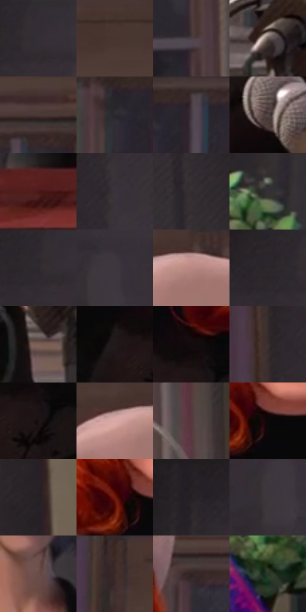

# 电影参考 195

- 状态：常规／活跃；来源世界：miles-home。
- 视角：near-level；景别：medium；场景：street。
- 时段：daylight-time-unspecified（外观依据，中置信度；具体时间／晨昏未知）；光照：neutral-day。
- 材质候选：skin, hair, fabric, stone, glass（帧级，不是像素分割）。
- 明暗组：dark；L* P5/P50/P95：4.19767 / 21.64368 / 49.28918。
- 资格门禁：无附加门禁。
- 原截图 SHA-256：`c2256d57f0c48c11491fc538d59ba66872aed136d4dbcf71ff0debb144d31e0a`；尺寸：2880 × 1202。
- sRGB 像素 SHA-256：`475515b46134243de9f072cd18990430af508e869ec61ac387c39709ecd12a8b`。

## 观察与迁移

典礼人群、近景面部和石建筑，情绪不由配色强行改写。

本公开版保存32个128×128原像素色卡上下文；图集格子并非原场景相邻位置。原rect、图集tile和像素SHA见 `data/palette-crops.json`。上下文不足时不得批准替色，不能以小样推断完整构图。

## 实测色卡

颜色比例分母为保留采样像素，不是材料面积；全部 32 色参与全库匹配。表内四舍五入仅用于阅读，原精度在 JSON。

| ID | HEX | Lab | 原图 xy | 像素数 | 比例 | 明度角色 |
| --- | --- | --- | --- | ---: | ---: | --- |
| 195-S01 | #332D35 | [19.381572, 4.555544, -4.124369] | [588, 28] | 9732 | 5.051701% | deep-shadow |
| 195-S02 | #463330 | [23.282009, 8.053583, 5.235606] | [1716, 28] | 8646 | 4.487978% | shadow |
| 195-S03 | #4A3F45 | [27.954952, 5.969644, -1.896081] | [1936, 412] | 8506 | 4.415307% | shadow |
| 195-S04 | #645951 | [38.635481, 2.98201, 6.260039] | [1068, 876] | 8301 | 4.308895% | shadow |
| 195-S05 | #4C3937 | [25.977325, 8.059715, 4.490593] | [1872, 204] | 8079 | 4.193659% | shadow |
| 195-S06 | #2C282D | [16.711775, 3.013028, -2.599253] | [1052, 308] | 7392 | 3.837050% | deep-shadow |
| 195-S07 | #443942 | [25.408039, 6.718998, -3.756428] | [1124, 284] | 7264 | 3.770608% | shadow |
| 195-S08 | #544646 | [31.131594, 5.946486, 2.219258] | [1716, 764] | 7013 | 3.640318% | shadow |
| 195-S09 | #4C1918 | [16.980033, 24.08456, 13.320305] | [1132, 1096] | 6939 | 3.601906% | deep-shadow |
| 195-S10 | #3A3238 | [21.822262, 4.876143, -2.471177] | [2264, 152] | 6847 | 3.554151% | shadow |
| 195-S11 | #332D2F | [19.165027, 3.153805, -0.295545] | [2552, 312] | 6744 | 3.500685% | deep-shadow |
| 195-S12 | #363236 | [21.326665, 2.678583, -1.889627] | [336, 816] | 6623 | 3.437876% | shadow |
| 195-S13 | #2F292E | [17.401994, 3.891377, -2.243351] | [556, 76] | 6500 | 3.374029% | deep-shadow |
| 195-S14 | #3E373E | [24.013461, 4.607091, -3.227361] | [684, 132] | 6243 | 3.240625% | shadow |
| 195-S15 | #BA8881 | [61.337329, 18.13046, 11.291721] | [1448, 64] | 5997 | 3.112931% | light |
| 195-S16 | #2A2529 | [15.358108, 3.254421, -1.794131] | [512, 28] | 5983 | 3.105664% | deep-shadow |
| 195-S17 | #7C6054 | [43.199383, 9.487235, 11.210659] | [1832, 976] | 5919 | 3.072443% | midtone |
| 195-S18 | #22191A | [9.87585, 4.690168, 1.009518] | [1492, 664] | 5808 | 3.014825% | deep-shadow |
| 195-S19 | #120B0C | [3.563532, 2.479091, 0.409279] | [1564, 620] | 5696 | 2.956688% | deep-shadow |
| 195-S20 | #3A2E30 | [20.310372, 5.866423, 0.781157] | [2168, 192] | 5676 | 2.946306% | shadow |
| 195-S21 | #1A1314 | [6.647229, 3.510144, 0.557037] | [1584, 692] | 5644 | 2.929696% | deep-shadow |
| 195-S22 | #91726D | [50.87313, 11.38564, 7.425901] | [1376, 48] | 5632 | 2.923467% | midtone |
| 195-S23 | #55393C | [27.253053, 12.927786, 3.160158] | [2040, 752] | 5407 | 2.806673% | shadow |
| 195-S24 | #0A0708 | [2.113928, 0.92342, -0.101777] | [1376, 520] | 5340 | 2.771895% | deep-shadow |
| 195-S25 | #262325 | [14.103364, 1.875142, -0.830159] | [2728, 464] | 5190 | 2.694033% | deep-shadow |
| 195-S26 | #711C10 | [24.889085, 36.479919, 29.323415] | [1328, 508] | 4872 | 2.528965% | shadow |
| 195-S27 | #241F22 | [12.41963, 3.091006, -1.158278] | [400, 28] | 4826 | 2.505087% | deep-shadow |
| 195-S28 | #3C363B | [23.38774, 3.73466, -2.162609] | [648, 172] | 4768 | 2.474980% | shadow |
| 195-S29 | #694D47 | [35.530694, 10.874998, 8.175995] | [2564, 928] | 3237 | 1.680267% | shadow |
| 195-S30 | #3B2926 | [18.608994, 7.892396, 5.274855] | [908, 44] | 3083 | 1.600328% | deep-shadow |
| 195-S31 | #312324 | [15.39515, 6.869509, 1.927721] | [1644, 244] | 2964 | 1.538557% | deep-shadow |
| 195-S32 | #3B4C37 | [30.338119, -11.423615, 10.356646] | [44, 900] | 1777 | 0.922408% | shadow |

## 色阶与空间分布

- 采样 ROI：`[0.01, 0.02, 0.98, 0.94]`；步长：4；样本数：192648。
- 排除区：`[]`。
- 深暗、暗、中、亮、高光五段计数：`[78566, 94404, 16786, 2782, 110]`。
- RGB 各 256 箱、L* 100 箱、13×5 色相明度表和 3×3 空间统计全部保存在 [总数据](../film-library.json)。
- [可视化档案](../../references/library.html)按需绘制直方图，不存 2,094 张重复图表图片。

## 纹理特征占比

**这是分块图像特征的面积占比，不是波点／排线／丝网／错版的精确语义覆盖率。** 窗格、发丝、织物也会产生方向或周期特征。
原图 ROI 像素 3087370；已测块覆盖 3087370（100.0000%）；未测 0。

| 特征 | 块覆盖像素 | 占已测面积 | 阈值敏感范围 |
| --- | ---: | ---: | --- |
| low-contrast | 446720 | 14.4693% | 9.8880% ~ 21.8988% |
| directional-structure | 975754 | 31.6047% | 23.6984% ~ 42.8484% |
| periodic-structure | 1599360 | 51.8033% | 46.2022% ~ 51.8033% |
| mixed-detail | 65536 | 2.1227% | 1.0614% ~ 4.2454% |

阈值敏感范围不是统计置信区间。逐块坐标、尺度、对比、方向一致性、频谱集中度、频率与角度见 [全量特征记录](../texture-features.jsonl)，以帧号定位。
四种印刷层的真实像素覆盖仍标为 `null`，不能填 0，也不能拿上表代替。不得据这些代理测量删除唯一证据。

[测量方法与保留策略](../../references/library-retention.md) · [分类索引](../archive/README.md)
