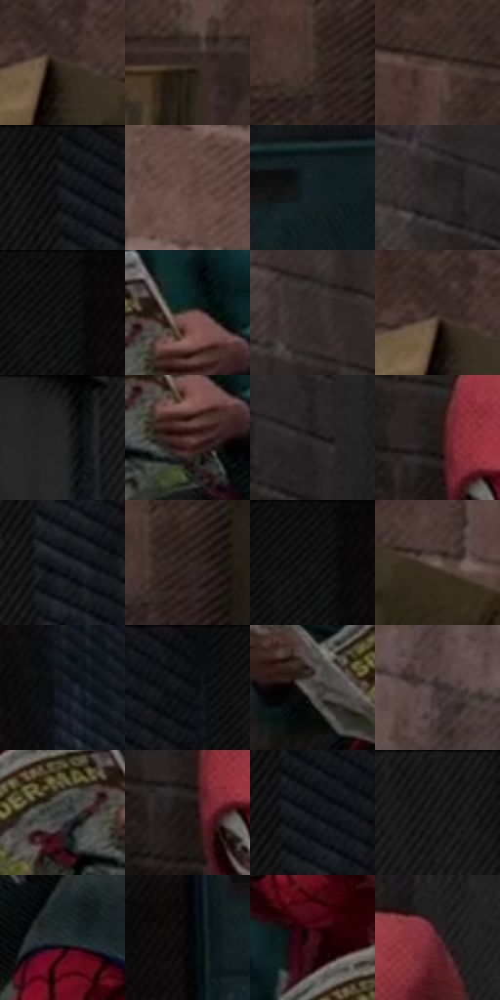

# 电影参考 196

- 状态：常规／活跃；来源世界：miles-home。
- 视角：low-angle；景别：full-body；场景：street。
- 时段：daylight-time-unspecified（外观依据，中置信度；具体时间／晨昏未知）；光照：neutral-day。
- 材质候选：fabric, brick, stone, paper（帧级，不是像素分割）。
- 明暗组：very-dark；L* P5/P50/P95：2.87988 / 15.63005 / 35.46778。
- 资格门禁：无附加门禁。
- 原截图 SHA-256：`35a472402006ccb4466ee222ce708a92ead09f11ea122b0e165168da9db329ef`；尺寸：2874 × 1206。
- sRGB 像素 SHA-256：`ae6244fcded46378e39530397aa0863bc1a5d6e2646e52b41d297511b0945a28`。

## 观察与迁移

低彩砖墙与纸板，纸边折痕和墙面颗粒分别处理。

196  /  稳定基准／阴影街巷  /  砖墙砌缝、纸箱折板、摊开的书页、布衣和背包并存  /  用结构和亮形区别材料；箱板厚折与薄纸弯曲不同，不统一成砂纸面

本公开版保存32个128×128原像素色卡上下文；图集格子并非原场景相邻位置。原rect、图集tile和像素SHA见 `data/palette-crops.json`。上下文不足时不得批准替色，不能以小样推断完整构图。

## 实测色卡

颜色比例分母为保留采样像素，不是材料面积；全部 32 色参与全库匹配。表内四舍五入仅用于阅读，原精度在 JSON。

| ID | HEX | Lab | 原图 xy | 像素数 | 比例 | 明度角色 |
| --- | --- | --- | --- | ---: | ---: | --- |
| 196-S01 | #3F312B | [21.682229, 5.247443, 6.234928] | [496, 376] | 9174 | 4.751669% | shadow |
| 196-S02 | #332721 | [16.819495, 4.513982, 6.103239] | [736, 736] | 8943 | 4.632023% | deep-shadow |
| 196-S03 | #443630 | [23.936943, 5.138905, 6.124539] | [140, 944] | 8916 | 4.618038% | shadow |
| 196-S04 | #4C3B35 | [26.51051, 6.420296, 6.565377] | [392, 268] | 8091 | 4.190730% | shadow |
| 196-S05 | #131415 | [6.258881, -0.186092, -0.773848] | [2080, 28] | 7772 | 4.025504% | deep-shadow |
| 196-S06 | #634642 | [32.759394, 11.829547, 7.33935] | [60, 252] | 7693 | 3.984586% | shadow |
| 196-S07 | #111F23 | [10.707205, -4.672051, -4.629097] | [2556, 424] | 7494 | 3.881514% | deep-shadow |
| 196-S08 | #292525 | [15.105578, 1.857683, 0.673503] | [1404, 108] | 7309 | 3.785693% | deep-shadow |
| 196-S09 | #0D090A | [2.735734, 1.25283, 0.014368] | [2300, 28] | 7225 | 3.742185% | deep-shadow |
| 196-S10 | #61504A | [35.54437, 6.0127, 6.18355] | [1644, 716] | 6838 | 3.541739% | shadow |
| 196-S11 | #322A29 | [17.89235, 3.468273, 2.012943] | [1240, 200] | 6590 | 3.413287% | deep-shadow |
| 196-S12 | #3A2C26 | [19.395466, 5.368699, 6.357745] | [480, 364] | 6512 | 3.372887% | deep-shadow |
| 196-S13 | #191818 | [8.358185, 0.488309, 0.174725] | [1836, 28] | 6506 | 3.369780% | deep-shadow |
| 196-S14 | #583C3A | [28.412456, 12.026722, 6.178329] | [1644, 780] | 6411 | 3.320575% | shadow |
| 196-S15 | #242121 | [13.062374, 1.413141, 0.510066] | [1492, 104] | 6194 | 3.208179% | deep-shadow |
| 196-S16 | #241917 | [10.047871, 5.108351, 3.533332] | [1368, 476] | 6001 | 3.108215% | deep-shadow |
| 196-S17 | #1B1F23 | [11.51332, -0.720078, -3.337785] | [2104, 188] | 5873 | 3.041918% | deep-shadow |
| 196-S18 | #2B201B | [13.386604, 4.364829, 5.425012] | [180, 936] | 5857 | 3.033630% | deep-shadow |
| 196-S19 | #100E0E | [4.118531, 0.680426, 0.240312] | [2296, 36] | 5528 | 2.863225% | deep-shadow |
| 196-S20 | #6E5F57 | [41.513193, 4.611387, 6.804429] | [600, 408] | 5520 | 2.859081% | midtone |
| 196-S21 | #10151C | [6.596751, -0.112815, -5.582916] | [2524, 192] | 5445 | 2.820235% | deep-shadow |
| 196-S22 | #0F1012 | [4.659244, 0.048469, -1.203576] | [2200, 40] | 5443 | 2.819199% | deep-shadow |
| 196-S23 | #494442 | [29.271076, 1.691998, 1.968659] | [1408, 788] | 5250 | 2.719235% | shadow |
| 196-S24 | #3A302C | [20.810044, 3.73109, 4.240329] | [996, 188] | 5041 | 2.610984% | shadow |
| 196-S25 | #363B3B | [24.411052, -2.106468, -0.723736] | [1552, 748] | 4844 | 2.508948% | shadow |
| 196-S26 | #1B100F | [5.764137, 4.792825, 2.259097] | [1364, 520] | 4766 | 2.468548% | deep-shadow |
| 196-S27 | #090D10 | [3.462521, -0.584251, -1.834302] | [2108, 76] | 4760 | 2.465440% | deep-shadow |
| 196-S28 | #1C1C1C | [10.268184, -0.000556, 0.001054] | [1956, 28] | 4703 | 2.435917% | deep-shadow |
| 196-S29 | #222D30 | [17.599817, -3.829515, -3.481007] | [1596, 948] | 4415 | 2.286747% | deep-shadow |
| 196-S30 | #050506 | [1.390654, 0.138957, -0.378259] | [2444, 480] | 4194 | 2.172280% | deep-shadow |
| 196-S31 | #43121C | [13.88572, 24.50921, 6.003507] | [1488, 652] | 2306 | 1.194392% | deep-shadow |
| 196-S32 | #542933 | [22.689082, 21.1667, 2.624515] | [1540, 400] | 1455 | 0.753617% | shadow |

## 色阶与空间分布

- 采样 ROI：`[0.01, 0.02, 0.98, 0.94]`；步长：4；样本数：193069。
- 排除区：`[]`。
- 深暗、暗、中、亮、高光五段计数：`[123866, 65370, 3833, 0, 0]`。
- RGB 各 256 箱、L* 100 箱、13×5 色相明度表和 3×3 空间统计全部保存在 [总数据](../film-library.json)。
- [可视化档案](../../references/library.html)按需绘制直方图，不存 2,094 张重复图表图片。

## 纹理特征占比

**这是分块图像特征的面积占比，不是波点／排线／丝网／错版的精确语义覆盖率。** 窗格、发丝、织物也会产生方向或周期特征。
原图 ROI 像素 3091892；已测块覆盖 3091892（100.0000%）；未测 0。

| 特征 | 块覆盖像素 | 占已测面积 | 阈值敏感范围 |
| --- | ---: | ---: | --- |
| low-contrast | 16384 | 0.5299% | 0.0000% ~ 3.1794% |
| directional-structure | 496512 | 16.0585% | 9.5300% ~ 24.7108% |
| periodic-structure | 2484276 | 80.3481% | 74.7593% ~ 80.3481% |
| mixed-detail | 94720 | 3.0635% | 0.5299% ~ 9.7742% |

阈值敏感范围不是统计置信区间。逐块坐标、尺度、对比、方向一致性、频谱集中度、频率与角度见 [全量特征记录](../texture-features.jsonl)，以帧号定位。
四种印刷层的真实像素覆盖仍标为 `null`，不能填 0，也不能拿上表代替。不得据这些代理测量删除唯一证据。

[测量方法与保留策略](../../references/library-retention.md) · [分类索引](../archive/README.md)
