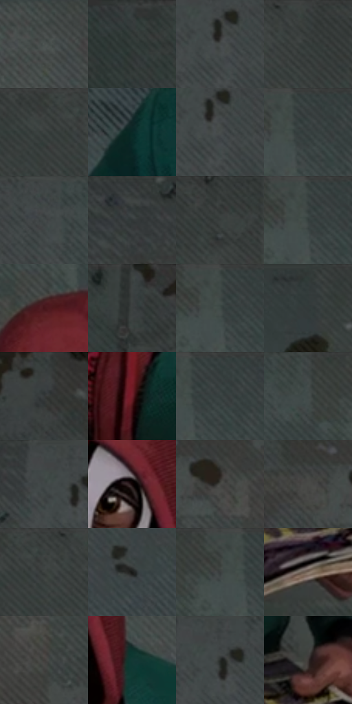

# 电影参考 197

- 状态：常规／活跃；来源世界：miles-home。
- 视角：high-angle；景别：medium；场景：street。
- 时段：daylight-time-unspecified（外观依据，中置信度；具体时间／晨昏未知）；光照：neutral-day。
- 材质候选：fabric, brick, stone, paper（帧级，不是像素分割）。
- 明暗组：dark；L* P5/P50/P95：11.00132 / 27.13784 / 34.01487。
- 资格门禁：无附加门禁。
- 原截图 SHA-256：`cb1faf45e53ffd3e8a4d5ab297d43a0a108babccbd497047742b5efef248ba00`；尺寸：2880 × 1208。
- sRGB 像素 SHA-256：`5d389bd92329e2407b70c09aabc6527c1de46f7b59ac9bf8922f638ddb27f0da`。

## 观察与迁移

低彩砖墙与纸板，纸边折痕和墙面颗粒分别处理。

197  /  稳定基准／俯视人物  /  帽内深暗、衣袖宽柔明暗、纸页层边、地砖污斑  /  保留头肩透视和手抓书的接触；纸上漫画仅是道具表面二次图像

本公开版保存32个128×128原像素色卡上下文；图集格子并非原场景相邻位置。原rect、图集tile和像素SHA见 `data/palette-crops.json`。上下文不足时不得批准替色，不能以小样推断完整构图。

## 实测色卡

颜色比例分母为保留采样像素，不是材料面积；全部 32 色参与全库匹配。表内四舍五入仅用于阅读，原精度在 JSON。

| ID | HEX | Lab | 原图 xy | 像素数 | 比例 | 明度角色 |
| --- | --- | --- | --- | ---: | ---: | --- |
| 197-S01 | #4B5150 | [33.899072, -2.627885, -0.239542] | [1748, 268] | 14269 | 7.380034% | shadow |
| 197-S02 | #303635 | [22.029841, -2.799372, -0.244376] | [120, 44] | 12790 | 6.615084% | shadow |
| 197-S03 | #444948 | [30.549, -2.268616, -0.10563] | [1020, 100] | 8671 | 4.484706% | shadow |
| 197-S04 | #363C3B | [24.739038, -2.755383, -0.243618] | [2136, 32] | 8220 | 4.251446% | shadow |
| 197-S05 | #3F4341 | [27.987395, -2.1172, 0.639723] | [2004, 40] | 8133 | 4.206449% | shadow |
| 197-S06 | #092926 | [14.308921, -12.45501, -1.474813] | [1080, 660] | 7891 | 4.081284% | deep-shadow |
| 197-S07 | #484D4C | [32.274056, -2.249018, -0.105575] | [1032, 112] | 7855 | 4.062665% | shadow |
| 197-S08 | #394242 | [27.184536, -3.682994, -1.248949] | [1420, 64] | 7643 | 3.953017% | shadow |
| 197-S09 | #424948 | [30.378571, -3.073736, -0.375086] | [1144, 40] | 6858 | 3.547009% | shadow |
| 197-S10 | #343938 | [23.478097, -2.358849, -0.105101] | [800, 28] | 6419 | 3.319955% | shadow |
| 197-S11 | #3C4140 | [27.049724, -2.311118, -0.105548] | [2248, 36] | 6331 | 3.274441% | shadow |
| 197-S12 | #353E3D | [25.378724, -3.963885, -0.644156] | [1400, 28] | 6101 | 3.155483% | shadow |
| 197-S13 | #45151A | [14.825213, 23.534799, 8.812665] | [1356, 224] | 5798 | 2.998769% | deep-shadow |
| 197-S14 | #3A3F3E | [26.163951, -2.322517, -0.105477] | [288, 28] | 5772 | 2.985322% | shadow |
| 197-S15 | #444D4B | [31.908212, -4.071443, -0.042252] | [1396, 56] | 5749 | 2.973426% | shadow |
| 197-S16 | #313A3A | [23.620087, -3.749067, -1.266556] | [1852, 32] | 5629 | 2.911361% | shadow |
| 197-S17 | #393E3D | [25.719328, -2.328344, -0.105432] | [448, 28] | 5552 | 2.871536% | shadow |
| 197-S18 | #6E1F29 | [25.125194, 35.477866, 13.52167] | [1540, 844] | 5398 | 2.791886% | shadow |
| 197-S19 | #3C4545 | [28.502429, -3.65981, -1.242613] | [1440, 60] | 5333 | 2.758268% | shadow |
| 197-S20 | #3F4544 | [28.721567, -2.696316, -0.242054] | [1268, 36] | 4922 | 2.545695% | shadow |
| 197-S21 | #3F4847 | [29.778662, -3.87731, -0.637972] | [972, 44] | 4891 | 2.529662% | shadow |
| 197-S22 | #100405 | [1.878636, 3.557038, 0.826053] | [1532, 440] | 4876 | 2.521904% | deep-shadow |
| 197-S23 | #464643 | [29.632586, -0.651601, 1.807963] | [652, 208] | 4829 | 2.497595% | shadow |
| 197-S24 | #494A47 | [31.275053, -1.063412, 1.64711] | [548, 196] | 4827 | 2.496561% | shadow |
| 197-S25 | #414544 | [28.895392, -1.879886, 0.03269] | [2064, 40] | 4777 | 2.470700% | shadow |
| 197-S26 | #191A18 | [9.086128, -0.990881, 1.231175] | [1064, 280] | 3886 | 2.009868% | deep-shadow |
| 197-S27 | #404645 | [29.158534, -2.690199, -0.241859] | [1364, 32] | 3795 | 1.962802% | shadow |
| 197-S28 | #807163 | [48.636814, 3.432635, 9.919763] | [1684, 1088] | 3563 | 1.842810% | midtone |
| 197-S29 | #403E3B | [26.306096, 0.203645, 2.147083] | [2328, 960] | 3290 | 1.701613% | shadow |
| 197-S30 | #133834 | [20.883279, -14.310778, -1.461806] | [1644, 568] | 3155 | 1.631790% | shadow |
| 197-S31 | #292B29 | [17.269771, -1.376155, 0.992098] | [1012, 68] | 3072 | 1.588861% | deep-shadow |
| 197-S32 | #3D3835 | [23.926182, 1.54834, 2.661107] | [1704, 964] | 3051 | 1.578000% | shadow |

## 色阶与空间分布

- 采样 ROI：`[0.01, 0.02, 0.98, 0.94]`；步长：4；样本数：193346。
- 排除区：`[]`。
- 深暗、暗、中、亮、高光五段计数：`[25895, 164629, 2497, 325, 0]`。
- RGB 各 256 箱、L* 100 箱、13×5 色相明度表和 3×3 空间统计全部保存在 [总数据](../film-library.json)。
- [可视化档案](../../references/library.html)按需绘制直方图，不存 2,094 张重复图表图片。

## 纹理特征占比

**这是分块图像特征的面积占比，不是波点／排线／丝网／错版的精确语义覆盖率。** 窗格、发丝、织物也会产生方向或周期特征。
原图 ROI 像素 3104134；已测块覆盖 3104134（100.0000%）；未测 0。

| 特征 | 块覆盖像素 | 占已测面积 | 阈值敏感范围 |
| --- | ---: | ---: | --- |
| low-contrast | 144896 | 4.6678% | 1.4020% ~ 14.0243% |
| directional-structure | 994816 | 32.0481% | 5.4678% ~ 58.0882% |
| periodic-structure | 1833350 | 59.0616% | 39.9820% ~ 75.2297% |
| mixed-detail | 131072 | 4.2225% | 0.5278% ~ 5.2781% |

阈值敏感范围不是统计置信区间。逐块坐标、尺度、对比、方向一致性、频谱集中度、频率与角度见 [全量特征记录](../texture-features.jsonl)，以帧号定位。
四种印刷层的真实像素覆盖仍标为 `null`，不能填 0，也不能拿上表代替。不得据这些代理测量删除唯一证据。

[测量方法与保留策略](../../references/library-retention.md) · [分类索引](../archive/README.md)
