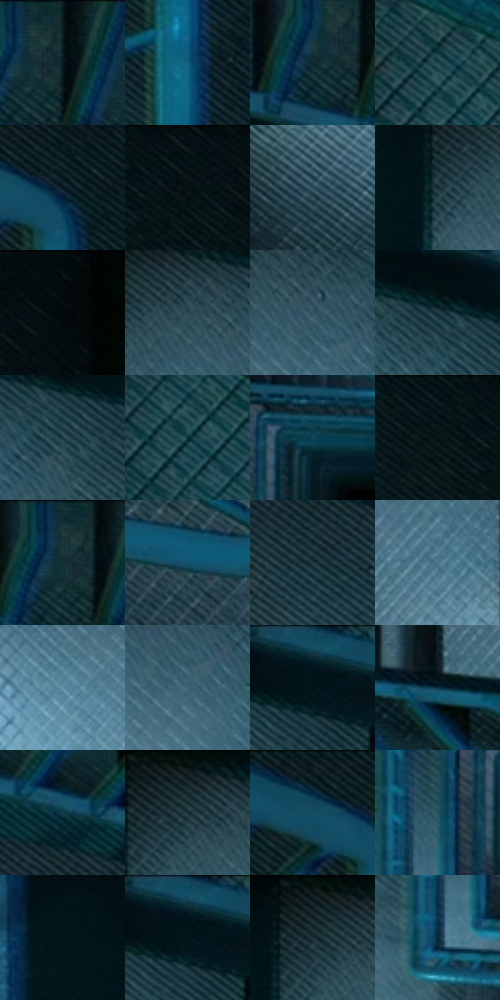

# 电影参考 198

- 状态：常规／活跃；来源世界：miles-home。
- 视角：overhead；景别：environment-wide；场景：interior。
- 时段：interior-time-unknown（外观依据，中置信度；具体时间／晨昏未知）；光照：cool-interior。
- 材质候选：fabric, painted-metal, stone（帧级，不是像素分割）。
- 明暗组：very-dark；L* P5/P50/P95：4.54718 / 19.62203 / 45.91908。
- 资格门禁：无附加门禁。
- 原截图 SHA-256：`e5f32d51e65107820b13d6990137b815c522740de787d45c04bf642e5d19db96`；尺寸：2880 × 1208。
- sRGB 像素 SHA-256：`e69f861819a823fded3c0d42ec1ff89483dbfff78d60216edce175c3a3cd91a3`。

## 观察与迁移

蓝色楼梯俯视，栏杆透视与结构格不叫排线。

198  /  常规室内／动作  /  冷青栏杆嵌套递远，地面网格、踏步与明暗条  /  保住楼梯几何和圆管窄亮带；冷色不能单独证明夜晚或金属固有色

本公开版保存32个128×128原像素色卡上下文；图集格子并非原场景相邻位置。原rect、图集tile和像素SHA见 `data/palette-crops.json`。上下文不足时不得批准替色，不能以小样推断完整构图。

## 实测色卡

颜色比例分母为保留采样像素，不是材料面积；全部 32 色参与全库匹配。表内四舍五入仅用于阅读，原精度在 JSON。

| ID | HEX | Lab | 原图 xy | 像素数 | 比例 | 明度角色 |
| --- | --- | --- | --- | ---: | ---: | --- |
| 198-S01 | #0D1E23 | [10.071887, -5.302363, -5.613348] | [1644, 28] | 8186 | 4.233861% | deep-shadow |
| 198-S02 | #166481 | [39.358547, -12.002927, -22.610788] | [2188, 308] | 7776 | 4.021805% | shadow |
| 198-S03 | #0C262D | [13.553695, -7.257819, -7.594154] | [1596, 88] | 7625 | 3.943707% | deep-shadow |
| 198-S04 | #1F434D | [26.277123, -9.608285, -9.984656] | [148, 160] | 7594 | 3.927674% | shadow |
| 198-S05 | #031920 | [7.396406, -5.427829, -7.500587] | [2184, 72] | 7550 | 3.904917% | deep-shadow |
| 198-S06 | #051215 | [4.687939, -3.239808, -3.182873] | [2580, 32] | 7275 | 3.762685% | deep-shadow |
| 198-S07 | #2E4D5A | [30.940716, -7.478696, -11.225005] | [772, 676] | 7050 | 3.646313% | shadow |
| 198-S08 | #122B32 | [15.934737, -7.17814, -7.487964] | [696, 112] | 6945 | 3.592006% | deep-shadow |
| 198-S09 | #040B0D | [2.657461, -1.526684, -1.49248] | [2776, 32] | 6830 | 3.532527% | deep-shadow |
| 198-S10 | #2A4651 | [28.023974, -7.157075, -9.885936] | [796, 88] | 6709 | 3.469945% | shadow |
| 198-S11 | #345665 | [34.650153, -7.823004, -12.503205] | [856, 124] | 6685 | 3.457532% | shadow |
| 198-S12 | #1D3840 | [21.797419, -7.65891, -8.162418] | [976, 72] | 6491 | 3.357194% | shadow |
| 198-S13 | #14363E | [20.575123, -9.416196, -8.705265] | [1020, 124] | 6489 | 3.356159% | shadow |
| 198-S14 | #0C2F36 | [17.354516, -9.668865, -8.143662] | [168, 208] | 6145 | 3.178240% | deep-shadow |
| 198-S15 | #0E4357 | [26.143442, -9.082662, -16.76656] | [1392, 568] | 6142 | 3.176688% | shadow |
| 198-S16 | #0D191D | [7.854006, -3.733161, -4.479788] | [2484, 28] | 6050 | 3.129105% | deep-shadow |
| 198-S17 | #172F36 | [17.834111, -6.987882, -7.37047] | [1612, 56] | 6042 | 3.124968% | deep-shadow |
| 198-S18 | #11516B | [31.954024, -9.553752, -20.528212] | [2088, 1052] | 5878 | 3.040146% | shadow |
| 198-S19 | #233B44 | [23.346035, -6.47875, -8.466025] | [1864, 332] | 5819 | 3.009630% | shadow |
| 198-S20 | #497589 | [46.901164, -9.463233, -15.661064] | [1872, 784] | 5806 | 3.002907% | midtone |
| 198-S21 | #6090A6 | [57.255251, -10.269242, -16.680414] | [800, 276] | 5791 | 2.995149% | midtone |
| 198-S22 | #3F6475 | [40.336068, -8.237163, -13.678766] | [872, 180] | 5788 | 2.993597% | midtone |
| 198-S23 | #041519 | [5.71132, -4.397147, -4.665054] | [1088, 52] | 5645 | 2.919636% | deep-shadow |
| 198-S24 | #083446 | [19.840478, -7.125745, -15.289345] | [1704, 888] | 5570 | 2.880846% | deep-shadow |
| 198-S25 | #113D4A | [23.50782, -9.936087, -12.284849] | [1864, 224] | 4908 | 2.538454% | shadow |
| 198-S26 | #1A3038 | [18.447905, -6.064429, -7.805941] | [752, 64] | 4900 | 2.534317% | deep-shadow |
| 198-S27 | #122429 | [12.924635, -5.704868, -5.647828] | [2108, 28] | 4793 | 2.478976% | deep-shadow |
| 198-S28 | #1F5261 | [32.231902, -11.739452, -13.761414] | [1296, 620] | 4709 | 2.435530% | shadow |
| 198-S29 | #05171B | [6.541023, -4.978994, -4.972773] | [608, 96] | 4616 | 2.387430% | deep-shadow |
| 198-S30 | #05212A | [11.184424, -6.737564, -9.084227] | [1088, 36] | 4254 | 2.200201% | deep-shadow |
| 198-S31 | #19272D | [14.663366, -4.029073, -5.841156] | [724, 28] | 3688 | 1.907461% | deep-shadow |
| 198-S32 | #062A3B | [15.540673, -5.39413, -14.434788] | [1264, 736] | 3597 | 1.860395% | deep-shadow |

## 色阶与空间分布

- 采样 ROI：`[0.01, 0.02, 0.98, 0.94]`；步长：4；样本数：193346。
- 排除区：`[]`。
- 深暗、暗、中、亮、高光五段计数：`[98918, 77194, 15736, 1498, 0]`。
- RGB 各 256 箱、L* 100 箱、13×5 色相明度表和 3×3 空间统计全部保存在 [总数据](../film-library.json)。
- [可视化档案](../../references/library.html)按需绘制直方图，不存 2,094 张重复图表图片。

## 纹理特征占比

**这是分块图像特征的面积占比，不是波点／排线／丝网／错版的精确语义覆盖率。** 窗格、发丝、织物也会产生方向或周期特征。
原图 ROI 像素 3104134；已测块覆盖 3104134（100.0000%）；未测 0。

| 特征 | 块覆盖像素 | 占已测面积 | 阈值敏感范围 |
| --- | ---: | ---: | --- |
| low-contrast | 22272 | 0.7175% | 0.3587% ~ 1.9628% |
| directional-structure | 952576 | 30.6873% | 14.2509% ~ 49.2474% |
| periodic-structure | 2029702 | 65.3871% | 48.9589% ~ 75.3000% |
| mixed-detail | 99584 | 3.2081% | 1.4350% ~ 8.4862% |

阈值敏感范围不是统计置信区间。逐块坐标、尺度、对比、方向一致性、频谱集中度、频率与角度见 [全量特征记录](../texture-features.jsonl)，以帧号定位。
四种印刷层的真实像素覆盖仍标为 `null`，不能填 0，也不能拿上表代替。不得据这些代理测量删除唯一证据。

[测量方法与保留策略](../../references/library-retention.md) · [分类索引](../archive/README.md)
