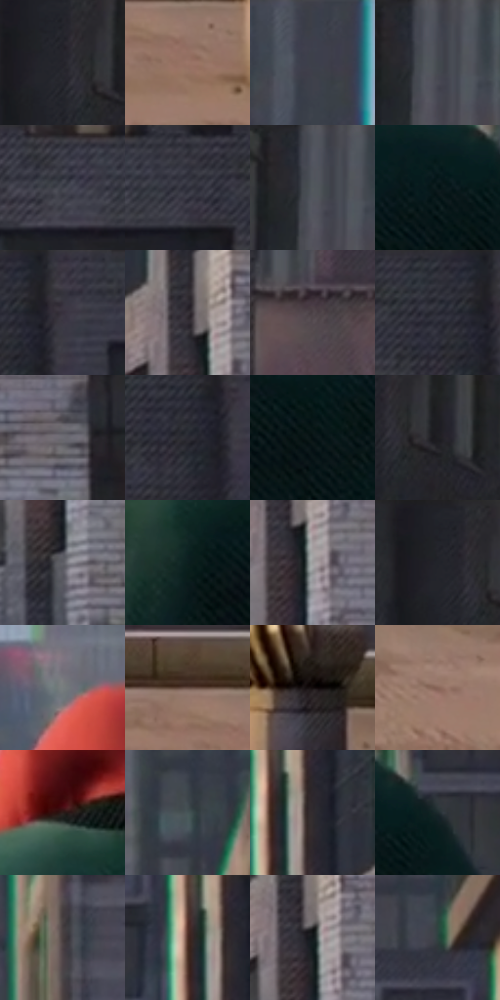

# 电影参考 199

- 状态：常规／活跃；来源世界：miles-home。
- 视角：near-level；景别：environment-wide；场景：city。
- 时段：daylight-time-unspecified（外观依据，中置信度；具体时间／晨昏未知）；光照：neutral-day。
- 材质候选：fabric, brick, glass, stone, metal, sky（帧级，不是像素分割）。
- 明暗组：dark；L* P5/P50/P95：4.99859 / 22.69188 / 53.83947。
- 资格门禁：无附加门禁。
- 原截图 SHA-256：`9fa4d72010de4b5cdd797f80f19c382e5c95ebaa3836368385eb32d78a423152`；尺寸：2880 × 1198。
- sRGB 像素 SHA-256：`61e5d8f61d96fbe635a497f6136cb91b2df753eddee354dc7898dafdc9568578`。

## 观察与迁移

灰日光楼群、屋顶与街谷；楼体受光面和远处空气层清楚。

199  /  白天／布料与建筑  /  红帽绿衣的大曲面、侧向受光、后景门窗和屋顶通风件  /  布料仍有柔和体积，不机械三阶硬切；不照搬人物配色

本公开版保存32个128×128原像素色卡上下文；图集格子并非原场景相邻位置。原rect、图集tile和像素SHA见 `data/palette-crops.json`。上下文不足时不得批准替色，不能以小样推断完整构图。

## 实测色卡

颜色比例分母为保留采样像素，不是材料面积；全部 32 色参与全库匹配。表内四舍五入仅用于阅读，原精度在 JSON。

| ID | HEX | Lab | 原图 xy | 像素数 | 比例 | 明度角色 |
| --- | --- | --- | --- | ---: | ---: | --- |
| 199-S01 | #26252C | [15.045715, 2.246194, -4.442016] | [84, 72] | 10763 | 5.586873% | deep-shadow |
| 199-S02 | #9B7467 | [52.330886, 13.445983, 13.150763] | [2580, 1092] | 9519 | 4.941136% | midtone |
| 199-S03 | #3C404A | [27.078897, 0.815609, -6.622614] | [924, 32] | 9153 | 4.751152% | shadow |
| 199-S04 | #464851 | [30.714024, 1.295282, -5.632364] | [296, 44] | 9033 | 4.688863% | shadow |
| 199-S05 | #34353F | [22.426433, 2.069842, -6.37484] | [2444, 24] | 8218 | 4.265811% | shadow |
| 199-S06 | #31313A | [20.654436, 2.244954, -5.673223] | [2552, 40] | 7916 | 4.109049% | shadow |
| 199-S07 | #545660 | [36.714886, 1.473473, -6.043633] | [284, 28] | 7424 | 3.853661% | shadow |
| 199-S08 | #061617 | [6.091375, -5.094101, -2.561211] | [1700, 652] | 7374 | 3.827706% | deep-shadow |
| 199-S09 | #3A3841 | [24.030253, 2.995633, -5.253605] | [2740, 40] | 6980 | 3.623188% | shadow |
| 199-S10 | #363036 | [20.691188, 4.035535, -2.82931] | [2180, 424] | 6979 | 3.622669% | shadow |
| 199-S11 | #4F454A | [30.431457, 5.256255, -1.444267] | [452, 548] | 6868 | 3.565051% | shadow |
| 199-S12 | #2C2E36 | [19.03793, 1.183929, -5.402293] | [2668, 52] | 6754 | 3.505876% | deep-shadow |
| 199-S13 | #6C6C73 | [45.840334, 1.472716, -3.887925] | [2320, 808] | 6456 | 3.351190% | midtone |
| 199-S14 | #2A2A32 | [17.359654, 2.043053, -5.163019] | [2688, 104] | 6382 | 3.312778% | deep-shadow |
| 199-S15 | #051011 | [4.004208, -2.962687, -1.640111] | [1588, 732] | 6297 | 3.268656% | deep-shadow |
| 199-S16 | #1E1D23 | [11.107221, 2.056863, -3.914522] | [144, 96] | 6048 | 3.139405% | deep-shadow |
| 199-S17 | #5F5F66 | [40.535067, 1.511158, -3.975017] | [2200, 656] | 5824 | 3.023130% | midtone |
| 199-S18 | #0D1F1F | [10.292098, -7.423414, -2.325243] | [1264, 720] | 5588 | 2.900627% | deep-shadow |
| 199-S19 | #9E9E9E | [65.114245, -0.001717, 0.003254] | [2208, 484] | 5564 | 2.888169% | light |
| 199-S20 | #202127 | [12.867941, 1.142017, -4.176663] | [56, 24] | 5278 | 2.739712% | deep-shadow |
| 199-S21 | #777D7F | [51.974088, -1.817156, -1.858879] | [1320, 196] | 5159 | 2.677941% | midtone |
| 199-S22 | #624941 | [33.443621, 9.364472, 8.91575] | [2520, 1028] | 4885 | 2.535713% | shadow |
| 199-S23 | #120B0B | [3.542021, 2.327933, 0.820672] | [2724, 1008] | 4646 | 2.411652% | deep-shadow |
| 199-S24 | #866458 | [45.480601, 11.936926, 12.144444] | [2300, 1116] | 4389 | 2.278248% | midtone |
| 199-S25 | #2C1D1C | [12.596207, 7.183717, 3.60919] | [1304, 532] | 4207 | 2.183776% | deep-shadow |
| 199-S26 | #475557 | [35.052182, -4.959142, -2.992547] | [1672, 176] | 4156 | 2.157302% | shadow |
| 199-S27 | #312B2F | [18.303123, 3.63131, -1.586595] | [2072, 340] | 4009 | 2.080997% | deep-shadow |
| 199-S28 | #1D2B2C | [16.358845, -5.588377, -2.566853] | [1784, 632] | 3717 | 1.929426% | deep-shadow |
| 199-S29 | #483F3F | [27.550211, 3.868869, 1.420108] | [1756, 384] | 3660 | 1.899838% | shadow |
| 199-S30 | #4B2D24 | [21.945607, 12.628788, 11.574616] | [2028, 328] | 3618 | 1.878037% | shadow |
| 199-S31 | #12181A | [7.735989, -2.110783, -2.33936] | [2196, 456] | 3382 | 1.755533% | deep-shadow |
| 199-S32 | #2E423F | [26.262255, -8.657052, -0.730174] | [1952, 88] | 2402 | 1.246834% | shadow |

## 色阶与空间分布

- 采样 ROI：`[0.01, 0.02, 0.98, 0.94]`；步长：4；样本数：192648。
- 排除区：`[]`。
- 深暗、暗、中、亮、高光五段计数：`[77939, 79567, 29950, 5174, 18]`。
- RGB 各 256 箱、L* 100 箱、13×5 色相明度表和 3×3 空间统计全部保存在 [总数据](../film-library.json)。
- [可视化档案](../../references/library.html)按需绘制直方图，不存 2,094 张重复图表图片。

## 纹理特征占比

**这是分块图像特征的面积占比，不是波点／排线／丝网／错版的精确语义覆盖率。** 窗格、发丝、织物也会产生方向或周期特征。
原图 ROI 像素 3081782；已测块覆盖 3081782（100.0000%）；未测 0。

| 特征 | 块覆盖像素 | 占已测面积 | 阈值敏感范围 |
| --- | ---: | ---: | --- |
| low-contrast | 26496 | 0.8598% | 0.0000% ~ 3.8461% |
| directional-structure | 895872 | 29.0699% | 17.1371% ~ 51.5567% |
| periodic-structure | 2106422 | 68.3508% | 48.4433% ~ 72.8988% |
| mixed-detail | 52992 | 1.7195% | 0.0000% ~ 6.1180% |

阈值敏感范围不是统计置信区间。逐块坐标、尺度、对比、方向一致性、频谱集中度、频率与角度见 [全量特征记录](../texture-features.jsonl)，以帧号定位。
四种印刷层的真实像素覆盖仍标为 `null`，不能填 0，也不能拿上表代替。不得据这些代理测量删除唯一证据。

[测量方法与保留策略](../../references/library-retention.md) · [分类索引](../archive/README.md)
