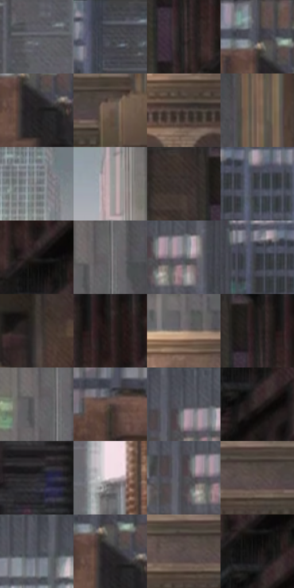

# 电影参考 200

- 状态：常规／活跃；来源世界：miles-home。
- 视角：near-level；景别：environment-wide；场景：city。
- 时段：daylight-time-unspecified（外观依据，中置信度；具体时间／晨昏未知）；光照：neutral-day。
- 材质候选：fabric, brick, glass, stone, metal, sky（帧级，不是像素分割）。
- 明暗组：dark；L* P5/P50/P95：9.15916 / 30.22147 / 63.08958。
- 资格门禁：无附加门禁。
- 原截图 SHA-256：`cd6faae1932aa1f54832e1c8c5334ea7965f46ab47ef6b6c267838866a38b4ad`；尺寸：2880 × 1210。
- sRGB 像素 SHA-256：`3666a4d521099068f849b1fb00e58d44475dcd426011d872aae512d80614788f`。

## 观察与迁移

灰日光楼群、屋顶与街谷；楼体受光面和远处空气层清楚。

200  /  白天／城市纵深  /  近处石砌体与玻璃塔楼不同窗格节奏，明亮天空夹缝  /  大立面、窗格暗组先于微纹；玻璃保留概括反射，非全黑洞或全镜面

本公开版保存32个128×128原像素色卡上下文；图集格子并非原场景相邻位置。原rect、图集tile和像素SHA见 `data/palette-crops.json`。上下文不足时不得批准替色，不能以小样推断完整构图。

## 实测色卡

颜色比例分母为保留采样像素，不是材料面积；全部 32 色参与全库匹配。表内四舍五入仅用于阅读，原精度在 JSON。

| ID | HEX | Lab | 原图 xy | 像素数 | 比例 | 明度角色 |
| --- | --- | --- | --- | ---: | ---: | --- |
| 200-S01 | #56565C | [36.755777, 1.315168, -3.46719] | [1492, 76] | 8558 | 4.410340% | shadow |
| 200-S02 | #414248 | [28.082364, 0.982085, -3.768879] | [1228, 48] | 8469 | 4.364474% | shadow |
| 200-S03 | #2C2728 | [16.204156, 2.533356, 0.18338] | [2672, 152] | 8150 | 4.200078% | deep-shadow |
| 200-S04 | #4F5058 | [34.198749, 1.408099, -4.815581] | [252, 32] | 7858 | 4.049597% | shadow |
| 200-S05 | #242122 | [13.097354, 1.649435, -0.16398] | [280, 144] | 7729 | 3.983117% | deep-shadow |
| 200-S06 | #69544B | [37.576094, 7.186258, 8.550968] | [2252, 404] | 7658 | 3.946528% | shadow |
| 200-S07 | #514541 | [30.369555, 4.343464, 4.302149] | [2044, 488] | 7116 | 3.667209% | shadow |
| 200-S08 | #7C6558 | [44.656786, 7.102723, 10.832799] | [2320, 196] | 7039 | 3.627528% | midtone |
| 200-S09 | #75767B | [49.700158, 0.653885, -2.869258] | [540, 72] | 7026 | 3.620828% | midtone |
| 200-S10 | #A19D9C | [65.035103, 1.258137, 1.038438] | [1828, 68] | 6833 | 3.521366% | light |
| 200-S11 | #3A302E | [20.869088, 4.11411, 2.958822] | [2580, 44] | 6827 | 3.518274% | shadow |
| 200-S12 | #3A3D44 | [25.726311, 0.44545, -4.714792] | [1120, 140] | 6261 | 3.226588% | shadow |
| 200-S13 | #191717 | [7.961033, 0.986611, 0.350963] | [2772, 172] | 6096 | 3.141556% | deep-shadow |
| 200-S14 | #636265 | [41.732109, 1.01979, -1.558254] | [2036, 124] | 6001 | 3.092598% | midtone |
| 200-S15 | #5B5C64 | [39.238928, 1.364949, -4.704116] | [908, 108] | 5974 | 3.078683% | shadow |
| 200-S16 | #353539 | [22.296969, 0.949733, -2.504194] | [1028, 128] | 5795 | 2.986436% | shadow |
| 200-S17 | #403837 | [24.303527, 3.299604, 1.908617] | [2512, 308] | 5790 | 2.983859% | shadow |
| 200-S18 | #251D1D | [11.694217, 3.891646, 1.46189] | [2748, 48] | 5660 | 2.916864% | deep-shadow |
| 200-S19 | #958174 | [55.432814, 5.459657, 9.863952] | [1968, 332] | 5634 | 2.903465% | midtone |
| 200-S20 | #1D1B1C | [10.022336, 1.212456, -0.345439] | [2668, 48] | 5469 | 2.818433% | deep-shadow |
| 200-S21 | #6B696B | [44.646708, 1.184554, -0.842193] | [2004, 148] | 5425 | 2.795758% | midtone |
| 200-S22 | #4C3D37 | [27.157994, 5.461006, 6.163929] | [100, 96] | 5371 | 2.767929% | shadow |
| 200-S23 | #44464F | [29.846526, 1.304833, -5.657914] | [864, 44] | 5358 | 2.761229% | shadow |
| 200-S24 | #322827 | [17.189655, 4.446803, 2.401984] | [2800, 272] | 5302 | 2.732370% | deep-shadow |
| 200-S25 | #2E2D32 | [18.74791, 1.660327, -3.047902] | [252, 824] | 5240 | 2.700418% | deep-shadow |
| 200-S26 | #E0D2D7 | [85.426817, 5.691281, -0.72532] | [1692, 924] | 5125 | 2.641154% | highlight |
| 200-S27 | #4D4A4D | [31.832357, 1.887131, -1.338196] | [844, 112] | 4960 | 2.556121% | shadow |
| 200-S28 | #5D504C | [35.175676, 4.640745, 4.34396] | [2152, 400] | 4927 | 2.539115% | shadow |
| 200-S29 | #494B54 | [32.007835, 1.281608, -5.595286] | [692, 28] | 4660 | 2.401517% | shadow |
| 200-S30 | #262527 | [14.853701, 0.948133, -1.160352] | [272, 116] | 4310 | 2.221146% | deep-shadow |
| 200-S31 | #564C4A | [33.22566, 3.775389, 2.711857] | [2112, 400] | 4007 | 2.064996% | shadow |
| 200-S32 | #131010 | [4.936031, 1.14604, 0.404472] | [2784, 212] | 3416 | 1.760425% | deep-shadow |

## 色阶与空间分布

- 采样 ROI：`[0.01, 0.02, 0.98, 0.94]`；步长：4；样本数：194044。
- 排除区：`[]`。
- 深暗、暗、中、亮、高光五段计数：`[52871, 95577, 34281, 7699, 3616]`。
- RGB 各 256 箱、L* 100 箱、13×5 色相明度表和 3×3 空间统计全部保存在 [总数据](../film-library.json)。
- [可视化档案](../../references/library.html)按需绘制直方图，不存 2,094 张重复图表图片。

## 纹理特征占比

**这是分块图像特征的面积占比，不是波点／排线／丝网／错版的精确语义覆盖率。** 窗格、发丝、织物也会产生方向或周期特征。
原图 ROI 像素 3109722；已测块覆盖 3109722（100.0000%）；未测 0。

| 特征 | 块覆盖像素 | 占已测面积 | 阈值敏感范围 |
| --- | ---: | ---: | --- |
| low-contrast | 0 | 0.0000% | 0.0000% ~ 0.5269% |
| directional-structure | 592000 | 19.0371% | 5.3139% ~ 33.6740% |
| periodic-structure | 2435802 | 78.3286% | 66.3260% ~ 79.8886% |
| mixed-detail | 81920 | 2.6343% | 0.0000% ~ 14.2706% |

阈值敏感范围不是统计置信区间。逐块坐标、尺度、对比、方向一致性、频谱集中度、频率与角度见 [全量特征记录](../texture-features.jsonl)，以帧号定位。
四种印刷层的真实像素覆盖仍标为 `null`，不能填 0，也不能拿上表代替。不得据这些代理测量删除唯一证据。

[测量方法与保留策略](../../references/library-retention.md) · [分类索引](../archive/README.md)
