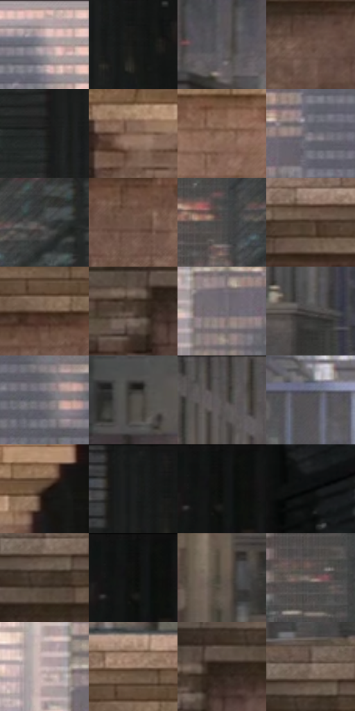

# 电影参考 201

- 状态：常规／活跃；来源世界：miles-home。
- 视角：near-level；景别：environment-wide；场景：city。
- 时段：daylight-time-unspecified（外观依据，中置信度；具体时间／晨昏未知）；光照：neutral-day。
- 材质候选：fabric, brick, glass, stone, metal, sky（帧级，不是像素分割）。
- 明暗组：dark；L* P5/P50/P95：4.5512 / 33.73958 / 62.5844。
- 资格门禁：无附加门禁。
- 原截图 SHA-256：`11e549013809fb265d53745f0b50a9e0c949287037c1e6aaa3528c1c94ba1df0`；尺寸：2880 × 1210。
- sRGB 像素 SHA-256：`5c8214598a1d5382e7862232b31fd9e62c625b138967b851bce096b64d06a2b5`。

## 观察与迁移

灰日光楼群、屋顶与街谷；楼体受光面和远处空气层清楚。

201  /  白天／建筑基准  /  女儿墙石块、檐口阴影、远楼细密窗口，人物很小  /  前景结构清楚、远景合并细节；不为突出人物擅自放大或改构图

本公开版保存32个128×128原像素色卡上下文；图集格子并非原场景相邻位置。原rect、图集tile和像素SHA见 `data/palette-crops.json`。上下文不足时不得批准替色，不能以小样推断完整构图。

## 实测色卡

颜色比例分母为保留采样像素，不是材料面积；全部 32 色参与全库匹配。表内四舍五入仅用于阅读，原精度在 JSON。

| ID | HEX | Lab | 原图 xy | 像素数 | 比例 | 明度角色 |
| --- | --- | --- | --- | ---: | ---: | --- |
| 201-S01 | #A79593 | [63.191848, 6.308063, 3.490669] | [1540, 40] | 8272 | 4.262951% | light |
| 201-S02 | #171715 | [7.669825, -0.490236, 1.333828] | [2388, 104] | 7869 | 4.055266% | deep-shadow |
| 201-S03 | #5E5C61 | [39.406514, 1.853736, -2.575814] | [148, 124] | 7613 | 3.923337% | shadow |
| 201-S04 | #6A5144 | [36.681318, 8.414633, 11.666193] | [752, 828] | 7518 | 3.874379% | shadow |
| 201-S05 | #262725 | [15.4698, -0.937703, 1.162816] | [2292, 288] | 7423 | 3.825421% | deep-shadow |
| 201-S06 | #7D5F4E | [42.906358, 9.679705, 14.441978] | [2376, 784] | 7337 | 3.781101% | midtone |
| 201-S07 | #8E6E5B | [49.079807, 9.87449, 15.465902] | [2052, 820] | 7239 | 3.730597% | midtone |
| 201-S08 | #7F7B85 | [52.254536, 3.530804, -4.883904] | [1376, 228] | 6988 | 3.601245% | midtone |
| 201-S09 | #3A3A39 | [24.389207, -0.226992, 0.621808] | [2056, 128] | 6963 | 3.588361% | shadow |
| 201-S10 | #715749 | [39.256428, 8.557728, 12.255464] | [1264, 836] | 6542 | 3.371400% | shadow |
| 201-S11 | #494848 | [30.686033, 0.413154, 0.148354] | [1944, 156] | 6520 | 3.360063% | shadow |
| 201-S12 | #4E3B2F | [26.600855, 6.419552, 10.657313] | [868, 720] | 6415 | 3.305951% | shadow |
| 201-S13 | #61493B | [33.184398, 8.047232, 12.326535] | [1152, 764] | 6378 | 3.286883% | shadow |
| 201-S14 | #55463D | [30.993615, 4.793021, 7.816247] | [544, 800] | 6240 | 3.215765% | shadow |
| 201-S15 | #726E74 | [46.961697, 2.761728, -2.773083] | [1268, 268] | 6234 | 3.212673% | midtone |
| 201-S16 | #434140 | [27.693376, 0.626507, 0.910533] | [584, 432] | 5913 | 3.047247% | shadow |
| 201-S17 | #67666D | [43.493041, 1.868095, -3.789018] | [1564, 304] | 5836 | 3.007565% | midtone |
| 201-S18 | #30302E | [19.800145, -0.462477, 1.280675] | [32, 408] | 5682 | 2.928202% | deep-shadow |
| 201-S19 | #504E4E | [33.35939, 0.817574, 0.292505] | [548, 32] | 5682 | 2.928202% | shadow |
| 201-S20 | #575557 | [36.388117, 1.229024, -0.87346] | [772, 80] | 5660 | 2.916864% | shadow |
| 201-S21 | #3A2A1F | [18.603687, 5.640387, 10.071544] | [2492, 732] | 5484 | 2.826163% | deep-shadow |
| 201-S22 | #1B1D1C | [10.524682, -1.201586, 0.36253] | [2336, 32] | 5444 | 2.805549% | deep-shadow |
| 201-S23 | #0E0F0E | [4.215794, -0.509006, 0.364132] | [2516, 28] | 5432 | 2.799365% | deep-shadow |
| 201-S24 | #070808 | [2.135079, -0.261639, -0.091875] | [2720, 136] | 5362 | 2.763291% | deep-shadow |
| 201-S25 | #413329 | [22.48498, 4.54548, 8.732563] | [648, 728] | 5269 | 2.715364% | shadow |
| 201-S26 | #121210 | [5.407322, -0.397659, 1.081988] | [2508, 56] | 5267 | 2.714333% | deep-shadow |
| 201-S27 | #5D544B | [36.320985, 1.989544, 6.60186] | [304, 592] | 5148 | 2.653007% | shadow |
| 201-S28 | #695E57 | [40.730512, 3.11849, 5.622343] | [1900, 380] | 4910 | 2.530354% | midtone |
| 201-S29 | #C6B3B3 | [74.509383, 6.78096, 2.474126] | [1188, 208] | 4719 | 2.431923% | light |
| 201-S30 | #9F8270 | [56.591988, 8.338009, 13.933375] | [1152, 692] | 4631 | 2.386572% | midtone |
| 201-S31 | #2A2018 | [13.177034, 3.341135, 7.268862] | [592, 772] | 4213 | 2.171157% | deep-shadow |
| 201-S32 | #7D6B60 | [46.605501, 5.223518, 8.796554] | [648, 676] | 3841 | 1.979448% | midtone |

## 色阶与空间分布

- 采样 ROI：`[0.01, 0.02, 0.98, 0.94]`；步长：4；样本数：194044。
- 排除区：`[]`。
- 深暗、暗、中、亮、高光五段计数：`[48490, 82428, 50506, 11631, 989]`。
- RGB 各 256 箱、L* 100 箱、13×5 色相明度表和 3×3 空间统计全部保存在 [总数据](../film-library.json)。
- [可视化档案](../../references/library.html)按需绘制直方图，不存 2,094 张重复图表图片。

## 纹理特征占比

**这是分块图像特征的面积占比，不是波点／排线／丝网／错版的精确语义覆盖率。** 窗格、发丝、织物也会产生方向或周期特征。
原图 ROI 像素 3109722；已测块覆盖 3109722（100.0000%）；未测 0。

| 特征 | 块覆盖像素 | 占已测面积 | 阈值敏感范围 |
| --- | ---: | ---: | --- |
| low-contrast | 55770 | 1.7934% | 0.3034% ~ 3.2834% |
| directional-structure | 750848 | 24.1452% | 8.4298% ~ 42.8406% |
| periodic-structure | 2237568 | 71.9540% | 56.3292% ~ 85.1256% |
| mixed-detail | 65536 | 2.1075% | 0.5269% ~ 3.1612% |

阈值敏感范围不是统计置信区间。逐块坐标、尺度、对比、方向一致性、频谱集中度、频率与角度见 [全量特征记录](../texture-features.jsonl)，以帧号定位。
四种印刷层的真实像素覆盖仍标为 `null`，不能填 0，也不能拿上表代替。不得据这些代理测量删除唯一证据。

[测量方法与保留策略](../../references/library-retention.md) · [分类索引](../archive/README.md)
